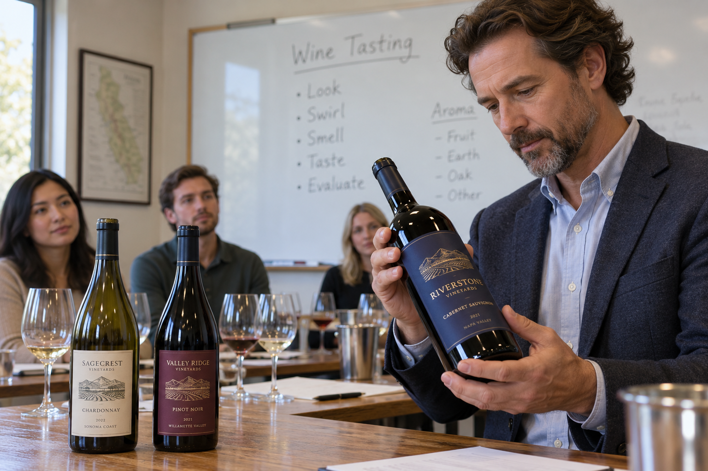
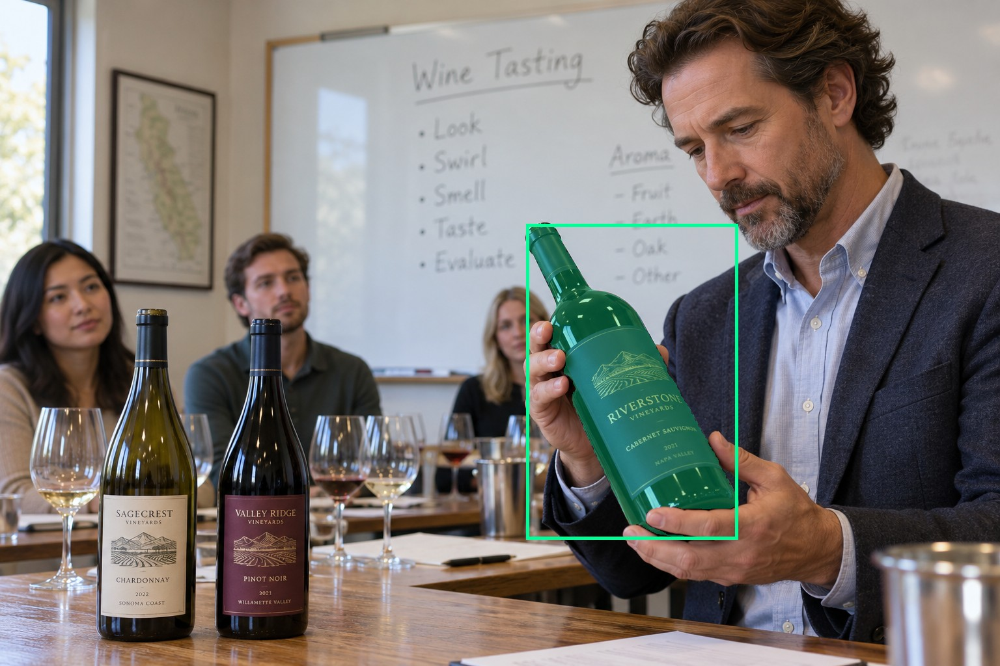
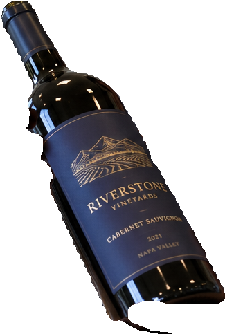
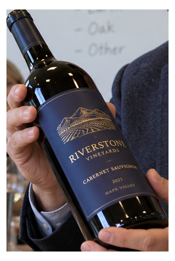
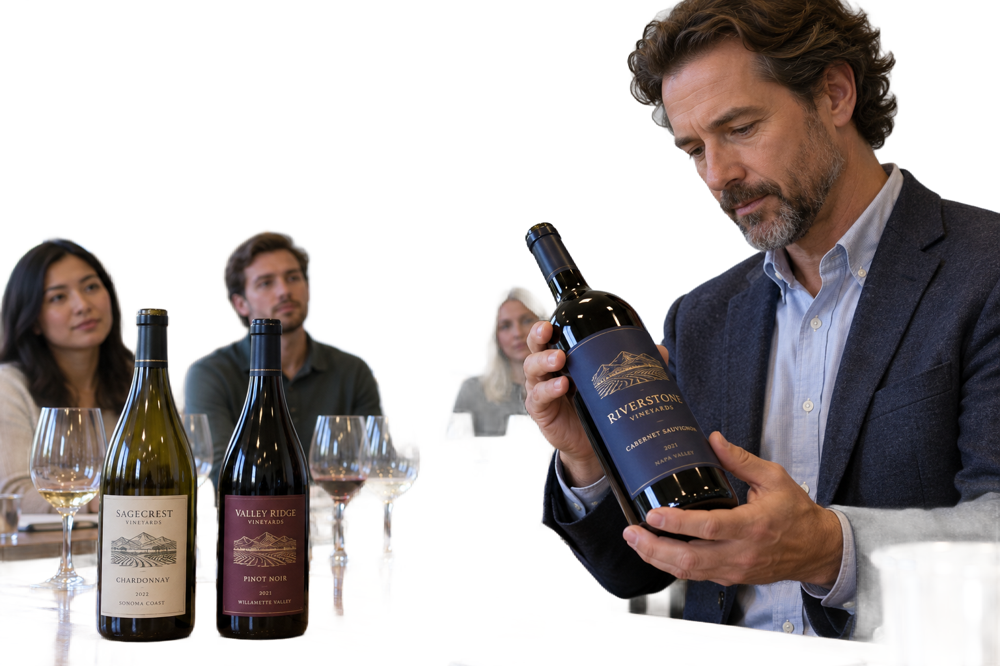

# main-selector-imagegen-diverse-v3-20261020:SZ07

**Scene and masks pending — exploratory. All targets/masks are proposals; no approved segmentation ground truth.**

**scene-v1: No automatic failure flag; usability pending.**

Reference title (source): На уроке дегустации · один и тот же размер на разных планах

Reference target description (source): Правая передняя бутылка в руке

Expected intent: `clear`. Accepted target proposals: `d0`.

Scene group: `main-selector-imagegen-diverse-v3-20261020:SZ07`. Development only; no independent split claim.

## Original and proposed target





Green marks the unreviewed target proposal. Source image pixels are retained separately.

[Selected-label mask audit](../selected-label-mask-audit.json): incomplete proposal retention is flagged separately from target agreement.

[Full-resolution target proposal mask](../masks/diverse-v3--SZ07-d0.png)

## Selector results

### scene-v1: No automatic failure flag; usability pending

Selected: d0; reason: existing_scene_v1_rank; mode: legacy; crop 325×483 px. Target agreement: True. Target retention proxy: 99.9%; maximum other-bottle retention: 0.0%; minimum associated label retention: 100.0%. Mask ownership, label completeness and legibility still require human review.



[Full-resolution keep mask](../keep-masks/diverse-v3--SZ07-scene-v1.png) · [Exact decision JSON](../results/diverse-v3--SZ07-scene-v1.json)

Associated label-mask retention proxies (unreviewed ownership): d3: 100.0%, 33922 source pixels

### semantic-v2: No automatic failure flag; usability pending

Selected: d0; reason: fallback_nearest_center; mode: fallback; crop 351×523 px. Target agreement: True. Target retention proxy: 100.0%; maximum other-bottle retention: 0.0%; minimum associated label retention: 100.0%. Mask ownership, label completeness and legibility still require human review. Selected-label mask audit: d3 100.0%.



[Full-resolution keep mask](../keep-masks/diverse-v3--SZ07-semantic-v2.png) · [Exact decision JSON](../results/diverse-v3--SZ07-semantic-v2.json)

Returned label views: [label 1](../label-crops/diverse-v3--SZ07-semantic-v2-0.png)

Associated label-mask retention proxies (unreviewed ownership): d3: 100.0%, 33922 source pixels

### dis-v1: PROXY failure; no native target ID

Selected: dis-foreground; reason: dis_foreground_mask; mode: foreground; crop 1536×1024 px. Target agreement: n/a (no native target ID). Target retention proxy: 100.0%; maximum other-bottle retention: 99.9%; minimum associated label retention: 100.0%. Mask ownership, label completeness and legibility still require human review.



[Full-resolution keep mask](../keep-masks/diverse-v3--SZ07-dis-v1.png) · [Exact decision JSON](../results/diverse-v3--SZ07-dis-v1.json)

Associated label-mask retention proxies (unreviewed ownership): d3: 100.0%, 33922 source pixels

## All frozen mask proposals

These links expose every detector proposal, including labels and hands. Shapes and owners are unreviewed.

| ID | Detector class | Full-resolution mask |
|---|---|---|
| d0 | wine bottle | [PNG](../masks/diverse-v3--SZ07-d0.png) |
| d1 | wine bottle | [PNG](../masks/diverse-v3--SZ07-d1.png) |
| d2 | wine bottle | [PNG](../masks/diverse-v3--SZ07-d2.png) |
| d3 | wine label | [PNG](../masks/diverse-v3--SZ07-d3.png) |
| d4 | wine label | [PNG](../masks/diverse-v3--SZ07-d4.png) |
| d5 | wine label | [PNG](../masks/diverse-v3--SZ07-d5.png) |
| d6 | hand | [PNG](../masks/diverse-v3--SZ07-d6.png) |
| d7 | hand | [PNG](../masks/diverse-v3--SZ07-d7.png) |
| d8 | hand | [PNG](../masks/diverse-v3--SZ07-d8.png) |
| d9 | hand | [PNG](../masks/diverse-v3--SZ07-d9.png) |
| d10 | wine glass | [PNG](../masks/diverse-v3--SZ07-d10.png) |
| d11 | wine glass | [PNG](../masks/diverse-v3--SZ07-d11.png) |
| d12 | wine glass | [PNG](../masks/diverse-v3--SZ07-d12.png) |
| d13 | wine glass | [PNG](../masks/diverse-v3--SZ07-d13.png) |
| d14 | wine glass | [PNG](../masks/diverse-v3--SZ07-d14.png) |
| d15 | wine glass | [PNG](../masks/diverse-v3--SZ07-d15.png) |
| d16 | wine glass | [PNG](../masks/diverse-v3--SZ07-d16.png) |
| d17 | wine glass | [PNG](../masks/diverse-v3--SZ07-d17.png) |

[Raw frozen detector response](../detections/diverse-v3--SZ07.json)

<details><summary>Generation prompt (quoted source data)</summary>

```text
Use case: photorealistic-natural. Generate ONE independent photograph, landscape 3:2, approximately 1536 by 1024 pixels. An adult instructor examines a foreground bottle in a wine-tasting classroom. Students and two unattended bottles farther away, whiteboard and glasses. Show physical holder face and hands. Three identical-size physical bottles on a table at different depths. A hand from right holds the RIGHT foreground navy-label bottle body. Two unattended bottles farther left appear smaller. Avoid extra hands. Obvious grip should establish target rather than photo center. Make the scene composition, person, clothing and location specific to this scenario, rather than repeating a generic bottle on a tasting counter. Show genuine physical contact when a grip is requested. Fictional wine branding; no arrows, bounding boxes, captions, collages, watermark or UI. Maintain anatomically plausible hands. Keep the target visible label inside the frame except the explicit close-up and occlusion cases.
```

</details>

Source review notes (quoted reference data):

> Цель предварительно связана с маской SAM3 по заданию генерации; подтвердите по самому фото. Форма масок и их владельцы ещё не проверены.
> Окружение: На уроке дегустации. Проверьте реалистичность рук, хват и присутствие требуемых деталей.
