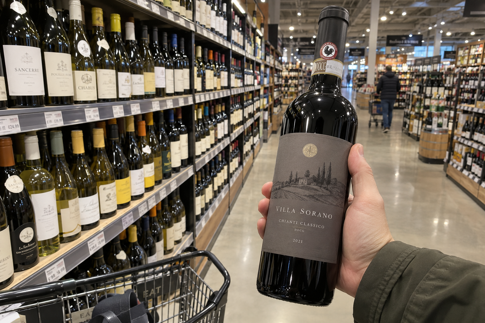
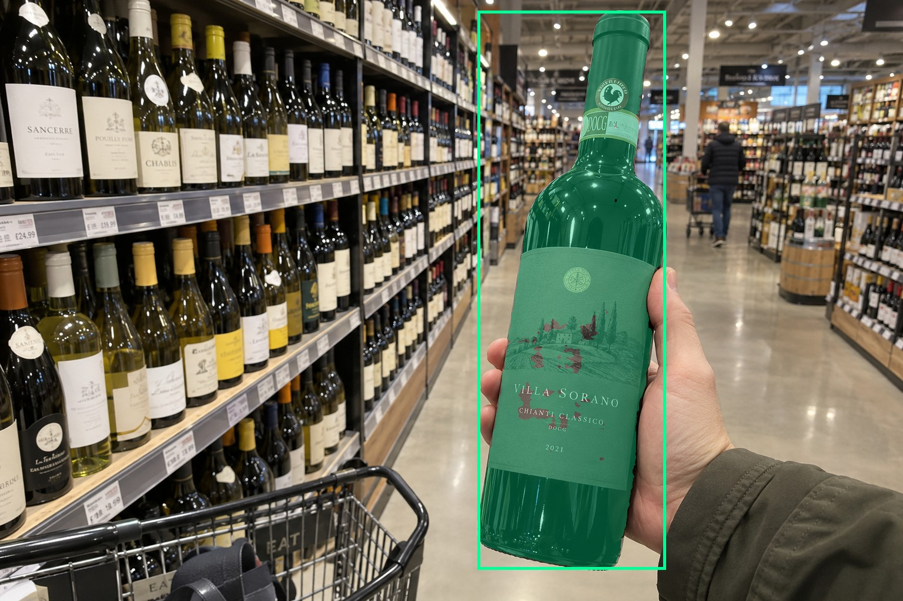
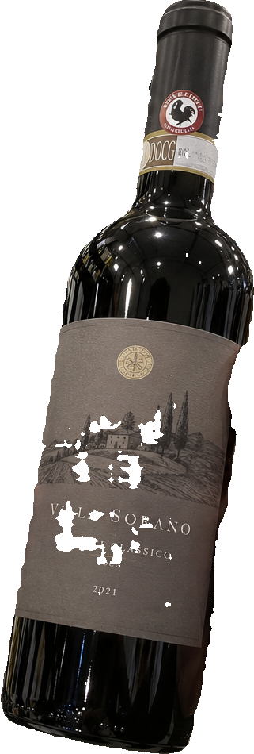
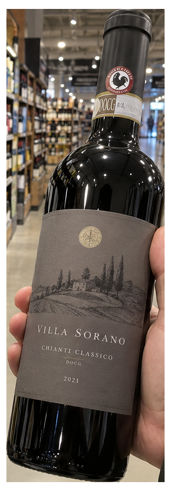
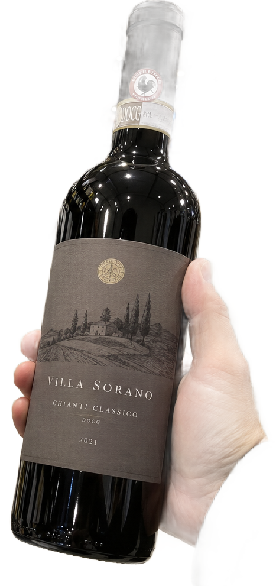

# main-selector-imagegen-diverse-v3-20261020:SZ09

**Scene and masks pending — exploratory. All targets/masks are proposals; no approved segmentation ground truth.**

**scene-v1: FAIL — provisional target/proxy.**

Reference title (source): Перед длинным рядом полок · глубокая полка с ярким фоном

Reference target description (source): Правая передняя бутылка в руке

Expected intent: `clear`. Accepted target proposals: `d21`.

Scene group: `main-selector-imagegen-diverse-v3-20261020:SZ09`. Development only; no independent split claim.

## Original and proposed target





Green marks the unreviewed target proposal. Source image pixels are retained separately.

[Selected-label mask audit](../selected-label-mask-audit.json): incomplete proposal retention is flagged separately from target agreement.

[Full-resolution target proposal mask](../masks/diverse-v3--SZ09-d21.png)

## Selector results

### scene-v1: FAIL — provisional target/proxy

Selected: d21; reason: existing_scene_v1_rank; mode: legacy; crop 321×950 px. Target agreement: True. Target retention proxy: 100.0%; maximum other-bottle retention: 0.0%; minimum associated label retention: 94.0%. Mask ownership, label completeness and legibility still require human review.



[Full-resolution keep mask](../keep-masks/diverse-v3--SZ09-scene-v1.png) · [Exact decision JSON](../results/diverse-v3--SZ09-scene-v1.json)

Associated label-mask retention proxies (unreviewed ownership): d89: 94.0%, 91829 source pixels; d116: 95.7%, 4905 source pixels

### semantic-v2: No automatic failure flag; usability pending

Selected: d21; reason: unique_visible_hand_contact; mode: confident; crop 346×1008 px. Target agreement: True. Target retention proxy: 100.0%; maximum other-bottle retention: 0.0%; minimum associated label retention: 100.0%. Mask ownership, label completeness and legibility still require human review. Selected-label mask audit: d89 100.0%; d116 100.0%.



[Full-resolution keep mask](../keep-masks/diverse-v3--SZ09-semantic-v2.png) · [Exact decision JSON](../results/diverse-v3--SZ09-semantic-v2.json)

Returned label views: [label 1](../label-crops/diverse-v3--SZ09-semantic-v2-0.png) · [label 2](../label-crops/diverse-v3--SZ09-semantic-v2-1.png)

Associated label-mask retention proxies (unreviewed ownership): d89: 100.0%, 91829 source pixels; d116: 100.0%, 4905 source pixels

### dis-v1: PROXY failure; no native target ID

Selected: dis-foreground; reason: dis_foreground_mask; mode: foreground; crop 467×991 px. Target agreement: n/a (no native target ID). Target retention proxy: 89.9%; maximum other-bottle retention: 0.0%; minimum associated label retention: 41.3%. Mask ownership, label completeness and legibility still require human review.



[Full-resolution keep mask](../keep-masks/diverse-v3--SZ09-dis-v1.png) · [Exact decision JSON](../results/diverse-v3--SZ09-dis-v1.json)

Associated label-mask retention proxies (unreviewed ownership): d89: 100.0%, 91829 source pixels; d116: 41.3%, 4905 source pixels

## All frozen mask proposals

These links expose every detector proposal, including labels and hands. Shapes and owners are unreviewed.

| ID | Detector class | Full-resolution mask |
|---|---|---|
| d0 | wine bottle | [PNG](../masks/diverse-v3--SZ09-d0.png) |
| d1 | wine bottle | [PNG](../masks/diverse-v3--SZ09-d1.png) |
| d2 | wine bottle | [PNG](../masks/diverse-v3--SZ09-d2.png) |
| d3 | wine bottle | [PNG](../masks/diverse-v3--SZ09-d3.png) |
| d4 | wine bottle | [PNG](../masks/diverse-v3--SZ09-d4.png) |
| d5 | wine bottle | [PNG](../masks/diverse-v3--SZ09-d5.png) |
| d6 | wine bottle | [PNG](../masks/diverse-v3--SZ09-d6.png) |
| d7 | wine bottle | [PNG](../masks/diverse-v3--SZ09-d7.png) |
| d8 | wine bottle | [PNG](../masks/diverse-v3--SZ09-d8.png) |
| d9 | wine bottle | [PNG](../masks/diverse-v3--SZ09-d9.png) |
| d10 | wine bottle | [PNG](../masks/diverse-v3--SZ09-d10.png) |
| d11 | wine bottle | [PNG](../masks/diverse-v3--SZ09-d11.png) |
| d12 | wine bottle | [PNG](../masks/diverse-v3--SZ09-d12.png) |
| d13 | wine bottle | [PNG](../masks/diverse-v3--SZ09-d13.png) |
| d14 | wine bottle | [PNG](../masks/diverse-v3--SZ09-d14.png) |
| d15 | wine bottle | [PNG](../masks/diverse-v3--SZ09-d15.png) |
| d16 | wine bottle | [PNG](../masks/diverse-v3--SZ09-d16.png) |
| d17 | wine bottle | [PNG](../masks/diverse-v3--SZ09-d17.png) |
| d18 | wine bottle | [PNG](../masks/diverse-v3--SZ09-d18.png) |
| d19 | wine bottle | [PNG](../masks/diverse-v3--SZ09-d19.png) |
| d20 | wine bottle | [PNG](../masks/diverse-v3--SZ09-d20.png) |
| d21 | wine bottle | [PNG](../masks/diverse-v3--SZ09-d21.png) |
| d22 | wine bottle | [PNG](../masks/diverse-v3--SZ09-d22.png) |
| d23 | wine bottle | [PNG](../masks/diverse-v3--SZ09-d23.png) |
| d24 | wine bottle | [PNG](../masks/diverse-v3--SZ09-d24.png) |
| d25 | wine bottle | [PNG](../masks/diverse-v3--SZ09-d25.png) |
| d26 | wine bottle | [PNG](../masks/diverse-v3--SZ09-d26.png) |
| d27 | wine bottle | [PNG](../masks/diverse-v3--SZ09-d27.png) |
| d28 | wine bottle | [PNG](../masks/diverse-v3--SZ09-d28.png) |
| d29 | wine bottle | [PNG](../masks/diverse-v3--SZ09-d29.png) |
| d30 | wine bottle | [PNG](../masks/diverse-v3--SZ09-d30.png) |
| d31 | wine bottle | [PNG](../masks/diverse-v3--SZ09-d31.png) |
| d32 | wine bottle | [PNG](../masks/diverse-v3--SZ09-d32.png) |
| d33 | wine bottle | [PNG](../masks/diverse-v3--SZ09-d33.png) |
| d34 | wine bottle | [PNG](../masks/diverse-v3--SZ09-d34.png) |
| d35 | wine bottle | [PNG](../masks/diverse-v3--SZ09-d35.png) |
| d36 | wine bottle | [PNG](../masks/diverse-v3--SZ09-d36.png) |
| d37 | wine bottle | [PNG](../masks/diverse-v3--SZ09-d37.png) |
| d38 | wine bottle | [PNG](../masks/diverse-v3--SZ09-d38.png) |
| d39 | wine bottle | [PNG](../masks/diverse-v3--SZ09-d39.png) |
| d40 | wine bottle | [PNG](../masks/diverse-v3--SZ09-d40.png) |
| d41 | wine bottle | [PNG](../masks/diverse-v3--SZ09-d41.png) |
| d42 | wine bottle | [PNG](../masks/diverse-v3--SZ09-d42.png) |
| d43 | wine bottle | [PNG](../masks/diverse-v3--SZ09-d43.png) |
| d44 | wine bottle | [PNG](../masks/diverse-v3--SZ09-d44.png) |
| d45 | wine bottle | [PNG](../masks/diverse-v3--SZ09-d45.png) |
| d46 | wine bottle | [PNG](../masks/diverse-v3--SZ09-d46.png) |
| d47 | wine bottle | [PNG](../masks/diverse-v3--SZ09-d47.png) |
| d48 | wine bottle | [PNG](../masks/diverse-v3--SZ09-d48.png) |
| d49 | wine bottle | [PNG](../masks/diverse-v3--SZ09-d49.png) |
| d50 | wine bottle | [PNG](../masks/diverse-v3--SZ09-d50.png) |
| d51 | wine bottle | [PNG](../masks/diverse-v3--SZ09-d51.png) |
| d52 | wine bottle | [PNG](../masks/diverse-v3--SZ09-d52.png) |
| d53 | wine bottle | [PNG](../masks/diverse-v3--SZ09-d53.png) |
| d54 | wine bottle | [PNG](../masks/diverse-v3--SZ09-d54.png) |
| d55 | wine bottle | [PNG](../masks/diverse-v3--SZ09-d55.png) |
| d56 | wine bottle | [PNG](../masks/diverse-v3--SZ09-d56.png) |
| d57 | wine bottle | [PNG](../masks/diverse-v3--SZ09-d57.png) |
| d58 | wine bottle | [PNG](../masks/diverse-v3--SZ09-d58.png) |
| d59 | wine bottle | [PNG](../masks/diverse-v3--SZ09-d59.png) |
| d60 | wine bottle | [PNG](../masks/diverse-v3--SZ09-d60.png) |
| d61 | wine bottle | [PNG](../masks/diverse-v3--SZ09-d61.png) |
| d62 | wine bottle | [PNG](../masks/diverse-v3--SZ09-d62.png) |
| d63 | wine bottle | [PNG](../masks/diverse-v3--SZ09-d63.png) |
| d64 | wine bottle | [PNG](../masks/diverse-v3--SZ09-d64.png) |
| d65 | wine bottle | [PNG](../masks/diverse-v3--SZ09-d65.png) |
| d66 | wine bottle | [PNG](../masks/diverse-v3--SZ09-d66.png) |
| d67 | wine label | [PNG](../masks/diverse-v3--SZ09-d67.png) |
| d68 | wine label | [PNG](../masks/diverse-v3--SZ09-d68.png) |
| d69 | wine label | [PNG](../masks/diverse-v3--SZ09-d69.png) |
| d70 | wine label | [PNG](../masks/diverse-v3--SZ09-d70.png) |
| d71 | wine label | [PNG](../masks/diverse-v3--SZ09-d71.png) |
| d72 | wine label | [PNG](../masks/diverse-v3--SZ09-d72.png) |
| d73 | wine label | [PNG](../masks/diverse-v3--SZ09-d73.png) |
| d74 | wine label | [PNG](../masks/diverse-v3--SZ09-d74.png) |
| d75 | wine label | [PNG](../masks/diverse-v3--SZ09-d75.png) |
| d76 | wine label | [PNG](../masks/diverse-v3--SZ09-d76.png) |
| d77 | wine label | [PNG](../masks/diverse-v3--SZ09-d77.png) |
| d78 | wine label | [PNG](../masks/diverse-v3--SZ09-d78.png) |
| d79 | wine label | [PNG](../masks/diverse-v3--SZ09-d79.png) |
| d80 | wine label | [PNG](../masks/diverse-v3--SZ09-d80.png) |
| d81 | wine label | [PNG](../masks/diverse-v3--SZ09-d81.png) |
| d82 | wine label | [PNG](../masks/diverse-v3--SZ09-d82.png) |
| d83 | wine label | [PNG](../masks/diverse-v3--SZ09-d83.png) |
| d84 | wine label | [PNG](../masks/diverse-v3--SZ09-d84.png) |
| d85 | wine label | [PNG](../masks/diverse-v3--SZ09-d85.png) |
| d86 | wine label | [PNG](../masks/diverse-v3--SZ09-d86.png) |
| d87 | wine label | [PNG](../masks/diverse-v3--SZ09-d87.png) |
| d88 | wine label | [PNG](../masks/diverse-v3--SZ09-d88.png) |
| d89 | wine label | [PNG](../masks/diverse-v3--SZ09-d89.png) |
| d90 | wine label | [PNG](../masks/diverse-v3--SZ09-d90.png) |
| d91 | wine label | [PNG](../masks/diverse-v3--SZ09-d91.png) |
| d92 | wine label | [PNG](../masks/diverse-v3--SZ09-d92.png) |
| d93 | wine label | [PNG](../masks/diverse-v3--SZ09-d93.png) |
| d94 | wine label | [PNG](../masks/diverse-v3--SZ09-d94.png) |
| d95 | wine label | [PNG](../masks/diverse-v3--SZ09-d95.png) |
| d96 | wine label | [PNG](../masks/diverse-v3--SZ09-d96.png) |
| d97 | wine label | [PNG](../masks/diverse-v3--SZ09-d97.png) |
| d98 | wine label | [PNG](../masks/diverse-v3--SZ09-d98.png) |
| d99 | wine label | [PNG](../masks/diverse-v3--SZ09-d99.png) |
| d100 | wine label | [PNG](../masks/diverse-v3--SZ09-d100.png) |
| d101 | wine label | [PNG](../masks/diverse-v3--SZ09-d101.png) |
| d102 | wine label | [PNG](../masks/diverse-v3--SZ09-d102.png) |
| d103 | wine label | [PNG](../masks/diverse-v3--SZ09-d103.png) |
| d104 | wine label | [PNG](../masks/diverse-v3--SZ09-d104.png) |
| d105 | wine label | [PNG](../masks/diverse-v3--SZ09-d105.png) |
| d106 | wine label | [PNG](../masks/diverse-v3--SZ09-d106.png) |
| d107 | wine label | [PNG](../masks/diverse-v3--SZ09-d107.png) |
| d108 | wine label | [PNG](../masks/diverse-v3--SZ09-d108.png) |
| d109 | wine label | [PNG](../masks/diverse-v3--SZ09-d109.png) |
| d110 | wine label | [PNG](../masks/diverse-v3--SZ09-d110.png) |
| d111 | wine label | [PNG](../masks/diverse-v3--SZ09-d111.png) |
| d112 | wine label | [PNG](../masks/diverse-v3--SZ09-d112.png) |
| d113 | wine label | [PNG](../masks/diverse-v3--SZ09-d113.png) |
| d114 | wine label | [PNG](../masks/diverse-v3--SZ09-d114.png) |
| d115 | wine label | [PNG](../masks/diverse-v3--SZ09-d115.png) |
| d116 | wine label | [PNG](../masks/diverse-v3--SZ09-d116.png) |
| d117 | wine label | [PNG](../masks/diverse-v3--SZ09-d117.png) |
| d118 | wine label | [PNG](../masks/diverse-v3--SZ09-d118.png) |
| d119 | wine label | [PNG](../masks/diverse-v3--SZ09-d119.png) |
| d120 | wine label | [PNG](../masks/diverse-v3--SZ09-d120.png) |
| d121 | wine label | [PNG](../masks/diverse-v3--SZ09-d121.png) |
| d122 | wine label | [PNG](../masks/diverse-v3--SZ09-d122.png) |
| d123 | wine label | [PNG](../masks/diverse-v3--SZ09-d123.png) |
| d124 | wine label | [PNG](../masks/diverse-v3--SZ09-d124.png) |
| d125 | wine label | [PNG](../masks/diverse-v3--SZ09-d125.png) |
| d126 | wine label | [PNG](../masks/diverse-v3--SZ09-d126.png) |
| d127 | wine label | [PNG](../masks/diverse-v3--SZ09-d127.png) |
| d128 | wine label | [PNG](../masks/diverse-v3--SZ09-d128.png) |
| d129 | wine label | [PNG](../masks/diverse-v3--SZ09-d129.png) |
| d130 | wine label | [PNG](../masks/diverse-v3--SZ09-d130.png) |
| d131 | wine label | [PNG](../masks/diverse-v3--SZ09-d131.png) |
| d132 | wine label | [PNG](../masks/diverse-v3--SZ09-d132.png) |
| d133 | hand | [PNG](../masks/diverse-v3--SZ09-d133.png) |
| d134 | price tag | [PNG](../masks/diverse-v3--SZ09-d134.png) |
| d135 | price tag | [PNG](../masks/diverse-v3--SZ09-d135.png) |
| d136 | price tag | [PNG](../masks/diverse-v3--SZ09-d136.png) |
| d137 | price tag | [PNG](../masks/diverse-v3--SZ09-d137.png) |
| d138 | price tag | [PNG](../masks/diverse-v3--SZ09-d138.png) |
| d139 | price tag | [PNG](../masks/diverse-v3--SZ09-d139.png) |
| d140 | price tag | [PNG](../masks/diverse-v3--SZ09-d140.png) |
| d141 | price tag | [PNG](../masks/diverse-v3--SZ09-d141.png) |
| d142 | price tag | [PNG](../masks/diverse-v3--SZ09-d142.png) |
| d143 | price tag | [PNG](../masks/diverse-v3--SZ09-d143.png) |
| d144 | price tag | [PNG](../masks/diverse-v3--SZ09-d144.png) |
| d145 | price tag | [PNG](../masks/diverse-v3--SZ09-d145.png) |
| d146 | price tag | [PNG](../masks/diverse-v3--SZ09-d146.png) |
| d147 | price tag | [PNG](../masks/diverse-v3--SZ09-d147.png) |
| d148 | price tag | [PNG](../masks/diverse-v3--SZ09-d148.png) |
| d149 | price tag | [PNG](../masks/diverse-v3--SZ09-d149.png) |
| d150 | price tag | [PNG](../masks/diverse-v3--SZ09-d150.png) |
| d151 | price tag | [PNG](../masks/diverse-v3--SZ09-d151.png) |
| d152 | price tag | [PNG](../masks/diverse-v3--SZ09-d152.png) |
| d153 | price tag | [PNG](../masks/diverse-v3--SZ09-d153.png) |
| d154 | price tag | [PNG](../masks/diverse-v3--SZ09-d154.png) |
| d155 | price tag | [PNG](../masks/diverse-v3--SZ09-d155.png) |
| d156 | price tag | [PNG](../masks/diverse-v3--SZ09-d156.png) |
| d157 | price tag | [PNG](../masks/diverse-v3--SZ09-d157.png) |
| d158 | price tag | [PNG](../masks/diverse-v3--SZ09-d158.png) |
| d159 | price tag | [PNG](../masks/diverse-v3--SZ09-d159.png) |
| d160 | price tag | [PNG](../masks/diverse-v3--SZ09-d160.png) |
| d161 | price tag | [PNG](../masks/diverse-v3--SZ09-d161.png) |
| d162 | price tag | [PNG](../masks/diverse-v3--SZ09-d162.png) |
| d163 | price tag | [PNG](../masks/diverse-v3--SZ09-d163.png) |
| d164 | price tag | [PNG](../masks/diverse-v3--SZ09-d164.png) |
| d165 | price tag | [PNG](../masks/diverse-v3--SZ09-d165.png) |
| d166 | price tag | [PNG](../masks/diverse-v3--SZ09-d166.png) |
| d167 | price tag | [PNG](../masks/diverse-v3--SZ09-d167.png) |
| d168 | price tag | [PNG](../masks/diverse-v3--SZ09-d168.png) |
| d169 | price tag | [PNG](../masks/diverse-v3--SZ09-d169.png) |
| d170 | price tag | [PNG](../masks/diverse-v3--SZ09-d170.png) |
| d171 | price tag | [PNG](../masks/diverse-v3--SZ09-d171.png) |
| d172 | price tag | [PNG](../masks/diverse-v3--SZ09-d172.png) |
| d173 | price tag | [PNG](../masks/diverse-v3--SZ09-d173.png) |
| d174 | price tag | [PNG](../masks/diverse-v3--SZ09-d174.png) |
| d175 | price tag | [PNG](../masks/diverse-v3--SZ09-d175.png) |

[Raw frozen detector response](../detections/diverse-v3--SZ09.json)

<details><summary>Generation prompt (quoted source data)</summary>

```text
Use case: photorealistic-natural. Generate ONE independent photograph, landscape 3:2, approximately 1536 by 1024 pixels. First-person customer examines a dark bottle in a large wine-supermarket aisle, deep receding shelves of brighter bottles, ceiling lights and trolley. Natural casual phone photograph. A hand from right holds a RIGHT foreground dark bottle with muted gray label. Deep shelves behind LEFT contain many small bright-label bottles, clearly farther away; the shelves and repeated rows show depth. Grip is fully visible at mid-body, target label within frame. Make the scene composition, person, clothing and location specific to this scenario, rather than repeating a generic bottle on a tasting counter. Show genuine physical contact when a grip is requested. Fictional wine branding; no arrows, bounding boxes, captions, collages, watermark or UI. Maintain anatomically plausible hands. Keep the target visible label inside the frame except the explicit close-up and occlusion cases.
```

</details>

Source review notes (quoted reference data):

> Цель предварительно связана с маской SAM3 по заданию генерации; подтвердите по самому фото. Форма масок и их владельцы ещё не проверены.
> Окружение: Перед длинным рядом полок. Проверьте реалистичность рук, хват и присутствие требуемых деталей.
