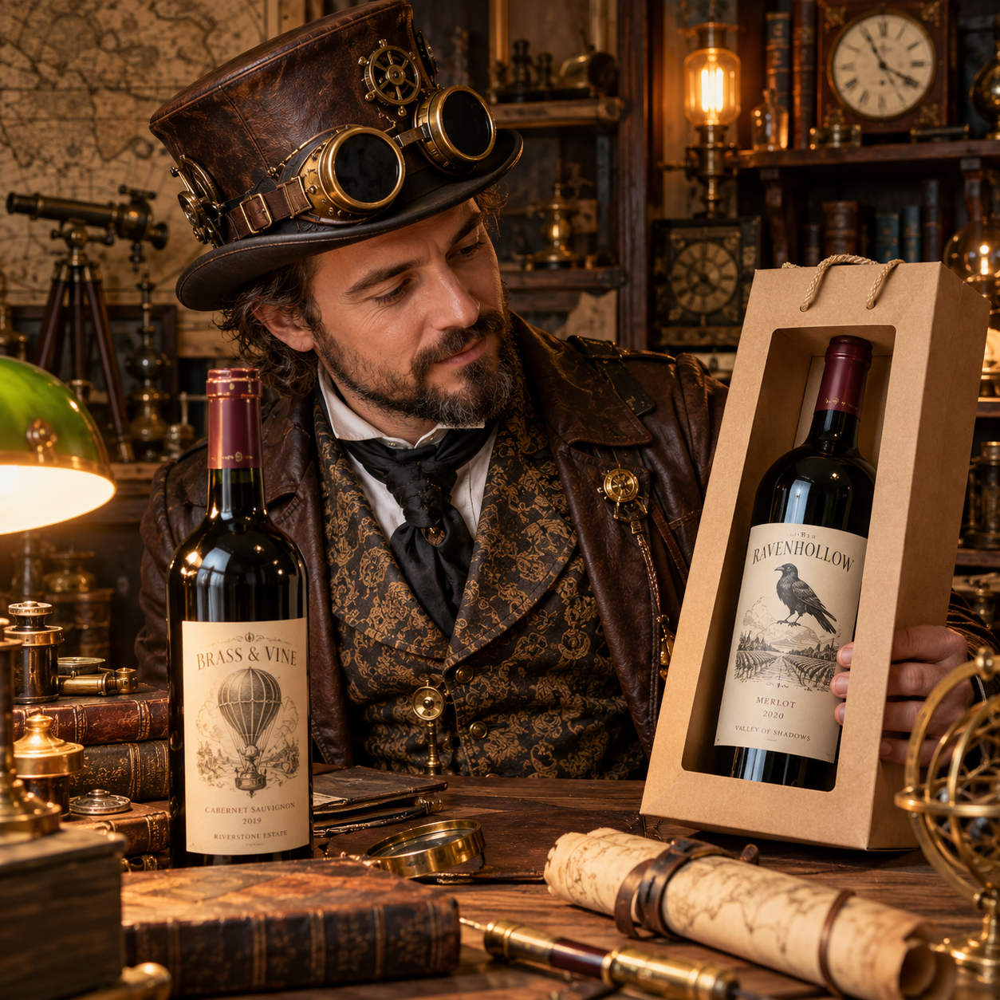
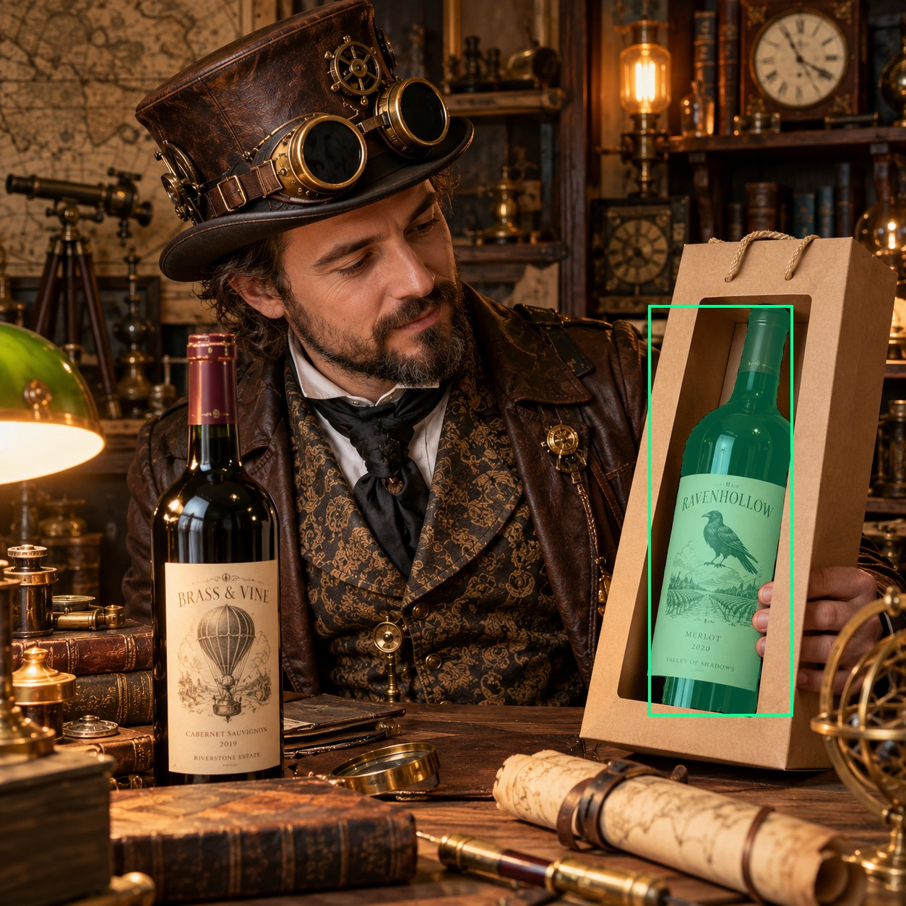
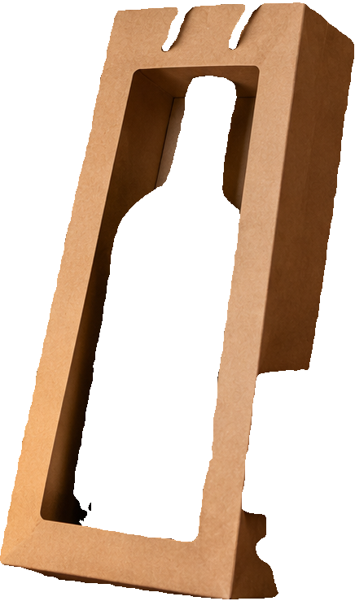
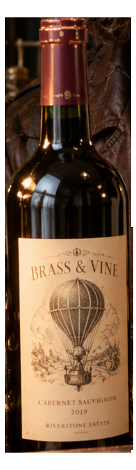
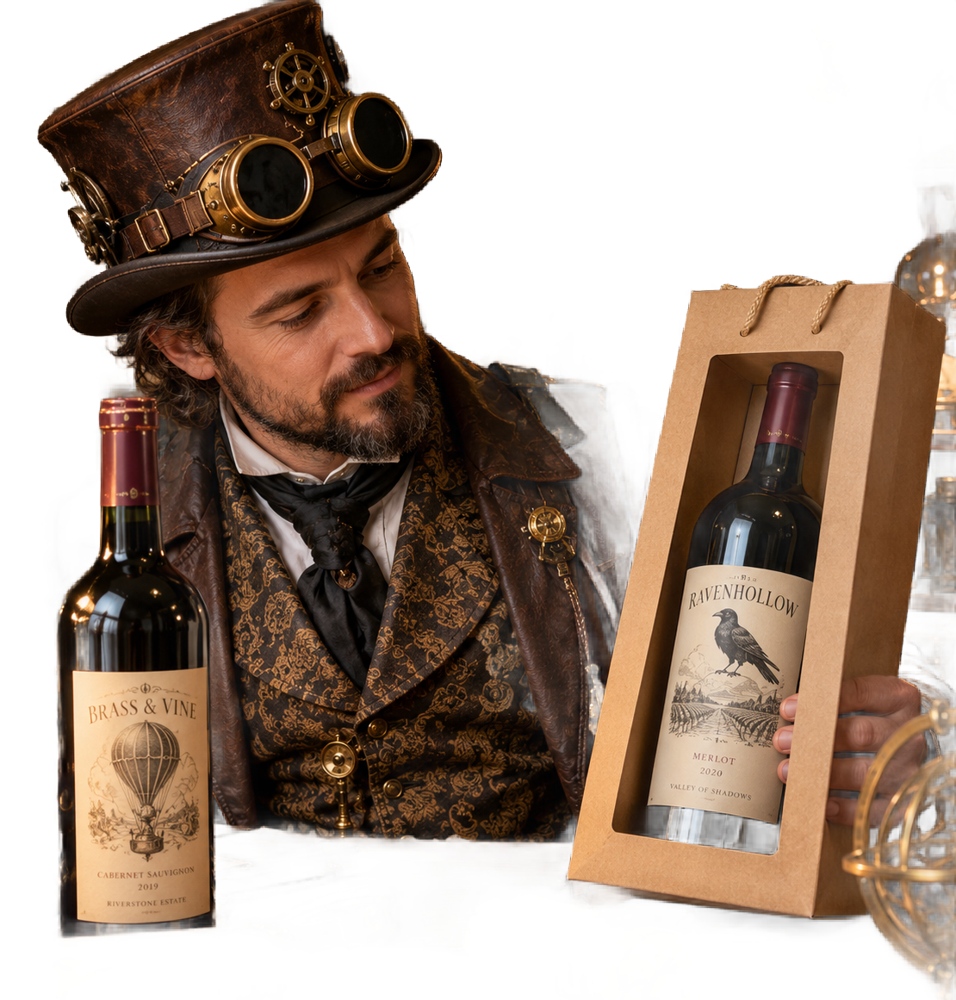

# main-selector-imagegen-diverse-v3-20261020:WP05

**Scene and masks pending — exploratory. All targets/masks are proposals; no approved segmentation ground truth.**

**scene-v1: FAIL — provisional target/proxy.**

Reference title (source): В кабинете изобретателя · открытый бумажный пакет

Reference target description (source): Удерживаемая бутылка справа в пакете с окном

Expected intent: `clear`. Accepted target proposals: `d0`.

Scene group: `main-selector-imagegen-diverse-v3-20261020:WP05`. Development only; no independent split claim.

## Original and proposed target





Green marks the unreviewed target proposal. Source image pixels are retained separately.

[Selected-label mask audit](../selected-label-mask-audit.json): incomplete proposal retention is flagged separately from target agreement.

[Full-resolution target proposal mask](../masks/diverse-v3--WP05-d0.png)

## Selector results

### scene-v1: FAIL — provisional target/proxy

Selected: d8; reason: existing_scene_v1_rank; mode: legacy; crop 436×739 px. Target agreement: False. Target retention proxy: 0.0%; maximum other-bottle retention: 0.0%; minimum associated label retention: 0.0%. Mask ownership, label completeness and legibility still require human review.



[Full-resolution keep mask](../keep-masks/diverse-v3--WP05-scene-v1.png) · [Exact decision JSON](../results/diverse-v3--WP05-scene-v1.json)

Associated label-mask retention proxies (unreviewed ownership): d2: 0.0%, 41122 source pixels

### semantic-v2: FAIL — provisional target/proxy

Selected: d1; reason: fallback_nearest_center; mode: fallback; crop 196×677 px. Target agreement: False. Target retention proxy: 0.0%; maximum other-bottle retention: 100.0%; minimum associated label retention: 0.0%. Mask ownership, label completeness and legibility still require human review. Selected-label mask audit: d3 100.0%.



[Full-resolution keep mask](../keep-masks/diverse-v3--WP05-semantic-v2.png) · [Exact decision JSON](../results/diverse-v3--WP05-semantic-v2.json)

Returned label views: [label 1](../label-crops/diverse-v3--WP05-semantic-v2-0.png)

Associated label-mask retention proxies (unreviewed ownership): d2: 0.0%, 41122 source pixels

### dis-v1: PROXY failure; no native target ID

Selected: dis-foreground; reason: dis_foreground_mask; mode: foreground; crop 1110×1161 px. Target agreement: n/a (no native target ID). Target retention proxy: 93.2%; maximum other-bottle retention: 97.9%; minimum associated label retention: 100.0%. Mask ownership, label completeness and legibility still require human review.



[Full-resolution keep mask](../keep-masks/diverse-v3--WP05-dis-v1.png) · [Exact decision JSON](../results/diverse-v3--WP05-dis-v1.json)

Associated label-mask retention proxies (unreviewed ownership): d2: 100.0%, 41122 source pixels

## All frozen mask proposals

These links expose every detector proposal, including labels and hands. Shapes and owners are unreviewed.

| ID | Detector class | Full-resolution mask |
|---|---|---|
| d0 | wine bottle | [PNG](../masks/diverse-v3--WP05-d0.png) |
| d1 | wine bottle | [PNG](../masks/diverse-v3--WP05-d1.png) |
| d2 | wine label | [PNG](../masks/diverse-v3--WP05-d2.png) |
| d3 | wine label | [PNG](../masks/diverse-v3--WP05-d3.png) |
| d4 | hand | [PNG](../masks/diverse-v3--WP05-d4.png) |
| d5 | hand | [PNG](../masks/diverse-v3--WP05-d5.png) |
| d6 | hand | [PNG](../masks/diverse-v3--WP05-d6.png) |
| d7 | box | [PNG](../masks/diverse-v3--WP05-d7.png) |
| d8 | box | [PNG](../masks/diverse-v3--WP05-d8.png) |
| d9 | box | [PNG](../masks/diverse-v3--WP05-d9.png) |

[Raw frozen detector response](../detections/diverse-v3--WP05.json)

<details><summary>Generation prompt (quoted source data)</summary>

```text
Use case: photorealistic-natural. Generate ONE independent photograph, square, approximately 1024 by 1024 pixels. An adult steampunk inventor with brass goggles on a leather top hat examines a wine gift in a Victorian study, clockwork devices, old maps and warm desk light. Photorealistic costume photograph, plausible human anatomy. A RIGHT foreground wine bottle is partly inside an open kraft paper gift bag whose front has a broad die-cut window exposing its entire ivory label and bottle body. A hand from right reaches through that opening and visibly grips the glass body. A second unheld bottle stands LEFT. Make the scene composition, person, clothing and location specific to this scenario, rather than repeating a generic bottle on a tasting counter. Show genuine physical contact when a grip is requested. Fictional wine branding; no arrows, bounding boxes, captions, collages, watermark or UI. Maintain anatomically plausible hands. Keep the target visible label inside the frame except the explicit close-up and occlusion cases.
```

</details>

Source review notes (quoted reference data):

> Цель предварительно связана с маской SAM3 по заданию генерации; подтвердите по самому фото. Форма масок и их владельцы ещё не проверены.
> Окружение: В кабинете изобретателя. Проверьте реалистичность рук, хват и присутствие требуемых деталей.
