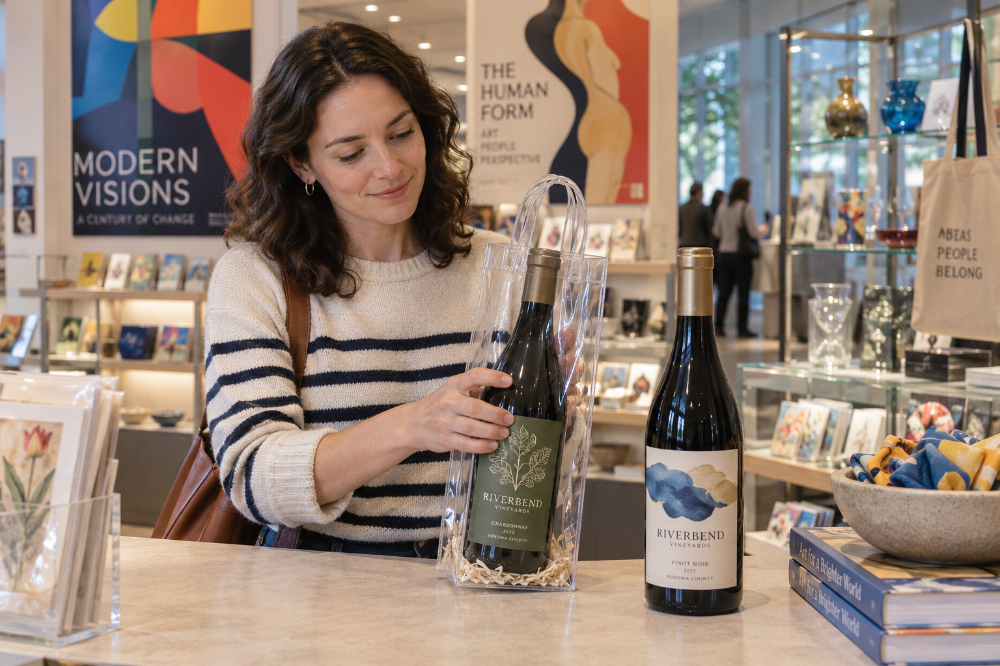
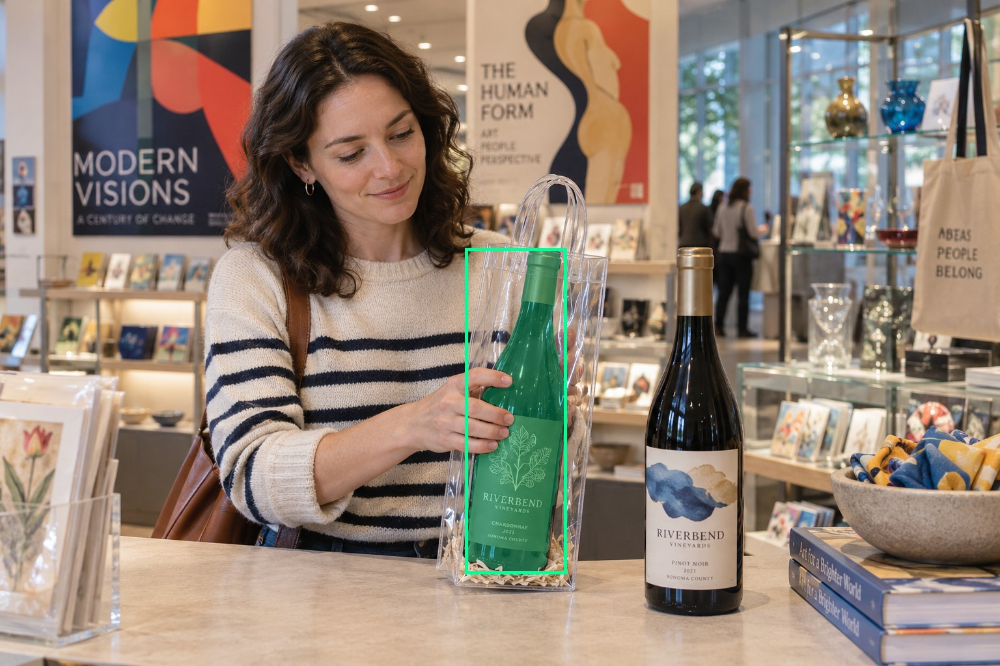
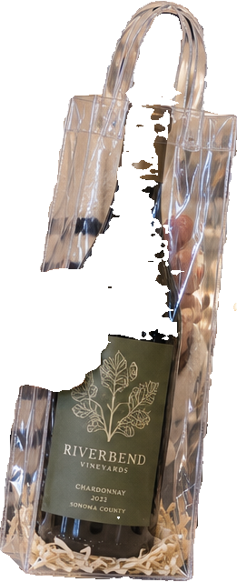
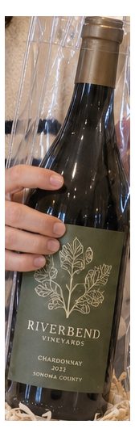
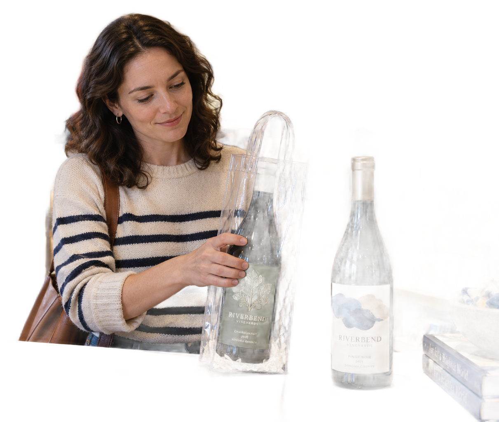

# main-selector-imagegen-diverse-v3-20261020:WP06

**Scene and masks pending — exploratory. All targets/masks are proposals; no approved segmentation ground truth.**

**scene-v1: FAIL — provisional target/proxy.**

Reference title (source): В музейном магазине · прозрачная сумка с ручками

Reference target description (source): Удерживаемая бутылка слева в прозрачной сумке

Expected intent: `clear`. Accepted target proposals: `d1`.

Scene group: `main-selector-imagegen-diverse-v3-20261020:WP06`. Development only; no independent split claim.

## Original and proposed target





Green marks the unreviewed target proposal. Source image pixels are retained separately.

[Selected-label mask audit](../selected-label-mask-audit.json): incomplete proposal retention is flagged separately from target agreement.

[Full-resolution target proposal mask](../masks/diverse-v3--WP06-d1.png)

## Selector results

### scene-v1: FAIL — provisional target/proxy

Selected: d8; reason: existing_scene_v1_rank; mode: legacy; crop 261×640 px. Target agreement: False. Target retention proxy: 67.1%; maximum other-bottle retention: 0.0%; minimum associated label retention: 99.8%. Mask ownership, label completeness and legibility still require human review.



[Full-resolution keep mask](../keep-masks/diverse-v3--WP06-scene-v1.png) · [Exact decision JSON](../results/diverse-v3--WP06-scene-v1.json)

Associated label-mask retention proxies (unreviewed ownership): d3: 99.8%, 22297 source pixels

### semantic-v2: No automatic failure flag; usability pending

Selected: d1; reason: explicit_pointing_gesture; mode: confident; crop 168×541 px. Target agreement: True. Target retention proxy: 100.0%; maximum other-bottle retention: 0.0%; minimum associated label retention: 100.0%. Mask ownership, label completeness and legibility still require human review.



[Full-resolution keep mask](../keep-masks/diverse-v3--WP06-semantic-v2.png) · [Exact decision JSON](../results/diverse-v3--WP06-semantic-v2.json)

Associated label-mask retention proxies (unreviewed ownership): d3: 100.0%, 22297 source pixels

### dis-v1: PROXY failure; no native target ID

Selected: dis-foreground; reason: dis_foreground_mask; mode: foreground; crop 1211×1024 px. Target agreement: n/a (no native target ID). Target retention proxy: 39.5%; maximum other-bottle retention: 0.0%; minimum associated label retention: 47.1%. Mask ownership, label completeness and legibility still require human review.



[Full-resolution keep mask](../keep-masks/diverse-v3--WP06-dis-v1.png) · [Exact decision JSON](../results/diverse-v3--WP06-dis-v1.json)

Associated label-mask retention proxies (unreviewed ownership): d3: 47.1%, 22297 source pixels

## All frozen mask proposals

These links expose every detector proposal, including labels and hands. Shapes and owners are unreviewed.

| ID | Detector class | Full-resolution mask |
|---|---|---|
| d0 | wine bottle | [PNG](../masks/diverse-v3--WP06-d0.png) |
| d1 | wine bottle | [PNG](../masks/diverse-v3--WP06-d1.png) |
| d2 | wine label | [PNG](../masks/diverse-v3--WP06-d2.png) |
| d3 | wine label | [PNG](../masks/diverse-v3--WP06-d3.png) |
| d4 | hand | [PNG](../masks/diverse-v3--WP06-d4.png) |
| d5 | hand | [PNG](../masks/diverse-v3--WP06-d5.png) |
| d6 | hand | [PNG](../masks/diverse-v3--WP06-d6.png) |
| d7 | box | [PNG](../masks/diverse-v3--WP06-d7.png) |
| d8 | box | [PNG](../masks/diverse-v3--WP06-d8.png) |
| d9 | box | [PNG](../masks/diverse-v3--WP06-d9.png) |
| d10 | wine glass | [PNG](../masks/diverse-v3--WP06-d10.png) |
| d11 | wine glass | [PNG](../masks/diverse-v3--WP06-d11.png) |

[Raw frozen detector response](../detections/diverse-v3--WP06.json)

<details><summary>Generation prompt (quoted source data)</summary>

```text
Use case: photorealistic-natural. Generate ONE independent photograph, landscape 3:2, approximately 1536 by 1024 pixels. An adult art-museum visitor in a bright contemporary gift shop examines a wine gift, colorful exhibition posters and glass display cases behind. Show face, casual clothing and held object. A hand from left holds the LEFT green-label bottle by gripping its middle THROUGH a clear plastic gift tote. The two loose tote handles hang above the neck and are not held. The RIGHT unwrapped bottle is unattended. Two bottles only, neutral counter background. Make the scene composition, person, clothing and location specific to this scenario, rather than repeating a generic bottle on a tasting counter. Show genuine physical contact when a grip is requested. Fictional wine branding; no arrows, bounding boxes, captions, collages, watermark or UI. Maintain anatomically plausible hands. Keep the target visible label inside the frame except the explicit close-up and occlusion cases.
```

</details>

Source review notes (quoted reference data):

> Цель предварительно связана с маской SAM3 по заданию генерации; подтвердите по самому фото. Форма масок и их владельцы ещё не проверены.
> Окружение: В музейном магазине. Проверьте реалистичность рук, хват и присутствие требуемых деталей.
