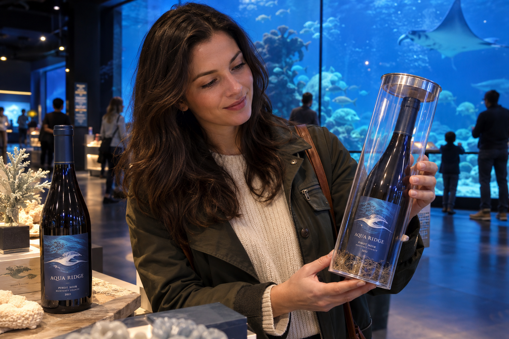
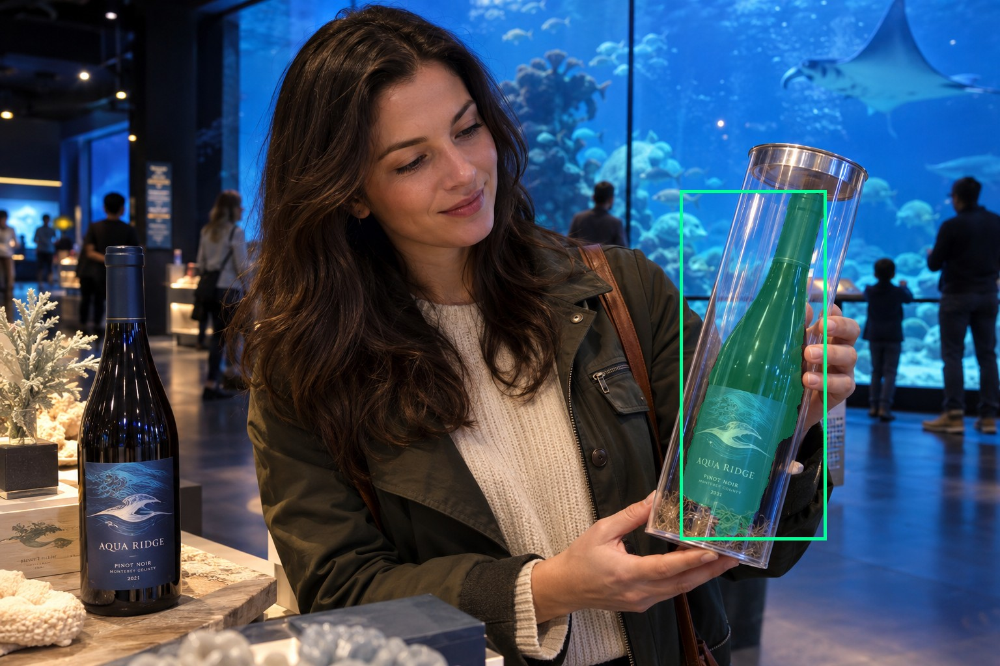
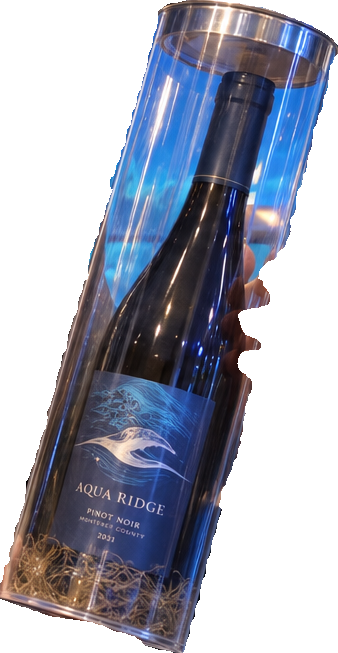
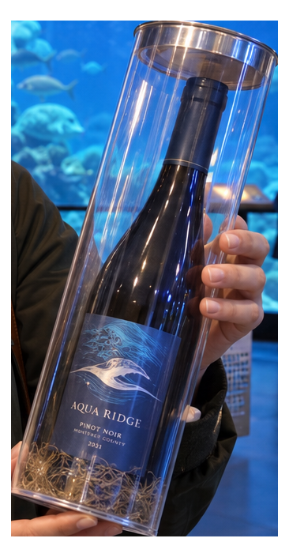
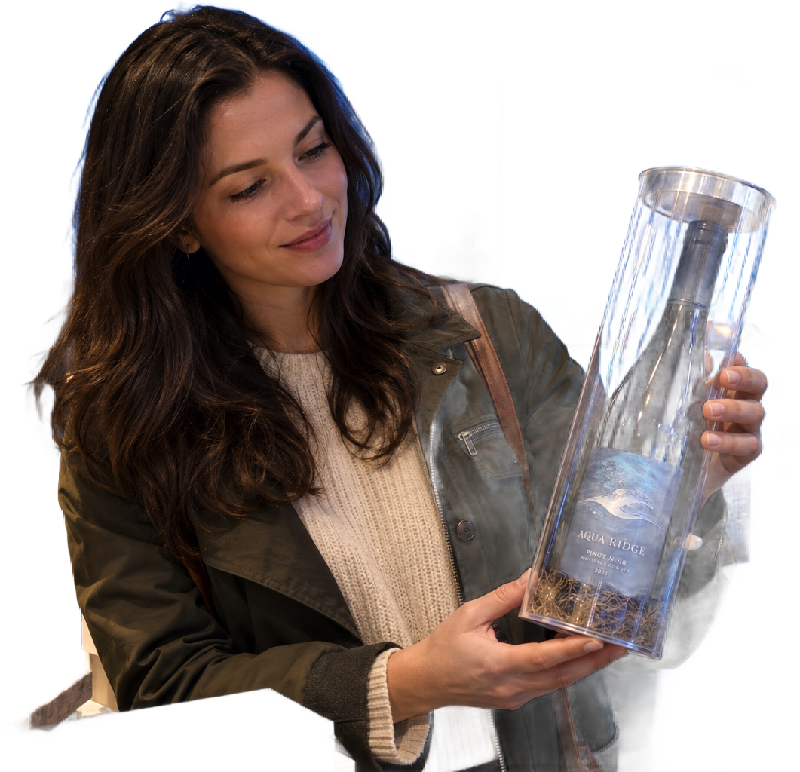

# main-selector-imagegen-diverse-v3-20261020:WP09

**Scene and masks pending — exploratory. All targets/masks are proposals; no approved segmentation ground truth.**

**scene-v1: FAIL — provisional target/proxy.**

Reference title (source): В океанариуме · прозрачный футляр

Reference target description (source): Бутылка справа в удерживаемом прозрачном футляре

Expected intent: `clear`. Accepted target proposals: `d0`.

Scene group: `main-selector-imagegen-diverse-v3-20261020:WP09`. Development only; no independent split claim.

## Original and proposed target





Green marks the unreviewed target proposal. Source image pixels are retained separately.

[Selected-label mask audit](../selected-label-mask-audit.json): incomplete proposal retention is flagged separately from target agreement.

[Full-resolution target proposal mask](../masks/diverse-v3--WP09-d0.png)

## Selector results

### scene-v1: FAIL — provisional target/proxy

Selected: d11; reason: existing_scene_v1_rank; mode: legacy; crop 338×653 px. Target agreement: False. Target retention proxy: 100.0%; maximum other-bottle retention: 0.0%; minimum associated label retention: 100.0%. Mask ownership, label completeness and legibility still require human review.



[Full-resolution keep mask](../keep-masks/diverse-v3--WP09-scene-v1.png) · [Exact decision JSON](../results/diverse-v3--WP09-scene-v1.json)

Associated label-mask retention proxies (unreviewed ownership): d2: 100.0%, 22373 source pixels

### semantic-v2: FAIL — provisional target/proxy

Selected: d11; reason: unique_visible_hand_contact; mode: confident; crop 366×705 px. Target agreement: False. Target retention proxy: 100.0%; maximum other-bottle retention: 0.0%; minimum associated label retention: 100.0%. Mask ownership, label completeness and legibility still require human review. Selected-label mask audit: d2 100.0%.



[Full-resolution keep mask](../keep-masks/diverse-v3--WP09-semantic-v2.png) · [Exact decision JSON](../results/diverse-v3--WP09-semantic-v2.json)

Returned label views: [label 1](../label-crops/diverse-v3--WP09-semantic-v2-0.png)

Associated label-mask retention proxies (unreviewed ownership): d2: 100.0%, 22373 source pixels

### dis-v1: PROXY failure; no native target ID

Selected: dis-foreground; reason: dis_foreground_mask; mode: foreground; crop 1061×1024 px. Target agreement: n/a (no native target ID). Target retention proxy: 63.0%; maximum other-bottle retention: 0.0%; minimum associated label retention: 71.4%. Mask ownership, label completeness and legibility still require human review.



[Full-resolution keep mask](../keep-masks/diverse-v3--WP09-dis-v1.png) · [Exact decision JSON](../results/diverse-v3--WP09-dis-v1.json)

Associated label-mask retention proxies (unreviewed ownership): d2: 71.4%, 22373 source pixels

## All frozen mask proposals

These links expose every detector proposal, including labels and hands. Shapes and owners are unreviewed.

| ID | Detector class | Full-resolution mask |
|---|---|---|
| d0 | wine bottle | [PNG](../masks/diverse-v3--WP09-d0.png) |
| d1 | wine bottle | [PNG](../masks/diverse-v3--WP09-d1.png) |
| d2 | wine label | [PNG](../masks/diverse-v3--WP09-d2.png) |
| d3 | wine label | [PNG](../masks/diverse-v3--WP09-d3.png) |
| d4 | hand | [PNG](../masks/diverse-v3--WP09-d4.png) |
| d5 | hand | [PNG](../masks/diverse-v3--WP09-d5.png) |
| d6 | hand | [PNG](../masks/diverse-v3--WP09-d6.png) |
| d7 | box | [PNG](../masks/diverse-v3--WP09-d7.png) |
| d8 | box | [PNG](../masks/diverse-v3--WP09-d8.png) |
| d9 | box | [PNG](../masks/diverse-v3--WP09-d9.png) |
| d10 | box | [PNG](../masks/diverse-v3--WP09-d10.png) |
| d11 | box | [PNG](../masks/diverse-v3--WP09-d11.png) |
| d12 | box | [PNG](../masks/diverse-v3--WP09-d12.png) |

[Raw frozen detector response](../detections/diverse-v3--WP09.json)

<details><summary>Generation prompt (quoted source data)</summary>

```text
Use case: photorealistic-natural. Generate ONE independent photograph, landscape 3:2, approximately 1536 by 1024 pixels. An adult visitor examines a packaged wine gift in the dry public gallery of a large aquarium, blue-lit fish tank behind glass. Show their face and hands; the bottle is outside the tank, physically held. A single real wine bottle with blue label sits in a clear rigid cylindrical acrylic gift tube at RIGHT; a hand from right holds the transparent tube firmly at bottle-body height. A second unheld bottle stands LEFT. Distinguish the bottle and its transparent container, with visible tube lid and reflections. Make the scene composition, person, clothing and location specific to this scenario, rather than repeating a generic bottle on a tasting counter. Show genuine physical contact when a grip is requested. Fictional wine branding; no arrows, bounding boxes, captions, collages, watermark or UI. Maintain anatomically plausible hands. Keep the target visible label inside the frame except the explicit close-up and occlusion cases.
```

</details>

Source review notes (quoted reference data):

> Цель предварительно связана с маской SAM3 по заданию генерации; подтвердите по самому фото. Форма масок и их владельцы ещё не проверены.
> Окружение: В океанариуме. Проверьте реалистичность рук, хват и присутствие требуемых деталей.
