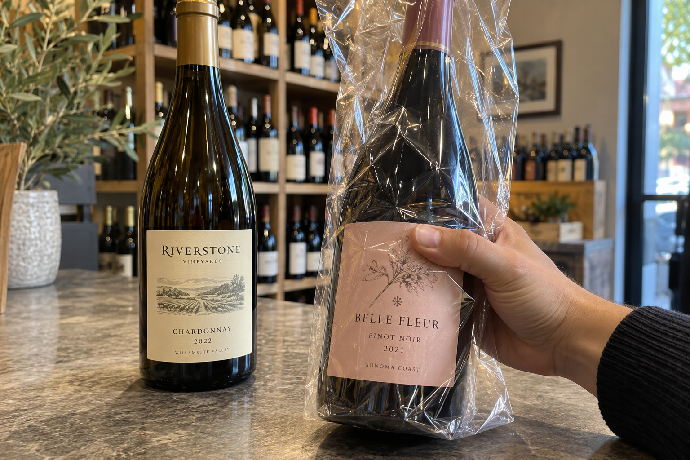
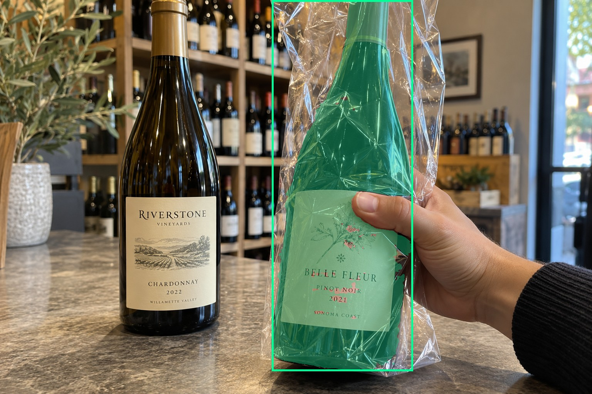
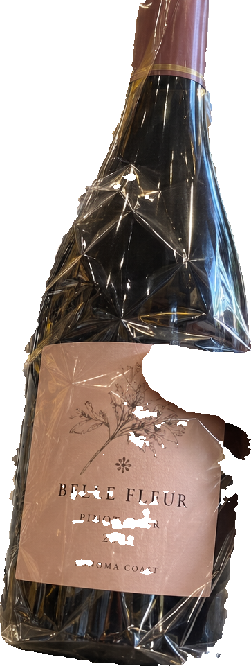
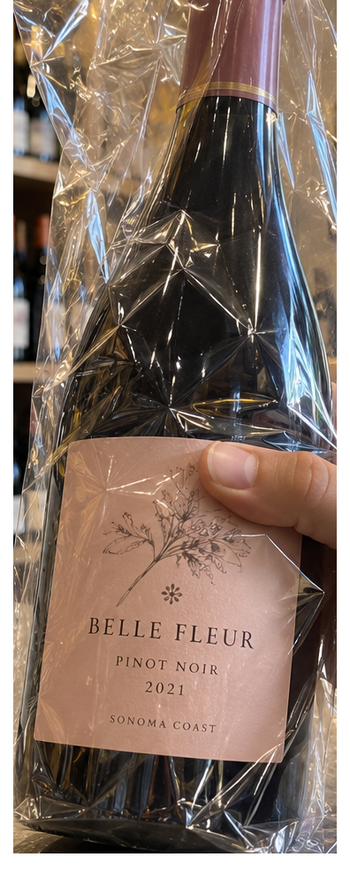
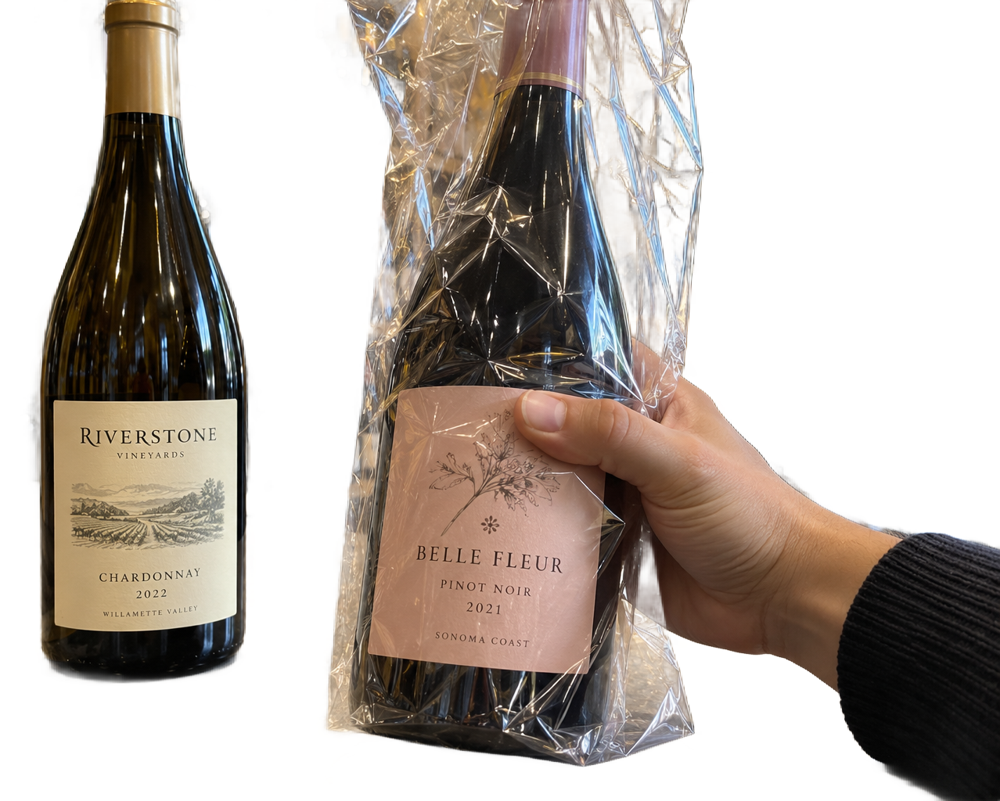

# main-selector-imagegen-hardcases-v2-20261020:BG01

**Scene confirmed; masks pending. All targets/masks are proposals; no approved segmentation ground truth.**

**scene-v1: FAIL — provisional target/proxy.**

Reference title (source): Хват справа через прозрачный пакет

Reference target description (source): Бутылка справа в прозрачном пакете

Expected intent: `clear`. Accepted target proposals: `d28`.

Scene group: `main-selector-imagegen-hardcases-v2-20261020:BG01`. Development only; no independent split claim.

## Original and proposed target





Green marks the unreviewed target proposal. Source image pixels are retained separately.

[Selected-label mask audit](../selected-label-mask-audit.json): incomplete proposal retention is flagged separately from target agreement.

[Full-resolution target proposal mask](../masks/hardcases-v2--BG01-d28.png)

## Selector results

### scene-v1: FAIL — provisional target/proxy

Selected: d28; reason: existing_scene_v1_rank; mode: legacy; crop 363×961 px. Target agreement: True. Target retention proxy: 100.0%; maximum other-bottle retention: 0.1%; minimum associated label retention: 96.0%. Mask ownership, label completeness and legibility still require human review.



[Full-resolution keep mask](../keep-masks/hardcases-v2--BG01-scene-v1.png) · [Exact decision JSON](../results/hardcases-v2--BG01-scene-v1.json)

Associated label-mask retention proxies (unreviewed ownership): d41: 96.0%, 88496 source pixels

### semantic-v2: FAIL — provisional target/proxy

Selected: d28; reason: unique_visible_hand_contact; mode: confident; crop 396×1003 px. Target agreement: True. Target retention proxy: 100.0%; maximum other-bottle retention: 100.0%; minimum associated label retention: 100.0%. Mask ownership, label completeness and legibility still require human review. Selected-label mask audit: d41 100.0%.



[Full-resolution keep mask](../keep-masks/hardcases-v2--BG01-semantic-v2.png) · [Exact decision JSON](../results/hardcases-v2--BG01-semantic-v2.json)

Returned label views: [label 1](../label-crops/hardcases-v2--BG01-semantic-v2-0.png)

Associated label-mask retention proxies (unreviewed ownership): d41: 100.0%, 88496 source pixels

### dis-v1: PROXY failure; no native target ID

Selected: dis-foreground; reason: dis_foreground_mask; mode: foreground; crop 1278×1024 px. Target agreement: n/a (no native target ID). Target retention proxy: 100.0%; maximum other-bottle retention: 99.7%; minimum associated label retention: 100.0%. Mask ownership, label completeness and legibility still require human review.



[Full-resolution keep mask](../keep-masks/hardcases-v2--BG01-dis-v1.png) · [Exact decision JSON](../results/hardcases-v2--BG01-dis-v1.json)

Associated label-mask retention proxies (unreviewed ownership): d41: 100.0%, 88496 source pixels

## All frozen mask proposals

These links expose every detector proposal, including labels and hands. Shapes and owners are unreviewed.

| ID | Detector class | Full-resolution mask |
|---|---|---|
| d0 | wine bottle | [PNG](../masks/hardcases-v2--BG01-d0.png) |
| d1 | wine bottle | [PNG](../masks/hardcases-v2--BG01-d1.png) |
| d2 | wine bottle | [PNG](../masks/hardcases-v2--BG01-d2.png) |
| d3 | wine bottle | [PNG](../masks/hardcases-v2--BG01-d3.png) |
| d4 | wine bottle | [PNG](../masks/hardcases-v2--BG01-d4.png) |
| d5 | wine bottle | [PNG](../masks/hardcases-v2--BG01-d5.png) |
| d6 | wine bottle | [PNG](../masks/hardcases-v2--BG01-d6.png) |
| d7 | wine bottle | [PNG](../masks/hardcases-v2--BG01-d7.png) |
| d8 | wine bottle | [PNG](../masks/hardcases-v2--BG01-d8.png) |
| d9 | wine bottle | [PNG](../masks/hardcases-v2--BG01-d9.png) |
| d10 | wine bottle | [PNG](../masks/hardcases-v2--BG01-d10.png) |
| d11 | wine bottle | [PNG](../masks/hardcases-v2--BG01-d11.png) |
| d12 | wine bottle | [PNG](../masks/hardcases-v2--BG01-d12.png) |
| d13 | wine bottle | [PNG](../masks/hardcases-v2--BG01-d13.png) |
| d14 | wine bottle | [PNG](../masks/hardcases-v2--BG01-d14.png) |
| d15 | wine bottle | [PNG](../masks/hardcases-v2--BG01-d15.png) |
| d16 | wine bottle | [PNG](../masks/hardcases-v2--BG01-d16.png) |
| d17 | wine bottle | [PNG](../masks/hardcases-v2--BG01-d17.png) |
| d18 | wine bottle | [PNG](../masks/hardcases-v2--BG01-d18.png) |
| d19 | wine bottle | [PNG](../masks/hardcases-v2--BG01-d19.png) |
| d20 | wine bottle | [PNG](../masks/hardcases-v2--BG01-d20.png) |
| d21 | wine bottle | [PNG](../masks/hardcases-v2--BG01-d21.png) |
| d22 | wine bottle | [PNG](../masks/hardcases-v2--BG01-d22.png) |
| d23 | wine bottle | [PNG](../masks/hardcases-v2--BG01-d23.png) |
| d24 | wine bottle | [PNG](../masks/hardcases-v2--BG01-d24.png) |
| d25 | wine bottle | [PNG](../masks/hardcases-v2--BG01-d25.png) |
| d26 | wine bottle | [PNG](../masks/hardcases-v2--BG01-d26.png) |
| d27 | wine bottle | [PNG](../masks/hardcases-v2--BG01-d27.png) |
| d28 | wine bottle | [PNG](../masks/hardcases-v2--BG01-d28.png) |
| d29 | wine bottle | [PNG](../masks/hardcases-v2--BG01-d29.png) |
| d30 | wine bottle | [PNG](../masks/hardcases-v2--BG01-d30.png) |
| d31 | wine bottle | [PNG](../masks/hardcases-v2--BG01-d31.png) |
| d32 | wine bottle | [PNG](../masks/hardcases-v2--BG01-d32.png) |
| d33 | wine bottle | [PNG](../masks/hardcases-v2--BG01-d33.png) |
| d34 | wine bottle | [PNG](../masks/hardcases-v2--BG01-d34.png) |
| d35 | wine bottle | [PNG](../masks/hardcases-v2--BG01-d35.png) |
| d36 | wine bottle | [PNG](../masks/hardcases-v2--BG01-d36.png) |
| d37 | wine bottle | [PNG](../masks/hardcases-v2--BG01-d37.png) |
| d38 | wine bottle | [PNG](../masks/hardcases-v2--BG01-d38.png) |
| d39 | wine bottle | [PNG](../masks/hardcases-v2--BG01-d39.png) |
| d40 | wine label | [PNG](../masks/hardcases-v2--BG01-d40.png) |
| d41 | wine label | [PNG](../masks/hardcases-v2--BG01-d41.png) |
| d42 | wine label | [PNG](../masks/hardcases-v2--BG01-d42.png) |
| d43 | wine label | [PNG](../masks/hardcases-v2--BG01-d43.png) |
| d44 | wine label | [PNG](../masks/hardcases-v2--BG01-d44.png) |
| d45 | wine label | [PNG](../masks/hardcases-v2--BG01-d45.png) |
| d46 | wine label | [PNG](../masks/hardcases-v2--BG01-d46.png) |
| d47 | wine label | [PNG](../masks/hardcases-v2--BG01-d47.png) |
| d48 | wine label | [PNG](../masks/hardcases-v2--BG01-d48.png) |
| d49 | wine label | [PNG](../masks/hardcases-v2--BG01-d49.png) |
| d50 | wine label | [PNG](../masks/hardcases-v2--BG01-d50.png) |
| d51 | wine label | [PNG](../masks/hardcases-v2--BG01-d51.png) |
| d52 | wine label | [PNG](../masks/hardcases-v2--BG01-d52.png) |
| d53 | wine label | [PNG](../masks/hardcases-v2--BG01-d53.png) |
| d54 | wine label | [PNG](../masks/hardcases-v2--BG01-d54.png) |
| d55 | wine label | [PNG](../masks/hardcases-v2--BG01-d55.png) |
| d56 | wine label | [PNG](../masks/hardcases-v2--BG01-d56.png) |
| d57 | wine label | [PNG](../masks/hardcases-v2--BG01-d57.png) |
| d58 | wine label | [PNG](../masks/hardcases-v2--BG01-d58.png) |
| d59 | wine label | [PNG](../masks/hardcases-v2--BG01-d59.png) |
| d60 | wine label | [PNG](../masks/hardcases-v2--BG01-d60.png) |
| d61 | wine label | [PNG](../masks/hardcases-v2--BG01-d61.png) |
| d62 | wine label | [PNG](../masks/hardcases-v2--BG01-d62.png) |
| d63 | wine label | [PNG](../masks/hardcases-v2--BG01-d63.png) |
| d64 | wine label | [PNG](../masks/hardcases-v2--BG01-d64.png) |
| d65 | wine label | [PNG](../masks/hardcases-v2--BG01-d65.png) |
| d66 | wine label | [PNG](../masks/hardcases-v2--BG01-d66.png) |
| d67 | hand | [PNG](../masks/hardcases-v2--BG01-d67.png) |
| d68 | box | [PNG](../masks/hardcases-v2--BG01-d68.png) |
| d69 | box | [PNG](../masks/hardcases-v2--BG01-d69.png) |
| d70 | box | [PNG](../masks/hardcases-v2--BG01-d70.png) |

[Raw frozen detector response](../detections/hardcases-v2--BG01.json)

<details><summary>Generation prompt (quoted source data)</summary>

```text
Generate exactly one independent photorealistic smartphone photograph, landscape 3:2, approximately 1536 by 1024 pixels. This is an ordinary wine selection moment, with natural perspective, believable glass and paper, imperfect ambient lighting, and realistic human anatomy. No collage, inset, split screen, arrows, highlights, bounding boxes, annotations, watermarks, UI, or text outside physical objects. Use fictional wine branding. Keep the target bottle's entire front label within the frame. The scene must communicate the stated gesture or physical relation visually; do not add any explanatory caption. Exactly two wine bottles on a counter. On the RIGHT foreground a single hand enters from right and grips the middle body of a wine bottle THROUGH a loose clear cellophane gift bag. Thumb and curled fingers visibly squeeze opposite sides of the bottle, with transparent plastic folds compressed between skin and glass. The bag is open above the neck and its creases reflect light; a pale pink front label remains discernible. An unwrapped unheld bottle with a clear cream label stands at left behind it. No printed bottle graphics, no opaque bag, no extra hands. Realistic everyday shop light.
```

</details>

Source review notes (quoted reference data):

> На дальних полках много дополнительных бутылок. Часть пальцев за стеклом скрыта: проверьте хват и анатомию.
