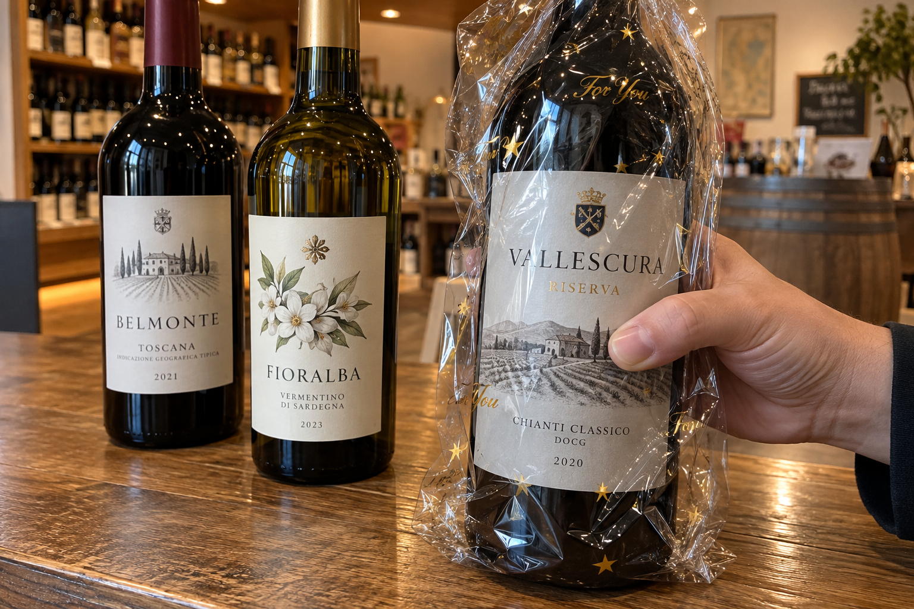
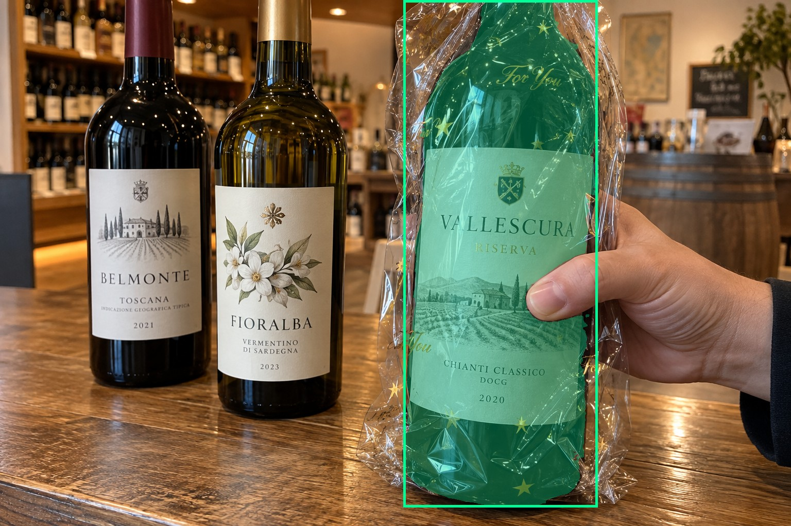
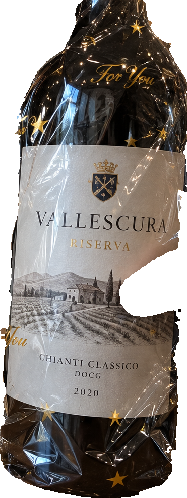
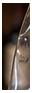
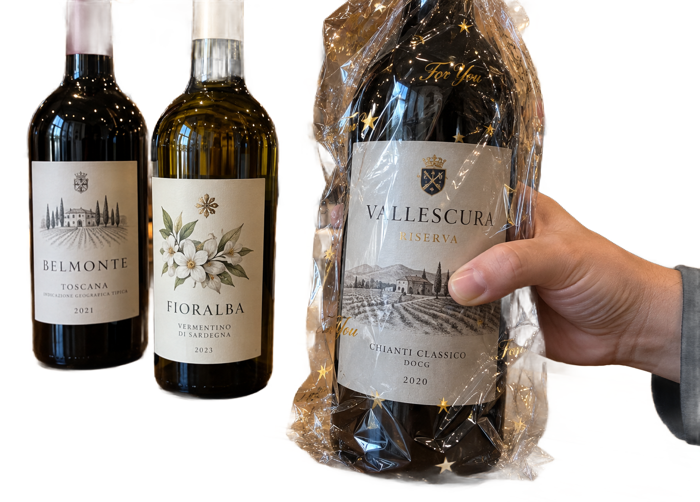

# main-selector-imagegen-hardcases-v2-20261020:BG03

**Scene confirmed; masks pending. All targets/masks are proposals; no approved segmentation ground truth.**

**scene-v1: No automatic failure flag; usability pending.**

Reference title (source): Прозрачная обёртка и печать поверх этикетки

Reference target description (source): Удерживаемая бутылка справа под прозрачной плёнкой

Expected intent: `clear`. Accepted target proposals: `d6`.

Scene group: `main-selector-imagegen-hardcases-v2-20261020:BG03`. Development only; no independent split claim.

## Original and proposed target





Green marks the unreviewed target proposal. Source image pixels are retained separately.

[Selected-label mask audit](../selected-label-mask-audit.json): incomplete proposal retention is flagged separately from target agreement.

[Full-resolution target proposal mask](../masks/hardcases-v2--BG03-d6.png)

## Selector results

### scene-v1: No automatic failure flag; usability pending

Selected: d6; reason: existing_scene_v1_rank; mode: legacy; crop 371×986 px. Target agreement: True. Target retention proxy: 99.9%; maximum other-bottle retention: 0.0%; minimum associated label retention: 99.8%. Mask ownership, label completeness and legibility still require human review.



[Full-resolution keep mask](../keep-masks/hardcases-v2--BG03-scene-v1.png) · [Exact decision JSON](../results/hardcases-v2--BG03-scene-v1.json)

Associated label-mask retention proxies (unreviewed ownership): d49: 99.8%, 158534 source pixels

### semantic-v2: FAIL — provisional target/proxy

Selected: d37; reason: fallback_nearest_center; mode: fallback; crop 32×93 px. Target agreement: False. Target retention proxy: 0.0%; maximum other-bottle retention: 94.5%; minimum associated label retention: 0.0%. Mask ownership, label completeness and legibility still require human review.



[Full-resolution keep mask](../keep-masks/hardcases-v2--BG03-semantic-v2.png) · [Exact decision JSON](../results/hardcases-v2--BG03-semantic-v2.json)

Associated label-mask retention proxies (unreviewed ownership): d49: 0.0%, 158534 source pixels

### dis-v1: PROXY failure; no native target ID

Selected: dis-foreground; reason: dis_foreground_mask; mode: foreground; crop 1428×1024 px. Target agreement: n/a (no native target ID). Target retention proxy: 99.7%; maximum other-bottle retention: 93.7%; minimum associated label retention: 100.0%. Mask ownership, label completeness and legibility still require human review.



[Full-resolution keep mask](../keep-masks/hardcases-v2--BG03-dis-v1.png) · [Exact decision JSON](../results/hardcases-v2--BG03-dis-v1.json)

Associated label-mask retention proxies (unreviewed ownership): d49: 100.0%, 158534 source pixels

## All frozen mask proposals

These links expose every detector proposal, including labels and hands. Shapes and owners are unreviewed.

| ID | Detector class | Full-resolution mask |
|---|---|---|
| d0 | wine bottle | [PNG](../masks/hardcases-v2--BG03-d0.png) |
| d1 | wine bottle | [PNG](../masks/hardcases-v2--BG03-d1.png) |
| d2 | wine bottle | [PNG](../masks/hardcases-v2--BG03-d2.png) |
| d3 | wine bottle | [PNG](../masks/hardcases-v2--BG03-d3.png) |
| d4 | wine bottle | [PNG](../masks/hardcases-v2--BG03-d4.png) |
| d5 | wine bottle | [PNG](../masks/hardcases-v2--BG03-d5.png) |
| d6 | wine bottle | [PNG](../masks/hardcases-v2--BG03-d6.png) |
| d7 | wine bottle | [PNG](../masks/hardcases-v2--BG03-d7.png) |
| d8 | wine bottle | [PNG](../masks/hardcases-v2--BG03-d8.png) |
| d9 | wine bottle | [PNG](../masks/hardcases-v2--BG03-d9.png) |
| d10 | wine bottle | [PNG](../masks/hardcases-v2--BG03-d10.png) |
| d11 | wine bottle | [PNG](../masks/hardcases-v2--BG03-d11.png) |
| d12 | wine bottle | [PNG](../masks/hardcases-v2--BG03-d12.png) |
| d13 | wine bottle | [PNG](../masks/hardcases-v2--BG03-d13.png) |
| d14 | wine bottle | [PNG](../masks/hardcases-v2--BG03-d14.png) |
| d15 | wine bottle | [PNG](../masks/hardcases-v2--BG03-d15.png) |
| d16 | wine bottle | [PNG](../masks/hardcases-v2--BG03-d16.png) |
| d17 | wine bottle | [PNG](../masks/hardcases-v2--BG03-d17.png) |
| d18 | wine bottle | [PNG](../masks/hardcases-v2--BG03-d18.png) |
| d19 | wine bottle | [PNG](../masks/hardcases-v2--BG03-d19.png) |
| d20 | wine bottle | [PNG](../masks/hardcases-v2--BG03-d20.png) |
| d21 | wine bottle | [PNG](../masks/hardcases-v2--BG03-d21.png) |
| d22 | wine bottle | [PNG](../masks/hardcases-v2--BG03-d22.png) |
| d23 | wine bottle | [PNG](../masks/hardcases-v2--BG03-d23.png) |
| d24 | wine bottle | [PNG](../masks/hardcases-v2--BG03-d24.png) |
| d25 | wine bottle | [PNG](../masks/hardcases-v2--BG03-d25.png) |
| d26 | wine bottle | [PNG](../masks/hardcases-v2--BG03-d26.png) |
| d27 | wine bottle | [PNG](../masks/hardcases-v2--BG03-d27.png) |
| d28 | wine bottle | [PNG](../masks/hardcases-v2--BG03-d28.png) |
| d29 | wine bottle | [PNG](../masks/hardcases-v2--BG03-d29.png) |
| d30 | wine bottle | [PNG](../masks/hardcases-v2--BG03-d30.png) |
| d31 | wine bottle | [PNG](../masks/hardcases-v2--BG03-d31.png) |
| d32 | wine bottle | [PNG](../masks/hardcases-v2--BG03-d32.png) |
| d33 | wine bottle | [PNG](../masks/hardcases-v2--BG03-d33.png) |
| d34 | wine bottle | [PNG](../masks/hardcases-v2--BG03-d34.png) |
| d35 | wine bottle | [PNG](../masks/hardcases-v2--BG03-d35.png) |
| d36 | wine bottle | [PNG](../masks/hardcases-v2--BG03-d36.png) |
| d37 | wine bottle | [PNG](../masks/hardcases-v2--BG03-d37.png) |
| d38 | wine bottle | [PNG](../masks/hardcases-v2--BG03-d38.png) |
| d39 | wine bottle | [PNG](../masks/hardcases-v2--BG03-d39.png) |
| d40 | wine bottle | [PNG](../masks/hardcases-v2--BG03-d40.png) |
| d41 | wine bottle | [PNG](../masks/hardcases-v2--BG03-d41.png) |
| d42 | wine bottle | [PNG](../masks/hardcases-v2--BG03-d42.png) |
| d43 | wine bottle | [PNG](../masks/hardcases-v2--BG03-d43.png) |
| d44 | wine bottle | [PNG](../masks/hardcases-v2--BG03-d44.png) |
| d45 | wine bottle | [PNG](../masks/hardcases-v2--BG03-d45.png) |
| d46 | wine label | [PNG](../masks/hardcases-v2--BG03-d46.png) |
| d47 | wine label | [PNG](../masks/hardcases-v2--BG03-d47.png) |
| d48 | wine label | [PNG](../masks/hardcases-v2--BG03-d48.png) |
| d49 | wine label | [PNG](../masks/hardcases-v2--BG03-d49.png) |
| d50 | wine label | [PNG](../masks/hardcases-v2--BG03-d50.png) |
| d51 | wine label | [PNG](../masks/hardcases-v2--BG03-d51.png) |
| d52 | wine label | [PNG](../masks/hardcases-v2--BG03-d52.png) |
| d53 | wine label | [PNG](../masks/hardcases-v2--BG03-d53.png) |
| d54 | wine label | [PNG](../masks/hardcases-v2--BG03-d54.png) |
| d55 | wine label | [PNG](../masks/hardcases-v2--BG03-d55.png) |
| d56 | wine label | [PNG](../masks/hardcases-v2--BG03-d56.png) |
| d57 | wine label | [PNG](../masks/hardcases-v2--BG03-d57.png) |
| d58 | wine label | [PNG](../masks/hardcases-v2--BG03-d58.png) |
| d59 | wine label | [PNG](../masks/hardcases-v2--BG03-d59.png) |
| d60 | wine label | [PNG](../masks/hardcases-v2--BG03-d60.png) |
| d61 | wine label | [PNG](../masks/hardcases-v2--BG03-d61.png) |
| d62 | wine label | [PNG](../masks/hardcases-v2--BG03-d62.png) |
| d63 | wine label | [PNG](../masks/hardcases-v2--BG03-d63.png) |
| d64 | wine label | [PNG](../masks/hardcases-v2--BG03-d64.png) |
| d65 | wine label | [PNG](../masks/hardcases-v2--BG03-d65.png) |
| d66 | wine label | [PNG](../masks/hardcases-v2--BG03-d66.png) |
| d67 | wine label | [PNG](../masks/hardcases-v2--BG03-d67.png) |
| d68 | wine label | [PNG](../masks/hardcases-v2--BG03-d68.png) |
| d69 | wine label | [PNG](../masks/hardcases-v2--BG03-d69.png) |
| d70 | wine label | [PNG](../masks/hardcases-v2--BG03-d70.png) |
| d71 | wine label | [PNG](../masks/hardcases-v2--BG03-d71.png) |
| d72 | wine label | [PNG](../masks/hardcases-v2--BG03-d72.png) |
| d73 | wine label | [PNG](../masks/hardcases-v2--BG03-d73.png) |
| d74 | wine label | [PNG](../masks/hardcases-v2--BG03-d74.png) |
| d75 | wine label | [PNG](../masks/hardcases-v2--BG03-d75.png) |
| d76 | wine label | [PNG](../masks/hardcases-v2--BG03-d76.png) |
| d77 | wine label | [PNG](../masks/hardcases-v2--BG03-d77.png) |
| d78 | hand | [PNG](../masks/hardcases-v2--BG03-d78.png) |

[Raw frozen detector response](../detections/hardcases-v2--BG03.json)

<details><summary>Generation prompt (quoted source data)</summary>

```text
Generate exactly one independent photorealistic smartphone photograph, landscape 3:2, approximately 1536 by 1024 pixels. This is an ordinary wine selection moment, with natural perspective, believable glass and paper, imperfect ambient lighting, and realistic human anatomy. No collage, inset, split screen, arrows, highlights, bounding boxes, annotations, watermarks, UI, or text outside physical objects. Use fictional wine branding. Keep the target bottle's entire front label within the frame. The scene must communicate the stated gesture or physical relation visually; do not add any explanatory caption. Exactly three wine bottles on a shop tasting counter. A RIGHT foreground dark bottle is held around its middle body by a hand entering from right through a transparent loose gift wrap. Show thumb and naturally curled fingers visibly enclosing opposite sides of the bottle, compressing the film. A few small gold decorative words and stars are printed on the clear wrapper, visibly distinct from the bottle pale gray paper label behind it; do not cover the entire label. Two unwrapped unheld bottles stand on the left behind, their labels clearer. Strong plastic highlights, believable transparent film, no extra fingers, realistic phone photo.
```

</details>

Source review notes (quoted reference data):

> Надписи и звёзды нанесены на прозрачную плёнку поверх бумажной этикетки. Есть дополнительные бутылки на полках.
