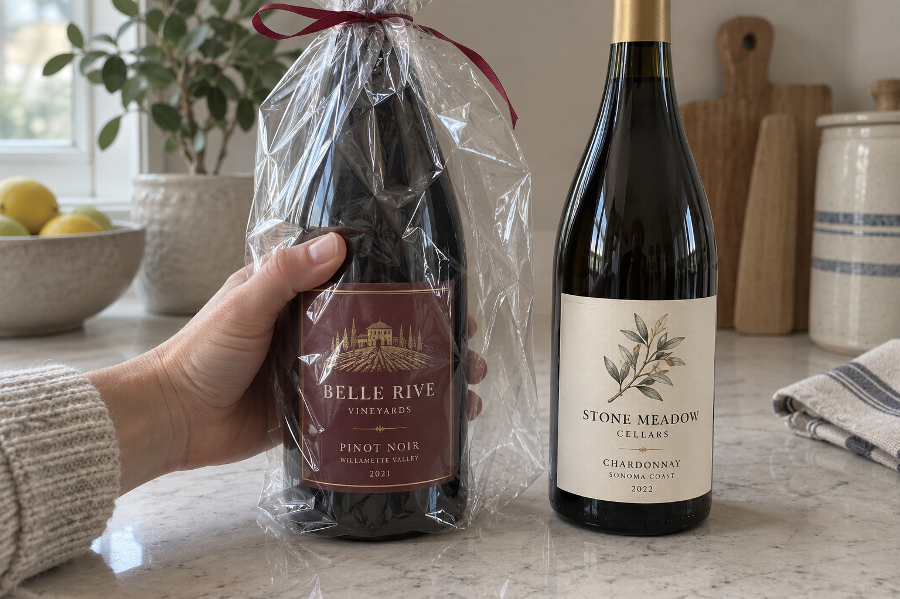
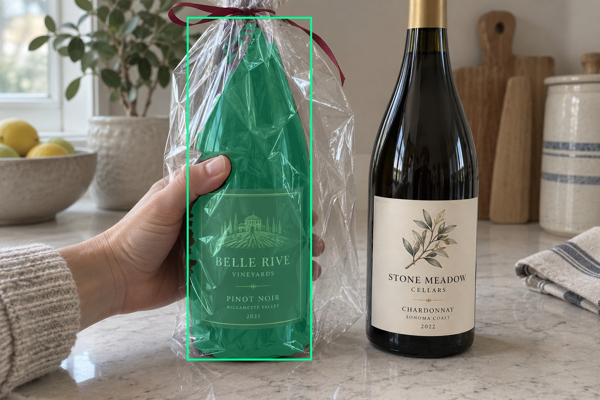
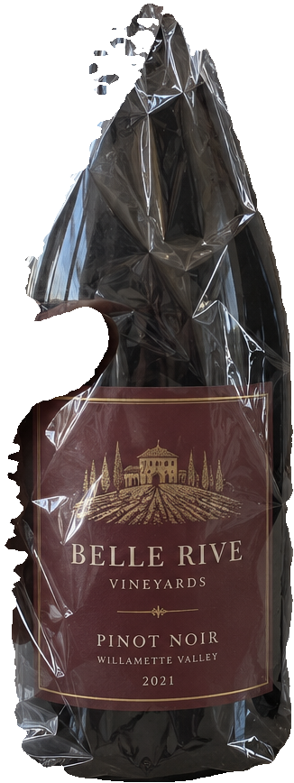
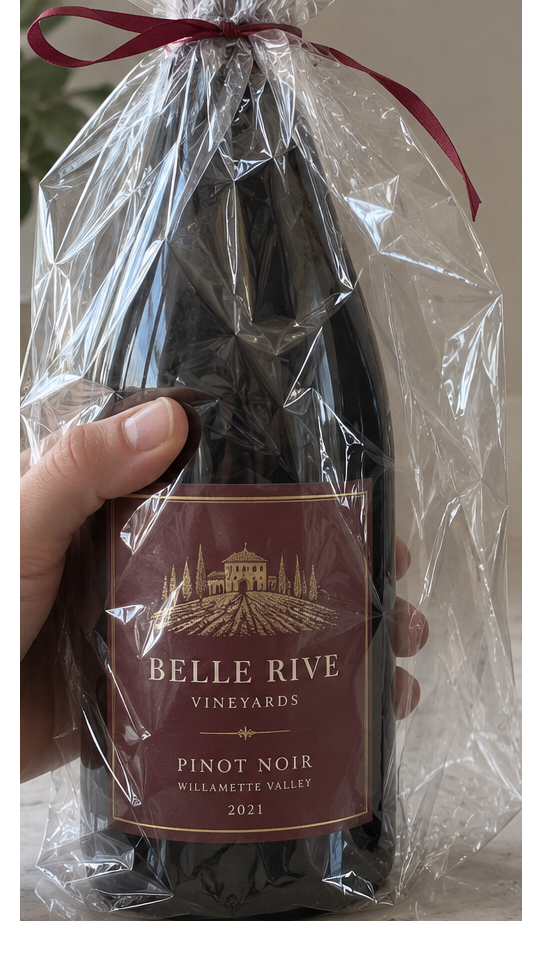
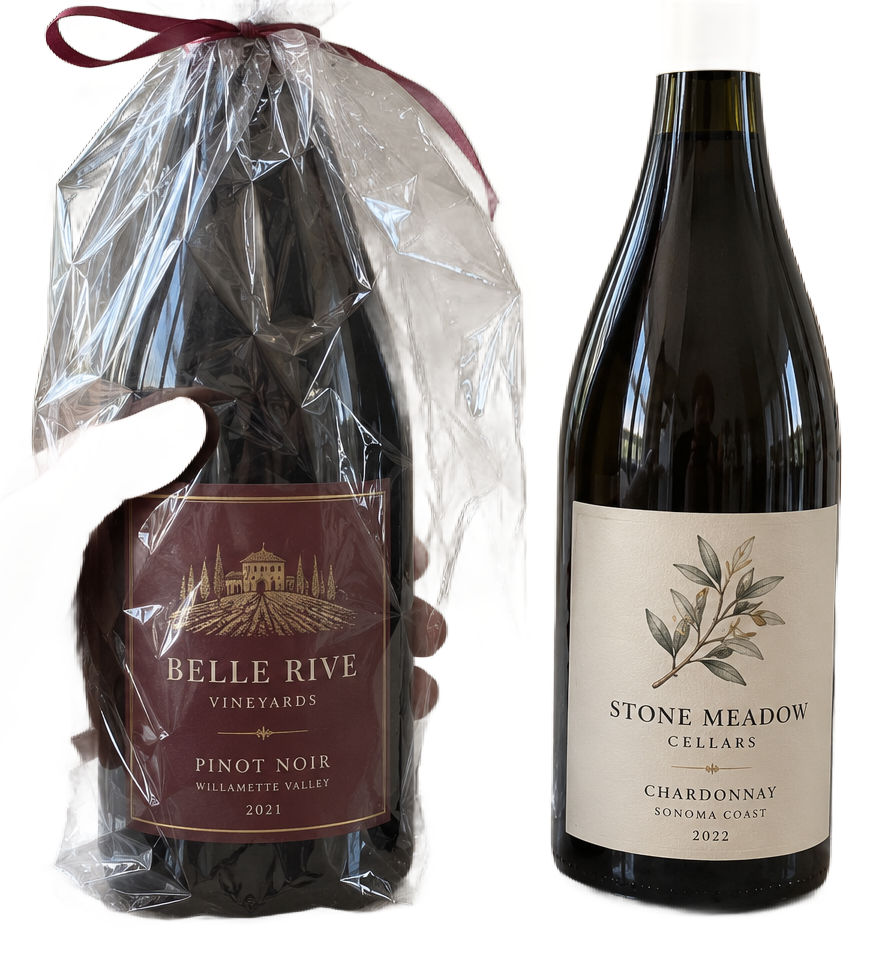

# main-selector-imagegen-hardcases-v2-20261020:BG04

**Scene confirmed; masks pending. All targets/masks are proposals; no approved segmentation ground truth.**

**scene-v1: No automatic failure flag; usability pending.**

Reference title (source): Хват слева — соседняя бутылка близко к пакету

Reference target description (source): Удерживаемая бутылка слева в прозрачном пакете

Expected intent: `clear`. Accepted target proposals: `d1`.

Scene group: `main-selector-imagegen-hardcases-v2-20261020:BG04`. Development only; no independent split claim.

## Original and proposed target





Green marks the unreviewed target proposal. Source image pixels are retained separately.

[Selected-label mask audit](../selected-label-mask-audit.json): incomplete proposal retention is flagged separately from target agreement.

[Full-resolution target proposal mask](../masks/hardcases-v2--BG04-d1.png)

## Selector results

### scene-v1: No automatic failure flag; usability pending

Selected: d1; reason: existing_scene_v1_rank; mode: legacy; crop 326×868 px. Target agreement: True. Target retention proxy: 100.0%; maximum other-bottle retention: 0.0%; minimum associated label retention: 100.0%. Mask ownership, label completeness and legibility still require human review.



[Full-resolution keep mask](../keep-masks/hardcases-v2--BG04-scene-v1.png) · [Exact decision JSON](../results/hardcases-v2--BG04-scene-v1.json)

Associated label-mask retention proxies (unreviewed ownership): d3: 100.0%, 91032 source pixels

### semantic-v2: FAIL — provisional target/proxy

Selected: d7; reason: unique_visible_hand_contact; mode: confident; crop 542×958 px. Target agreement: False. Target retention proxy: 100.0%; maximum other-bottle retention: 0.0%; minimum associated label retention: 100.0%. Mask ownership, label completeness and legibility still require human review. Selected-label mask audit: d3 100.0%.



[Full-resolution keep mask](../keep-masks/hardcases-v2--BG04-semantic-v2.png) · [Exact decision JSON](../results/hardcases-v2--BG04-semantic-v2.json)

Returned label views: [label 1](../label-crops/hardcases-v2--BG04-semantic-v2-0.png)

Associated label-mask retention proxies (unreviewed ownership): d3: 100.0%, 91032 source pixels

### dis-v1: PROXY failure; no native target ID

Selected: dis-foreground; reason: dis_foreground_mask; mode: foreground; crop 873×956 px. Target agreement: n/a (no native target ID). Target retention proxy: 99.5%; maximum other-bottle retention: 96.3%; minimum associated label retention: 100.0%. Mask ownership, label completeness and legibility still require human review.



[Full-resolution keep mask](../keep-masks/hardcases-v2--BG04-dis-v1.png) · [Exact decision JSON](../results/hardcases-v2--BG04-dis-v1.json)

Associated label-mask retention proxies (unreviewed ownership): d3: 100.0%, 91032 source pixels

## All frozen mask proposals

These links expose every detector proposal, including labels and hands. Shapes and owners are unreviewed.

| ID | Detector class | Full-resolution mask |
|---|---|---|
| d0 | wine bottle | [PNG](../masks/hardcases-v2--BG04-d0.png) |
| d1 | wine bottle | [PNG](../masks/hardcases-v2--BG04-d1.png) |
| d2 | wine label | [PNG](../masks/hardcases-v2--BG04-d2.png) |
| d3 | wine label | [PNG](../masks/hardcases-v2--BG04-d3.png) |
| d4 | hand | [PNG](../masks/hardcases-v2--BG04-d4.png) |
| d5 | hand | [PNG](../masks/hardcases-v2--BG04-d5.png) |
| d6 | hand | [PNG](../masks/hardcases-v2--BG04-d6.png) |
| d7 | packet | [PNG](../masks/hardcases-v2--BG04-d7.png) |

[Raw frozen detector response](../detections/hardcases-v2--BG04.json)

<details><summary>Generation prompt (quoted source data)</summary>

```text
Generate exactly one independent photorealistic smartphone photograph, landscape 3:2, approximately 1536 by 1024 pixels. This is an ordinary wine selection moment, with natural perspective, believable glass and paper, imperfect ambient lighting, and realistic human anatomy. No collage, inset, split screen, arrows, highlights, bounding boxes, annotations, watermarks, UI, or text outside physical objects. Use fictional wine branding. Keep the target bottle's entire front label within the frame. The scene must communicate the stated gesture or physical relation visually; do not add any explanatory caption. Exactly two physical wine bottles on a pale countertop. The LEFT bottle has a burgundy front label and is wrapped in a very clear crinkled cellophane gift bag. One hand enters from left and grips its middle body through the film, with opposing thumb and bent fingers visibly wrapping glass. The RIGHT unheld bottle with a cream label stands close beside it, with a narrow but visible gap between glass silhouettes. The loose transparent bag flap extends into the gap in front of the neighbor but the bottles do not overlap. Make the target grip obvious and all target label borders visible; keep the neighboring bottle separate. Soft overcast window light, natural anatomy.
```

</details>

Source review notes (quoted reference data):

> Плёнка и соседняя бутылка расположены близко: отдельно проверьте исключение соседней бутылки из будущего кропа.
