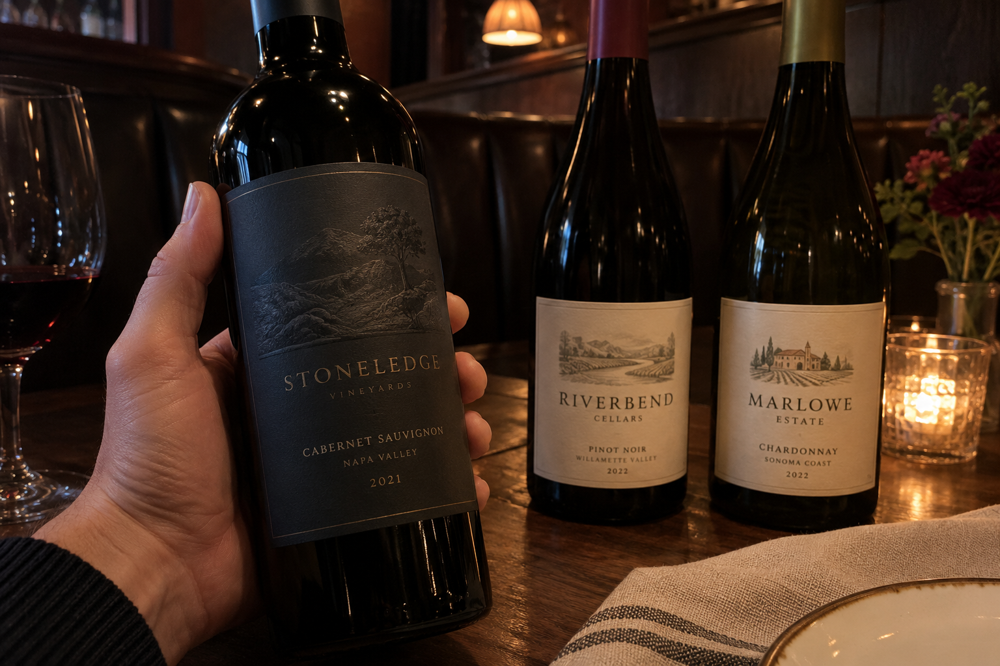
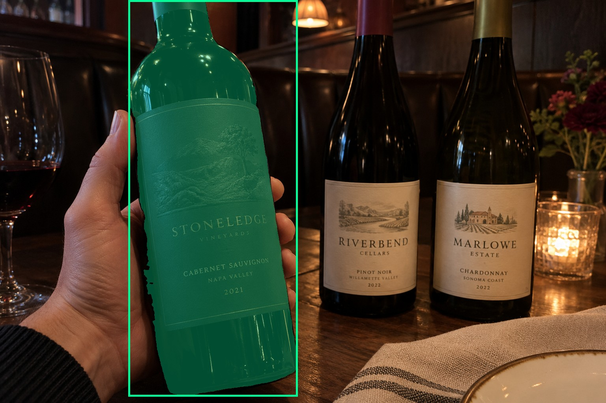
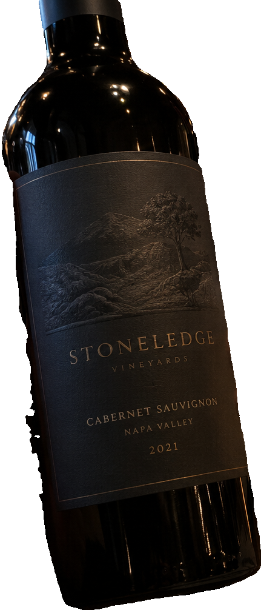
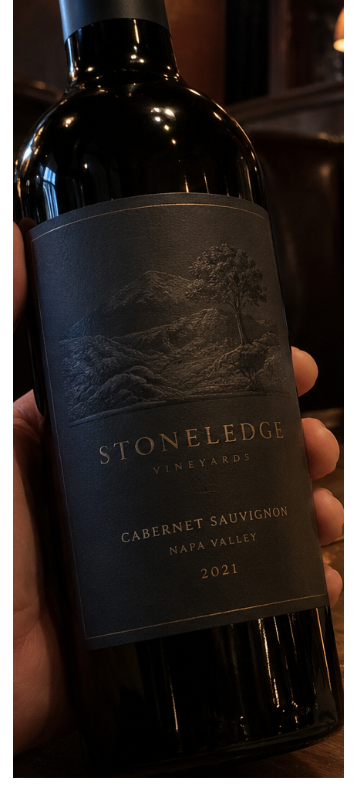
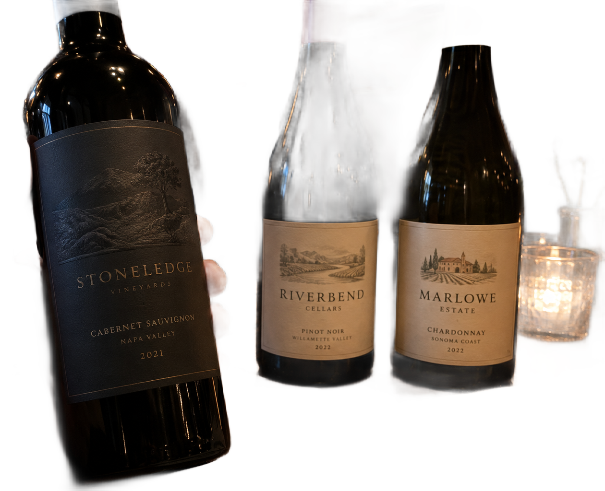

# main-selector-imagegen-hardcases-v2-20261020:DK02

**Scene confirmed; masks pending. All targets/masks are proposals; no approved segmentation ground truth.**

**scene-v1: No automatic failure flag; usability pending.**

Reference title (source): Боковой хват слева в полумраке

Reference target description (source): Удерживаемая бутылка слева с тёмной этикеткой

Expected intent: `clear`. Accepted target proposals: `d4`.

Scene group: `main-selector-imagegen-hardcases-v2-20261020:DK02`. Development only; no independent split claim.

## Original and proposed target





Green marks the unreviewed target proposal. Source image pixels are retained separately.

[Selected-label mask audit](../selected-label-mask-audit.json): incomplete proposal retention is flagged separately from target agreement.

[Full-resolution target proposal mask](../masks/hardcases-v2--DK02-d4.png)

## Selector results

### scene-v1: No automatic failure flag; usability pending

Selected: d4; reason: existing_scene_v1_rank; mode: legacy; crop 431×1006 px. Target agreement: True. Target retention proxy: 100.0%; maximum other-bottle retention: 0.0%; minimum associated label retention: 99.9%. Mask ownership, label completeness and legibility still require human review.



[Full-resolution keep mask](../keep-masks/hardcases-v2--DK02-scene-v1.png) · [Exact decision JSON](../results/hardcases-v2--DK02-scene-v1.json)

Associated label-mask retention proxies (unreviewed ownership): d9: 99.9%, 177336 source pixels

### semantic-v2: No automatic failure flag; usability pending

Selected: d4; reason: unique_visible_hand_contact; mode: confident; crop 463×1024 px. Target agreement: True. Target retention proxy: 100.0%; maximum other-bottle retention: 0.0%; minimum associated label retention: 100.0%. Mask ownership, label completeness and legibility still require human review. Selected-label mask audit: d9 100.0%.



[Full-resolution keep mask](../keep-masks/hardcases-v2--DK02-semantic-v2.png) · [Exact decision JSON](../results/hardcases-v2--DK02-semantic-v2.json)

Returned label views: [label 1](../label-crops/hardcases-v2--DK02-semantic-v2-0.png)

Associated label-mask retention proxies (unreviewed ownership): d9: 100.0%, 177336 source pixels

### dis-v1: PROXY failure; no native target ID

Selected: dis-foreground; reason: dis_foreground_mask; mode: foreground; crop 1260×1024 px. Target agreement: n/a (no native target ID). Target retention proxy: 98.5%; maximum other-bottle retention: 91.6%; minimum associated label retention: 100.0%. Mask ownership, label completeness and legibility still require human review.



[Full-resolution keep mask](../keep-masks/hardcases-v2--DK02-dis-v1.png) · [Exact decision JSON](../results/hardcases-v2--DK02-dis-v1.json)

Associated label-mask retention proxies (unreviewed ownership): d9: 100.0%, 177336 source pixels

## All frozen mask proposals

These links expose every detector proposal, including labels and hands. Shapes and owners are unreviewed.

| ID | Detector class | Full-resolution mask |
|---|---|---|
| d0 | wine bottle | [PNG](../masks/hardcases-v2--DK02-d0.png) |
| d1 | wine bottle | [PNG](../masks/hardcases-v2--DK02-d1.png) |
| d2 | wine bottle | [PNG](../masks/hardcases-v2--DK02-d2.png) |
| d3 | wine bottle | [PNG](../masks/hardcases-v2--DK02-d3.png) |
| d4 | wine bottle | [PNG](../masks/hardcases-v2--DK02-d4.png) |
| d5 | wine bottle | [PNG](../masks/hardcases-v2--DK02-d5.png) |
| d6 | wine bottle | [PNG](../masks/hardcases-v2--DK02-d6.png) |
| d7 | wine bottle | [PNG](../masks/hardcases-v2--DK02-d7.png) |
| d8 | wine label | [PNG](../masks/hardcases-v2--DK02-d8.png) |
| d9 | wine label | [PNG](../masks/hardcases-v2--DK02-d9.png) |
| d10 | wine label | [PNG](../masks/hardcases-v2--DK02-d10.png) |
| d11 | hand | [PNG](../masks/hardcases-v2--DK02-d11.png) |
| d12 | wine glass | [PNG](../masks/hardcases-v2--DK02-d12.png) |

[Raw frozen detector response](../detections/hardcases-v2--DK02.json)

<details><summary>Generation prompt (quoted source data)</summary>

```text
Generate exactly one independent photorealistic smartphone photograph, landscape 3:2, approximately 1536 by 1024 pixels. This is an ordinary wine selection moment, with natural perspective, believable glass and paper, imperfect ambient lighting, and realistic human anatomy. No collage, inset, split screen, arrows, highlights, bounding boxes, annotations, watermarks, UI, or text outside physical objects. Use fictional wine branding. Keep the target bottle's entire front label within the frame. The scene must communicate the stated gesture or physical relation visually; do not add any explanatory caption. Exactly three wine bottles in a dark restaurant booth. In LEFT foreground a single hand from left clasps a dark bottle at the middle body, with thumb and bent fingers wrapping both side edges. Its charcoal label has low contrast but a visible full paper outline. At center-right in the back, two unheld bottles have much brighter cream labels lit by a warm pendant lamp. The foreground bottle is slightly lifted and presented toward the camera. Preserve readable physical contact between hand and bottle in low light. No other hands, plausible shadows, candid smartphone scene.
```

</details>

Source review notes (quoted reference data):

> Тёмная этикетка читается слабо, но её контур различим. Есть мелкие фоновые бутылки.
