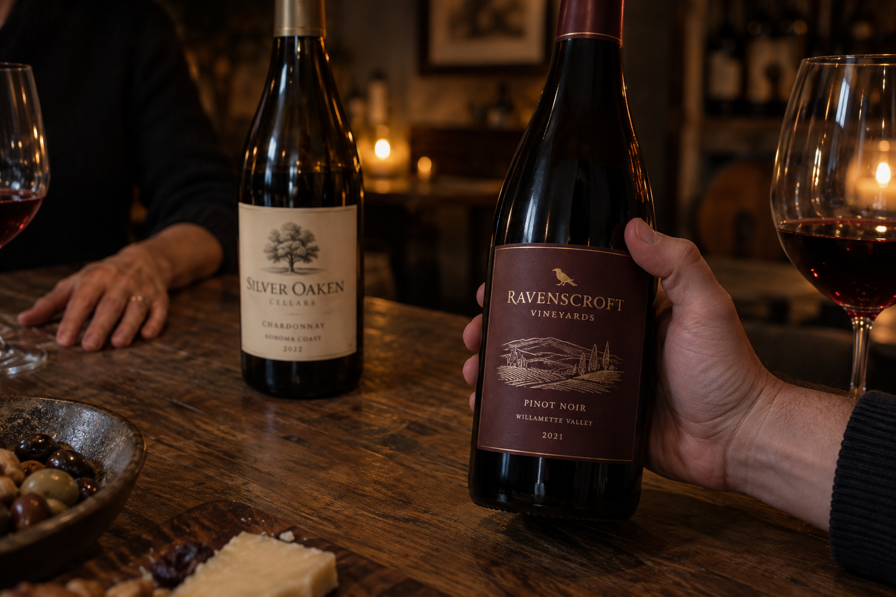
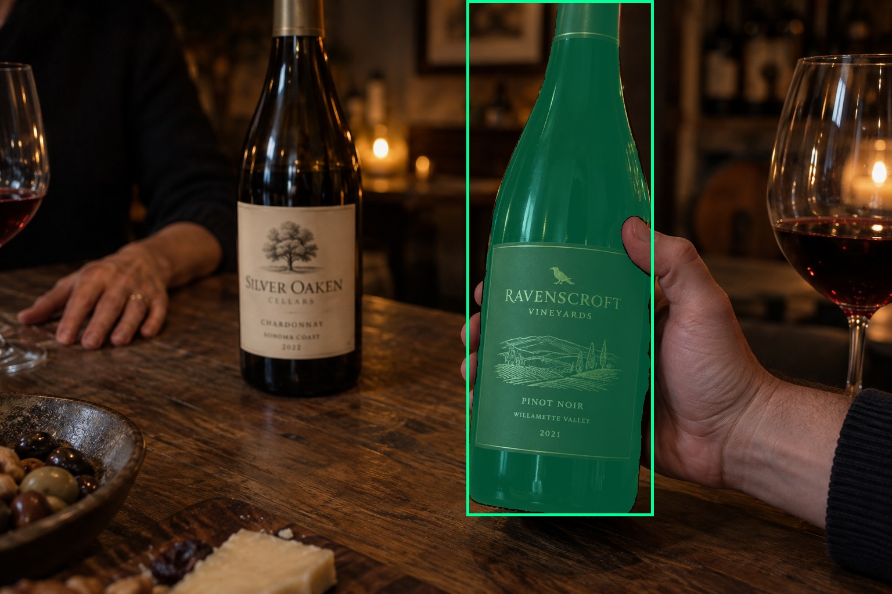
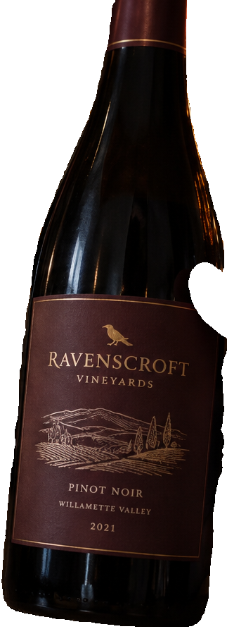
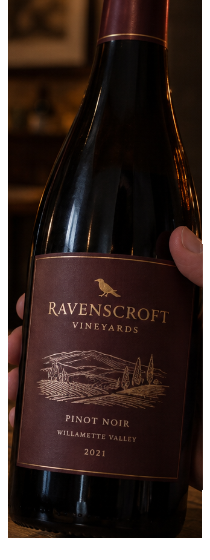
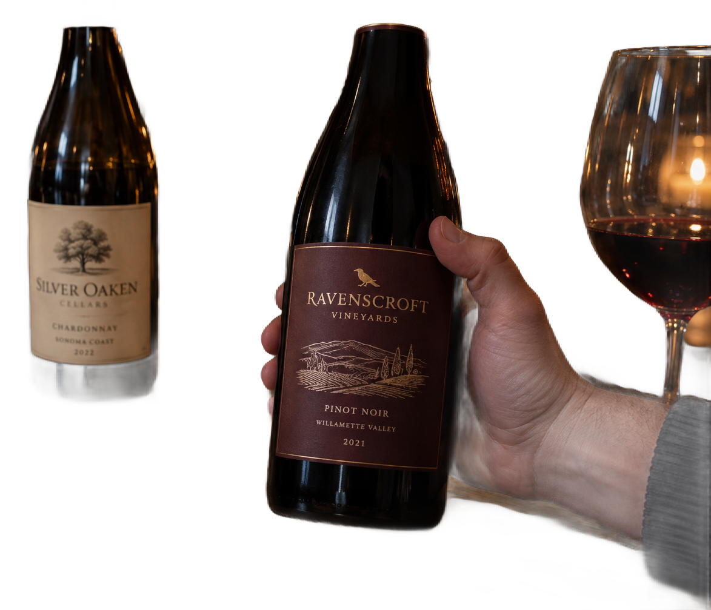

# main-selector-imagegen-hardcases-v2-20261020:DK03

**Scene confirmed; masks pending. All targets/masks are proposals; no approved segmentation ground truth.**

**scene-v1: FAIL — provisional target/proxy.**

Reference title (source): Хват справа и чужая рука на заднем плане

Reference target description (source): Удерживаемая передняя бутылка справа

Expected intent: `clear`. Accepted target proposals: `d5`.

Scene group: `main-selector-imagegen-hardcases-v2-20261020:DK03`. Development only; no independent split claim.

## Original and proposed target





Green marks the unreviewed target proposal. Source image pixels are retained separately.

[Selected-label mask audit](../selected-label-mask-audit.json): incomplete proposal retention is flagged separately from target agreement.

[Full-resolution target proposal mask](../masks/hardcases-v2--DK03-d5.png)

## Selector results

### scene-v1: FAIL — provisional target/proxy

Selected: d5; reason: existing_scene_v1_rank; mode: legacy; crop 323×892 px. Target agreement: True. Target retention proxy: 100.0%; maximum other-bottle retention: 0.0%; minimum associated label retention: 98.4%. Mask ownership, label completeness and legibility still require human review.



[Full-resolution keep mask](../keep-masks/hardcases-v2--DK03-scene-v1.png) · [Exact decision JSON](../results/hardcases-v2--DK03-scene-v1.json)

Associated label-mask retention proxies (unreviewed ownership): d7: 100.0%, 96357 source pixels; d10: 98.4%, 7501 source pixels

### semantic-v2: No automatic failure flag; usability pending

Selected: d5; reason: unique_visible_hand_contact; mode: confident; crop 348×925 px. Target agreement: True. Target retention proxy: 100.0%; maximum other-bottle retention: 0.0%; minimum associated label retention: 100.0%. Mask ownership, label completeness and legibility still require human review. Selected-label mask audit: d7 100.0%; d10 100.0%.



[Full-resolution keep mask](../keep-masks/hardcases-v2--DK03-semantic-v2.png) · [Exact decision JSON](../results/hardcases-v2--DK03-semantic-v2.json)

Returned label views: [label 1](../label-crops/hardcases-v2--DK03-semantic-v2-0.png) · [label 2](../label-crops/hardcases-v2--DK03-semantic-v2-1.png)

Associated label-mask retention proxies (unreviewed ownership): d7: 100.0%, 96357 source pixels; d10: 100.0%, 7501 source pixels

### dis-v1: PROXY failure; no native target ID

Selected: dis-foreground; reason: dis_foreground_mask; mode: foreground; crop 1173×1007 px. Target agreement: n/a (no native target ID). Target retention proxy: 96.9%; maximum other-bottle retention: 86.3%; minimum associated label retention: 15.1%. Mask ownership, label completeness and legibility still require human review.



[Full-resolution keep mask](../keep-masks/hardcases-v2--DK03-dis-v1.png) · [Exact decision JSON](../results/hardcases-v2--DK03-dis-v1.json)

Associated label-mask retention proxies (unreviewed ownership): d7: 100.0%, 96357 source pixels; d10: 15.1%, 7501 source pixels

## All frozen mask proposals

These links expose every detector proposal, including labels and hands. Shapes and owners are unreviewed.

| ID | Detector class | Full-resolution mask |
|---|---|---|
| d0 | wine bottle | [PNG](../masks/hardcases-v2--DK03-d0.png) |
| d1 | wine bottle | [PNG](../masks/hardcases-v2--DK03-d1.png) |
| d2 | wine bottle | [PNG](../masks/hardcases-v2--DK03-d2.png) |
| d3 | wine bottle | [PNG](../masks/hardcases-v2--DK03-d3.png) |
| d4 | wine bottle | [PNG](../masks/hardcases-v2--DK03-d4.png) |
| d5 | wine bottle | [PNG](../masks/hardcases-v2--DK03-d5.png) |
| d6 | wine label | [PNG](../masks/hardcases-v2--DK03-d6.png) |
| d7 | wine label | [PNG](../masks/hardcases-v2--DK03-d7.png) |
| d8 | wine label | [PNG](../masks/hardcases-v2--DK03-d8.png) |
| d9 | wine label | [PNG](../masks/hardcases-v2--DK03-d9.png) |
| d10 | wine label | [PNG](../masks/hardcases-v2--DK03-d10.png) |
| d11 | hand | [PNG](../masks/hardcases-v2--DK03-d11.png) |
| d12 | hand | [PNG](../masks/hardcases-v2--DK03-d12.png) |
| d13 | hand | [PNG](../masks/hardcases-v2--DK03-d13.png) |
| d14 | hand | [PNG](../masks/hardcases-v2--DK03-d14.png) |
| d15 | hand | [PNG](../masks/hardcases-v2--DK03-d15.png) |
| d16 | hand | [PNG](../masks/hardcases-v2--DK03-d16.png) |
| d17 | wine glass | [PNG](../masks/hardcases-v2--DK03-d17.png) |
| d18 | wine glass | [PNG](../masks/hardcases-v2--DK03-d18.png) |

[Raw frozen detector response](../detections/hardcases-v2--DK03.json)

<details><summary>Generation prompt (quoted source data)</summary>

```text
Generate exactly one independent photorealistic smartphone photograph, landscape 3:2, approximately 1536 by 1024 pixels. This is an ordinary wine selection moment, with natural perspective, believable glass and paper, imperfect ambient lighting, and realistic human anatomy. No collage, inset, split screen, arrows, highlights, bounding boxes, annotations, watermarks, UI, or text outside physical objects. Use fictional wine branding. Keep the target bottle's entire front label within the frame. The scene must communicate the stated gesture or physical relation visually; do not add any explanatory caption. Exactly two wine bottles in a dim tasting room. The RIGHT foreground bottle with a dark maroon label is firmly held around its middle body by a hand entering from right, visibly opposing thumb and bent fingers wrapping glass. The LEFT background bottle has a bright ivory label. A second distant person has an OPEN relaxed hand resting on the table behind and to the left of that background bottle, visibly separated by a small air gap and not grasping it. Clearly distinguish a real foreground grip from the background hand proximity. Low evening light, target label outline visible, realistic two hands belonging to different off-frame people.
```

</details>

Source review notes (quoted reference data):

> Вторая рука лежит на столе отдельно от фоновой бутылки; это контрпример ложного хвата по близости. Есть дополнительные бутылки на дальних полках.
