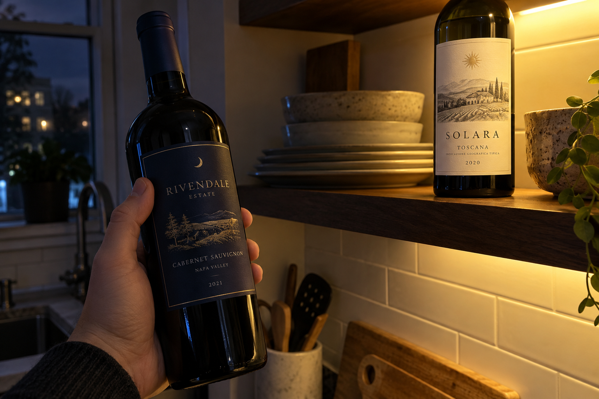
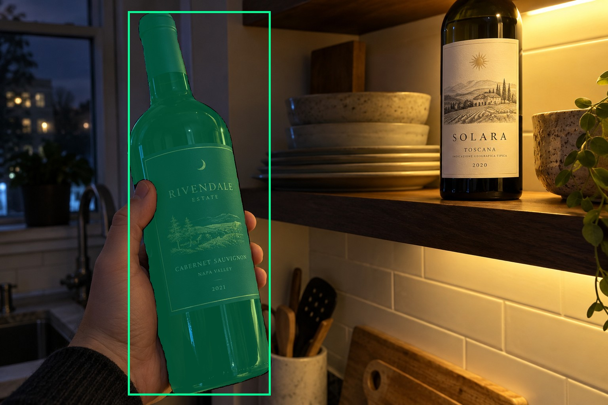
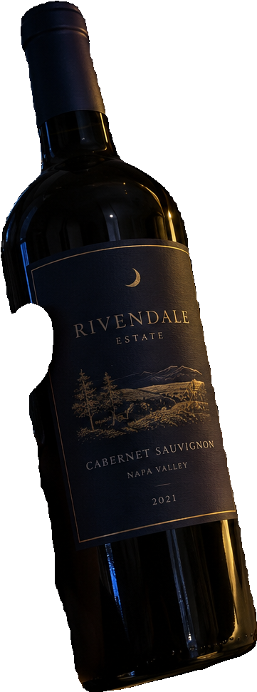
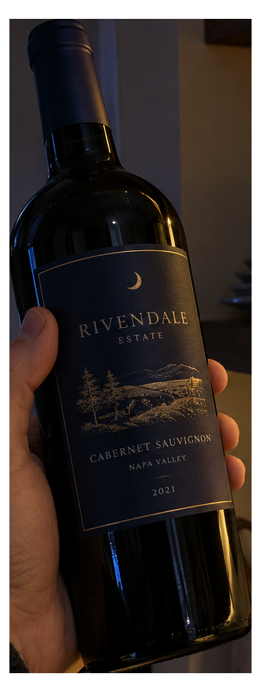
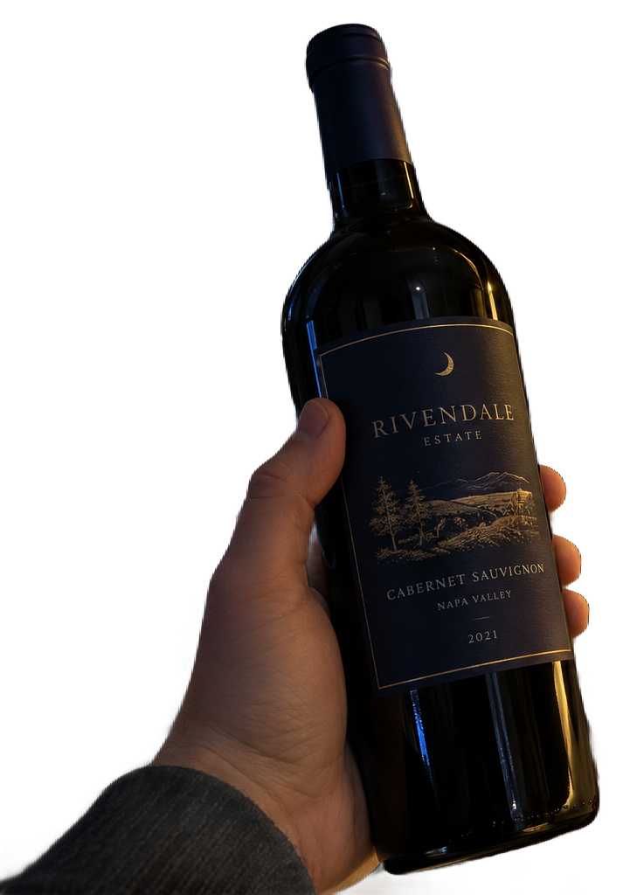

# main-selector-imagegen-hardcases-v2-20261020:DK04

**Scene confirmed; masks pending. All targets/masks are proposals; no approved segmentation ground truth.**

**scene-v1: No automatic failure flag; usability pending.**

Reference title (source): Левый хват и яркая бутылка на полке

Reference target description (source): Удерживаемая бутылка слева перед полкой

Expected intent: `clear`. Accepted target proposals: `d0`.

Scene group: `main-selector-imagegen-hardcases-v2-20261020:DK04`. Development only; no independent split claim.

## Original and proposed target





Green marks the unreviewed target proposal. Source image pixels are retained separately.

[Selected-label mask audit](../selected-label-mask-audit.json): incomplete proposal retention is flagged separately from target agreement.

[Full-resolution target proposal mask](../masks/hardcases-v2--DK04-d0.png)

## Selector results

### scene-v1: No automatic failure flag; usability pending

Selected: d0; reason: existing_scene_v1_rank; mode: legacy; crop 361×971 px. Target agreement: True. Target retention proxy: 100.0%; maximum other-bottle retention: 0.0%; minimum associated label retention: 99.9%. Mask ownership, label completeness and legibility still require human review.



[Full-resolution keep mask](../keep-masks/hardcases-v2--DK04-scene-v1.png) · [Exact decision JSON](../results/hardcases-v2--DK04-scene-v1.json)

Associated label-mask retention proxies (unreviewed ownership): d2: 99.9%, 91067 source pixels

### semantic-v2: No automatic failure flag; usability pending

Selected: d0; reason: unique_visible_hand_contact; mode: confident; crop 388×1024 px. Target agreement: True. Target retention proxy: 100.0%; maximum other-bottle retention: 0.0%; minimum associated label retention: 100.0%. Mask ownership, label completeness and legibility still require human review. Selected-label mask audit: d2 100.0%.



[Full-resolution keep mask](../keep-masks/hardcases-v2--DK04-semantic-v2.png) · [Exact decision JSON](../results/hardcases-v2--DK04-semantic-v2.json)

Returned label views: [label 1](../label-crops/hardcases-v2--DK04-semantic-v2-0.png)

Associated label-mask retention proxies (unreviewed ownership): d2: 100.0%, 91067 source pixels

### dis-v1: Proxy satisfied; usability pending

Selected: dis-foreground; reason: dis_foreground_mask; mode: foreground; crop 713×1024 px. Target agreement: n/a (no native target ID). Target retention proxy: 100.0%; maximum other-bottle retention: 0.0%; minimum associated label retention: 100.0%. Mask ownership, label completeness and legibility still require human review.



[Full-resolution keep mask](../keep-masks/hardcases-v2--DK04-dis-v1.png) · [Exact decision JSON](../results/hardcases-v2--DK04-dis-v1.json)

Associated label-mask retention proxies (unreviewed ownership): d2: 100.0%, 91067 source pixels

## All frozen mask proposals

These links expose every detector proposal, including labels and hands. Shapes and owners are unreviewed.

| ID | Detector class | Full-resolution mask |
|---|---|---|
| d0 | wine bottle | [PNG](../masks/hardcases-v2--DK04-d0.png) |
| d1 | wine bottle | [PNG](../masks/hardcases-v2--DK04-d1.png) |
| d2 | wine label | [PNG](../masks/hardcases-v2--DK04-d2.png) |
| d3 | wine label | [PNG](../masks/hardcases-v2--DK04-d3.png) |
| d4 | hand | [PNG](../masks/hardcases-v2--DK04-d4.png) |

[Raw frozen detector response](../detections/hardcases-v2--DK04.json)

<details><summary>Generation prompt (quoted source data)</summary>

```text
Generate exactly one independent photorealistic smartphone photograph, landscape 3:2, approximately 1536 by 1024 pixels. This is an ordinary wine selection moment, with natural perspective, believable glass and paper, imperfect ambient lighting, and realistic human anatomy. No collage, inset, split screen, arrows, highlights, bounding boxes, annotations, watermarks, UI, or text outside physical objects. Use fictional wine branding. Keep the target bottle's entire front label within the frame. The scene must communicate the stated gesture or physical relation visually; do not add any explanatory caption. Exactly two visible physical wine bottles at night in a home kitchen. A LEFT foreground dark bottle with a navy paper label is held at its middle body by one hand from lower left, thumb on one side and curled fingers wrapping the other. Its complete label outline is visible under weak cool window light. The other unheld bottle stands on a higher shelf at upper right, its large pale label brightly illuminated by a warm under-shelf lamp. Different support planes are obvious. No extra bottles or hands, realistic underexposure and subtle phone noise, foreground grip remains clearly visible.
```

</details>

Source review notes (quoted reference data):

> Целевая бутылка находится перед полкой; задняя яркая бутылка стоит выше. Проверяйте хват, а не нижнее положение в кадре.
