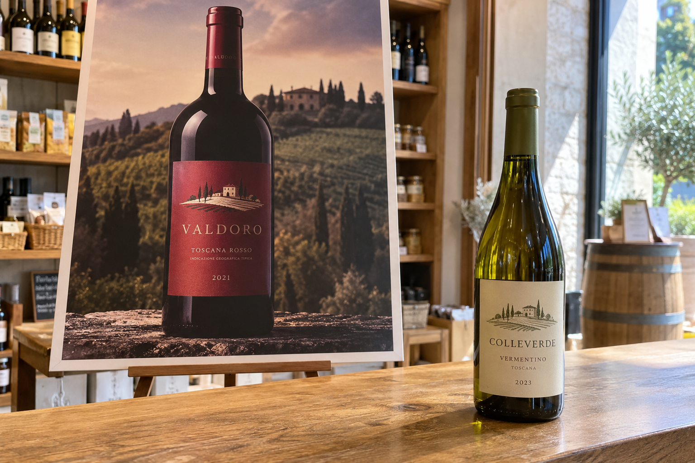
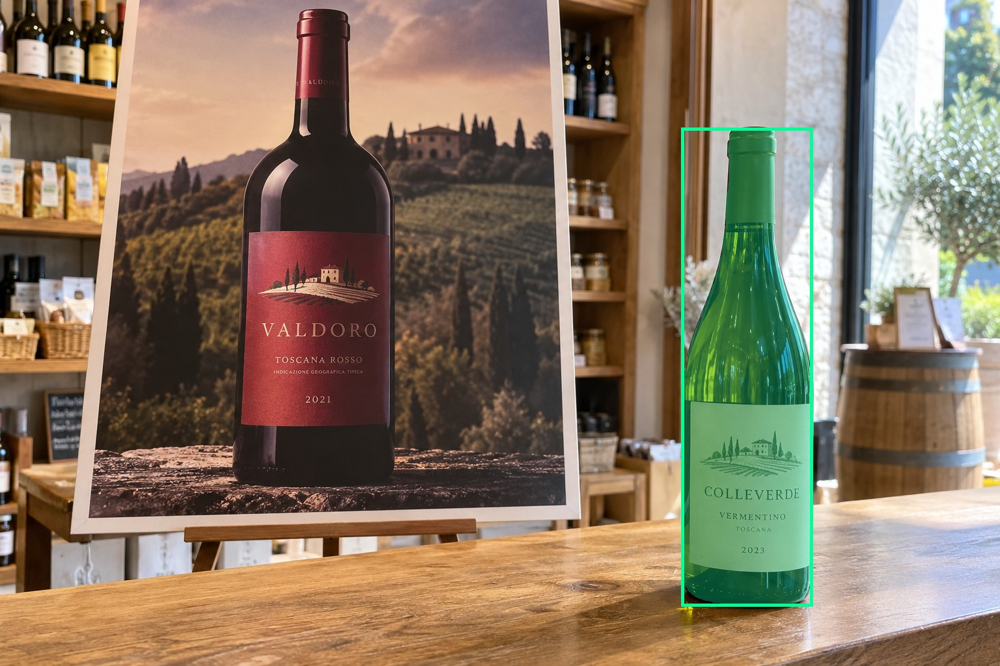
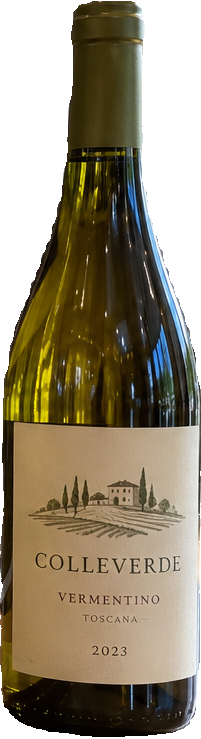
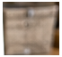
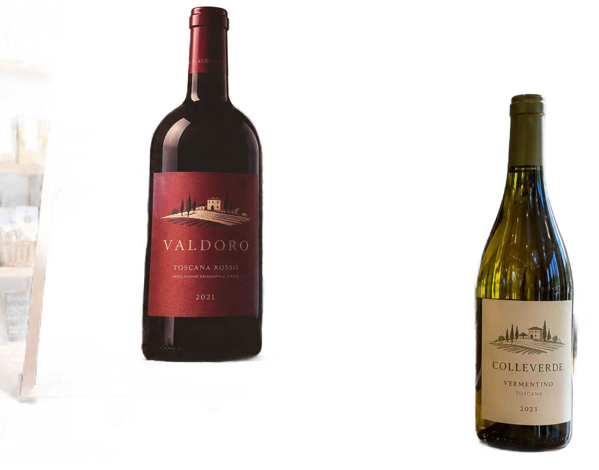

# main-selector-imagegen-hardcases-v2-20261020:DP01

**Scene confirmed; masks pending. All targets/masks are proposals; no approved segmentation ground truth.**

**scene-v1: No automatic failure flag; usability pending.**

Reference title (source): Настоящая бутылка перед большим плакатом

Reference target description (source): Настоящая бутылка справа на прилавке

Expected intent: `clear`. Accepted target proposals: `d1`.

Scene group: `main-selector-imagegen-hardcases-v2-20261020:DP01`. Development only; no independent split claim.

## Original and proposed target





Green marks the unreviewed target proposal. Source image pixels are retained separately.

[Selected-label mask audit](../selected-label-mask-audit.json): incomplete proposal retention is flagged separately from target agreement.

[Full-resolution target proposal mask](../masks/hardcases-v2--DP01-d1.png)

## Selector results

### scene-v1: No automatic failure flag; usability pending

Selected: d1; reason: existing_scene_v1_rank; mode: legacy; crop 201×739 px. Target agreement: True. Target retention proxy: 100.0%; maximum other-bottle retention: 0.0%; minimum associated label retention: 99.8%. Mask ownership, label completeness and legibility still require human review.



[Full-resolution keep mask](../keep-masks/hardcases-v2--DP01-scene-v1.png) · [Exact decision JSON](../results/hardcases-v2--DP01-scene-v1.json)

Associated label-mask retention proxies (unreviewed ownership): d17: 99.8%, 47578 source pixels

### semantic-v2: FAIL — provisional target/proxy

Selected: d47; reason: fallback_nearest_center; mode: fallback; crop 69×64 px. Target agreement: False. Target retention proxy: 0.0%; maximum other-bottle retention: 0.0%; minimum associated label retention: 0.0%. Mask ownership, label completeness and legibility still require human review.



[Full-resolution keep mask](../keep-masks/hardcases-v2--DP01-semantic-v2.png) · [Exact decision JSON](../results/hardcases-v2--DP01-semantic-v2.json)

Associated label-mask retention proxies (unreviewed ownership): d17: 0.0%, 47578 source pixels

### dis-v1: PROXY failure; no native target ID

Selected: dis-foreground; reason: dis_foreground_mask; mode: foreground; crop 1237×972 px. Target agreement: n/a (no native target ID). Target retention proxy: 99.8%; maximum other-bottle retention: 99.9%; minimum associated label retention: 100.0%. Mask ownership, label completeness and legibility still require human review.



[Full-resolution keep mask](../keep-masks/hardcases-v2--DP01-dis-v1.png) · [Exact decision JSON](../results/hardcases-v2--DP01-dis-v1.json)

Associated label-mask retention proxies (unreviewed ownership): d17: 100.0%, 47578 source pixels

## All frozen mask proposals

These links expose every detector proposal, including labels and hands. Shapes and owners are unreviewed.

| ID | Detector class | Full-resolution mask |
|---|---|---|
| d0 | wine bottle | [PNG](../masks/hardcases-v2--DP01-d0.png) |
| d1 | wine bottle | [PNG](../masks/hardcases-v2--DP01-d1.png) |
| d2 | wine bottle | [PNG](../masks/hardcases-v2--DP01-d2.png) |
| d3 | wine bottle | [PNG](../masks/hardcases-v2--DP01-d3.png) |
| d4 | wine bottle | [PNG](../masks/hardcases-v2--DP01-d4.png) |
| d5 | wine bottle | [PNG](../masks/hardcases-v2--DP01-d5.png) |
| d6 | wine bottle | [PNG](../masks/hardcases-v2--DP01-d6.png) |
| d7 | wine bottle | [PNG](../masks/hardcases-v2--DP01-d7.png) |
| d8 | wine bottle | [PNG](../masks/hardcases-v2--DP01-d8.png) |
| d9 | wine bottle | [PNG](../masks/hardcases-v2--DP01-d9.png) |
| d10 | wine bottle | [PNG](../masks/hardcases-v2--DP01-d10.png) |
| d11 | wine bottle | [PNG](../masks/hardcases-v2--DP01-d11.png) |
| d12 | wine bottle | [PNG](../masks/hardcases-v2--DP01-d12.png) |
| d13 | wine bottle | [PNG](../masks/hardcases-v2--DP01-d13.png) |
| d14 | wine bottle | [PNG](../masks/hardcases-v2--DP01-d14.png) |
| d15 | wine bottle | [PNG](../masks/hardcases-v2--DP01-d15.png) |
| d16 | wine label | [PNG](../masks/hardcases-v2--DP01-d16.png) |
| d17 | wine label | [PNG](../masks/hardcases-v2--DP01-d17.png) |
| d18 | wine label | [PNG](../masks/hardcases-v2--DP01-d18.png) |
| d19 | wine label | [PNG](../masks/hardcases-v2--DP01-d19.png) |
| d20 | wine label | [PNG](../masks/hardcases-v2--DP01-d20.png) |
| d21 | wine label | [PNG](../masks/hardcases-v2--DP01-d21.png) |
| d22 | wine label | [PNG](../masks/hardcases-v2--DP01-d22.png) |
| d23 | wine label | [PNG](../masks/hardcases-v2--DP01-d23.png) |
| d24 | wine label | [PNG](../masks/hardcases-v2--DP01-d24.png) |
| d25 | wine label | [PNG](../masks/hardcases-v2--DP01-d25.png) |
| d26 | wine label | [PNG](../masks/hardcases-v2--DP01-d26.png) |
| d27 | wine label | [PNG](../masks/hardcases-v2--DP01-d27.png) |
| d28 | wine label | [PNG](../masks/hardcases-v2--DP01-d28.png) |
| d29 | wine label | [PNG](../masks/hardcases-v2--DP01-d29.png) |
| d30 | wine label | [PNG](../masks/hardcases-v2--DP01-d30.png) |
| d31 | wine label | [PNG](../masks/hardcases-v2--DP01-d31.png) |
| d32 | wine label | [PNG](../masks/hardcases-v2--DP01-d32.png) |
| d33 | wine label | [PNG](../masks/hardcases-v2--DP01-d33.png) |
| d34 | wine label | [PNG](../masks/hardcases-v2--DP01-d34.png) |
| d35 | wine label | [PNG](../masks/hardcases-v2--DP01-d35.png) |
| d36 | wine label | [PNG](../masks/hardcases-v2--DP01-d36.png) |
| d37 | box | [PNG](../masks/hardcases-v2--DP01-d37.png) |
| d38 | box | [PNG](../masks/hardcases-v2--DP01-d38.png) |
| d39 | box | [PNG](../masks/hardcases-v2--DP01-d39.png) |
| d40 | box | [PNG](../masks/hardcases-v2--DP01-d40.png) |
| d41 | box | [PNG](../masks/hardcases-v2--DP01-d41.png) |
| d42 | box | [PNG](../masks/hardcases-v2--DP01-d42.png) |
| d43 | box | [PNG](../masks/hardcases-v2--DP01-d43.png) |
| d44 | box | [PNG](../masks/hardcases-v2--DP01-d44.png) |
| d45 | box | [PNG](../masks/hardcases-v2--DP01-d45.png) |
| d46 | box | [PNG](../masks/hardcases-v2--DP01-d46.png) |
| d47 | box | [PNG](../masks/hardcases-v2--DP01-d47.png) |
| d48 | packet | [PNG](../masks/hardcases-v2--DP01-d48.png) |
| d49 | packet | [PNG](../masks/hardcases-v2--DP01-d49.png) |
| d50 | packet | [PNG](../masks/hardcases-v2--DP01-d50.png) |
| d51 | packet | [PNG](../masks/hardcases-v2--DP01-d51.png) |
| d52 | packet | [PNG](../masks/hardcases-v2--DP01-d52.png) |
| d53 | packet | [PNG](../masks/hardcases-v2--DP01-d53.png) |
| d54 | packet | [PNG](../masks/hardcases-v2--DP01-d54.png) |
| d55 | packet | [PNG](../masks/hardcases-v2--DP01-d55.png) |
| d56 | packet | [PNG](../masks/hardcases-v2--DP01-d56.png) |
| d57 | price tag | [PNG](../masks/hardcases-v2--DP01-d57.png) |
| d58 | price tag | [PNG](../masks/hardcases-v2--DP01-d58.png) |
| d59 | price tag | [PNG](../masks/hardcases-v2--DP01-d59.png) |
| d60 | price tag | [PNG](../masks/hardcases-v2--DP01-d60.png) |
| d61 | price tag | [PNG](../masks/hardcases-v2--DP01-d61.png) |
| d62 | price tag | [PNG](../masks/hardcases-v2--DP01-d62.png) |
| d63 | price tag | [PNG](../masks/hardcases-v2--DP01-d63.png) |
| d64 | price tag | [PNG](../masks/hardcases-v2--DP01-d64.png) |
| d65 | price tag | [PNG](../masks/hardcases-v2--DP01-d65.png) |

[Raw frozen detector response](../detections/hardcases-v2--DP01.json)

<details><summary>Generation prompt (quoted source data)</summary>

```text
Generate exactly one independent photorealistic smartphone photograph, landscape 3:2, approximately 1536 by 1024 pixels. This is an ordinary wine selection moment, with natural perspective, believable glass and paper, imperfect ambient lighting, and realistic human anatomy. No collage, inset, split screen, arrows, highlights, bounding boxes, annotations, watermarks, UI, or text outside physical objects. Use fictional wine branding. Keep the target bottle's entire front label within the frame. The scene must communicate the stated gesture or physical relation visually; do not add any explanatory caption. A small physical green wine bottle with an ivory label stands on the RIGHT of a shop counter. On the left behind it is a large flat rectangular advertising poster on an easel, showing a much larger high-contrast photograph of a dark wine bottle with a red label. The entire poster border and thin easel legs are visible; the printed bottle is unmistakably flat within the poster. Exactly one real bottle, no hands and no other bottles. The real bottle has visible curved glass reflections, a three-dimensional base and cast shadow. Bright shop daylight, realistic handheld photo.
```

</details>

Source review notes (quoted reference data):

> В магазине появились дополнительные физические бутылки на дальних полках. Это не контроль строго одной настоящей бутылки.
