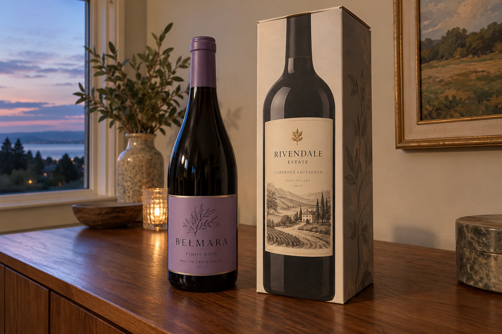
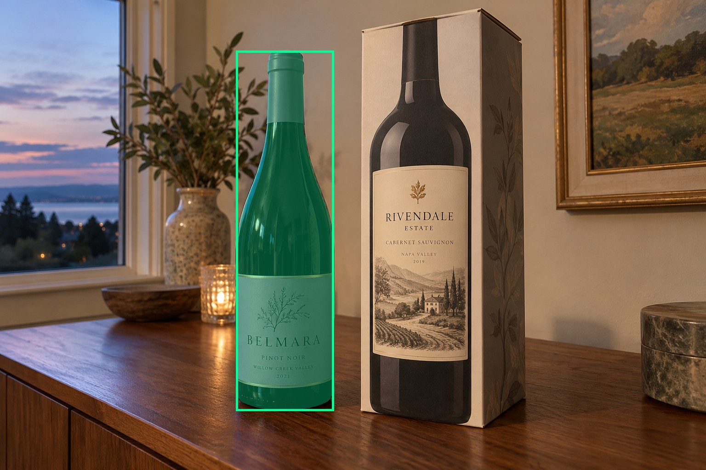
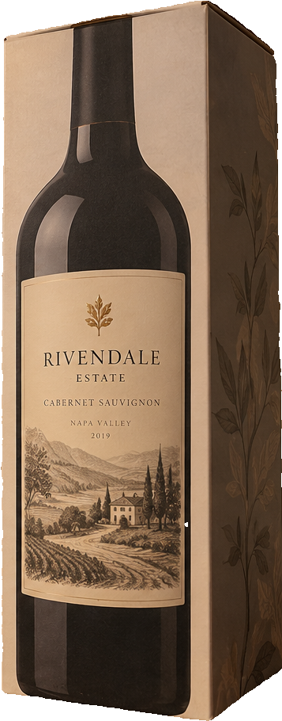
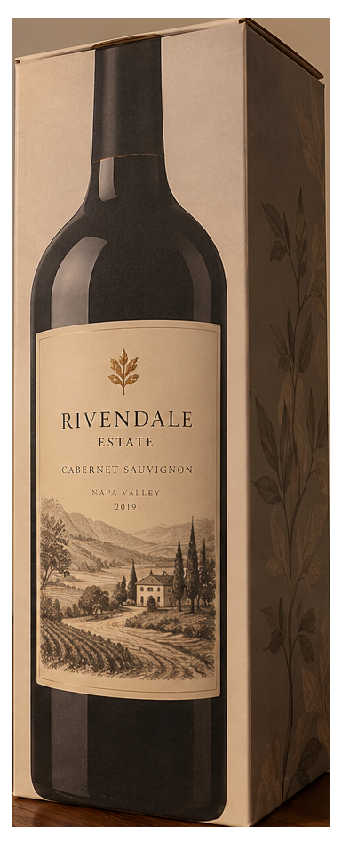
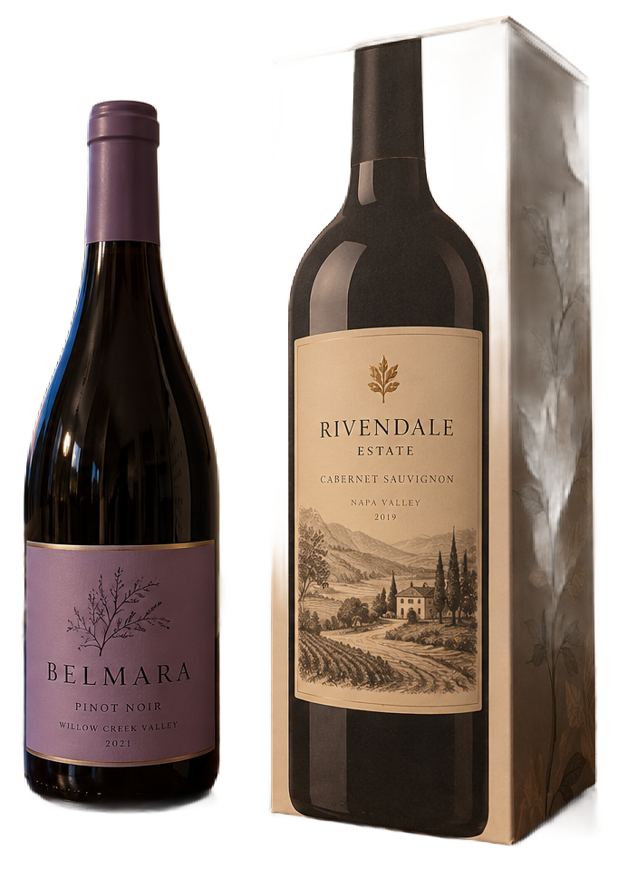

# main-selector-imagegen-hardcases-v2-20261020:DP02

**Scene confirmed; masks pending. All targets/masks are proposals; no approved segmentation ground truth.**

**scene-v1: FAIL — provisional target/proxy.**

Reference title (source): Бутылка рядом с рисунком на коробке

Reference target description (source): Настоящая бутылка слева от коробки

Expected intent: `clear`. Accepted target proposals: `d1`.

Scene group: `main-selector-imagegen-hardcases-v2-20261020:DP02`. Development only; no independent split claim.

## Original and proposed target





Green marks the unreviewed target proposal. Source image pixels are retained separately.

[Selected-label mask audit](../selected-label-mask-audit.json): incomplete proposal retention is flagged separately from target agreement.

[Full-resolution target proposal mask](../masks/hardcases-v2--DP02-d1.png)

## Selector results

### scene-v1: FAIL — provisional target/proxy

Selected: d4; reason: existing_scene_v1_rank; mode: legacy; crop 357×910 px. Target agreement: False. Target retention proxy: 0.0%; maximum other-bottle retention: 100.0%; minimum associated label retention: 0.0%. Mask ownership, label completeness and legibility still require human review.



[Full-resolution keep mask](../keep-masks/hardcases-v2--DP02-scene-v1.png) · [Exact decision JSON](../results/hardcases-v2--DP02-scene-v1.json)

Associated label-mask retention proxies (unreviewed ownership): d3: 0.0%, 50255 source pixels

### semantic-v2: FAIL — provisional target/proxy

Selected: d4; reason: dominant_foreground_subject; mode: confident; crop 385×966 px. Target agreement: False. Target retention proxy: 0.0%; maximum other-bottle retention: 100.0%; minimum associated label retention: 0.0%. Mask ownership, label completeness and legibility still require human review. Selected-label mask audit: d2 100.0%.



[Full-resolution keep mask](../keep-masks/hardcases-v2--DP02-semantic-v2.png) · [Exact decision JSON](../results/hardcases-v2--DP02-semantic-v2.json)

Returned label views: [label 1](../label-crops/hardcases-v2--DP02-semantic-v2-0.png)

Associated label-mask retention proxies (unreviewed ownership): d3: 0.0%, 50255 source pixels

### dis-v1: PROXY failure; no native target ID

Selected: dis-foreground; reason: dis_foreground_mask; mode: foreground; crop 682×969 px. Target agreement: n/a (no native target ID). Target retention proxy: 99.8%; maximum other-bottle retention: 99.9%; minimum associated label retention: 100.0%. Mask ownership, label completeness and legibility still require human review.



[Full-resolution keep mask](../keep-masks/hardcases-v2--DP02-dis-v1.png) · [Exact decision JSON](../results/hardcases-v2--DP02-dis-v1.json)

Associated label-mask retention proxies (unreviewed ownership): d3: 100.0%, 50255 source pixels

## All frozen mask proposals

These links expose every detector proposal, including labels and hands. Shapes and owners are unreviewed.

| ID | Detector class | Full-resolution mask |
|---|---|---|
| d0 | wine bottle | [PNG](../masks/hardcases-v2--DP02-d0.png) |
| d1 | wine bottle | [PNG](../masks/hardcases-v2--DP02-d1.png) |
| d2 | wine label | [PNG](../masks/hardcases-v2--DP02-d2.png) |
| d3 | wine label | [PNG](../masks/hardcases-v2--DP02-d3.png) |
| d4 | box | [PNG](../masks/hardcases-v2--DP02-d4.png) |
| d5 | box | [PNG](../masks/hardcases-v2--DP02-d5.png) |

[Raw frozen detector response](../detections/hardcases-v2--DP02.json)

<details><summary>Generation prompt (quoted source data)</summary>

```text
Generate exactly one independent photorealistic smartphone photograph, landscape 3:2, approximately 1536 by 1024 pixels. This is an ordinary wine selection moment, with natural perspective, believable glass and paper, imperfect ambient lighting, and realistic human anatomy. No collage, inset, split screen, arrows, highlights, bounding boxes, annotations, watermarks, UI, or text outside physical objects. Use fictional wine branding. Keep the target bottle's entire front label within the frame. The scene must communicate the stated gesture or physical relation visually; do not add any explanatory caption. Exactly one real upright wine bottle on the LEFT with a lavender label stands on a wooden sideboard beside a tall rectangular gift carton on the right. The carton has an oversized realistic printed bottle illustration with a bright cream label. Both carton side panel and top folded seam are visible, separating its flat printed bottle from the real glass bottle. The physical bottle and carton are close but their silhouettes have a narrow clear gap. No hands or background bottles. Soft evening window light, casual eye-level phone photograph. Preserve all physical front-label paper.
```

</details>

Source review notes (quoted reference data):

> Небольшой промежуток между бутылкой и коробкой: отдельно проверьте, что маска не включает печатную бутылку.
