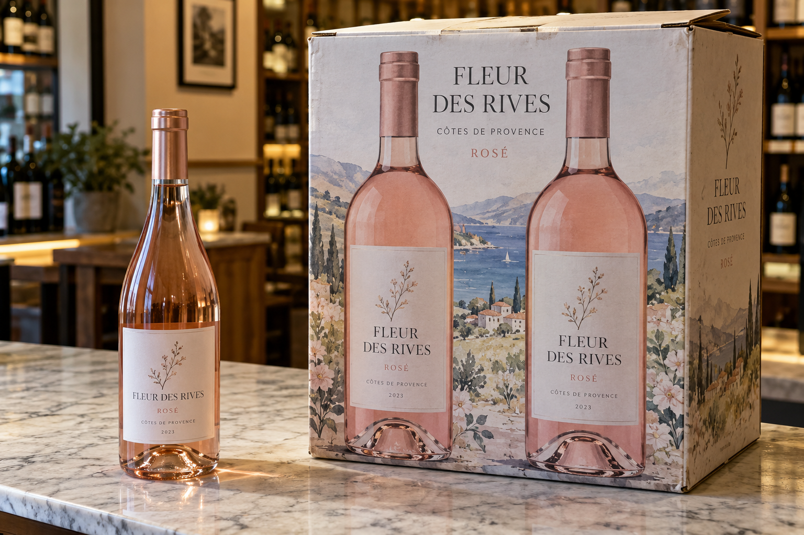
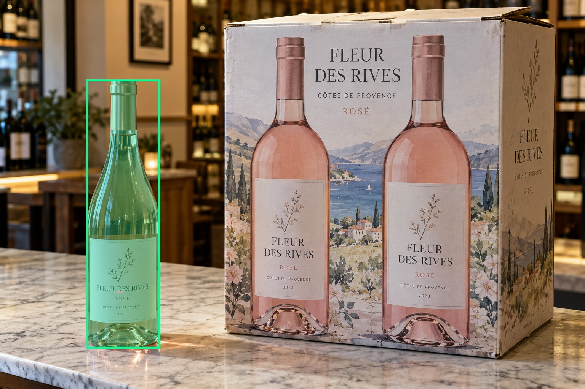
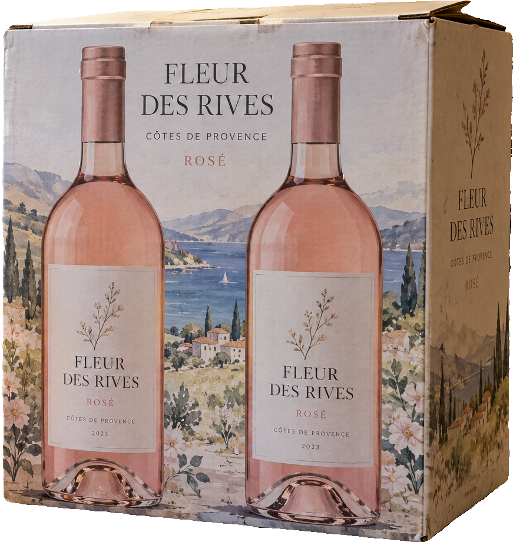
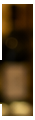
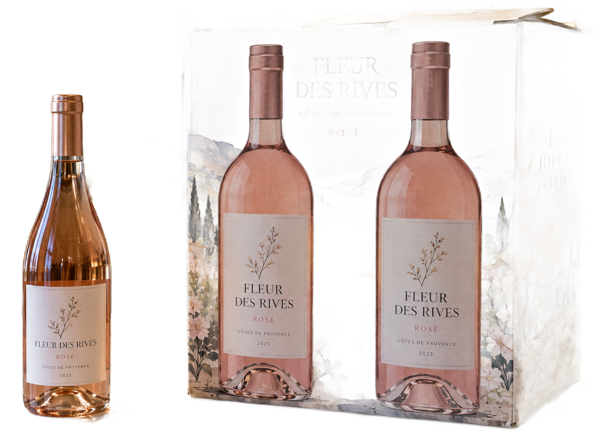

# main-selector-imagegen-hardcases-v2-20261020:DP04

**Scene confirmed; masks pending. All targets/masks are proposals; no approved segmentation ground truth.**

**scene-v1: FAIL — provisional target/proxy.**

Reference title (source): Бутылка слева у коробки с двумя изображениями

Reference target description (source): Передняя настоящая бутылка слева от коробки

Expected intent: `clear`. Accepted target proposals: `d21`.

Scene group: `main-selector-imagegen-hardcases-v2-20261020:DP04`. Development only; no independent split claim.

## Original and proposed target





Green marks the unreviewed target proposal. Source image pixels are retained separately.

[Selected-label mask audit](../selected-label-mask-audit.json): incomplete proposal retention is flagged separately from target agreement.

[Full-resolution target proposal mask](../masks/hardcases-v2--DP04-d21.png)

## Selector results

### scene-v1: FAIL — provisional target/proxy

Selected: d66; reason: existing_scene_v1_rank; mode: legacy; crop 871×921 px. Target agreement: False. Target retention proxy: 0.0%; maximum other-bottle retention: 100.0%; minimum associated label retention: 0.0%. Mask ownership, label completeness and legibility still require human review.



[Full-resolution keep mask](../keep-masks/hardcases-v2--DP04-scene-v1.png) · [Exact decision JSON](../results/hardcases-v2--DP04-scene-v1.json)

Associated label-mask retention proxies (unreviewed ownership): d53: 0.0%, 38333 source pixels

### semantic-v2: FAIL — provisional target/proxy

Selected: d16; reason: fallback_nearest_center; mode: fallback; crop 35×120 px. Target agreement: False. Target retention proxy: 0.0%; maximum other-bottle retention: 100.0%; minimum associated label retention: 0.0%. Mask ownership, label completeness and legibility still require human review. Selected-label mask audit: d43 100.0%.



[Full-resolution keep mask](../keep-masks/hardcases-v2--DP04-semantic-v2.png) · [Exact decision JSON](../results/hardcases-v2--DP04-semantic-v2.json)

Returned label views: [label 1](../label-crops/hardcases-v2--DP04-semantic-v2-0.png)

Associated label-mask retention proxies (unreviewed ownership): d53: 0.0%, 38333 source pixels

### dis-v1: PROXY failure; no native target ID

Selected: dis-foreground; reason: dis_foreground_mask; mode: foreground; crop 1305×980 px. Target agreement: n/a (no native target ID). Target retention proxy: 99.8%; maximum other-bottle retention: 99.9%; minimum associated label retention: 100.0%. Mask ownership, label completeness and legibility still require human review.



[Full-resolution keep mask](../keep-masks/hardcases-v2--DP04-dis-v1.png) · [Exact decision JSON](../results/hardcases-v2--DP04-dis-v1.json)

Associated label-mask retention proxies (unreviewed ownership): d53: 100.0%, 38333 source pixels

## All frozen mask proposals

These links expose every detector proposal, including labels and hands. Shapes and owners are unreviewed.

| ID | Detector class | Full-resolution mask |
|---|---|---|
| d0 | wine bottle | [PNG](../masks/hardcases-v2--DP04-d0.png) |
| d1 | wine bottle | [PNG](../masks/hardcases-v2--DP04-d1.png) |
| d2 | wine bottle | [PNG](../masks/hardcases-v2--DP04-d2.png) |
| d3 | wine bottle | [PNG](../masks/hardcases-v2--DP04-d3.png) |
| d4 | wine bottle | [PNG](../masks/hardcases-v2--DP04-d4.png) |
| d5 | wine bottle | [PNG](../masks/hardcases-v2--DP04-d5.png) |
| d6 | wine bottle | [PNG](../masks/hardcases-v2--DP04-d6.png) |
| d7 | wine bottle | [PNG](../masks/hardcases-v2--DP04-d7.png) |
| d8 | wine bottle | [PNG](../masks/hardcases-v2--DP04-d8.png) |
| d9 | wine bottle | [PNG](../masks/hardcases-v2--DP04-d9.png) |
| d10 | wine bottle | [PNG](../masks/hardcases-v2--DP04-d10.png) |
| d11 | wine bottle | [PNG](../masks/hardcases-v2--DP04-d11.png) |
| d12 | wine bottle | [PNG](../masks/hardcases-v2--DP04-d12.png) |
| d13 | wine bottle | [PNG](../masks/hardcases-v2--DP04-d13.png) |
| d14 | wine bottle | [PNG](../masks/hardcases-v2--DP04-d14.png) |
| d15 | wine bottle | [PNG](../masks/hardcases-v2--DP04-d15.png) |
| d16 | wine bottle | [PNG](../masks/hardcases-v2--DP04-d16.png) |
| d17 | wine bottle | [PNG](../masks/hardcases-v2--DP04-d17.png) |
| d18 | wine bottle | [PNG](../masks/hardcases-v2--DP04-d18.png) |
| d19 | wine bottle | [PNG](../masks/hardcases-v2--DP04-d19.png) |
| d20 | wine bottle | [PNG](../masks/hardcases-v2--DP04-d20.png) |
| d21 | wine bottle | [PNG](../masks/hardcases-v2--DP04-d21.png) |
| d22 | wine bottle | [PNG](../masks/hardcases-v2--DP04-d22.png) |
| d23 | wine bottle | [PNG](../masks/hardcases-v2--DP04-d23.png) |
| d24 | wine bottle | [PNG](../masks/hardcases-v2--DP04-d24.png) |
| d25 | wine bottle | [PNG](../masks/hardcases-v2--DP04-d25.png) |
| d26 | wine bottle | [PNG](../masks/hardcases-v2--DP04-d26.png) |
| d27 | wine bottle | [PNG](../masks/hardcases-v2--DP04-d27.png) |
| d28 | wine bottle | [PNG](../masks/hardcases-v2--DP04-d28.png) |
| d29 | wine bottle | [PNG](../masks/hardcases-v2--DP04-d29.png) |
| d30 | wine bottle | [PNG](../masks/hardcases-v2--DP04-d30.png) |
| d31 | wine bottle | [PNG](../masks/hardcases-v2--DP04-d31.png) |
| d32 | wine bottle | [PNG](../masks/hardcases-v2--DP04-d32.png) |
| d33 | wine bottle | [PNG](../masks/hardcases-v2--DP04-d33.png) |
| d34 | wine bottle | [PNG](../masks/hardcases-v2--DP04-d34.png) |
| d35 | wine bottle | [PNG](../masks/hardcases-v2--DP04-d35.png) |
| d36 | wine bottle | [PNG](../masks/hardcases-v2--DP04-d36.png) |
| d37 | wine bottle | [PNG](../masks/hardcases-v2--DP04-d37.png) |
| d38 | wine bottle | [PNG](../masks/hardcases-v2--DP04-d38.png) |
| d39 | wine bottle | [PNG](../masks/hardcases-v2--DP04-d39.png) |
| d40 | wine label | [PNG](../masks/hardcases-v2--DP04-d40.png) |
| d41 | wine label | [PNG](../masks/hardcases-v2--DP04-d41.png) |
| d42 | wine label | [PNG](../masks/hardcases-v2--DP04-d42.png) |
| d43 | wine label | [PNG](../masks/hardcases-v2--DP04-d43.png) |
| d44 | wine label | [PNG](../masks/hardcases-v2--DP04-d44.png) |
| d45 | wine label | [PNG](../masks/hardcases-v2--DP04-d45.png) |
| d46 | wine label | [PNG](../masks/hardcases-v2--DP04-d46.png) |
| d47 | wine label | [PNG](../masks/hardcases-v2--DP04-d47.png) |
| d48 | wine label | [PNG](../masks/hardcases-v2--DP04-d48.png) |
| d49 | wine label | [PNG](../masks/hardcases-v2--DP04-d49.png) |
| d50 | wine label | [PNG](../masks/hardcases-v2--DP04-d50.png) |
| d51 | wine label | [PNG](../masks/hardcases-v2--DP04-d51.png) |
| d52 | wine label | [PNG](../masks/hardcases-v2--DP04-d52.png) |
| d53 | wine label | [PNG](../masks/hardcases-v2--DP04-d53.png) |
| d54 | wine label | [PNG](../masks/hardcases-v2--DP04-d54.png) |
| d55 | wine label | [PNG](../masks/hardcases-v2--DP04-d55.png) |
| d56 | wine label | [PNG](../masks/hardcases-v2--DP04-d56.png) |
| d57 | wine label | [PNG](../masks/hardcases-v2--DP04-d57.png) |
| d58 | wine label | [PNG](../masks/hardcases-v2--DP04-d58.png) |
| d59 | wine label | [PNG](../masks/hardcases-v2--DP04-d59.png) |
| d60 | wine label | [PNG](../masks/hardcases-v2--DP04-d60.png) |
| d61 | wine label | [PNG](../masks/hardcases-v2--DP04-d61.png) |
| d62 | wine label | [PNG](../masks/hardcases-v2--DP04-d62.png) |
| d63 | wine label | [PNG](../masks/hardcases-v2--DP04-d63.png) |
| d64 | wine label | [PNG](../masks/hardcases-v2--DP04-d64.png) |
| d65 | wine label | [PNG](../masks/hardcases-v2--DP04-d65.png) |
| d66 | box | [PNG](../masks/hardcases-v2--DP04-d66.png) |

[Raw frozen detector response](../detections/hardcases-v2--DP04.json)

<details><summary>Generation prompt (quoted source data)</summary>

```text
Generate exactly one independent photorealistic smartphone photograph, landscape 3:2, approximately 1536 by 1024 pixels. This is an ordinary wine selection moment, with natural perspective, believable glass and paper, imperfect ambient lighting, and realistic human anatomy. No collage, inset, split screen, arrows, highlights, bounding boxes, annotations, watermarks, UI, or text outside physical objects. Use fictional wine branding. Keep the target bottle's entire front label within the frame. The scene must communicate the stated gesture or physical relation visually; do not add any explanatory caption. A single physical rosé wine bottle, pale pink glass contents and white label, stands on the LEFT of a marble counter. A wide upright cardboard presentation box on the right shows TWO large printed wine bottles on its front. Visible right side panel, top flaps and rectangular corners prove the graphics belong to the box. The physical bottle is smaller than the printed pictures and is separated from the box by a narrow gap, with a real cast shadow. No hands or background bottles. Soft shop lighting, lightly worn real packaging, no artificial target markers.
```

</details>

Source review notes (quoted reference data):

> На дальних полках появились дополнительные физические бутылки. Два крупных изображения принадлежат коробке.
