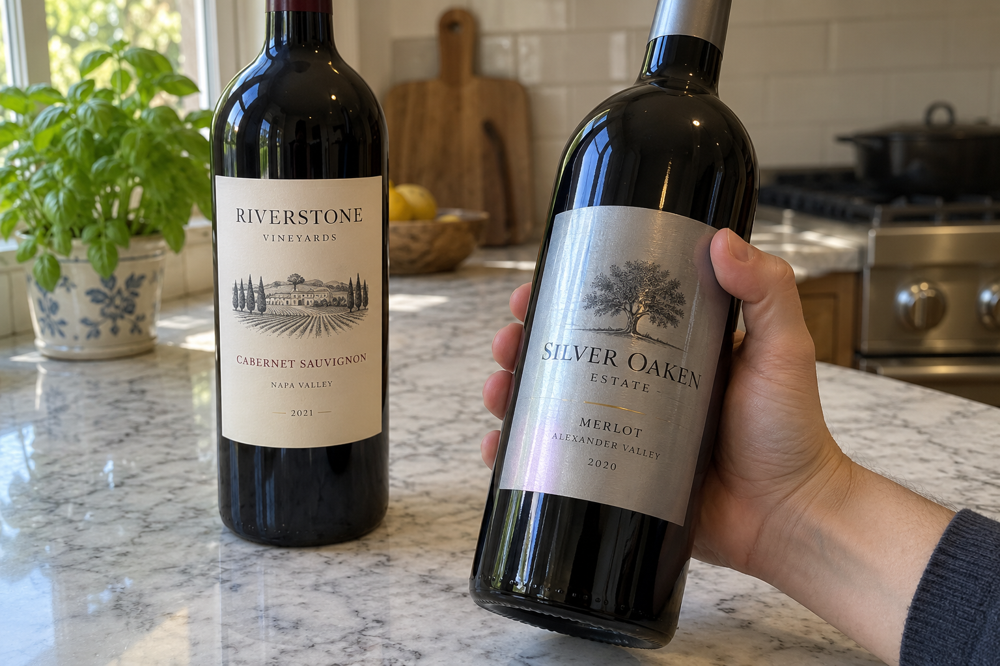
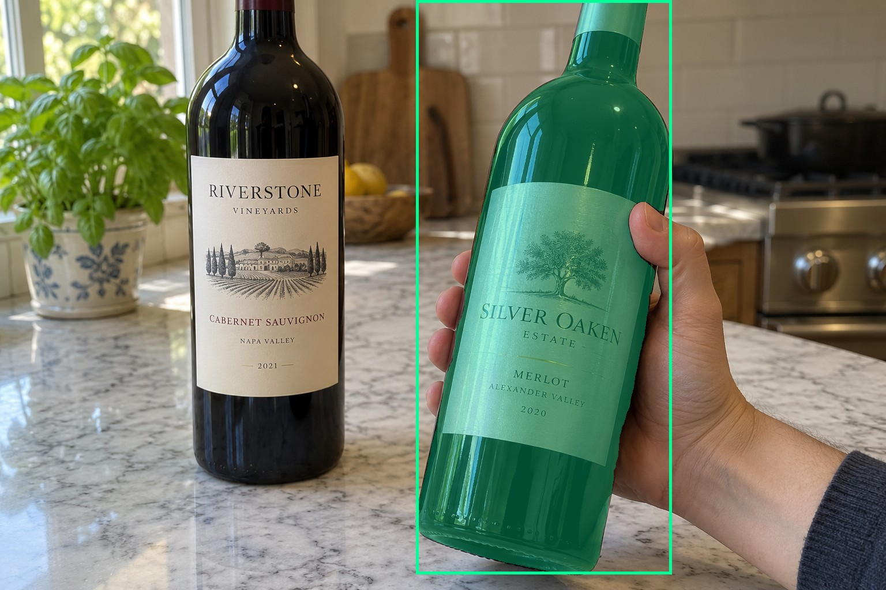
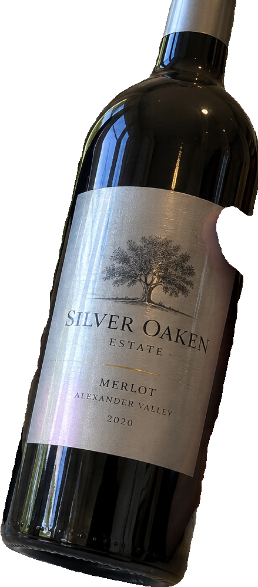
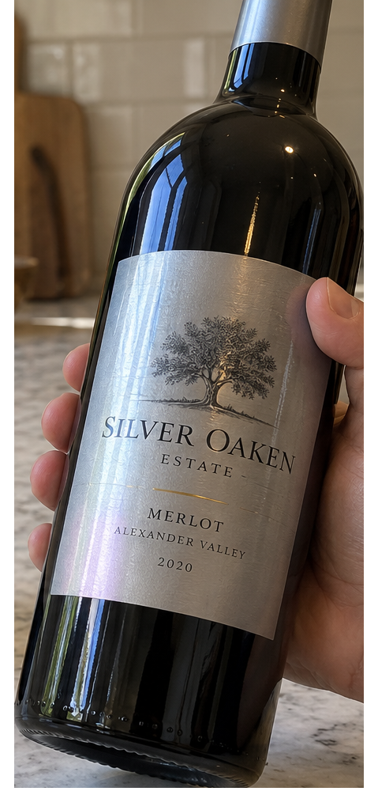
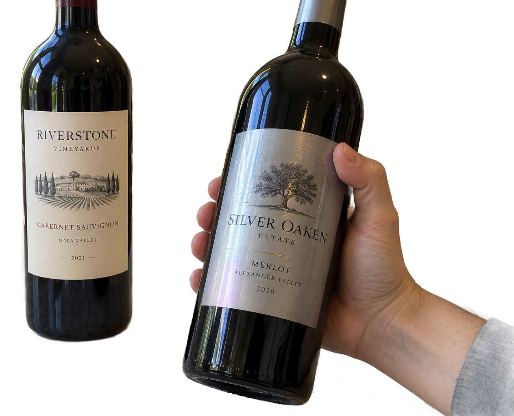

# main-selector-imagegen-hardcases-v2-20261020:GL01

**Scene confirmed; masks pending. All targets/masks are proposals; no approved segmentation ground truth.**

**scene-v1: No automatic failure flag; usability pending.**

Reference title (source): Хват справа и вертикальный блик

Reference target description (source): Удерживаемая бутылка справа с серебристой этикеткой

Expected intent: `clear`. Accepted target proposals: `d0`.

Scene group: `main-selector-imagegen-hardcases-v2-20261020:GL01`. Development only; no independent split claim.

## Original and proposed target





Green marks the unreviewed target proposal. Source image pixels are retained separately.

[Selected-label mask audit](../selected-label-mask-audit.json): incomplete proposal retention is flagged separately from target agreement.

[Full-resolution target proposal mask](../masks/hardcases-v2--GL01-d0.png)

## Selector results

### scene-v1: No automatic failure flag; usability pending

Selected: d0; reason: existing_scene_v1_rank; mode: legacy; crop 439×996 px. Target agreement: True. Target retention proxy: 99.9%; maximum other-bottle retention: 0.0%; minimum associated label retention: 100.0%. Mask ownership, label completeness and legibility still require human review.



[Full-resolution keep mask](../keep-masks/hardcases-v2--GL01-scene-v1.png) · [Exact decision JSON](../results/hardcases-v2--GL01-scene-v1.json)

Associated label-mask retention proxies (unreviewed ownership): d2: 100.0%, 127808 source pixels

### semantic-v2: No automatic failure flag; usability pending

Selected: d0; reason: unique_visible_hand_contact; mode: confident; crop 479×1024 px. Target agreement: True. Target retention proxy: 100.0%; maximum other-bottle retention: 0.0%; minimum associated label retention: 100.0%. Mask ownership, label completeness and legibility still require human review. Selected-label mask audit: d2 100.0%.



[Full-resolution keep mask](../keep-masks/hardcases-v2--GL01-semantic-v2.png) · [Exact decision JSON](../results/hardcases-v2--GL01-semantic-v2.json)

Returned label views: [label 1](../label-crops/hardcases-v2--GL01-semantic-v2-0.png)

Associated label-mask retention proxies (unreviewed ownership): d2: 100.0%, 127808 source pixels

### dis-v1: PROXY failure; no native target ID

Selected: dis-foreground; reason: dis_foreground_mask; mode: foreground; crop 1264×1024 px. Target agreement: n/a (no native target ID). Target retention proxy: 100.0%; maximum other-bottle retention: 99.9%; minimum associated label retention: 100.0%. Mask ownership, label completeness and legibility still require human review.



[Full-resolution keep mask](../keep-masks/hardcases-v2--GL01-dis-v1.png) · [Exact decision JSON](../results/hardcases-v2--GL01-dis-v1.json)

Associated label-mask retention proxies (unreviewed ownership): d2: 100.0%, 127808 source pixels

## All frozen mask proposals

These links expose every detector proposal, including labels and hands. Shapes and owners are unreviewed.

| ID | Detector class | Full-resolution mask |
|---|---|---|
| d0 | wine bottle | [PNG](../masks/hardcases-v2--GL01-d0.png) |
| d1 | wine bottle | [PNG](../masks/hardcases-v2--GL01-d1.png) |
| d2 | wine label | [PNG](../masks/hardcases-v2--GL01-d2.png) |
| d3 | wine label | [PNG](../masks/hardcases-v2--GL01-d3.png) |
| d4 | hand | [PNG](../masks/hardcases-v2--GL01-d4.png) |
| d5 | hand | [PNG](../masks/hardcases-v2--GL01-d5.png) |

[Raw frozen detector response](../detections/hardcases-v2--GL01.json)

<details><summary>Generation prompt (quoted source data)</summary>

```text
Generate exactly one independent photorealistic smartphone photograph, landscape 3:2, approximately 1536 by 1024 pixels. This is an ordinary wine selection moment, with natural perspective, believable glass and paper, imperfect ambient lighting, and realistic human anatomy. No collage, inset, split screen, arrows, highlights, bounding boxes, annotations, watermarks, UI, or text outside physical objects. Use fictional wine branding. Keep the target bottle's entire front label within the frame. The scene must communicate the stated gesture or physical relation visually; do not add any explanatory caption. Exactly two wine bottles. In the RIGHT foreground a single hand visibly grips the middle body of a dark bottle with a silver-gray paper label: thumb wraps one side and bent fingers wrap the opposite side in front of the glass. A bright narrow vertical window reflection crosses part of its label, but the label outline remains visible. A larger unheld bottle with a clean readable cream label stands on the left behind it. The held bottle is slightly tilted, hand is connected to a wrist entering from right. Natural daylight in a kitchen, anatomically correct single hand, no extra fingers.
```

</details>

Source review notes (quoted reference data):

> Блик заметен на серебристой бумаге; часть правого края перекрыта большим пальцем. Проверяйте только реально видимую этикетку.
