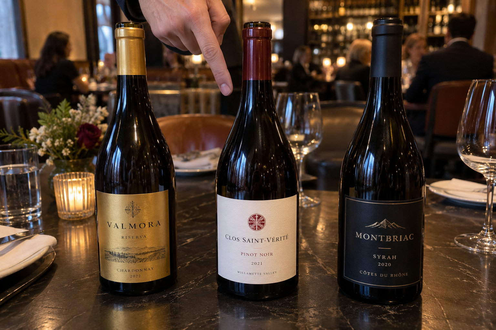
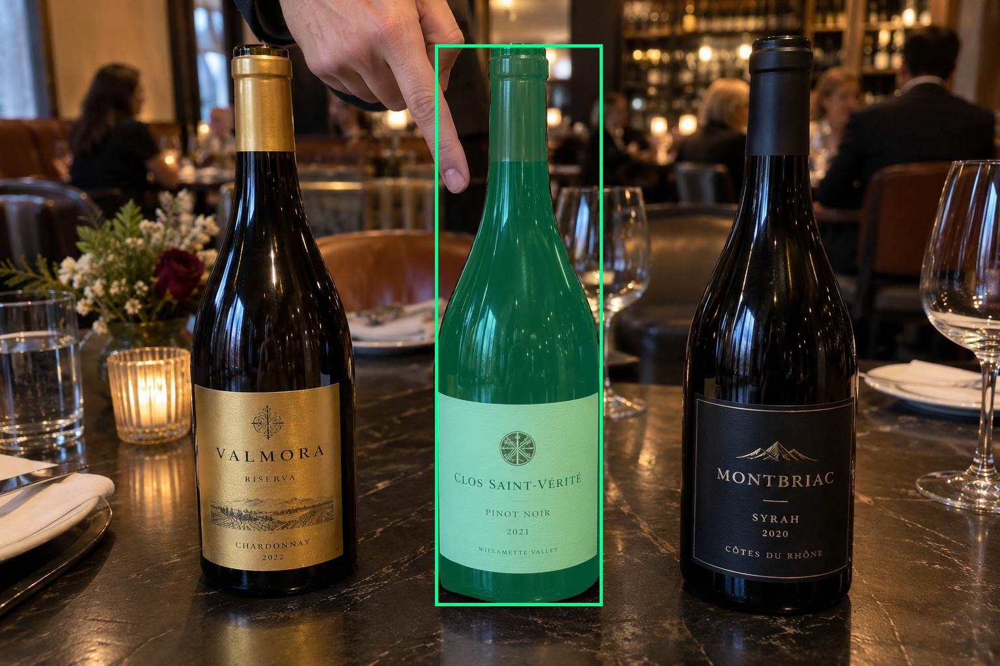
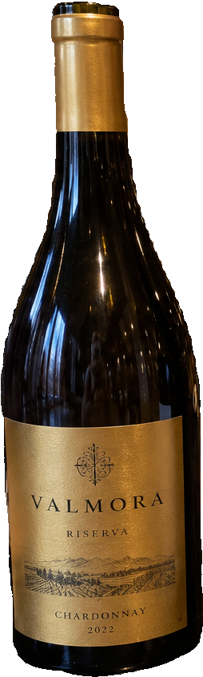
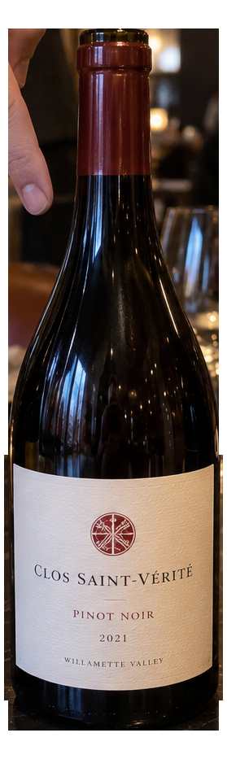
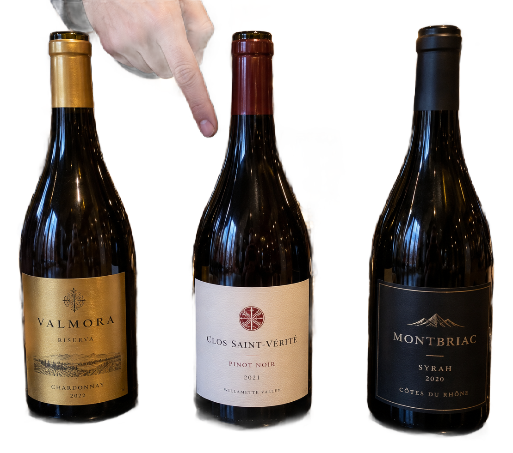

# main-selector-imagegen-hardcases-v2-20261020:PT03

**Scene confirmed; masks pending. All targets/masks are proposals; no approved segmentation ground truth.**

**scene-v1: FAIL — provisional target/proxy.**

Reference title (source): Указание сверху на среднюю бутылку

Reference target description (source): Средняя бутылка с красной круглой эмблемой

Expected intent: `clear`. Accepted target proposals: `d2`.

Scene group: `main-selector-imagegen-hardcases-v2-20261020:PT03`. Development only; no independent split claim.

## Original and proposed target





Green marks the unreviewed target proposal. Source image pixels are retained separately.

[Selected-label mask audit](../selected-label-mask-audit.json): incomplete proposal retention is flagged separately from target agreement.

[Full-resolution target proposal mask](../masks/hardcases-v2--PT03-d2.png)

## Selector results

### scene-v1: FAIL — provisional target/proxy

Selected: d1; reason: existing_scene_v1_rank; mode: legacy; crop 254×848 px. Target agreement: False. Target retention proxy: 0.0%; maximum other-bottle retention: 100.0%; minimum associated label retention: 0.0%. Mask ownership, label completeness and legibility still require human review.



[Full-resolution keep mask](../keep-masks/hardcases-v2--PT03-scene-v1.png) · [Exact decision JSON](../results/hardcases-v2--PT03-scene-v1.json)

Associated label-mask retention proxies (unreviewed ownership): d5: 0.0%, 62785 source pixels

### semantic-v2: No automatic failure flag; usability pending

Selected: d2; reason: explicit_pointing_gesture; mode: confident; crop 279×933 px. Target agreement: True. Target retention proxy: 100.0%; maximum other-bottle retention: 0.0%; minimum associated label retention: 100.0%. Mask ownership, label completeness and legibility still require human review. Selected-label mask audit: d5 100.0%.



[Full-resolution keep mask](../keep-masks/hardcases-v2--PT03-semantic-v2.png) · [Exact decision JSON](../results/hardcases-v2--PT03-semantic-v2.json)

Returned label views: [label 1](../label-crops/hardcases-v2--PT03-semantic-v2-0.png)

Associated label-mask retention proxies (unreviewed ownership): d5: 100.0%, 62785 source pixels

### dis-v1: PROXY failure; no native target ID

Selected: dis-foreground; reason: dis_foreground_mask; mode: foreground; crop 1109×981 px. Target agreement: n/a (no native target ID). Target retention proxy: 99.0%; maximum other-bottle retention: 99.9%; minimum associated label retention: 99.5%. Mask ownership, label completeness and legibility still require human review.



[Full-resolution keep mask](../keep-masks/hardcases-v2--PT03-dis-v1.png) · [Exact decision JSON](../results/hardcases-v2--PT03-dis-v1.json)

Associated label-mask retention proxies (unreviewed ownership): d5: 99.5%, 62785 source pixels

## All frozen mask proposals

These links expose every detector proposal, including labels and hands. Shapes and owners are unreviewed.

| ID | Detector class | Full-resolution mask |
|---|---|---|
| d0 | wine bottle | [PNG](../masks/hardcases-v2--PT03-d0.png) |
| d1 | wine bottle | [PNG](../masks/hardcases-v2--PT03-d1.png) |
| d2 | wine bottle | [PNG](../masks/hardcases-v2--PT03-d2.png) |
| d3 | wine label | [PNG](../masks/hardcases-v2--PT03-d3.png) |
| d4 | wine label | [PNG](../masks/hardcases-v2--PT03-d4.png) |
| d5 | wine label | [PNG](../masks/hardcases-v2--PT03-d5.png) |
| d6 | hand | [PNG](../masks/hardcases-v2--PT03-d6.png) |
| d7 | wine glass | [PNG](../masks/hardcases-v2--PT03-d7.png) |
| d8 | wine glass | [PNG](../masks/hardcases-v2--PT03-d8.png) |
| d9 | wine glass | [PNG](../masks/hardcases-v2--PT03-d9.png) |

[Raw frozen detector response](../detections/hardcases-v2--PT03.json)

<details><summary>Generation prompt (quoted source data)</summary>

```text
Generate exactly one independent photorealistic smartphone photograph, landscape 3:2, approximately 1536 by 1024 pixels. This is an ordinary wine selection moment, with natural perspective, believable glass and paper, imperfect ambient lighting, and realistic human anatomy. No collage, inset, split screen, arrows, highlights, bounding boxes, annotations, watermarks, UI, or text outside physical objects. Use fictional wine branding. Keep the target bottle's entire front label within the frame. The scene must communicate the stated gesture or physical relation visually; do not add any explanatory caption. Exactly three upright wine bottles form a loose row on a dark restaurant table, separated by visible air. The middle bottle has a white front label with a small red circular emblem. A single hand enters from above, visible palm and curled fingers, index extended straight downward and ending a small gap above that middle bottle shoulder. The index clearly indicates the middle bottle without holding it. The left bottle has a bright gold label and the right a black label. All bottle front labels are unobstructed. Natural overhead restaurant lighting, moderate depth of field, close candid phone photo.
```

</details>

Source review notes (quoted reference data):

> Палец направлен немного по диагонали, между плечом и горлышком средней бутылки. Подтвердите, что цель читается однозначно.
