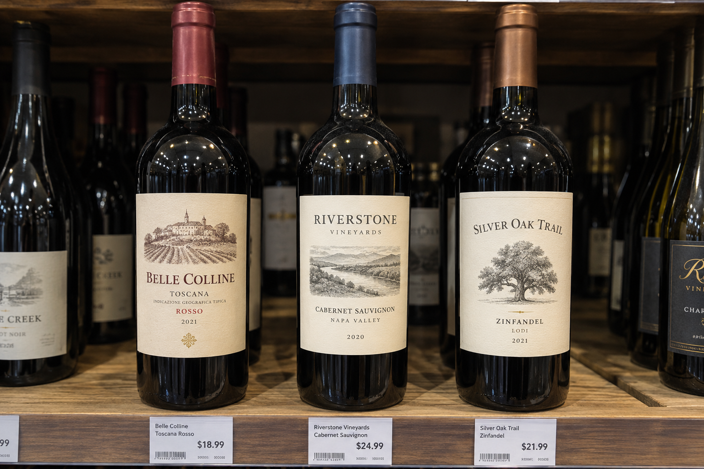
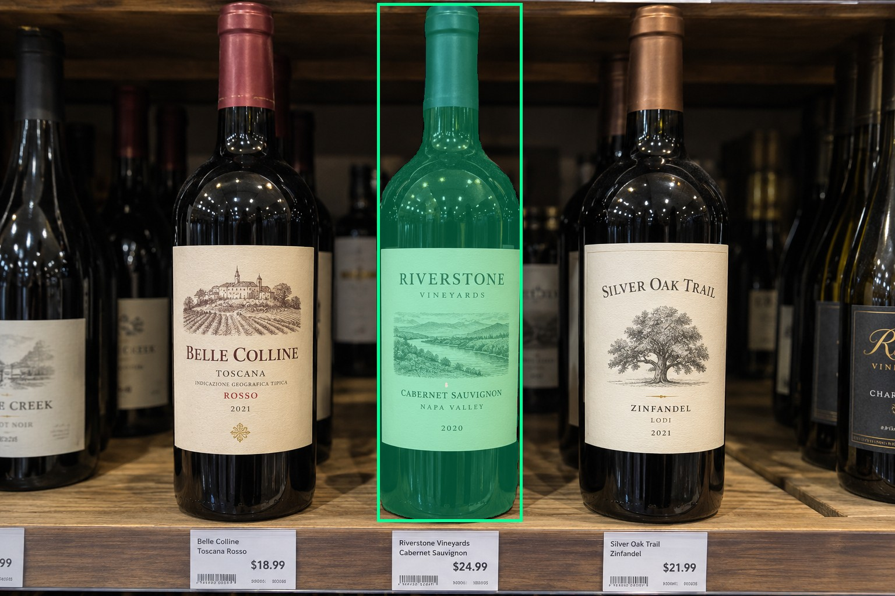
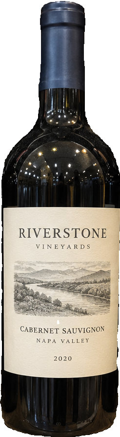
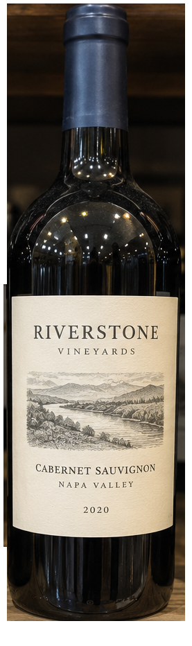
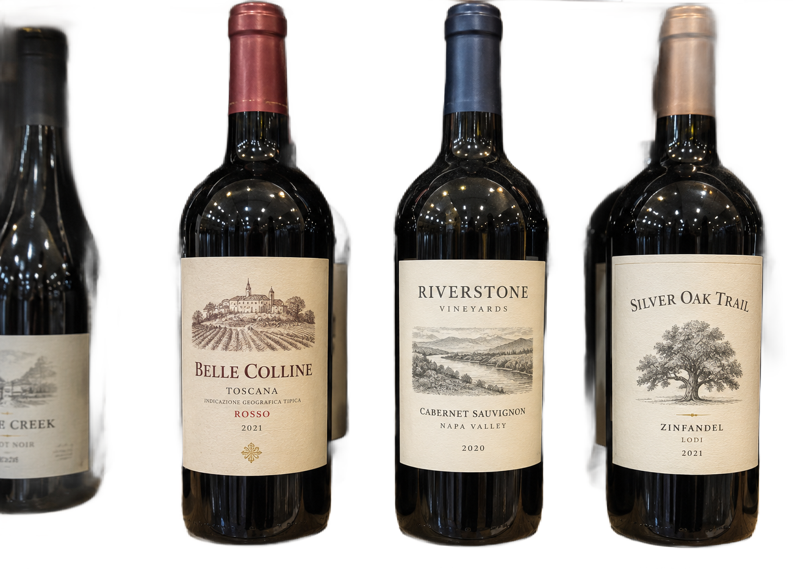

# main-selector-imagegen-pilot-v1-20261019:AM02

**Scene confirmed; masks pending. All targets/masks are proposals; no approved segmentation ground truth.**

**scene-v1: No automatic failure flag; usability pending.**

Reference title (source): Три равнозначные бутылки

Reference target description (source): Центральная передняя бутылка — fallback

Expected intent: `ambiguous`. Accepted target proposals: `d18`.

Scene group: `main-selector-imagegen-pilot-v1-20261019:AM02`. Development only; no independent split claim.

## Original and proposed target





Green marks the unreviewed target proposal. Source image pixels are retained separately.

[Selected-label mask audit](../selected-label-mask-audit.json): incomplete proposal retention is flagged separately from target agreement.

[Full-resolution target proposal mask](../masks/pilot-v1--AM02-d18.png)

## Selector results

### scene-v1: No automatic failure flag; usability pending

Selected: d18; reason: existing_scene_v1_rank; mode: legacy; crop 246×893 px. Target agreement: True. Target retention proxy: 99.9%; maximum other-bottle retention: 0.0%; minimum associated label retention: 99.8%. Mask ownership, label completeness and legibility still require human review.



[Full-resolution keep mask](../keep-masks/pilot-v1--AM02-scene-v1.png) · [Exact decision JSON](../results/pilot-v1--AM02-scene-v1.json)

Associated label-mask retention proxies (unreviewed ownership): d32: 99.8%, 80837 source pixels

### semantic-v2: FAIL — provisional target/proxy

Selected: d18; reason: fallback_center_contains; mode: fallback; crop 277×932 px. Target agreement: True. Target retention proxy: 100.0%; maximum other-bottle retention: 55.2%; minimum associated label retention: 100.0%. Mask ownership, label completeness and legibility still require human review. Selected-label mask audit: d32 100.0%.



[Full-resolution keep mask](../keep-masks/pilot-v1--AM02-semantic-v2.png) · [Exact decision JSON](../results/pilot-v1--AM02-semantic-v2.json)

Returned label views: [label 1](../label-crops/pilot-v1--AM02-semantic-v2-0.png)

Associated label-mask retention proxies (unreviewed ownership): d32: 100.0%, 80837 source pixels

### dis-v1: PROXY failure; no native target ID

Selected: dis-foreground; reason: dis_foreground_mask; mode: foreground; crop 1303×934 px. Target agreement: n/a (no native target ID). Target retention proxy: 99.9%; maximum other-bottle retention: 99.9%; minimum associated label retention: 100.0%. Mask ownership, label completeness and legibility still require human review.



[Full-resolution keep mask](../keep-masks/pilot-v1--AM02-dis-v1.png) · [Exact decision JSON](../results/pilot-v1--AM02-dis-v1.json)

Associated label-mask retention proxies (unreviewed ownership): d32: 100.0%, 80837 source pixels

## All frozen mask proposals

These links expose every detector proposal, including labels and hands. Shapes and owners are unreviewed.

| ID | Detector class | Full-resolution mask |
|---|---|---|
| d0 | wine bottle | [PNG](../masks/pilot-v1--AM02-d0.png) |
| d1 | wine bottle | [PNG](../masks/pilot-v1--AM02-d1.png) |
| d2 | wine bottle | [PNG](../masks/pilot-v1--AM02-d2.png) |
| d3 | wine bottle | [PNG](../masks/pilot-v1--AM02-d3.png) |
| d4 | wine bottle | [PNG](../masks/pilot-v1--AM02-d4.png) |
| d5 | wine bottle | [PNG](../masks/pilot-v1--AM02-d5.png) |
| d6 | wine bottle | [PNG](../masks/pilot-v1--AM02-d6.png) |
| d7 | wine bottle | [PNG](../masks/pilot-v1--AM02-d7.png) |
| d8 | wine bottle | [PNG](../masks/pilot-v1--AM02-d8.png) |
| d9 | wine bottle | [PNG](../masks/pilot-v1--AM02-d9.png) |
| d10 | wine bottle | [PNG](../masks/pilot-v1--AM02-d10.png) |
| d11 | wine bottle | [PNG](../masks/pilot-v1--AM02-d11.png) |
| d12 | wine bottle | [PNG](../masks/pilot-v1--AM02-d12.png) |
| d13 | wine bottle | [PNG](../masks/pilot-v1--AM02-d13.png) |
| d14 | wine bottle | [PNG](../masks/pilot-v1--AM02-d14.png) |
| d15 | wine bottle | [PNG](../masks/pilot-v1--AM02-d15.png) |
| d16 | wine bottle | [PNG](../masks/pilot-v1--AM02-d16.png) |
| d17 | wine bottle | [PNG](../masks/pilot-v1--AM02-d17.png) |
| d18 | wine bottle | [PNG](../masks/pilot-v1--AM02-d18.png) |
| d19 | wine bottle | [PNG](../masks/pilot-v1--AM02-d19.png) |
| d20 | wine label | [PNG](../masks/pilot-v1--AM02-d20.png) |
| d21 | wine label | [PNG](../masks/pilot-v1--AM02-d21.png) |
| d22 | wine label | [PNG](../masks/pilot-v1--AM02-d22.png) |
| d23 | wine label | [PNG](../masks/pilot-v1--AM02-d23.png) |
| d24 | wine label | [PNG](../masks/pilot-v1--AM02-d24.png) |
| d25 | wine label | [PNG](../masks/pilot-v1--AM02-d25.png) |
| d26 | wine label | [PNG](../masks/pilot-v1--AM02-d26.png) |
| d27 | wine label | [PNG](../masks/pilot-v1--AM02-d27.png) |
| d28 | wine label | [PNG](../masks/pilot-v1--AM02-d28.png) |
| d29 | wine label | [PNG](../masks/pilot-v1--AM02-d29.png) |
| d30 | wine label | [PNG](../masks/pilot-v1--AM02-d30.png) |
| d31 | wine label | [PNG](../masks/pilot-v1--AM02-d31.png) |
| d32 | wine label | [PNG](../masks/pilot-v1--AM02-d32.png) |
| d33 | price tag | [PNG](../masks/pilot-v1--AM02-d33.png) |
| d34 | price tag | [PNG](../masks/pilot-v1--AM02-d34.png) |
| d35 | price tag | [PNG](../masks/pilot-v1--AM02-d35.png) |
| d36 | price tag | [PNG](../masks/pilot-v1--AM02-d36.png) |

[Raw frozen detector response](../detections/pilot-v1--AM02.json)

<details><summary>Generation prompt (quoted source data)</summary>

```text
Use case: photorealistic-natural.
Asset type: one independent synthetic smartphone photograph for a wine-subject selection test dataset.
Style: a believable candid phone photo with realistic optics, materials, shadows, depth and anatomically plausible hands when requested. Natural photographic imperfections, not a diagram, collage, 3D render, advertisement or contact sheet.
Bottle labels may use fictional wine names and normal small wine-label text. Labels must have complete physical paper boundaries and plausible printing. Do not add target markers, bounding boxes, arrows, captions, segmentation colors, watermarks or any explanation outside the scene.
Generate exactly one landscape photograph, approximately 1536 by 1024 pixels. Any wine identity is fictional; this tests selection and visible-label preservation, not catalogue recognition.
Scene request: Exactly three similarly sized physical wine bottles in a straight shelf row, with the middle bottle near the photo center. Similar focus, lighting and depth; no hands and no unique visual emphasis. A natural shop photo rather than a catalog grid.
```

</details>

Source review notes (quoted reference data):

> Вместо трёх бутылок появились дополнительные бутылки сзади и по краям. Не принимать как контроль ровно трёх предметов.
