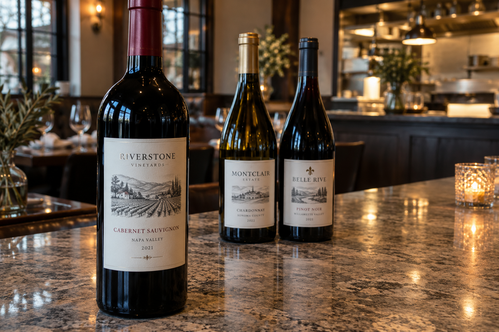
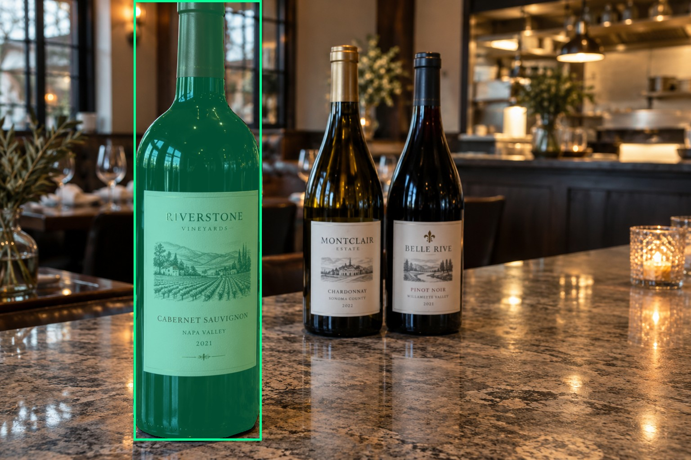
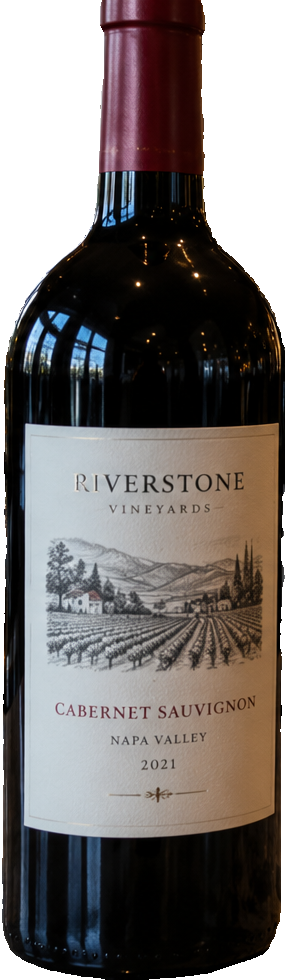
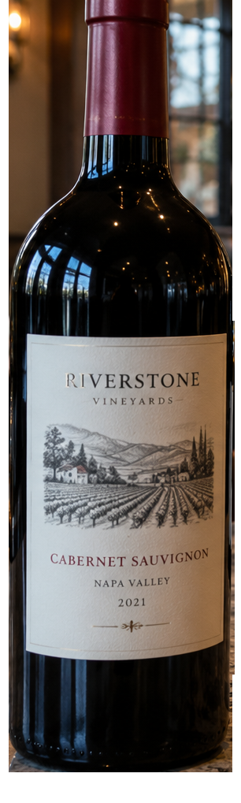
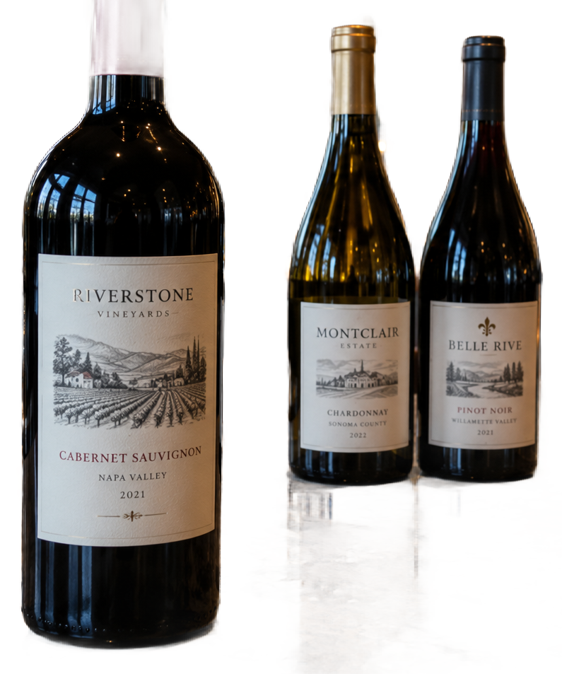

# main-selector-imagegen-pilot-v1-20261019:FG01

**Scene confirmed; masks pending. All targets/masks are proposals; no approved segmentation ground truth.**

**scene-v1: No automatic failure flag; usability pending.**

Reference title (source): Три бутылки: передняя слева

Reference target description (source): Передняя бутылка слева

Expected intent: `clear`. Accepted target proposals: `d1`.

Scene group: `main-selector-imagegen-pilot-v1-20261019:FG01`. Development only; no independent split claim.

## Original and proposed target





Green marks the unreviewed target proposal. Source image pixels are retained separately.

[Selected-label mask audit](../selected-label-mask-audit.json): incomplete proposal retention is flagged separately from target agreement.

[Full-resolution target proposal mask](../masks/pilot-v1--FG01-d1.png)

## Selector results

### scene-v1: No automatic failure flag; usability pending

Selected: d1; reason: existing_scene_v1_rank; mode: legacy; crop 285×980 px. Target agreement: True. Target retention proxy: 99.9%; maximum other-bottle retention: 0.0%; minimum associated label retention: 100.0%. Mask ownership, label completeness and legibility still require human review.



[Full-resolution keep mask](../keep-masks/pilot-v1--FG01-scene-v1.png) · [Exact decision JSON](../results/pilot-v1--FG01-scene-v1.json)

Associated label-mask retention proxies (unreviewed ownership): d4: 100.0%, 102405 source pixels

### semantic-v2: No automatic failure flag; usability pending

Selected: d1; reason: foreground_scale_and_lower_base; mode: confident; crop 306×1019 px. Target agreement: True. Target retention proxy: 100.0%; maximum other-bottle retention: 0.0%; minimum associated label retention: 100.0%. Mask ownership, label completeness and legibility still require human review. Selected-label mask audit: d4 100.0%.



[Full-resolution keep mask](../keep-masks/pilot-v1--FG01-semantic-v2.png) · [Exact decision JSON](../results/pilot-v1--FG01-semantic-v2.json)

Returned label views: [label 1](../label-crops/pilot-v1--FG01-semantic-v2-0.png)

Associated label-mask retention proxies (unreviewed ownership): d4: 100.0%, 102405 source pixels

### dis-v1: PROXY failure; no native target ID

Selected: dis-foreground; reason: dis_foreground_mask; mode: foreground; crop 795×953 px. Target agreement: n/a (no native target ID). Target retention proxy: 92.1%; maximum other-bottle retention: 100.0%; minimum associated label retention: 100.0%. Mask ownership, label completeness and legibility still require human review.



[Full-resolution keep mask](../keep-masks/pilot-v1--FG01-dis-v1.png) · [Exact decision JSON](../results/pilot-v1--FG01-dis-v1.json)

Associated label-mask retention proxies (unreviewed ownership): d4: 100.0%, 102405 source pixels

## All frozen mask proposals

These links expose every detector proposal, including labels and hands. Shapes and owners are unreviewed.

| ID | Detector class | Full-resolution mask |
|---|---|---|
| d0 | wine bottle | [PNG](../masks/pilot-v1--FG01-d0.png) |
| d1 | wine bottle | [PNG](../masks/pilot-v1--FG01-d1.png) |
| d2 | wine bottle | [PNG](../masks/pilot-v1--FG01-d2.png) |
| d3 | wine label | [PNG](../masks/pilot-v1--FG01-d3.png) |
| d4 | wine label | [PNG](../masks/pilot-v1--FG01-d4.png) |
| d5 | wine label | [PNG](../masks/pilot-v1--FG01-d5.png) |
| d6 | wine label | [PNG](../masks/pilot-v1--FG01-d6.png) |
| d7 | wine glass | [PNG](../masks/pilot-v1--FG01-d7.png) |
| d8 | wine glass | [PNG](../masks/pilot-v1--FG01-d8.png) |
| d9 | wine glass | [PNG](../masks/pilot-v1--FG01-d9.png) |
| d10 | wine glass | [PNG](../masks/pilot-v1--FG01-d10.png) |

[Raw frozen detector response](../detections/pilot-v1--FG01.json)

<details><summary>Generation prompt (quoted source data)</summary>

```text
Use case: photorealistic-natural.
Asset type: one independent synthetic smartphone photograph for a wine-subject selection test dataset.
Style: a believable candid phone photo with realistic optics, materials, shadows, depth and anatomically plausible hands when requested. Natural photographic imperfections, not a diagram, collage, 3D render, advertisement or contact sheet.
Bottle labels may use fictional wine names and normal small wine-label text. Labels must have complete physical paper boundaries and plausible printing. Do not add target markers, bounding boxes, arrows, captions, segmentation colors, watermarks or any explanation outside the scene.
Generate exactly one landscape photograph, approximately 1536 by 1024 pixels. Any wine identity is fictional; this tests selection and visible-label preservation, not catalogue recognition.
Scene request: Exactly three physical wine bottles on the same restaurant counter. A clearly nearer, larger standard wine bottle stands in the left foreground with its whole front label visible. Two smaller, more distant standard wine bottles stand close together near the image center behind it. Viewpoint and overlap clearly establish that the left bottle is nearest. No hands, posters or other bottles.
```

</details>

Source review notes (quoted reference data):

> Основные три бутылки различимы. Горлышко передней бутылки обрезано сверху; этикетка видна.
