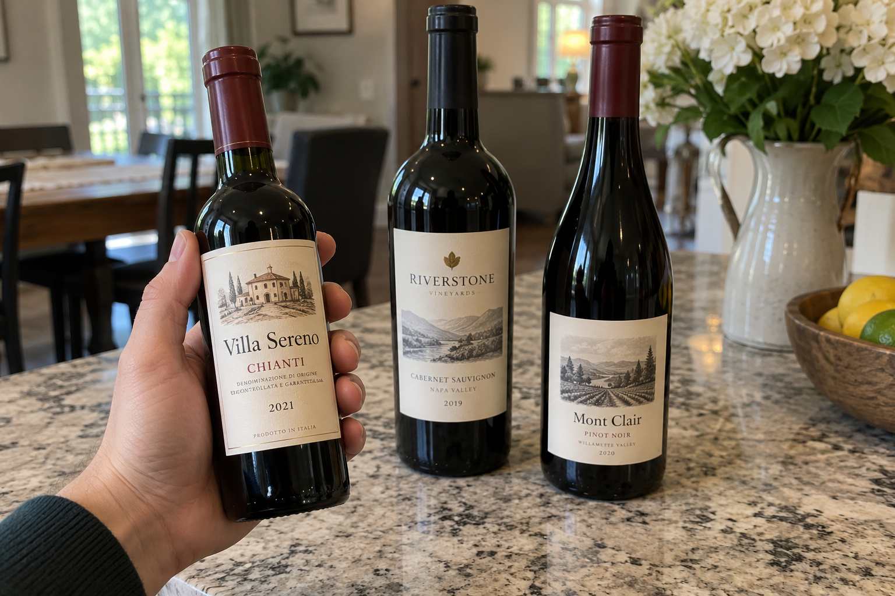
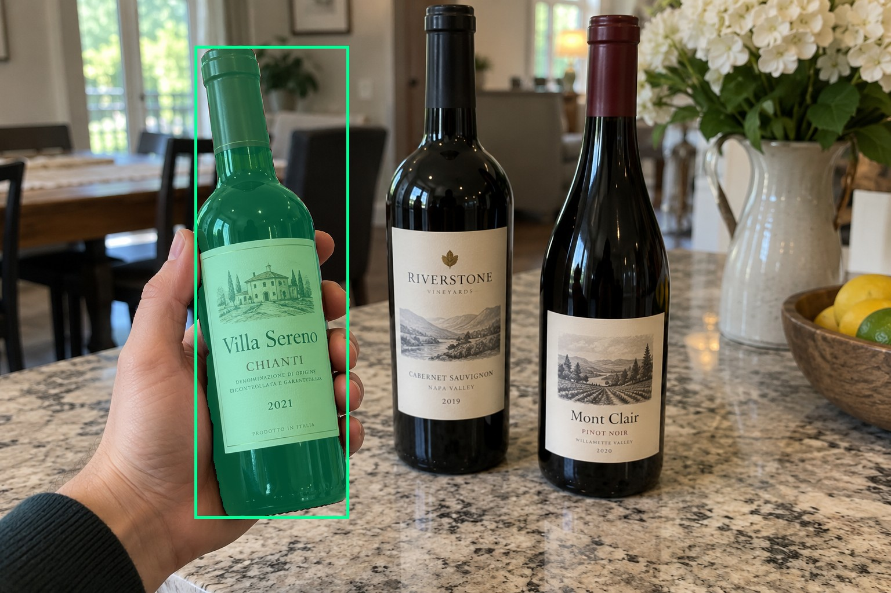
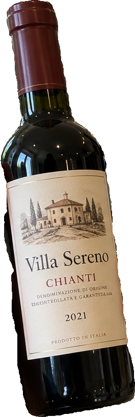
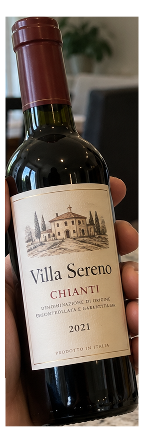
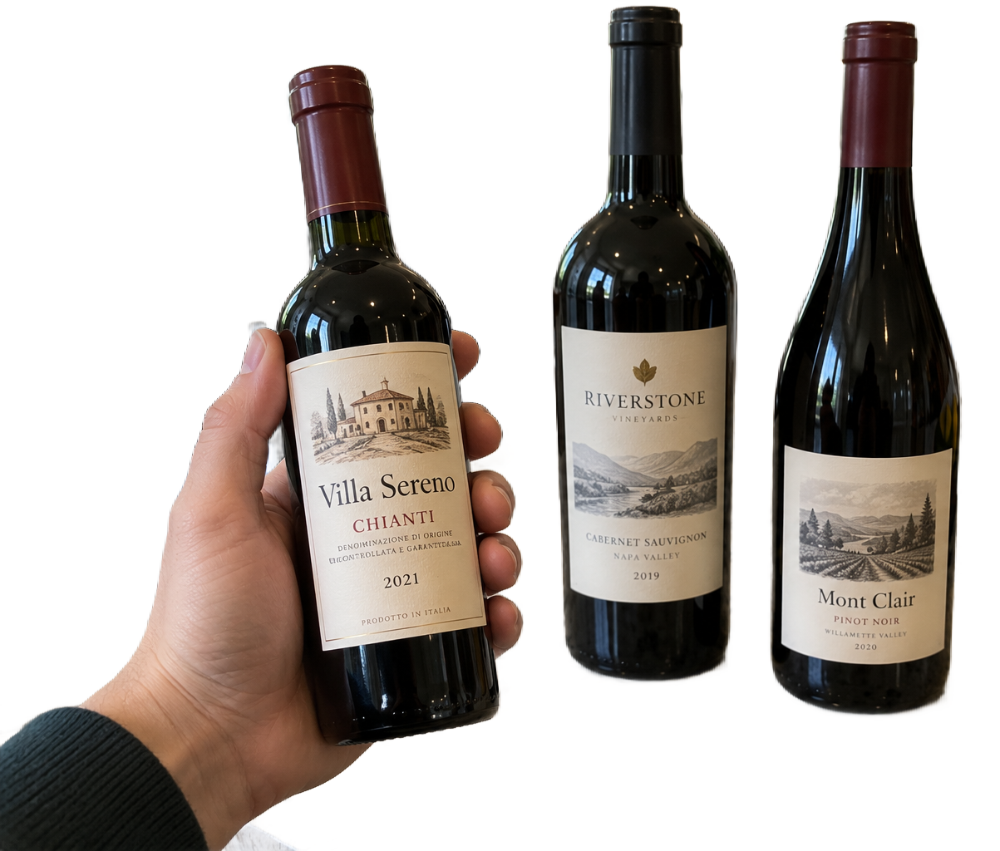

# main-selector-imagegen-pilot-v1-20261019:FG05

**Scene confirmed; masks pending. All targets/masks are proposals; no approved segmentation ground truth.**

**scene-v1: No automatic failure flag; usability pending.**

Reference title (source): Маленькая удерживаемая бутылка

Reference target description (source): Маленькая удерживаемая бутылка слева

Expected intent: `clear`. Accepted target proposals: `d1`.

Scene group: `main-selector-imagegen-pilot-v1-20261019:FG05`. Development only; no independent split claim.

## Original and proposed target





Green marks the unreviewed target proposal. Source image pixels are retained separately.

[Selected-label mask audit](../selected-label-mask-audit.json): incomplete proposal retention is flagged separately from target agreement.

[Full-resolution target proposal mask](../masks/pilot-v1--FG05-d1.png)

## Selector results

### scene-v1: No automatic failure flag; usability pending

Selected: d1; reason: existing_scene_v1_rank; mode: legacy; crop 265×816 px. Target agreement: True. Target retention proxy: 100.0%; maximum other-bottle retention: 0.0%; minimum associated label retention: 99.9%. Mask ownership, label completeness and legibility still require human review.



[Full-resolution keep mask](../keep-masks/pilot-v1--FG05-scene-v1.png) · [Exact decision JSON](../results/pilot-v1--FG05-scene-v1.json)

Associated label-mask retention proxies (unreviewed ownership): d4: 99.9%, 70139 source pixels

### semantic-v2: No automatic failure flag; usability pending

Selected: d1; reason: unique_visible_hand_contact; mode: confident; crop 288×882 px. Target agreement: True. Target retention proxy: 100.0%; maximum other-bottle retention: 0.0%; minimum associated label retention: 100.0%. Mask ownership, label completeness and legibility still require human review. Selected-label mask audit: d4 100.0%.



[Full-resolution keep mask](../keep-masks/pilot-v1--FG05-semantic-v2.png) · [Exact decision JSON](../results/pilot-v1--FG05-semantic-v2.json)

Returned label views: [label 1](../label-crops/pilot-v1--FG05-semantic-v2-0.png)

Associated label-mask retention proxies (unreviewed ownership): d4: 100.0%, 70139 source pixels

### dis-v1: PROXY failure; no native target ID

Selected: dis-foreground; reason: dis_foreground_mask; mode: foreground; crop 1203×1024 px. Target agreement: n/a (no native target ID). Target retention proxy: 100.0%; maximum other-bottle retention: 100.0%; minimum associated label retention: 100.0%. Mask ownership, label completeness and legibility still require human review.



[Full-resolution keep mask](../keep-masks/pilot-v1--FG05-dis-v1.png) · [Exact decision JSON](../results/pilot-v1--FG05-dis-v1.json)

Associated label-mask retention proxies (unreviewed ownership): d4: 100.0%, 70139 source pixels

## All frozen mask proposals

These links expose every detector proposal, including labels and hands. Shapes and owners are unreviewed.

| ID | Detector class | Full-resolution mask |
|---|---|---|
| d0 | wine bottle | [PNG](../masks/pilot-v1--FG05-d0.png) |
| d1 | wine bottle | [PNG](../masks/pilot-v1--FG05-d1.png) |
| d2 | wine bottle | [PNG](../masks/pilot-v1--FG05-d2.png) |
| d3 | wine label | [PNG](../masks/pilot-v1--FG05-d3.png) |
| d4 | wine label | [PNG](../masks/pilot-v1--FG05-d4.png) |
| d5 | wine label | [PNG](../masks/pilot-v1--FG05-d5.png) |
| d6 | hand | [PNG](../masks/pilot-v1--FG05-d6.png) |

[Raw frozen detector response](../detections/pilot-v1--FG05.json)

<details><summary>Generation prompt (quoted source data)</summary>

```text
Use case: photorealistic-natural.
Asset type: one independent synthetic smartphone photograph for a wine-subject selection test dataset.
Style: a believable candid phone photo with realistic optics, materials, shadows, depth and anatomically plausible hands when requested. Natural photographic imperfections, not a diagram, collage, 3D render, advertisement or contact sheet.
Bottle labels may use fictional wine names and normal small wine-label text. Labels must have complete physical paper boundaries and plausible printing. Do not add target markers, bounding boxes, arrows, captions, segmentation colors, watermarks or any explanation outside the scene.
Generate exactly one landscape photograph, approximately 1536 by 1024 pixels. Any wine identity is fictional; this tests selection and visible-label preservation, not catalogue recognition.
Scene request: Exactly three physical wine bottles. A person visibly grips a half-size wine bottle around its body in the left foreground, presenting it to the camera. Its complete main label remains mostly visible below the fingers. Two full-size bottles stand farther away near the center. The small held bottle is the intentional subject despite the larger background bottles.
```

</details>

Source review notes (quoted reference data):

> Явного несоответствия при первичном просмотре не отмечено; требуется ваше review.
