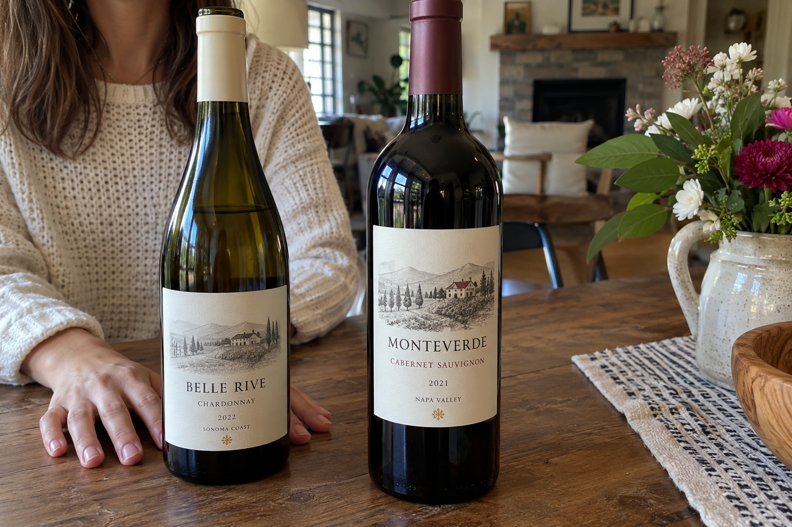
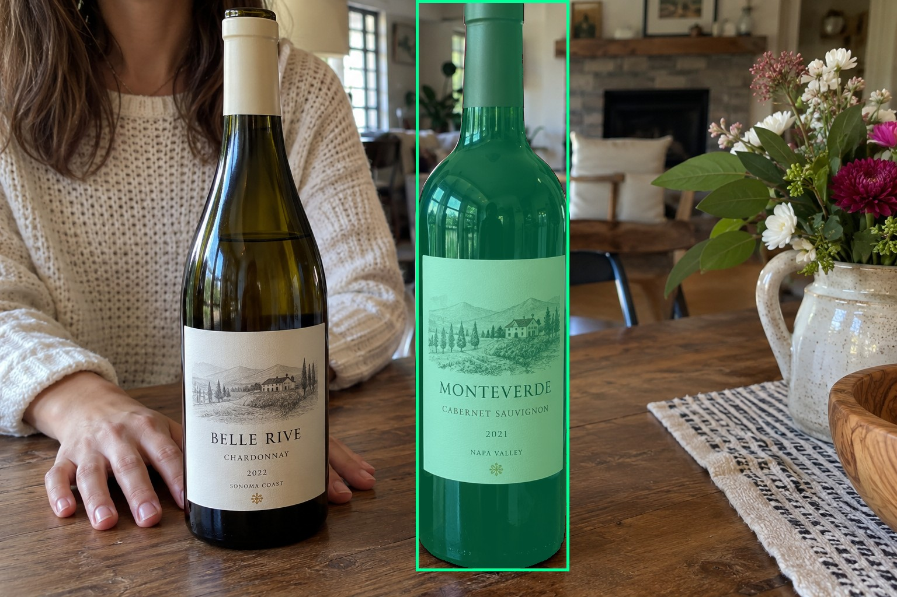
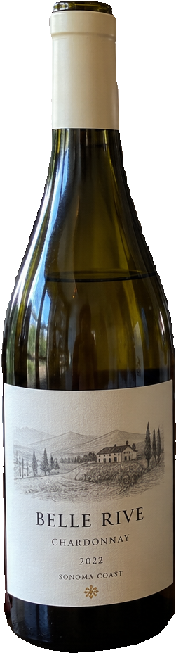
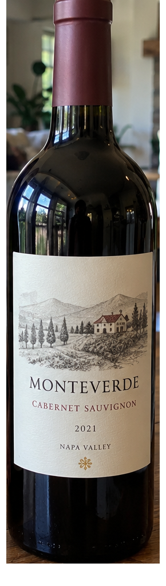
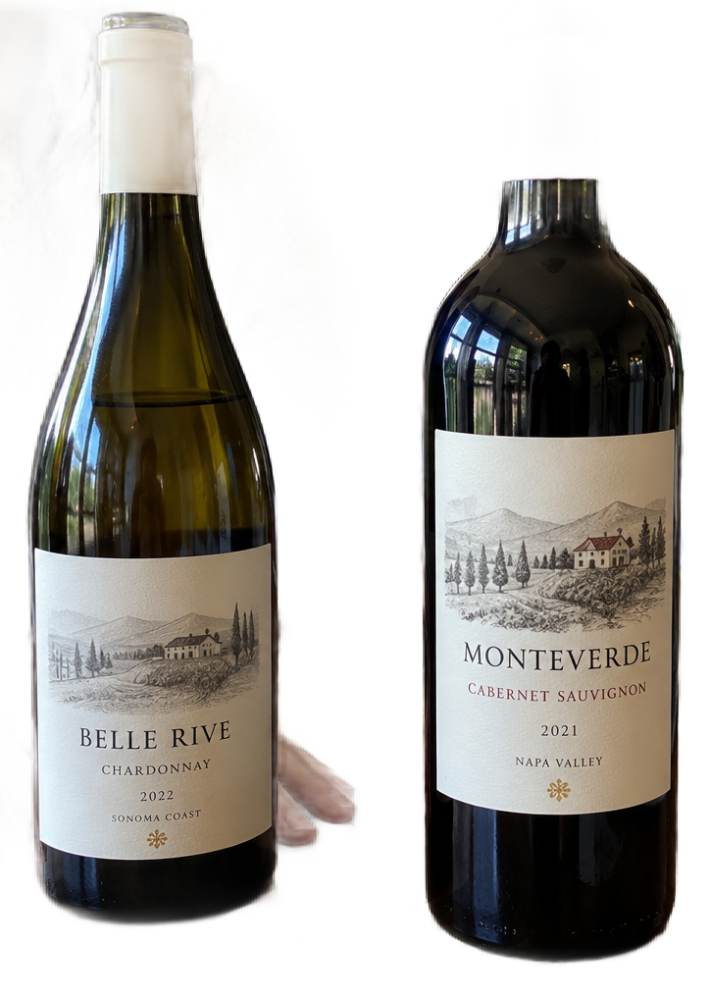

# main-selector-imagegen-pilot-v1-20261019:HA04

**Scene confirmed; masks pending. All targets/masks are proposals; no approved segmentation ground truth.**

**scene-v1: FAIL — provisional target/proxy.**

Reference title (source): Рука позади основания

Reference target description (source): Правая бутылка — fallback

Expected intent: `ambiguous`. Accepted target proposals: `d1`.

Scene group: `main-selector-imagegen-pilot-v1-20261019:HA04`. Development only; no independent split claim.

## Original and proposed target





Green marks the unreviewed target proposal. Source image pixels are retained separately.

[Selected-label mask audit](../selected-label-mask-audit.json): incomplete proposal retention is flagged separately from target agreement.

[Full-resolution target proposal mask](../masks/pilot-v1--HA04-d1.png)

## Selector results

### scene-v1: FAIL — provisional target/proxy

Selected: d0; reason: existing_scene_v1_rank; mode: legacy; crop 251×928 px. Target agreement: False. Target retention proxy: 0.0%; maximum other-bottle retention: 100.0%; minimum associated label retention: 0.0%. Mask ownership, label completeness and legibility still require human review.



[Full-resolution keep mask](../keep-masks/pilot-v1--HA04-scene-v1.png) · [Exact decision JSON](../results/pilot-v1--HA04-scene-v1.json)

Associated label-mask retention proxies (unreviewed ownership): d3: 0.0%, 91754 source pixels

### semantic-v2: No automatic failure flag; usability pending

Selected: d1; reason: fallback_center_contains; mode: fallback; crop 290×1018 px. Target agreement: True. Target retention proxy: 100.0%; maximum other-bottle retention: 0.0%; minimum associated label retention: 100.0%. Mask ownership, label completeness and legibility still require human review. Selected-label mask audit: d3 100.0%.



[Full-resolution keep mask](../keep-masks/pilot-v1--HA04-semantic-v2.png) · [Exact decision JSON](../results/pilot-v1--HA04-semantic-v2.json)

Returned label views: [label 1](../label-crops/pilot-v1--HA04-semantic-v2-0.png)

Associated label-mask retention proxies (unreviewed ownership): d3: 100.0%, 91754 source pixels

### dis-v1: PROXY failure; no native target ID

Selected: dis-foreground; reason: dis_foreground_mask; mode: foreground; crop 724×1019 px. Target agreement: n/a (no native target ID). Target retention proxy: 90.7%; maximum other-bottle retention: 92.5%; minimum associated label retention: 100.0%. Mask ownership, label completeness and legibility still require human review.



[Full-resolution keep mask](../keep-masks/pilot-v1--HA04-dis-v1.png) · [Exact decision JSON](../results/pilot-v1--HA04-dis-v1.json)

Associated label-mask retention proxies (unreviewed ownership): d3: 100.0%, 91754 source pixels

## All frozen mask proposals

These links expose every detector proposal, including labels and hands. Shapes and owners are unreviewed.

| ID | Detector class | Full-resolution mask |
|---|---|---|
| d0 | wine bottle | [PNG](../masks/pilot-v1--HA04-d0.png) |
| d1 | wine bottle | [PNG](../masks/pilot-v1--HA04-d1.png) |
| d2 | wine label | [PNG](../masks/pilot-v1--HA04-d2.png) |
| d3 | wine label | [PNG](../masks/pilot-v1--HA04-d3.png) |
| d4 | hand | [PNG](../masks/pilot-v1--HA04-d4.png) |
| d5 | hand | [PNG](../masks/pilot-v1--HA04-d5.png) |
| d6 | hand | [PNG](../masks/pilot-v1--HA04-d6.png) |

[Raw frozen detector response](../detections/pilot-v1--HA04.json)

<details><summary>Generation prompt (quoted source data)</summary>

```text
Use case: photorealistic-natural.
Asset type: one independent synthetic smartphone photograph for a wine-subject selection test dataset.
Style: a believable candid phone photo with realistic optics, materials, shadows, depth and anatomically plausible hands when requested. Natural photographic imperfections, not a diagram, collage, 3D render, advertisement or contact sheet.
Bottle labels may use fictional wine names and normal small wine-label text. Labels must have complete physical paper boundaries and plausible printing. Do not add target markers, bounding boxes, arrows, captions, segmentation colors, watermarks or any explanation outside the scene.
Generate exactly one landscape photograph, approximately 1536 by 1024 pixels. Any wine identity is fictional; this tests selection and visible-label preservation, not catalogue recognition.
Scene request: Two equally prominent wine bottles on a table. An open hand lies on the table behind the base of the left bottle; fingers are visible to both sides of the base but never wrap around or cross the front glass. The right bottle stands closer to the photo center. No actual grip.
```

</details>

Source review notes (quoted reference data):

> Проверьте анатомию и число рук: справа от левой бутылки видны дополнительные пальцы.
