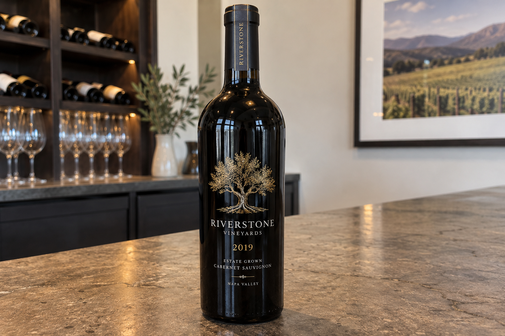
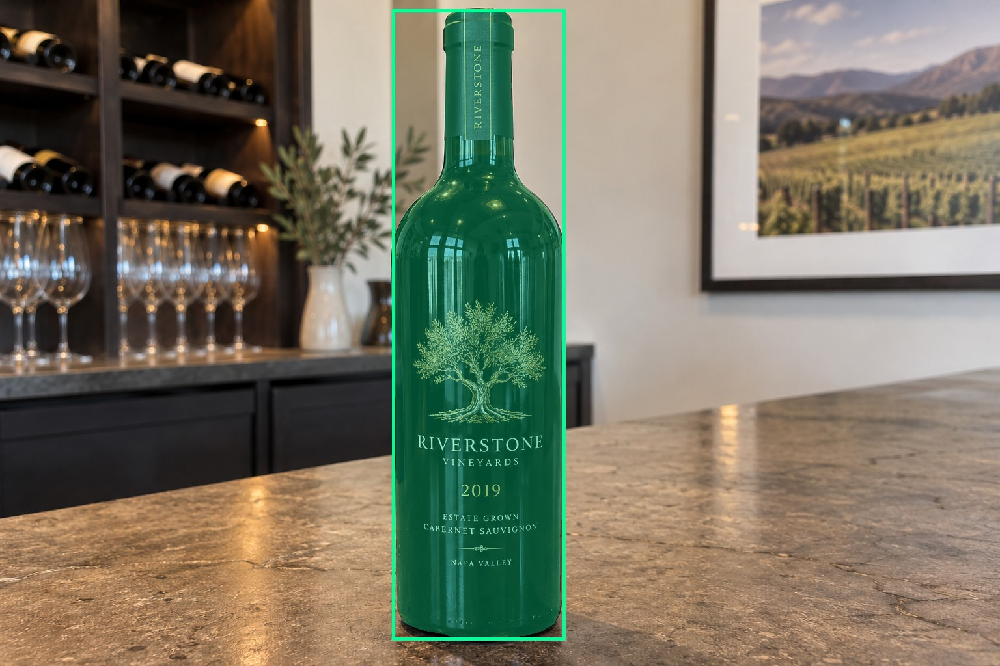
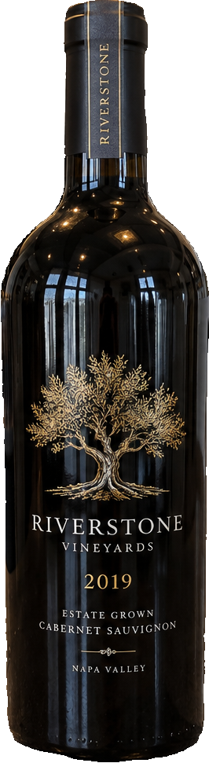
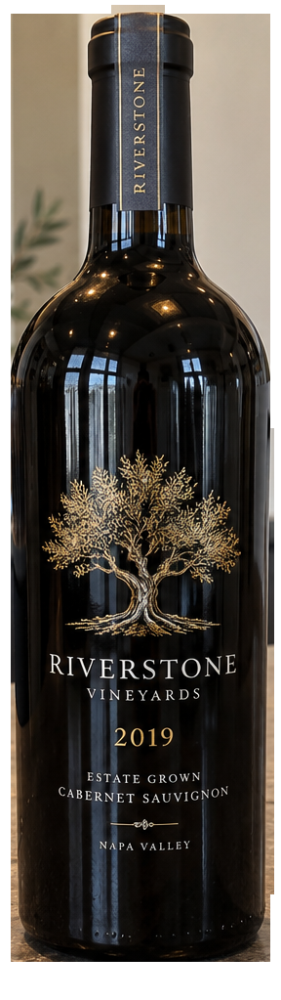
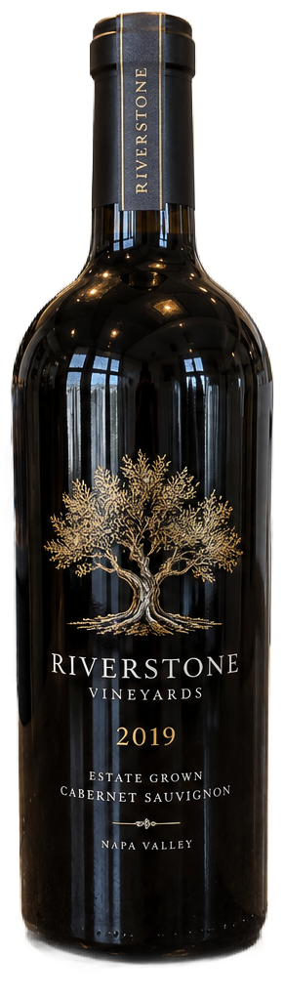

# main-selector-imagegen-pilot-v1-20261019:LA04

**Scene confirmed; masks pending. All targets/masks are proposals; no approved segmentation ground truth.**

**scene-v1: No automatic failure flag; usability pending.**

Reference title (source): Печать прямо на стекле

Reference target description (source): Основная центральная бутылка

Expected intent: `clear`. Accepted target proposals: `d11`.

Scene group: `main-selector-imagegen-pilot-v1-20261019:LA04`. Development only; no independent split claim.

## Original and proposed target





Green marks the unreviewed target proposal. Source image pixels are retained separately.

[Selected-label mask audit](../selected-label-mask-audit.json): incomplete proposal retention is flagged separately from target agreement.

[Full-resolution target proposal mask](../masks/pilot-v1--LA04-d11.png)

## Selector results

### scene-v1: No automatic failure flag; usability pending

Selected: d11; reason: existing_scene_v1_rank; mode: legacy; crop 266×971 px. Target agreement: True. Target retention proxy: 100.0%; maximum other-bottle retention: 0.0%; minimum associated label retention: 99.8%. Mask ownership, label completeness and legibility still require human review.



[Full-resolution keep mask](../keep-masks/pilot-v1--LA04-scene-v1.png) · [Exact decision JSON](../results/pilot-v1--LA04-scene-v1.json)

Associated label-mask retention proxies (unreviewed ownership): d21: 100.0%, 24305 source pixels; d24: 99.8%, 9467 source pixels; d25: 100.0%, 83545 source pixels

### semantic-v2: No automatic failure flag; usability pending

Selected: d11; reason: fallback_center_contains; mode: fallback; crop 288×1023 px. Target agreement: True. Target retention proxy: 100.0%; maximum other-bottle retention: 0.0%; minimum associated label retention: 100.0%. Mask ownership, label completeness and legibility still require human review. Selected-label mask audit: d25 100.0%; d24 100.0%.



[Full-resolution keep mask](../keep-masks/pilot-v1--LA04-semantic-v2.png) · [Exact decision JSON](../results/pilot-v1--LA04-semantic-v2.json)

Returned label views: [label 1](../label-crops/pilot-v1--LA04-semantic-v2-0.png) · [label 2](../label-crops/pilot-v1--LA04-semantic-v2-1.png)

Associated label-mask retention proxies (unreviewed ownership): d21: 100.0%, 24305 source pixels; d24: 100.0%, 9467 source pixels; d25: 100.0%, 83545 source pixels

### dis-v1: Proxy satisfied; usability pending

Selected: dis-foreground; reason: dis_foreground_mask; mode: foreground; crop 291×1024 px. Target agreement: n/a (no native target ID). Target retention proxy: 100.0%; maximum other-bottle retention: 0.0%; minimum associated label retention: 100.0%. Mask ownership, label completeness and legibility still require human review.



[Full-resolution keep mask](../keep-masks/pilot-v1--LA04-dis-v1.png) · [Exact decision JSON](../results/pilot-v1--LA04-dis-v1.json)

Associated label-mask retention proxies (unreviewed ownership): d21: 100.0%, 24305 source pixels; d24: 100.0%, 9467 source pixels; d25: 100.0%, 83545 source pixels

## All frozen mask proposals

These links expose every detector proposal, including labels and hands. Shapes and owners are unreviewed.

| ID | Detector class | Full-resolution mask |
|---|---|---|
| d0 | wine bottle | [PNG](../masks/pilot-v1--LA04-d0.png) |
| d1 | wine bottle | [PNG](../masks/pilot-v1--LA04-d1.png) |
| d2 | wine bottle | [PNG](../masks/pilot-v1--LA04-d2.png) |
| d3 | wine bottle | [PNG](../masks/pilot-v1--LA04-d3.png) |
| d4 | wine bottle | [PNG](../masks/pilot-v1--LA04-d4.png) |
| d5 | wine bottle | [PNG](../masks/pilot-v1--LA04-d5.png) |
| d6 | wine bottle | [PNG](../masks/pilot-v1--LA04-d6.png) |
| d7 | wine bottle | [PNG](../masks/pilot-v1--LA04-d7.png) |
| d8 | wine bottle | [PNG](../masks/pilot-v1--LA04-d8.png) |
| d9 | wine bottle | [PNG](../masks/pilot-v1--LA04-d9.png) |
| d10 | wine bottle | [PNG](../masks/pilot-v1--LA04-d10.png) |
| d11 | wine bottle | [PNG](../masks/pilot-v1--LA04-d11.png) |
| d12 | wine bottle | [PNG](../masks/pilot-v1--LA04-d12.png) |
| d13 | wine label | [PNG](../masks/pilot-v1--LA04-d13.png) |
| d14 | wine label | [PNG](../masks/pilot-v1--LA04-d14.png) |
| d15 | wine label | [PNG](../masks/pilot-v1--LA04-d15.png) |
| d16 | wine label | [PNG](../masks/pilot-v1--LA04-d16.png) |
| d17 | wine label | [PNG](../masks/pilot-v1--LA04-d17.png) |
| d18 | wine label | [PNG](../masks/pilot-v1--LA04-d18.png) |
| d19 | wine label | [PNG](../masks/pilot-v1--LA04-d19.png) |
| d20 | wine label | [PNG](../masks/pilot-v1--LA04-d20.png) |
| d21 | wine label | [PNG](../masks/pilot-v1--LA04-d21.png) |
| d22 | wine label | [PNG](../masks/pilot-v1--LA04-d22.png) |
| d23 | wine label | [PNG](../masks/pilot-v1--LA04-d23.png) |
| d24 | wine label | [PNG](../masks/pilot-v1--LA04-d24.png) |
| d25 | wine label | [PNG](../masks/pilot-v1--LA04-d25.png) |
| d26 | wine glass | [PNG](../masks/pilot-v1--LA04-d26.png) |
| d27 | wine glass | [PNG](../masks/pilot-v1--LA04-d27.png) |
| d28 | wine glass | [PNG](../masks/pilot-v1--LA04-d28.png) |
| d29 | wine glass | [PNG](../masks/pilot-v1--LA04-d29.png) |
| d30 | wine glass | [PNG](../masks/pilot-v1--LA04-d30.png) |
| d31 | wine glass | [PNG](../masks/pilot-v1--LA04-d31.png) |
| d32 | wine glass | [PNG](../masks/pilot-v1--LA04-d32.png) |
| d33 | wine glass | [PNG](../masks/pilot-v1--LA04-d33.png) |
| d34 | wine glass | [PNG](../masks/pilot-v1--LA04-d34.png) |

[Raw frozen detector response](../detections/pilot-v1--LA04.json)

<details><summary>Generation prompt (quoted source data)</summary>

```text
Use case: photorealistic-natural.
Asset type: one independent synthetic smartphone photograph for a wine-subject selection test dataset.
Style: a believable candid phone photo with realistic optics, materials, shadows, depth and anatomically plausible hands when requested. Natural photographic imperfections, not a diagram, collage, 3D render, advertisement or contact sheet.
Bottle labels may use fictional wine names and normal small wine-label text. Labels must have complete physical paper boundaries and plausible printing. Do not add target markers, bounding boxes, arrows, captions, segmentation colors, watermarks or any explanation outside the scene.
Generate exactly one landscape photograph, approximately 1536 by 1024 pixels. Any wine identity is fictional; this tests selection and visible-label preservation, not catalogue recognition.
Scene request: One physical wine bottle on a plain tasting counter. Wine name and vintage are printed directly in pale ink on dark glass, with a prominent gold graphic above and fine small identifying text below. There is no front paper rectangle, but there is a small neck paper strip. Whole visible printing region should be usable for recognition.
```

</details>

Source review notes (quoted reference data):

> На фоне добавлены бутылки на полках. Инвентарь шире одного основного предмета; полнота разметки конкурентов пока не подтверждена.
> Отдельная бумажная полоска на горлышке из рецепта не видна.
