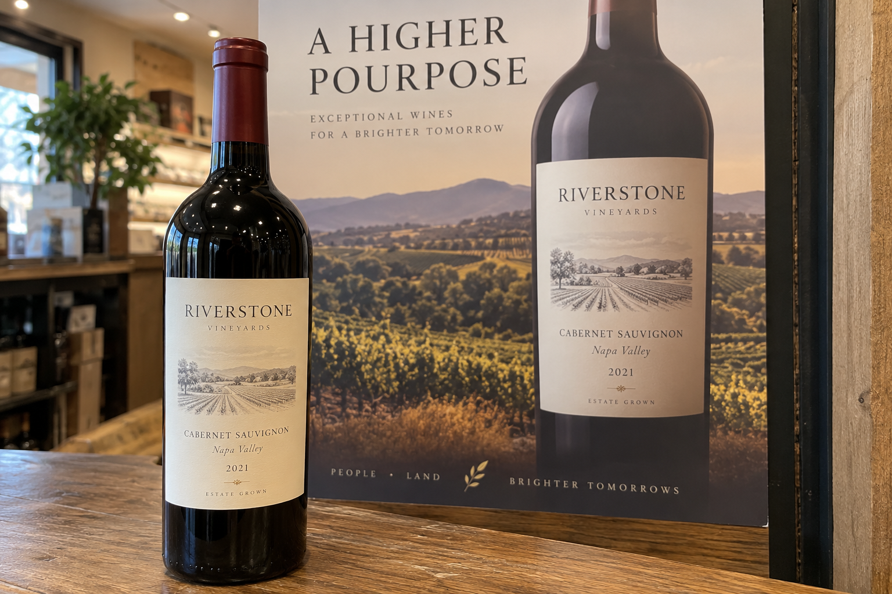
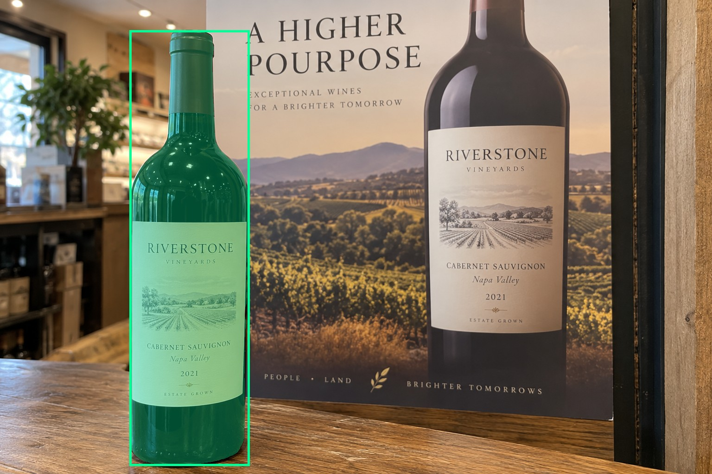
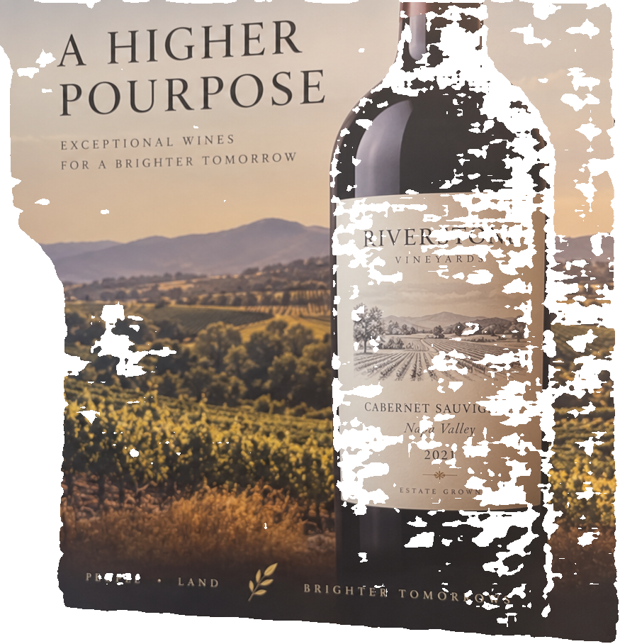
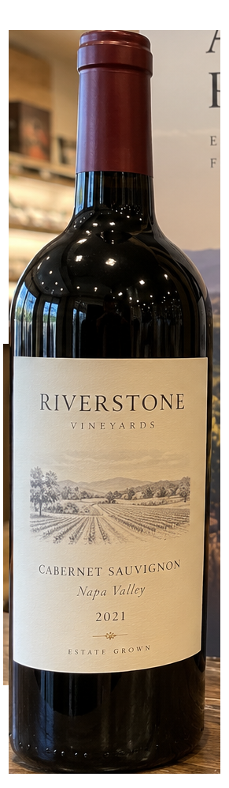
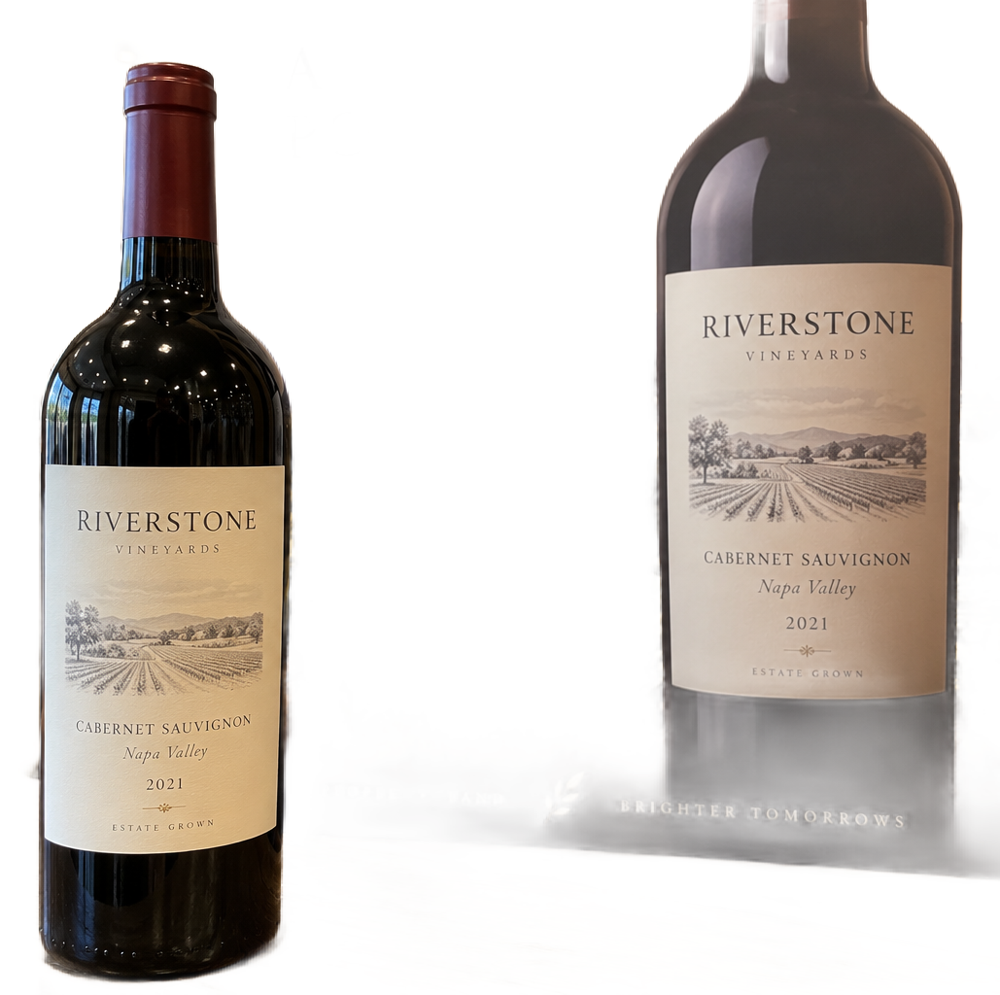

# main-selector-imagegen-pilot-v1-20261019:OW01

**Scene confirmed; masks pending. All targets/masks are proposals; no approved segmentation ground truth.**

**scene-v1: FAIL — provisional target/proxy.**

Reference title (source): Бутылка перед большим плакатом

Reference target description (source): Настоящая бутылка слева перед плакатом

Expected intent: `clear`. Accepted target proposals: `d4`.

Scene group: `main-selector-imagegen-pilot-v1-20261019:OW01`. Development only; no independent split claim.

## Original and proposed target





Green marks the unreviewed target proposal. Source image pixels are retained separately.

[Selected-label mask audit](../selected-label-mask-audit.json): incomplete proposal retention is flagged separately from target agreement.

[Full-resolution target proposal mask](../masks/pilot-v1--OW01-d4.png)

## Selector results

### scene-v1: FAIL — provisional target/proxy

Selected: d8; reason: existing_scene_v1_rank; mode: legacy; crop 875×908 px. Target agreement: False. Target retention proxy: 0.0%; maximum other-bottle retention: 71.9%; minimum associated label retention: 0.0%. Mask ownership, label completeness and legibility still require human review.



[Full-resolution keep mask](../keep-masks/pilot-v1--OW01-scene-v1.png) · [Exact decision JSON](../results/pilot-v1--OW01-scene-v1.json)

Associated label-mask retention proxies (unreviewed ownership): d6: 0.0%, 95885 source pixels

### semantic-v2: No automatic failure flag; usability pending

Selected: d4; reason: foreground_scale_and_lower_base; mode: confident; crop 291×997 px. Target agreement: True. Target retention proxy: 100.0%; maximum other-bottle retention: 0.0%; minimum associated label retention: 100.0%. Mask ownership, label completeness and legibility still require human review. Selected-label mask audit: d6 100.0%.



[Full-resolution keep mask](../keep-masks/pilot-v1--OW01-semantic-v2.png) · [Exact decision JSON](../results/pilot-v1--OW01-semantic-v2.json)

Returned label views: [label 1](../label-crops/pilot-v1--OW01-semantic-v2-0.png)

Associated label-mask retention proxies (unreviewed ownership): d6: 100.0%, 95885 source pixels

### dis-v1: PROXY failure; no native target ID

Selected: dis-foreground; reason: dis_foreground_mask; mode: foreground; crop 1029×1024 px. Target agreement: n/a (no native target ID). Target retention proxy: 99.9%; maximum other-bottle retention: 85.8%; minimum associated label retention: 99.8%. Mask ownership, label completeness and legibility still require human review.



[Full-resolution keep mask](../keep-masks/pilot-v1--OW01-dis-v1.png) · [Exact decision JSON](../results/pilot-v1--OW01-dis-v1.json)

Associated label-mask retention proxies (unreviewed ownership): d6: 99.8%, 95885 source pixels

## All frozen mask proposals

These links expose every detector proposal, including labels and hands. Shapes and owners are unreviewed.

| ID | Detector class | Full-resolution mask |
|---|---|---|
| d0 | wine bottle | [PNG](../masks/pilot-v1--OW01-d0.png) |
| d1 | wine bottle | [PNG](../masks/pilot-v1--OW01-d1.png) |
| d2 | wine bottle | [PNG](../masks/pilot-v1--OW01-d2.png) |
| d3 | wine bottle | [PNG](../masks/pilot-v1--OW01-d3.png) |
| d4 | wine bottle | [PNG](../masks/pilot-v1--OW01-d4.png) |
| d5 | wine label | [PNG](../masks/pilot-v1--OW01-d5.png) |
| d6 | wine label | [PNG](../masks/pilot-v1--OW01-d6.png) |
| d7 | box | [PNG](../masks/pilot-v1--OW01-d7.png) |
| d8 | box | [PNG](../masks/pilot-v1--OW01-d8.png) |
| d9 | box | [PNG](../masks/pilot-v1--OW01-d9.png) |
| d10 | box | [PNG](../masks/pilot-v1--OW01-d10.png) |
| d11 | box | [PNG](../masks/pilot-v1--OW01-d11.png) |
| d12 | box | [PNG](../masks/pilot-v1--OW01-d12.png) |
| d13 | box | [PNG](../masks/pilot-v1--OW01-d13.png) |
| d14 | box | [PNG](../masks/pilot-v1--OW01-d14.png) |
| d15 | box | [PNG](../masks/pilot-v1--OW01-d15.png) |
| d16 | box | [PNG](../masks/pilot-v1--OW01-d16.png) |
| d17 | box | [PNG](../masks/pilot-v1--OW01-d17.png) |

[Raw frozen detector response](../detections/pilot-v1--OW01.json)

<details><summary>Generation prompt (quoted source data)</summary>

```text
Use case: photorealistic-natural.
Asset type: one independent synthetic smartphone photograph for a wine-subject selection test dataset.
Style: a believable candid phone photo with realistic optics, materials, shadows, depth and anatomically plausible hands when requested. Natural photographic imperfections, not a diagram, collage, 3D render, advertisement or contact sheet.
Bottle labels may use fictional wine names and normal small wine-label text. Labels must have complete physical paper boundaries and plausible printing. Do not add target markers, bounding boxes, arrows, captions, segmentation colors, watermarks or any explanation outside the scene.
Generate exactly one landscape photograph, approximately 1536 by 1024 pixels. Any wine identity is fictional; this tests selection and visible-label preservation, not catalogue recognition.
Scene request: A real physical wine bottle stands in the left foreground on a shop counter. Behind it is a large flat rectangular poster with a printed image of another wine bottle that is larger than the real bottle. Poster edges and paper surface are plainly visible. The real foreground bottle is intentionally prominent; the printed depiction is background advertising. No other physical bottles.
```

</details>

Source review notes (quoted reference data):

> На дальних полках добавлены физические бутылки. Требуется проверить инвентарь и отделить их от рисунка на плакате.
