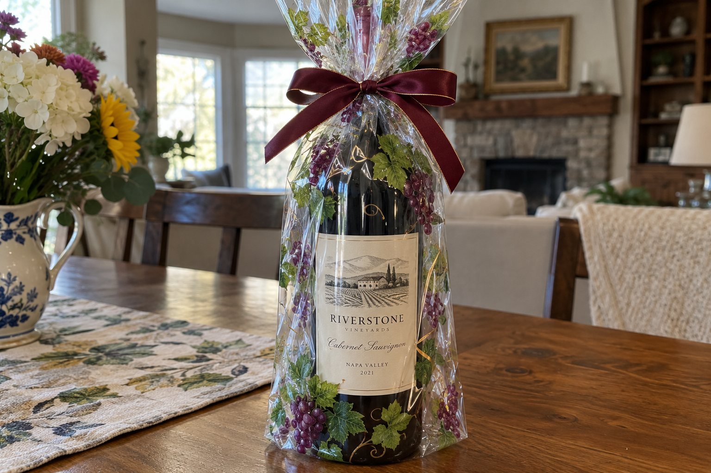
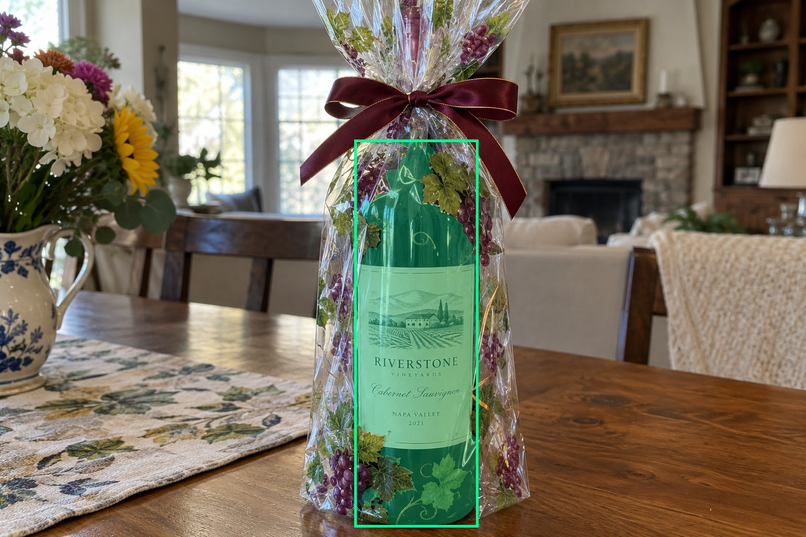
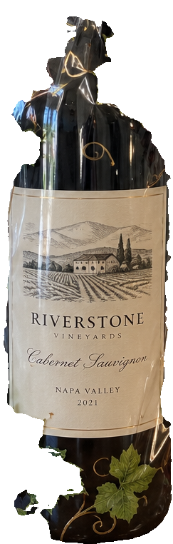
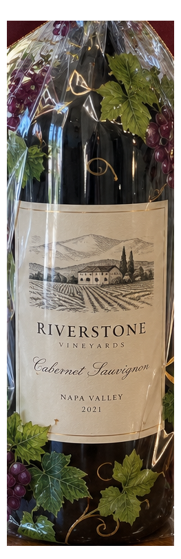
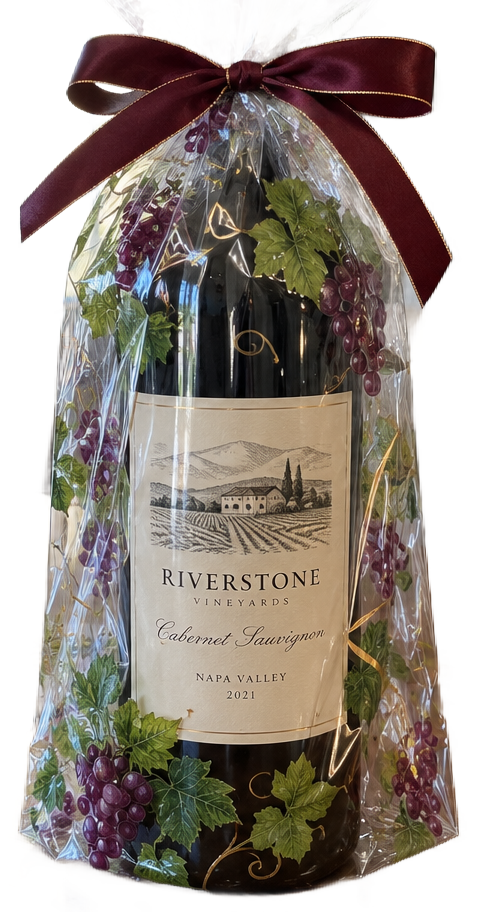

# main-selector-imagegen-pilot-v1-20261019:OW05

**Scene confirmed; masks pending. All targets/masks are proposals; no approved segmentation ground truth.**

**scene-v1: No automatic failure flag; usability pending.**

Reference title (source): Прозрачный пакет с графикой

Reference target description (source): Бутылка внутри прозрачного пакета

Expected intent: `clear`. Accepted target proposals: `d0`.

Scene group: `main-selector-imagegen-pilot-v1-20261019:OW05`. Development only; no independent split claim.

## Original and proposed target





Green marks the unreviewed target proposal. Source image pixels are retained separately.

[Selected-label mask audit](../selected-label-mask-audit.json): incomplete proposal retention is flagged separately from target agreement.

[Full-resolution target proposal mask](../masks/pilot-v1--OW05-d0.png)

## Selector results

### scene-v1: No automatic failure flag; usability pending

Selected: d0; reason: existing_scene_v1_rank; mode: legacy; crop 243×762 px. Target agreement: True. Target retention proxy: 100.0%; maximum other-bottle retention: 0.0%; minimum associated label retention: 100.0%. Mask ownership, label completeness and legibility still require human review.



[Full-resolution keep mask](../keep-masks/pilot-v1--OW05-scene-v1.png) · [Exact decision JSON](../results/pilot-v1--OW05-scene-v1.json)

Associated label-mask retention proxies (unreviewed ownership): d1: 100.0%, 72918 source pixels

### semantic-v2: No automatic failure flag; usability pending

Selected: d0; reason: only_credible_subject; mode: confident; crop 263×811 px. Target agreement: True. Target retention proxy: 100.0%; maximum other-bottle retention: 0.0%; minimum associated label retention: 100.0%. Mask ownership, label completeness and legibility still require human review. Selected-label mask audit: d1 100.0%.



[Full-resolution keep mask](../keep-masks/pilot-v1--OW05-semantic-v2.png) · [Exact decision JSON](../results/pilot-v1--OW05-semantic-v2.json)

Returned label views: [label 1](../label-crops/pilot-v1--OW05-semantic-v2-0.png)

Associated label-mask retention proxies (unreviewed ownership): d1: 100.0%, 72918 source pixels

### dis-v1: Proxy satisfied; usability pending

Selected: dis-foreground; reason: dis_foreground_mask; mode: foreground; crop 477×912 px. Target agreement: n/a (no native target ID). Target retention proxy: 100.0%; maximum other-bottle retention: 0.0%; minimum associated label retention: 100.0%. Mask ownership, label completeness and legibility still require human review.



[Full-resolution keep mask](../keep-masks/pilot-v1--OW05-dis-v1.png) · [Exact decision JSON](../results/pilot-v1--OW05-dis-v1.json)

Associated label-mask retention proxies (unreviewed ownership): d1: 100.0%, 72918 source pixels

## All frozen mask proposals

These links expose every detector proposal, including labels and hands. Shapes and owners are unreviewed.

| ID | Detector class | Full-resolution mask |
|---|---|---|
| d0 | wine bottle | [PNG](../masks/pilot-v1--OW05-d0.png) |
| d1 | wine label | [PNG](../masks/pilot-v1--OW05-d1.png) |

[Raw frozen detector response](../detections/pilot-v1--OW05.json)

<details><summary>Generation prompt (quoted source data)</summary>

```text
Use case: photorealistic-natural.
Asset type: one independent synthetic smartphone photograph for a wine-subject selection test dataset.
Style: a believable candid phone photo with realistic optics, materials, shadows, depth and anatomically plausible hands when requested. Natural photographic imperfections, not a diagram, collage, 3D render, advertisement or contact sheet.
Bottle labels may use fictional wine names and normal small wine-label text. Labels must have complete physical paper boundaries and plausible printing. Do not add target markers, bounding boxes, arrows, captions, segmentation colors, watermarks or any explanation outside the scene.
Generate exactly one landscape photograph, approximately 1536 by 1024 pixels. Any wine identity is fictional; this tests selection and visible-label preservation, not catalogue recognition.
Scene request: One real wine bottle is inside a clear cellophane gift bag on a table. The bag has bright printed decorative grape leaves and a ribbon near the neck, but the full visible cream front wine label remains visible through the bag. Include realistic highlights and folds without inventing extra bottle outlines. No other physical wine bottle.
```

</details>

Source review notes (quoted reference data):

> Прозрачная плёнка и отражения не дают точную физическую маску видимости автоматически.
