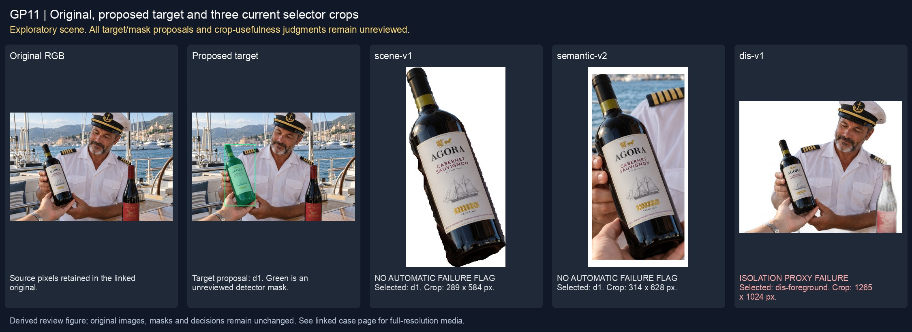
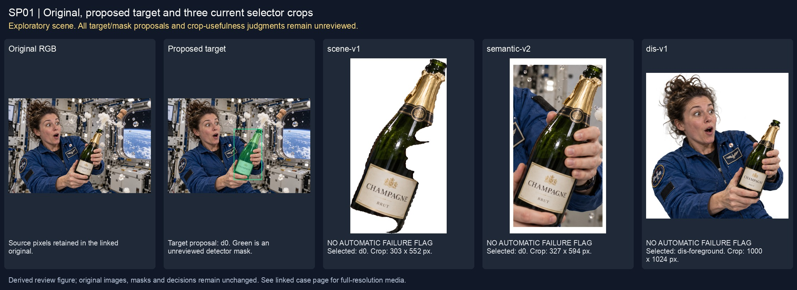
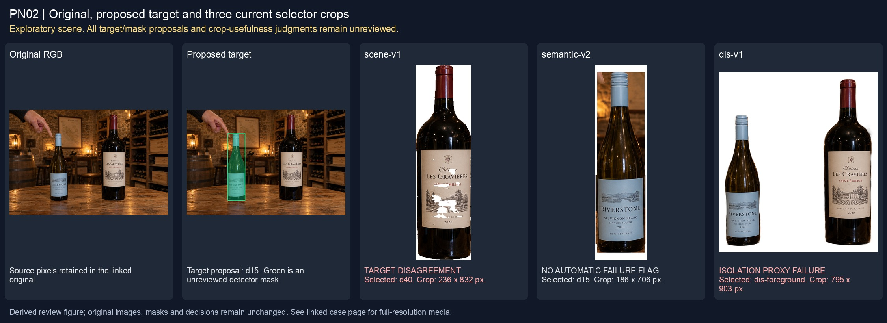

# Inline review figures

These figures replace browser screenshots that captured the summary instead of the intended case. They are derived directly from the unchanged frozen images, target overlays and selector crops. They introduce no new target, mask or human approval.

## main-selector-imagegen-diverse-v3-20261020:GP11

[Full original, proposal masks and crops](../imagegen-all152-current-20261020/cases/diverse-v3--GP11.md)

## main-selector-imagegen-diverse-v3-20261020:SP01

[Full original, proposal masks and crops](../imagegen-all152-current-20261020/cases/diverse-v3--SP01.md)

## main-selector-imagegen-diverse-v3-20261020:PN02

[Full original, proposal masks and crops](../imagegen-all152-current-20261020/cases/diverse-v3--PN02.md)
