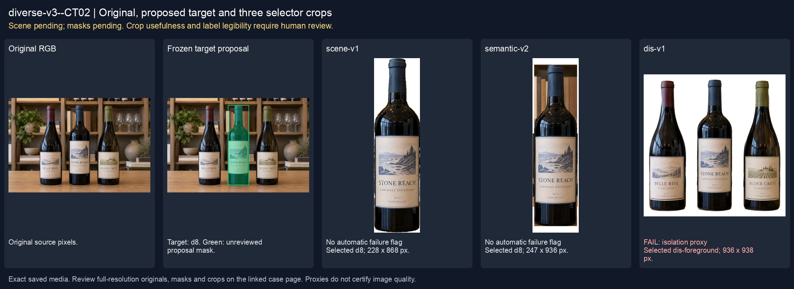
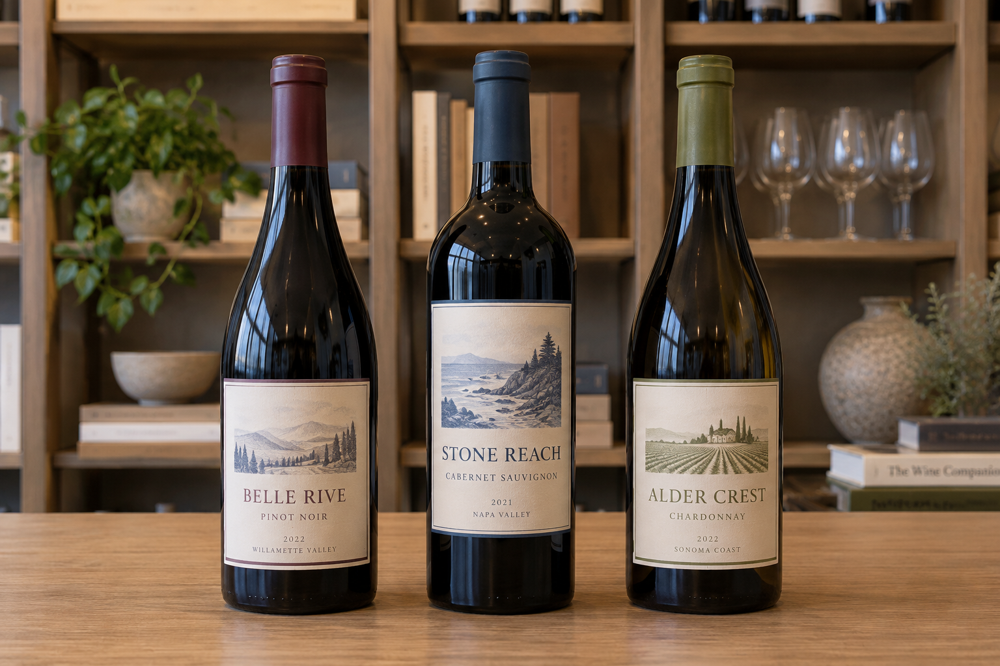
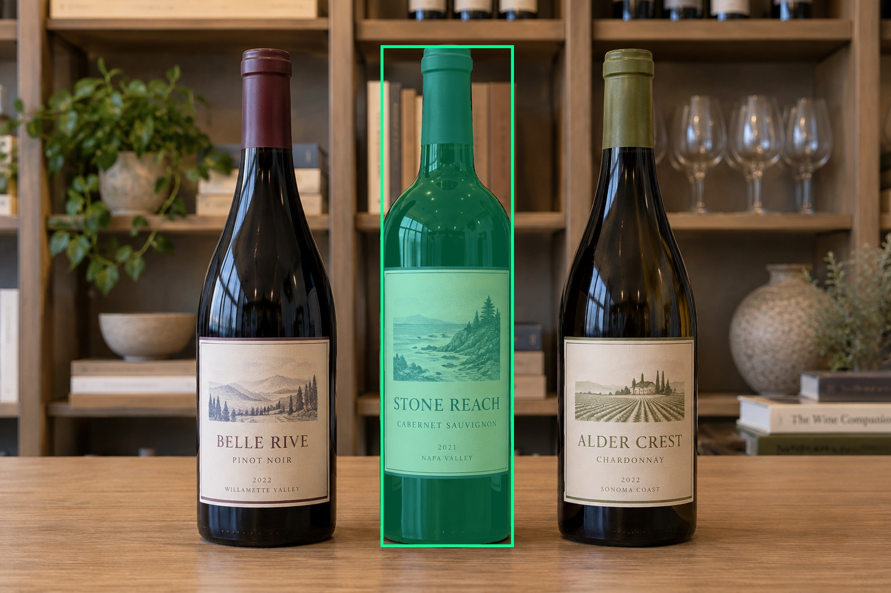
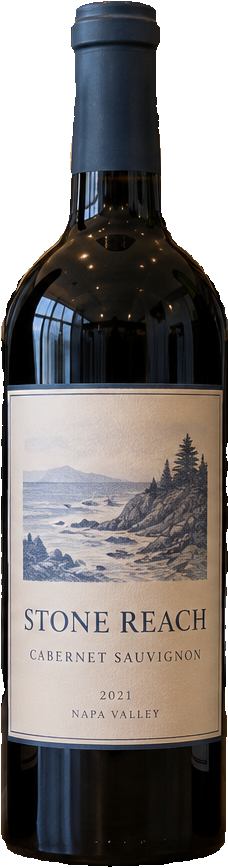
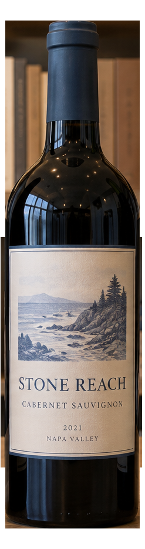
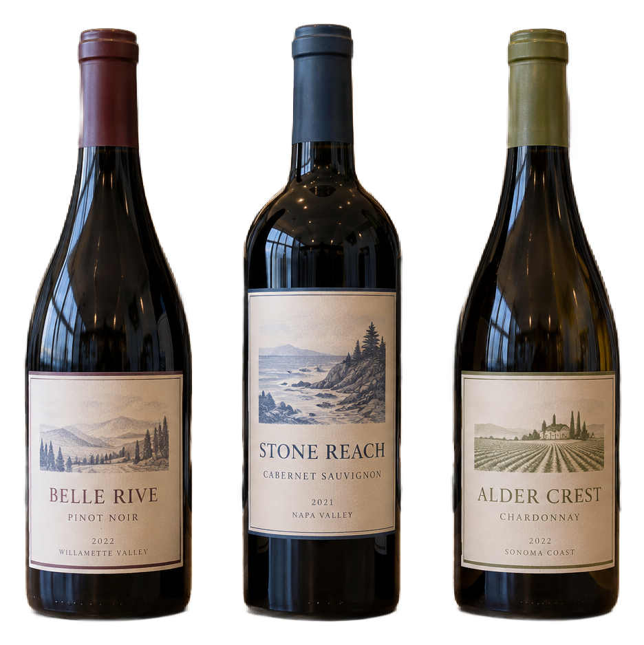

# main-selector-imagegen-diverse-v3-20261020:CT02

**Scene and masks pending — exploratory. All targets/masks are proposals; no approved segmentation ground truth.**



**scene-v1: No automatic failure flag; usability pending.**

Reference title (source): Три равных бутылки на полке · три равнозначные бутылки

Reference target description (source): Средняя бутылка — предварительный fallback

Expected intent: `ambiguous`. Accepted target proposals: `d8`.

Scene group: `main-selector-imagegen-diverse-v3-20261020:CT02`. Development only; no independent split claim.

## Original and proposed target





Green marks the unreviewed target proposal. Source image pixels are retained separately.

[Selected-label mask audit](../selected-label-mask-audit.json): incomplete proposal retention is flagged separately from target agreement.

[Full-resolution target proposal mask](../masks/diverse-v3--CT02-d8.png)

## Selector results

### scene-v1: No automatic failure flag; usability pending

Selected: d8; reason: existing_scene_v1_rank; mode: legacy; crop 228×868 px. Target agreement: True. Target retention proxy: 99.9%; maximum other-bottle retention: 0.0%; minimum associated label retention: 100.0%. Mask ownership, label completeness and legibility still require human review.



[Full-resolution keep mask](../keep-masks/diverse-v3--CT02-scene-v1.png) · [Exact decision JSON](../results/diverse-v3--CT02-scene-v1.json)

Associated label-mask retention proxies (unreviewed ownership): d18: 100.0%, 77681 source pixels

### semantic-v2: No automatic failure flag; usability pending

Selected: d8; reason: fallback_center_contains; mode: fallback; crop 247×936 px. Target agreement: True. Target retention proxy: 100.0%; maximum other-bottle retention: 0.0%; minimum associated label retention: 100.0%. Mask ownership, label completeness and legibility still require human review. Selected-label mask audit: d18 100.0%.



[Full-resolution keep mask](../keep-masks/diverse-v3--CT02-semantic-v2.png) · [Exact decision JSON](../results/diverse-v3--CT02-semantic-v2.json)

Returned label views: [label 1](../label-crops/diverse-v3--CT02-semantic-v2-0.png)

Associated label-mask retention proxies (unreviewed ownership): d18: 100.0%, 77681 source pixels

### dis-v1: PROXY failure; no native target ID

Selected: dis-foreground; reason: dis_foreground_mask; mode: foreground; crop 936×938 px. Target agreement: n/a (no native target ID). Target retention proxy: 100.0%; maximum other-bottle retention: 99.9%; minimum associated label retention: 100.0%. Mask ownership, label completeness and legibility still require human review.



[Full-resolution keep mask](../keep-masks/diverse-v3--CT02-dis-v1.png) · [Exact decision JSON](../results/diverse-v3--CT02-dis-v1.json)

Associated label-mask retention proxies (unreviewed ownership): d18: 100.0%, 77681 source pixels

## All frozen mask proposals

These links expose every detector proposal, including labels and hands. Shapes and owners are unreviewed.

| ID | Detector class | Full-resolution mask |
|---|---|---|
| d0 | wine bottle | [PNG](../masks/diverse-v3--CT02-d0.png) |
| d1 | wine bottle | [PNG](../masks/diverse-v3--CT02-d1.png) |
| d2 | wine bottle | [PNG](../masks/diverse-v3--CT02-d2.png) |
| d3 | wine bottle | [PNG](../masks/diverse-v3--CT02-d3.png) |
| d4 | wine bottle | [PNG](../masks/diverse-v3--CT02-d4.png) |
| d5 | wine bottle | [PNG](../masks/diverse-v3--CT02-d5.png) |
| d6 | wine bottle | [PNG](../masks/diverse-v3--CT02-d6.png) |
| d7 | wine bottle | [PNG](../masks/diverse-v3--CT02-d7.png) |
| d8 | wine bottle | [PNG](../masks/diverse-v3--CT02-d8.png) |
| d9 | wine bottle | [PNG](../masks/diverse-v3--CT02-d9.png) |
| d10 | wine bottle | [PNG](../masks/diverse-v3--CT02-d10.png) |
| d11 | wine bottle | [PNG](../masks/diverse-v3--CT02-d11.png) |
| d12 | wine label | [PNG](../masks/diverse-v3--CT02-d12.png) |
| d13 | wine label | [PNG](../masks/diverse-v3--CT02-d13.png) |
| d14 | wine label | [PNG](../masks/diverse-v3--CT02-d14.png) |
| d15 | wine label | [PNG](../masks/diverse-v3--CT02-d15.png) |
| d16 | wine label | [PNG](../masks/diverse-v3--CT02-d16.png) |
| d17 | wine label | [PNG](../masks/diverse-v3--CT02-d17.png) |
| d18 | wine label | [PNG](../masks/diverse-v3--CT02-d18.png) |
| d19 | wine label | [PNG](../masks/diverse-v3--CT02-d19.png) |
| d20 | wine label | [PNG](../masks/diverse-v3--CT02-d20.png) |
| d21 | wine glass | [PNG](../masks/diverse-v3--CT02-d21.png) |
| d22 | wine glass | [PNG](../masks/diverse-v3--CT02-d22.png) |
| d23 | wine glass | [PNG](../masks/diverse-v3--CT02-d23.png) |
| d24 | wine glass | [PNG](../masks/diverse-v3--CT02-d24.png) |
| d25 | wine glass | [PNG](../masks/diverse-v3--CT02-d25.png) |
| d26 | wine glass | [PNG](../masks/diverse-v3--CT02-d26.png) |
| d27 | wine glass | [PNG](../masks/diverse-v3--CT02-d27.png) |

## Additional image-only context masks

Fixed English noun requests used RGB only; no target or annotation was supplied. Primary dN IDs remain unchanged. These masks are detector evidence, not reviewed ground truth.

[Saved validated context response](../context/diverse-v3--CT02.json)

| Appended ID | Context class | Full-resolution mask |
|---|---|---|
| d28 | bottle held in hand | [PNG](../context-masks/diverse-v3--CT02-d28.png) |
| d29 | bottle held in hand | [PNG](../context-masks/diverse-v3--CT02-d29.png) |
| d30 | bottle held in hand | [PNG](../context-masks/diverse-v3--CT02-d30.png) |
| d31 | bottle held in hand | [PNG](../context-masks/diverse-v3--CT02-d31.png) |
| d32 | bottle held in hand | [PNG](../context-masks/diverse-v3--CT02-d32.png) |
| d33 | bottle held in hand | [PNG](../context-masks/diverse-v3--CT02-d33.png) |

[Raw frozen detector response](../detections/diverse-v3--CT02.json)

<details><summary>Generation prompt (quoted source data)</summary>

```text
Use case: photorealistic-natural. Generate ONE independent photograph, landscape 3:2, approximately 1536 by 1024 pixels. A tidy wine-store display with exactly three equally prominent bottles in the foreground and neutral shelves behind. No customer hands or dominant gesture. Exactly three similarly sized upright wine bottles form an evenly spaced row on a plain table, same depth and lighting, middle bottle exactly at photo center. Labels differ in muted color but have same size and contrast. No hands, no obvious main subject or other bottles. Make the scene composition, person, clothing and location specific to this scenario, rather than repeating a generic bottle on a tasting counter. Show genuine physical contact when a grip is requested. Fictional wine branding; no arrows, bounding boxes, captions, collages, watermark or UI. Maintain anatomically plausible hands. Keep the target visible label inside the frame except the explicit close-up and occlusion cases.
```

</details>

Source review notes (quoted reference data):

> Цель предварительно связана с маской SAM3 по заданию генерации; подтвердите по самому фото. Форма масок и их владельцы ещё не проверены.
> Окружение: Три равных бутылки на полке. Проверьте реалистичность рук, хват и присутствие требуемых деталей.
