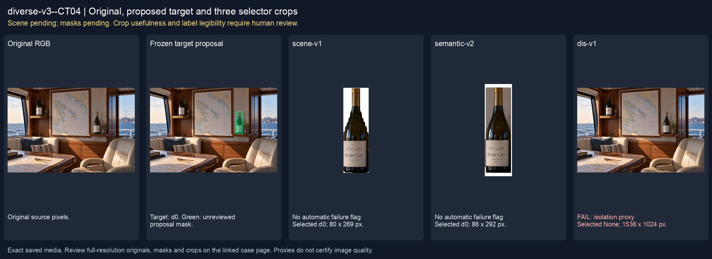
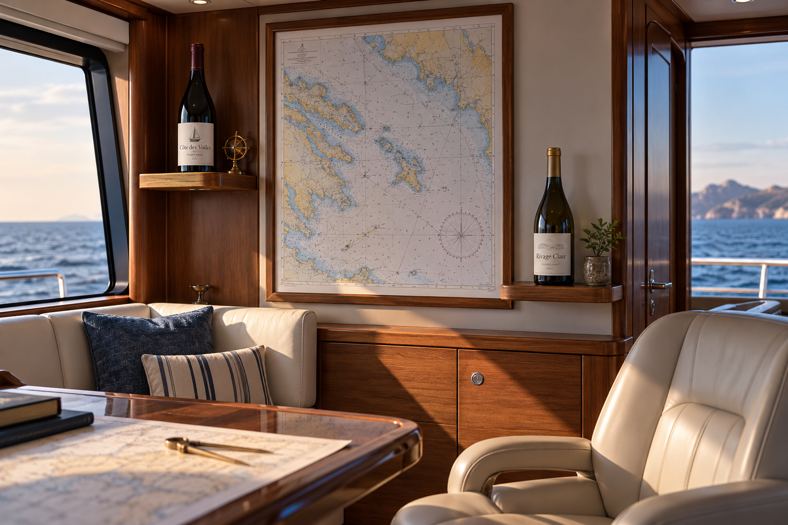
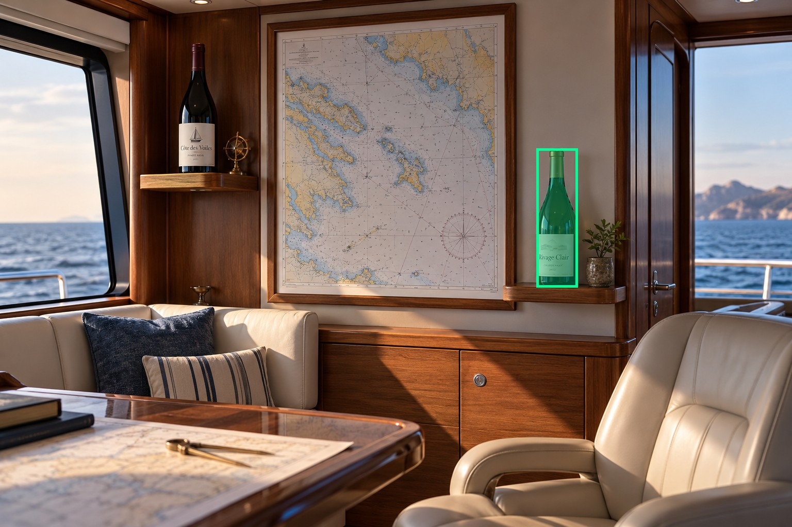
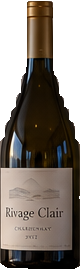
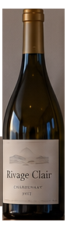

# main-selector-imagegen-diverse-v3-20261020:CT04

**Scene and masks pending — exploratory. All targets/masks are proposals; no approved segmentation ground truth.**



**scene-v1: No automatic failure flag; usability pending.**

Reference title (source): Равная пара в каюте · равнозначные бутылки на полках

Reference target description (source): Неоднозначные бутылки на полках — fallback

Expected intent: `ambiguous`. Accepted target proposals: `d0`.

Scene group: `main-selector-imagegen-diverse-v3-20261020:CT04`. Development only; no independent split claim.

## Original and proposed target





Green marks the unreviewed target proposal. Source image pixels are retained separately.

[Selected-label mask audit](../selected-label-mask-audit.json): incomplete proposal retention is flagged separately from target agreement.

[Full-resolution target proposal mask](../masks/diverse-v3--CT04-d0.png)

## Selector results

### scene-v1: No automatic failure flag; usability pending

Selected: d0; reason: existing_scene_v1_rank; mode: legacy; crop 80×269 px. Target agreement: True. Target retention proxy: 99.7%; maximum other-bottle retention: 0.0%; minimum associated label retention: 100.0%. Mask ownership, label completeness and legibility still require human review.



[Full-resolution keep mask](../keep-masks/diverse-v3--CT04-scene-v1.png) · [Exact decision JSON](../results/diverse-v3--CT04-scene-v1.json)

Associated label-mask retention proxies (unreviewed ownership): d2: 100.0%, 6111 source pixels

### semantic-v2: No automatic failure flag; usability pending

Selected: d0; reason: fallback_nearest_center; mode: fallback; crop 86×292 px. Target agreement: True. Target retention proxy: 100.0%; maximum other-bottle retention: 0.0%; minimum associated label retention: 100.0%. Mask ownership, label completeness and legibility still require human review. Selected-label mask audit: d2 100.0%.



[Full-resolution keep mask](../keep-masks/diverse-v3--CT04-semantic-v2.png) · [Exact decision JSON](../results/diverse-v3--CT04-semantic-v2.json)

Returned label views: [label 1](../label-crops/diverse-v3--CT04-semantic-v2-0.png)

Associated label-mask retention proxies (unreviewed ownership): d2: 100.0%, 6111 source pixels

### dis-v1: PROXY failure; no native target ID

Selected: None; reason: fallback_original_frame; mode: fallback; crop 1536×1024 px. Target agreement: n/a (no native target ID). Target retention proxy: 100.0%; maximum other-bottle retention: 100.0%; minimum associated label retention: 100.0%. Mask ownership, label completeness and legibility still require human review.


[Full-resolution keep mask](../keep-masks/diverse-v3--CT04-dis-v1.png) · [Exact decision JSON](../results/diverse-v3--CT04-dis-v1.json)

Associated label-mask retention proxies (unreviewed ownership): d2: 100.0%, 6111 source pixels

## All frozen mask proposals

These links expose every detector proposal, including labels and hands. Shapes and owners are unreviewed.

| ID | Detector class | Full-resolution mask |
|---|---|---|
| d0 | wine bottle | [PNG](../masks/diverse-v3--CT04-d0.png) |
| d1 | wine bottle | [PNG](../masks/diverse-v3--CT04-d1.png) |
| d2 | wine label | [PNG](../masks/diverse-v3--CT04-d2.png) |
| d3 | wine label | [PNG](../masks/diverse-v3--CT04-d3.png) |
| d4 | wine glass | [PNG](../masks/diverse-v3--CT04-d4.png) |

## Additional image-only context masks

Fixed English noun requests used RGB only; no target or annotation was supplied. Primary dN IDs remain unchanged. These masks are detector evidence, not reviewed ground truth.

[Saved validated context response](../context/diverse-v3--CT04.json)

| Appended ID | Context class | Full-resolution mask |
|---|---|---|
| d5 | bottle held in hand | [PNG](../context-masks/diverse-v3--CT04-d5.png) |
| d6 | bottle held in hand | [PNG](../context-masks/diverse-v3--CT04-d6.png) |

[Raw frozen detector response](../detections/diverse-v3--CT04.json)

<details><summary>Generation prompt (quoted source data)</summary>

```text
Use case: photorealistic-natural. Generate ONE independent photograph, landscape 3:2, approximately 1536 by 1024 pixels. An unoccupied captain cabin on a modern yacht, chart on wall, two short shelves and sea through windows. Two equally prominent bottles on separate shelves, no hands or intended main subject. Exactly two similarly sized wine bottles on separate short shelves, one upper left and one lower right, equal distance from image center and equal apparent label size. No hands or depth dominance. Both shelf edges visible. Avoid making either bottle the obvious main subject. Make the scene composition, person, clothing and location specific to this scenario, rather than repeating a generic bottle on a tasting counter. Show genuine physical contact when a grip is requested. Fictional wine branding; no arrows, bounding boxes, captions, collages, watermark or UI. Maintain anatomically plausible hands. Keep the target visible label inside the frame except the explicit close-up and occlusion cases.
```

</details>

Source review notes (quoted reference data):

> Цель предварительно связана с маской SAM3 по заданию генерации; подтвердите по самому фото. Форма масок и их владельцы ещё не проверены.
> Окружение: Равная пара в каюте. Проверьте реалистичность рук, хват и присутствие требуемых деталей.
> Вместо равной симметричной пары получились две бутылки разного размера и на разной высоте. Явного удержания или указания нет; подтвердите пригодность как неоднозначного случая.
