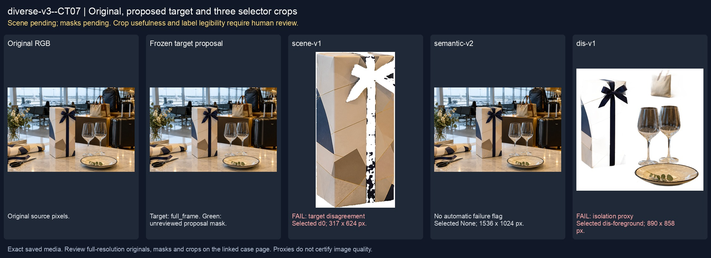
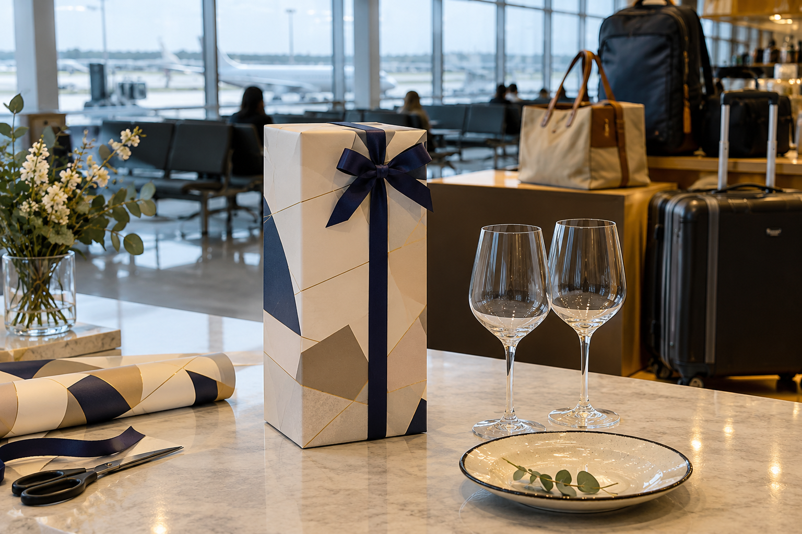
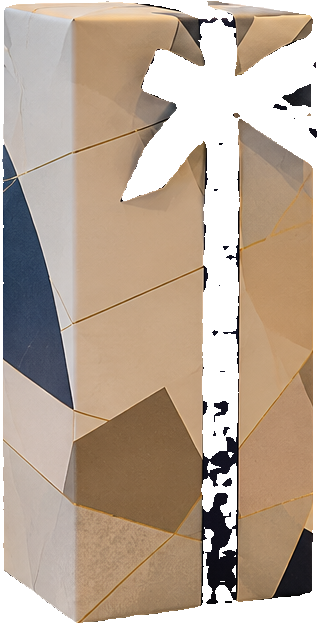
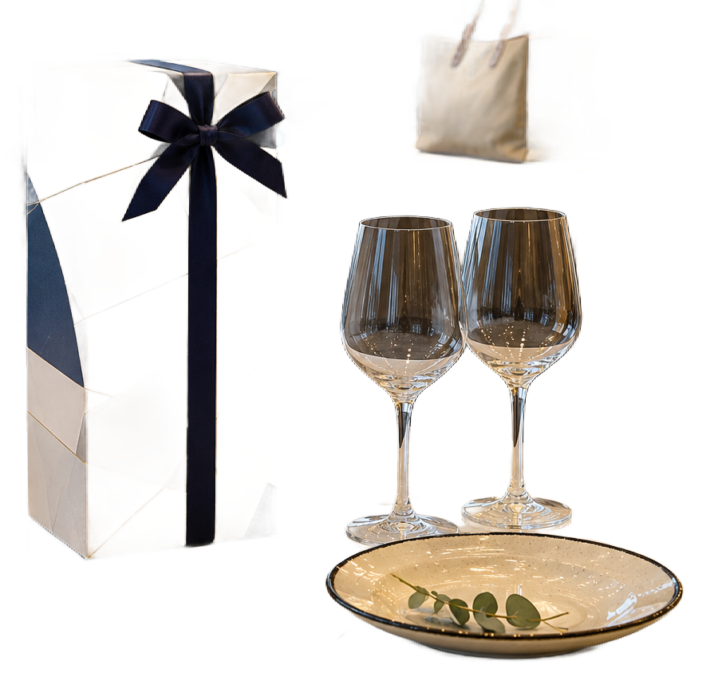

# main-selector-imagegen-diverse-v3-20261020:CT07

**Scene and masks pending — exploratory. All targets/masks are proposals; no approved segmentation ground truth.**



**scene-v1: FAIL — provisional target/proxy.**

Reference title (source): Закрытая коробка в аэропорту · коробка без изображения бутылки

Reference target description (source): Нет видимой бутылки — полный кадр

Expected intent: `no_target`. Accepted target proposals: `full_frame`.

Scene group: `main-selector-imagegen-diverse-v3-20261020:CT07`. Development only; no independent split claim.

## Original and proposed target




Green marks the unreviewed target proposal. Source image pixels are retained separately.

[Selected-label mask audit](../selected-label-mask-audit.json): incomplete proposal retention is flagged separately from target agreement.

## Selector results

### scene-v1: FAIL — provisional target/proxy

Selected: d0; reason: existing_scene_v1_rank; mode: legacy; crop 317×624 px. Target agreement: False. Target retention proxy: n/a; maximum other-bottle retention: n/a; minimum associated label retention: n/a. Mask ownership, label completeness and legibility still require human review.



[Full-resolution keep mask](../keep-masks/diverse-v3--CT07-scene-v1.png) · [Exact decision JSON](../results/diverse-v3--CT07-scene-v1.json)

### semantic-v2: No automatic failure flag; usability pending

Selected: None; reason: fallback_original_frame; mode: fallback; crop 1536×1024 px. Target agreement: True. Target retention proxy: n/a; maximum other-bottle retention: n/a; minimum associated label retention: n/a. Mask ownership, label completeness and legibility still require human review.


[Full-resolution keep mask](../keep-masks/diverse-v3--CT07-semantic-v2.png) · [Exact decision JSON](../results/diverse-v3--CT07-semantic-v2.json)

### dis-v1: PROXY failure; no native target ID

Selected: dis-foreground; reason: dis_foreground_mask; mode: foreground; crop 890×858 px. Target agreement: n/a (no native target ID). Target retention proxy: n/a; maximum other-bottle retention: n/a; minimum associated label retention: n/a. Mask ownership, label completeness and legibility still require human review.



[Full-resolution keep mask](../keep-masks/diverse-v3--CT07-dis-v1.png) · [Exact decision JSON](../results/diverse-v3--CT07-dis-v1.json)

## All frozen mask proposals

These links expose every detector proposal, including labels and hands. Shapes and owners are unreviewed.

| ID | Detector class | Full-resolution mask |
|---|---|---|
| d0 | box | [PNG](../masks/diverse-v3--CT07-d0.png) |
| d1 | wine glass | [PNG](../masks/diverse-v3--CT07-d1.png) |
| d2 | wine glass | [PNG](../masks/diverse-v3--CT07-d2.png) |

## Additional image-only context masks

Fixed English noun requests used RGB only; no target or annotation was supplied. Primary dN IDs remain unchanged. These masks are detector evidence, not reviewed ground truth.

[Saved validated context response](../context/diverse-v3--CT07.json)

| Appended ID | Context class | Full-resolution mask |
|---|---|---|

[Raw frozen detector response](../detections/diverse-v3--CT07.json)

<details><summary>Generation prompt (quoted source data)</summary>

```text
Use case: photorealistic-natural. Generate ONE independent photograph, landscape 3:2, approximately 1536 by 1024 pixels. An airport gift-packing corner with a plain closed carton and accessories on a counter, travel bags behind. Absolutely no visible bottles or printed bottle images in frame. A closed plain rectangular gift carton, two empty glasses and a plate on a table. NO visible wine bottle, no printed bottle image, no bottle-shaped decoration, no hands. The plain carton has only abstract geometric patterns and a small ribbon. Ordinary smartphone photograph. Make the scene composition, person, clothing and location specific to this scenario, rather than repeating a generic bottle on a tasting counter. Show genuine physical contact when a grip is requested. Fictional wine branding; no arrows, bounding boxes, captions, collages, watermark or UI. Maintain anatomically plausible hands. Keep the target visible label inside the frame except the explicit close-up and occlusion cases.
```

</details>

Source review notes (quoted reference data):

> Цель предварительно связана с маской SAM3 по заданию генерации; подтвердите по самому фото. Форма масок и их владельцы ещё не проверены.
> Окружение: Закрытая коробка в аэропорту. Проверьте реалистичность рук, хват и присутствие требуемых деталей.
