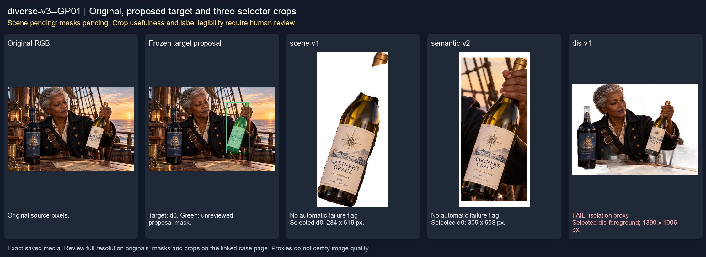
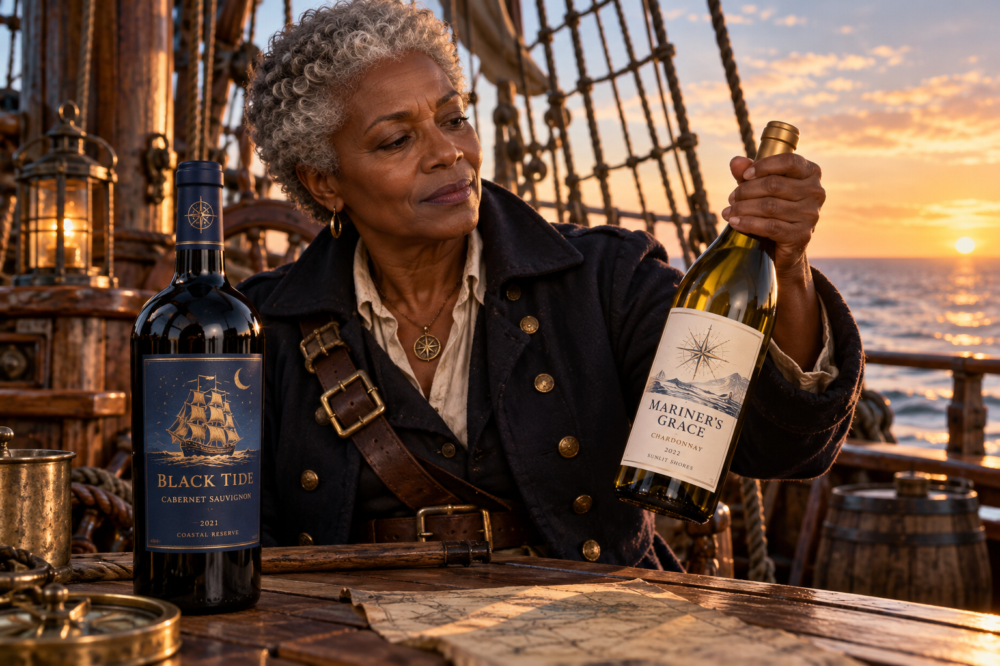
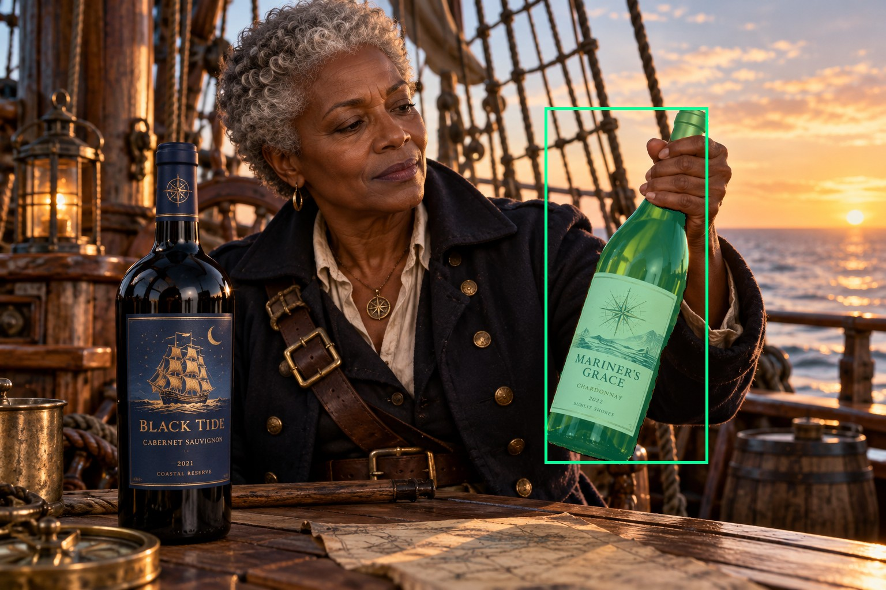
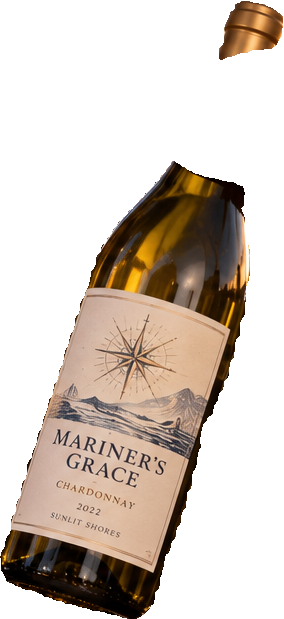
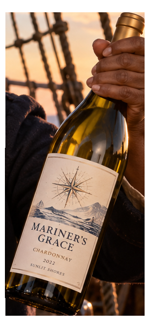
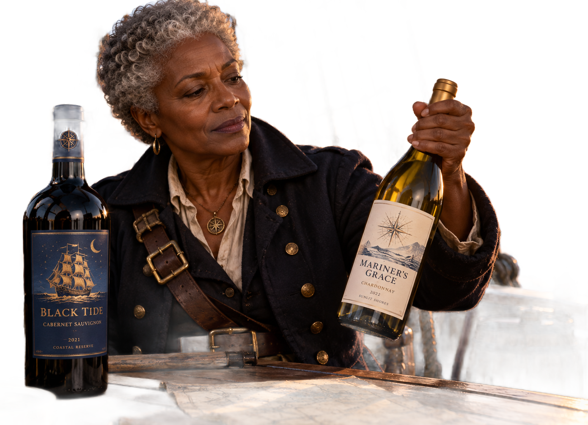

# main-selector-imagegen-diverse-v3-20261020:GP01

**Scene and masks pending — exploratory. All targets/masks are proposals; no approved segmentation ground truth.**



**scene-v1: No automatic failure flag; usability pending.**

Reference title (source): Оригинальная пиратская капитанша · хват за горлышко справа

Reference target description (source): Правая бутылка, удерживаемая за горлышко

Expected intent: `clear`. Accepted target proposals: `d0`.

Scene group: `main-selector-imagegen-diverse-v3-20261020:GP01`. Development only; no independent split claim.

## Original and proposed target





Green marks the unreviewed target proposal. Source image pixels are retained separately.

[Selected-label mask audit](../selected-label-mask-audit.json): incomplete proposal retention is flagged separately from target agreement.

[Full-resolution target proposal mask](../masks/diverse-v3--GP01-d0.png)

## Selector results

### scene-v1: No automatic failure flag; usability pending

Selected: d0; reason: existing_scene_v1_rank; mode: legacy; crop 284×619 px. Target agreement: True. Target retention proxy: 100.0%; maximum other-bottle retention: 0.0%; minimum associated label retention: 100.0%. Mask ownership, label completeness and legibility still require human review.



[Full-resolution keep mask](../keep-masks/diverse-v3--GP01-scene-v1.png) · [Exact decision JSON](../results/diverse-v3--GP01-scene-v1.json)

Associated label-mask retention proxies (unreviewed ownership): d2: 100.0%, 38784 source pixels

### semantic-v2: No automatic failure flag; usability pending

Selected: d0; reason: unique_visible_hand_contact; mode: confident; crop 305×668 px. Target agreement: True. Target retention proxy: 100.0%; maximum other-bottle retention: 0.0%; minimum associated label retention: 100.0%. Mask ownership, label completeness and legibility still require human review. Selected-label mask audit: d2 100.0%.



[Full-resolution keep mask](../keep-masks/diverse-v3--GP01-semantic-v2.png) · [Exact decision JSON](../results/diverse-v3--GP01-semantic-v2.json)

Returned label views: [label 1](../label-crops/diverse-v3--GP01-semantic-v2-0.png)

Associated label-mask retention proxies (unreviewed ownership): d2: 100.0%, 38784 source pixels

### dis-v1: PROXY failure; no native target ID

Selected: dis-foreground; reason: dis_foreground_mask; mode: foreground; crop 1390×1006 px. Target agreement: n/a (no native target ID). Target retention proxy: 100.0%; maximum other-bottle retention: 95.6%; minimum associated label retention: 100.0%. Mask ownership, label completeness and legibility still require human review.



[Full-resolution keep mask](../keep-masks/diverse-v3--GP01-dis-v1.png) · [Exact decision JSON](../results/diverse-v3--GP01-dis-v1.json)

Associated label-mask retention proxies (unreviewed ownership): d2: 100.0%, 38784 source pixels

## All frozen mask proposals

These links expose every detector proposal, including labels and hands. Shapes and owners are unreviewed.

| ID | Detector class | Full-resolution mask |
|---|---|---|
| d0 | wine bottle | [PNG](../masks/diverse-v3--GP01-d0.png) |
| d1 | wine bottle | [PNG](../masks/diverse-v3--GP01-d1.png) |
| d2 | wine label | [PNG](../masks/diverse-v3--GP01-d2.png) |
| d3 | wine label | [PNG](../masks/diverse-v3--GP01-d3.png) |
| d4 | wine label | [PNG](../masks/diverse-v3--GP01-d4.png) |
| d5 | hand | [PNG](../masks/diverse-v3--GP01-d5.png) |
| d6 | hand | [PNG](../masks/diverse-v3--GP01-d6.png) |

## Additional image-only context masks

Fixed English noun requests used RGB only; no target or annotation was supplied. Primary dN IDs remain unchanged. These masks are detector evidence, not reviewed ground truth.

[Saved validated context response](../context/diverse-v3--GP01.json)

| Appended ID | Context class | Full-resolution mask |
|---|---|---|
| d7 | bottle held in hand | [PNG](../context-masks/diverse-v3--GP01-d7.png) |
| d8 | bottle held in hand | [PNG](../context-masks/diverse-v3--GP01-d8.png) |

[Raw frozen detector response](../detections/diverse-v3--GP01.json)

<details><summary>Generation prompt (quoted source data)</summary>

```text
Generate ONE independent landscape 3:2 photograph, approximately 1536 by 1024 pixels. An original Black female pirate captain in her sixties, short silver hair and a plain navy wool coat, examines a wine bottle on the teak deck of a wooden sailing ship. Show her face and upper torso, rigging and sunset sea. Two physical wine bottles. Her hand from upper right clearly encloses the NECK of the RIGHT white-label bottle, thumb and fingers wrapping opposing sides, lifting its base slightly. The LEFT blue-label bottle is unattended and larger. Full target label toward camera and inside the frame. Photorealistic candid cinematic photograph, fictional wine branding, anatomically plausible hands, visible physical contact where requested. No captions, arrows, bounding boxes, watermarks, collage or UI. Create entirely original pirate characters with no actor or existing film character likeness.
```

</details>

Source review notes (quoted reference data):

> Цель предварительно связана с маской SAM3 по заданию генерации; подтвердите по самому фото. Форма масок и их владельцы ещё не проверены.
> Окружение: Пиратская капитанша на палубе. Проверьте реалистичность рук, хват и присутствие требуемых деталей.
> Запрос с Джеком Воробьём заблокирован генератором; здесь отдельная оригинальная пиратская капитанша.
