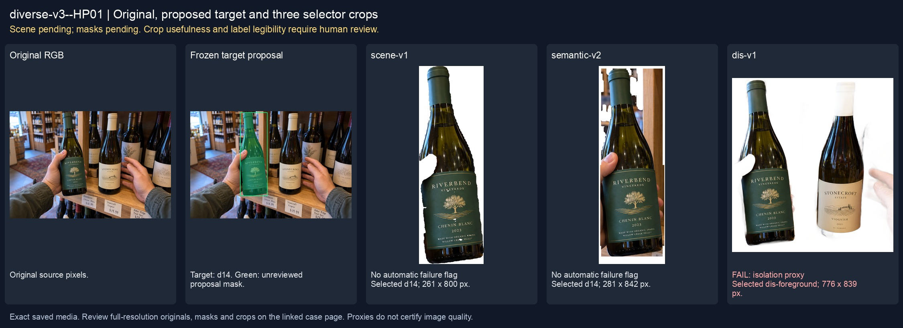
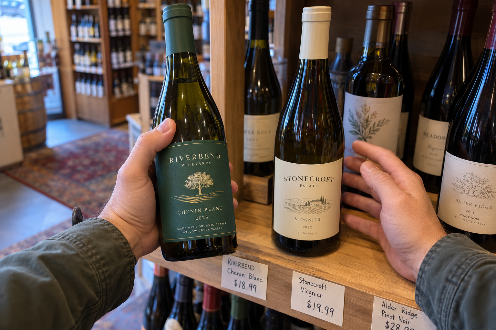
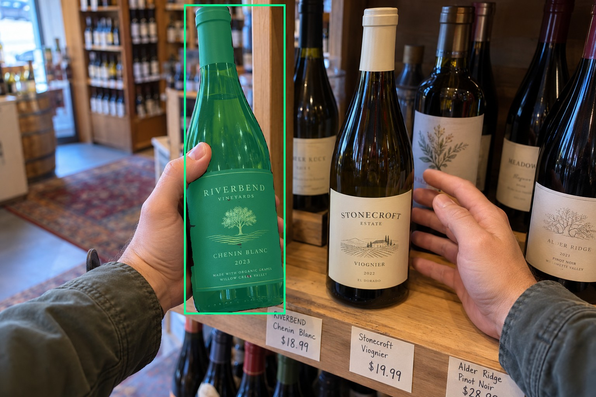
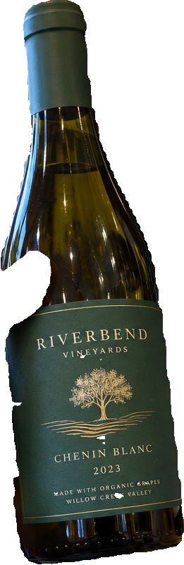
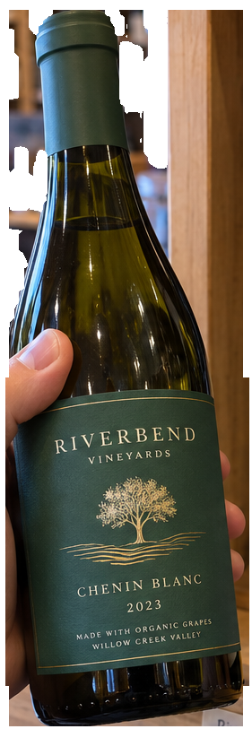
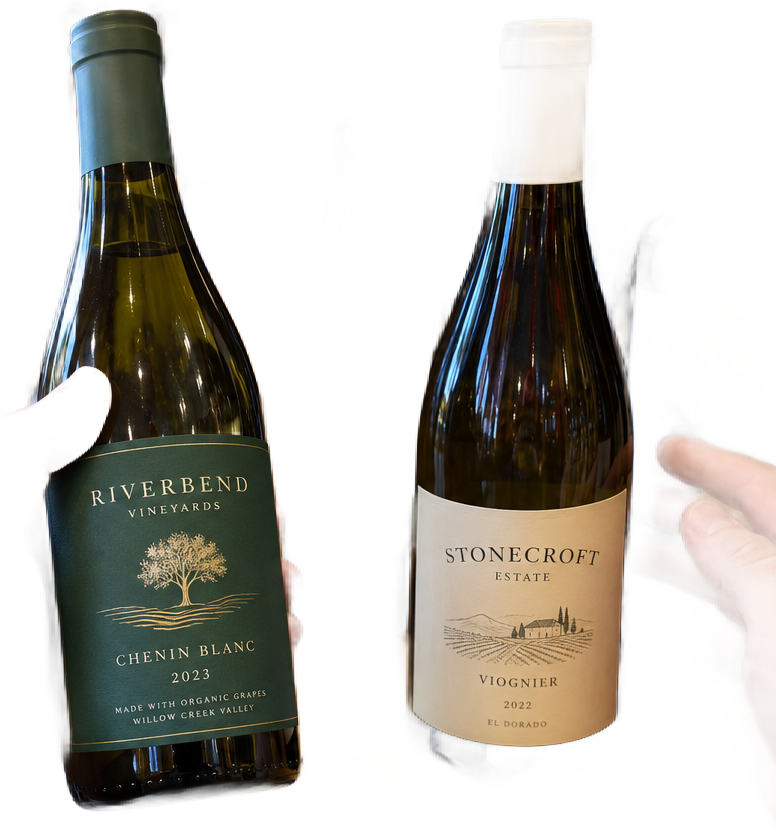

# main-selector-imagegen-diverse-v3-20261020:HP01

**Scene and masks pending — exploratory. All targets/masks are proposals; no approved segmentation ground truth.**



**scene-v1: FAIL — provisional target/proxy.**

Reference title (source): В винном магазине · хват слева и ладонь за соседом

Reference target description (source): Удерживаемая бутылка слева

Expected intent: `clear`. Accepted target proposals: `d14`.

Scene group: `main-selector-imagegen-diverse-v3-20261020:HP01`. Development only; no independent split claim.

## Original and proposed target





Green marks the unreviewed target proposal. Source image pixels are retained separately.

[Selected-label mask audit](../selected-label-mask-audit.json): incomplete proposal retention is flagged separately from target agreement.

[Full-resolution target proposal mask](../masks/diverse-v3--HP01-d14.png)

## Selector results

### scene-v1: FAIL — provisional target/proxy

Selected: d14; reason: existing_scene_v1_rank; mode: legacy; crop 261×800 px. Target agreement: True. Target retention proxy: 100.0%; maximum other-bottle retention: 1.0%; minimum associated label retention: 99.5%. Mask ownership, label completeness and legibility still require human review.



[Full-resolution keep mask](../keep-masks/diverse-v3--HP01-scene-v1.png) · [Exact decision JSON](../results/diverse-v3--HP01-scene-v1.json)

Associated label-mask retention proxies (unreviewed ownership): d68: 99.5%, 67348 source pixels

### semantic-v2: No automatic failure flag; usability pending

Selected: d14; reason: unique_visible_hand_contact; mode: confident; crop 281×842 px. Target agreement: True. Target retention proxy: 100.0%; maximum other-bottle retention: 1.0%; minimum associated label retention: 100.0%. Mask ownership, label completeness and legibility still require human review. Selected-label mask audit: d68 100.0%.



[Full-resolution keep mask](../keep-masks/diverse-v3--HP01-semantic-v2.png) · [Exact decision JSON](../results/diverse-v3--HP01-semantic-v2.json)

Returned label views: [label 1](../label-crops/diverse-v3--HP01-semantic-v2-0.png)

Associated label-mask retention proxies (unreviewed ownership): d68: 100.0%, 67348 source pixels

### dis-v1: PROXY failure; no native target ID

Selected: dis-foreground; reason: dis_foreground_mask; mode: foreground; crop 776×839 px. Target agreement: n/a (no native target ID). Target retention proxy: 97.8%; maximum other-bottle retention: 81.5%; minimum associated label retention: 99.9%. Mask ownership, label completeness and legibility still require human review.



[Full-resolution keep mask](../keep-masks/diverse-v3--HP01-dis-v1.png) · [Exact decision JSON](../results/diverse-v3--HP01-dis-v1.json)

Associated label-mask retention proxies (unreviewed ownership): d68: 99.9%, 67348 source pixels

## All frozen mask proposals

These links expose every detector proposal, including labels and hands. Shapes and owners are unreviewed.

| ID | Detector class | Full-resolution mask |
|---|---|---|
| d0 | wine bottle | [PNG](../masks/diverse-v3--HP01-d0.png) |
| d1 | wine bottle | [PNG](../masks/diverse-v3--HP01-d1.png) |
| d2 | wine bottle | [PNG](../masks/diverse-v3--HP01-d2.png) |
| d3 | wine bottle | [PNG](../masks/diverse-v3--HP01-d3.png) |
| d4 | wine bottle | [PNG](../masks/diverse-v3--HP01-d4.png) |
| d5 | wine bottle | [PNG](../masks/diverse-v3--HP01-d5.png) |
| d6 | wine bottle | [PNG](../masks/diverse-v3--HP01-d6.png) |
| d7 | wine bottle | [PNG](../masks/diverse-v3--HP01-d7.png) |
| d8 | wine bottle | [PNG](../masks/diverse-v3--HP01-d8.png) |
| d9 | wine bottle | [PNG](../masks/diverse-v3--HP01-d9.png) |
| d10 | wine bottle | [PNG](../masks/diverse-v3--HP01-d10.png) |
| d11 | wine bottle | [PNG](../masks/diverse-v3--HP01-d11.png) |
| d12 | wine bottle | [PNG](../masks/diverse-v3--HP01-d12.png) |
| d13 | wine bottle | [PNG](../masks/diverse-v3--HP01-d13.png) |
| d14 | wine bottle | [PNG](../masks/diverse-v3--HP01-d14.png) |
| d15 | wine bottle | [PNG](../masks/diverse-v3--HP01-d15.png) |
| d16 | wine bottle | [PNG](../masks/diverse-v3--HP01-d16.png) |
| d17 | wine bottle | [PNG](../masks/diverse-v3--HP01-d17.png) |
| d18 | wine bottle | [PNG](../masks/diverse-v3--HP01-d18.png) |
| d19 | wine bottle | [PNG](../masks/diverse-v3--HP01-d19.png) |
| d20 | wine bottle | [PNG](../masks/diverse-v3--HP01-d20.png) |
| d21 | wine bottle | [PNG](../masks/diverse-v3--HP01-d21.png) |
| d22 | wine bottle | [PNG](../masks/diverse-v3--HP01-d22.png) |
| d23 | wine bottle | [PNG](../masks/diverse-v3--HP01-d23.png) |
| d24 | wine bottle | [PNG](../masks/diverse-v3--HP01-d24.png) |
| d25 | wine bottle | [PNG](../masks/diverse-v3--HP01-d25.png) |
| d26 | wine bottle | [PNG](../masks/diverse-v3--HP01-d26.png) |
| d27 | wine bottle | [PNG](../masks/diverse-v3--HP01-d27.png) |
| d28 | wine bottle | [PNG](../masks/diverse-v3--HP01-d28.png) |
| d29 | wine bottle | [PNG](../masks/diverse-v3--HP01-d29.png) |
| d30 | wine bottle | [PNG](../masks/diverse-v3--HP01-d30.png) |
| d31 | wine bottle | [PNG](../masks/diverse-v3--HP01-d31.png) |
| d32 | wine bottle | [PNG](../masks/diverse-v3--HP01-d32.png) |
| d33 | wine bottle | [PNG](../masks/diverse-v3--HP01-d33.png) |
| d34 | wine bottle | [PNG](../masks/diverse-v3--HP01-d34.png) |
| d35 | wine bottle | [PNG](../masks/diverse-v3--HP01-d35.png) |
| d36 | wine bottle | [PNG](../masks/diverse-v3--HP01-d36.png) |
| d37 | wine bottle | [PNG](../masks/diverse-v3--HP01-d37.png) |
| d38 | wine bottle | [PNG](../masks/diverse-v3--HP01-d38.png) |
| d39 | wine bottle | [PNG](../masks/diverse-v3--HP01-d39.png) |
| d40 | wine bottle | [PNG](../masks/diverse-v3--HP01-d40.png) |
| d41 | wine bottle | [PNG](../masks/diverse-v3--HP01-d41.png) |
| d42 | wine bottle | [PNG](../masks/diverse-v3--HP01-d42.png) |
| d43 | wine bottle | [PNG](../masks/diverse-v3--HP01-d43.png) |
| d44 | wine bottle | [PNG](../masks/diverse-v3--HP01-d44.png) |
| d45 | wine bottle | [PNG](../masks/diverse-v3--HP01-d45.png) |
| d46 | wine bottle | [PNG](../masks/diverse-v3--HP01-d46.png) |
| d47 | wine bottle | [PNG](../masks/diverse-v3--HP01-d47.png) |
| d48 | wine bottle | [PNG](../masks/diverse-v3--HP01-d48.png) |
| d49 | wine bottle | [PNG](../masks/diverse-v3--HP01-d49.png) |
| d50 | wine bottle | [PNG](../masks/diverse-v3--HP01-d50.png) |
| d51 | wine bottle | [PNG](../masks/diverse-v3--HP01-d51.png) |
| d52 | wine bottle | [PNG](../masks/diverse-v3--HP01-d52.png) |
| d53 | wine bottle | [PNG](../masks/diverse-v3--HP01-d53.png) |
| d54 | wine bottle | [PNG](../masks/diverse-v3--HP01-d54.png) |
| d55 | wine bottle | [PNG](../masks/diverse-v3--HP01-d55.png) |
| d56 | wine bottle | [PNG](../masks/diverse-v3--HP01-d56.png) |
| d57 | wine bottle | [PNG](../masks/diverse-v3--HP01-d57.png) |
| d58 | wine bottle | [PNG](../masks/diverse-v3--HP01-d58.png) |
| d59 | wine bottle | [PNG](../masks/diverse-v3--HP01-d59.png) |
| d60 | wine label | [PNG](../masks/diverse-v3--HP01-d60.png) |
| d61 | wine label | [PNG](../masks/diverse-v3--HP01-d61.png) |
| d62 | wine label | [PNG](../masks/diverse-v3--HP01-d62.png) |
| d63 | wine label | [PNG](../masks/diverse-v3--HP01-d63.png) |
| d64 | wine label | [PNG](../masks/diverse-v3--HP01-d64.png) |
| d65 | wine label | [PNG](../masks/diverse-v3--HP01-d65.png) |
| d66 | wine label | [PNG](../masks/diverse-v3--HP01-d66.png) |
| d67 | wine label | [PNG](../masks/diverse-v3--HP01-d67.png) |
| d68 | wine label | [PNG](../masks/diverse-v3--HP01-d68.png) |
| d69 | wine label | [PNG](../masks/diverse-v3--HP01-d69.png) |
| d70 | wine label | [PNG](../masks/diverse-v3--HP01-d70.png) |
| d71 | wine label | [PNG](../masks/diverse-v3--HP01-d71.png) |
| d72 | wine label | [PNG](../masks/diverse-v3--HP01-d72.png) |
| d73 | wine label | [PNG](../masks/diverse-v3--HP01-d73.png) |
| d74 | wine label | [PNG](../masks/diverse-v3--HP01-d74.png) |
| d75 | wine label | [PNG](../masks/diverse-v3--HP01-d75.png) |
| d76 | wine label | [PNG](../masks/diverse-v3--HP01-d76.png) |
| d77 | wine label | [PNG](../masks/diverse-v3--HP01-d77.png) |
| d78 | wine label | [PNG](../masks/diverse-v3--HP01-d78.png) |
| d79 | wine label | [PNG](../masks/diverse-v3--HP01-d79.png) |
| d80 | wine label | [PNG](../masks/diverse-v3--HP01-d80.png) |
| d81 | wine label | [PNG](../masks/diverse-v3--HP01-d81.png) |
| d82 | wine label | [PNG](../masks/diverse-v3--HP01-d82.png) |
| d83 | wine label | [PNG](../masks/diverse-v3--HP01-d83.png) |
| d84 | wine label | [PNG](../masks/diverse-v3--HP01-d84.png) |
| d85 | wine label | [PNG](../masks/diverse-v3--HP01-d85.png) |
| d86 | wine label | [PNG](../masks/diverse-v3--HP01-d86.png) |
| d87 | wine label | [PNG](../masks/diverse-v3--HP01-d87.png) |
| d88 | wine label | [PNG](../masks/diverse-v3--HP01-d88.png) |
| d89 | wine label | [PNG](../masks/diverse-v3--HP01-d89.png) |
| d90 | wine label | [PNG](../masks/diverse-v3--HP01-d90.png) |
| d91 | wine label | [PNG](../masks/diverse-v3--HP01-d91.png) |
| d92 | hand | [PNG](../masks/diverse-v3--HP01-d92.png) |
| d93 | hand | [PNG](../masks/diverse-v3--HP01-d93.png) |
| d94 | price tag | [PNG](../masks/diverse-v3--HP01-d94.png) |
| d95 | price tag | [PNG](../masks/diverse-v3--HP01-d95.png) |
| d96 | price tag | [PNG](../masks/diverse-v3--HP01-d96.png) |

## Additional image-only context masks

Fixed English noun requests used RGB only; no target or annotation was supplied. Primary dN IDs remain unchanged. These masks are detector evidence, not reviewed ground truth.

[Saved validated context response](../context/diverse-v3--HP01.json)

| Appended ID | Context class | Full-resolution mask |
|---|---|---|
| d97 | bottle held in hand | [PNG](../context-masks/diverse-v3--HP01-d97.png) |
| d98 | bottle held in hand | [PNG](../context-masks/diverse-v3--HP01-d98.png) |
| d99 | bottle held in hand | [PNG](../context-masks/diverse-v3--HP01-d99.png) |
| d100 | bottle held in hand | [PNG](../context-masks/diverse-v3--HP01-d100.png) |
| d101 | bottle held in hand | [PNG](../context-masks/diverse-v3--HP01-d101.png) |
| d102 | bottle held in hand | [PNG](../context-masks/diverse-v3--HP01-d102.png) |
| d103 | bottle held in hand | [PNG](../context-masks/diverse-v3--HP01-d103.png) |
| d104 | bottle held in hand | [PNG](../context-masks/diverse-v3--HP01-d104.png) |
| d105 | bottle held in hand | [PNG](../context-masks/diverse-v3--HP01-d105.png) |
| d106 | bottle held in hand | [PNG](../context-masks/diverse-v3--HP01-d106.png) |
| d107 | bottle held in hand | [PNG](../context-masks/diverse-v3--HP01-d107.png) |
| d108 | bottle held in hand | [PNG](../context-masks/diverse-v3--HP01-d108.png) |
| d109 | bottle held in hand | [PNG](../context-masks/diverse-v3--HP01-d109.png) |
| d110 | bottle held in hand | [PNG](../context-masks/diverse-v3--HP01-d110.png) |
| d111 | bottle held in hand | [PNG](../context-masks/diverse-v3--HP01-d111.png) |

[Raw frozen detector response](../detections/diverse-v3--HP01.json)

<details><summary>Generation prompt (quoted source data)</summary>

```text
Use case: photorealistic-natural. Generate ONE independent photograph, landscape 3:2, approximately 1536 by 1024 pixels. First-person customer browsing in a compact independent wine store, real shelves, handwritten shelf prices, no staged studio backdrop. Two bottles in the described setting. The LEFT green-label bottle is firmly held around mid-body by one hand from left, thumb opposing curled fingers. A second open hand rests BEHIND the right unheld cream-label bottle, visibly separated by air. Show real grip versus apparent overlap. Make the scene composition, person, clothing and location specific to this scenario, rather than repeating a generic bottle on a tasting counter. Show genuine physical contact when a grip is requested. Fictional wine branding; no arrows, bounding boxes, captions, collages, watermark or UI. Maintain anatomically plausible hands. Keep the target visible label inside the frame except the explicit close-up and occlusion cases.
```

</details>

Source review notes (quoted reference data):

> Цель предварительно связана с маской SAM3 по заданию генерации; подтвердите по самому фото. Форма масок и их владельцы ещё не проверены.
> Окружение: В винном магазине. Проверьте реалистичность рук, хват и присутствие требуемых деталей.
