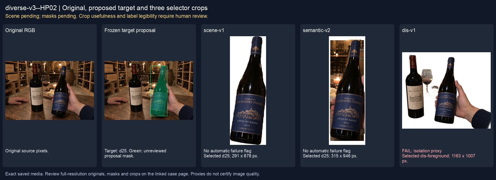
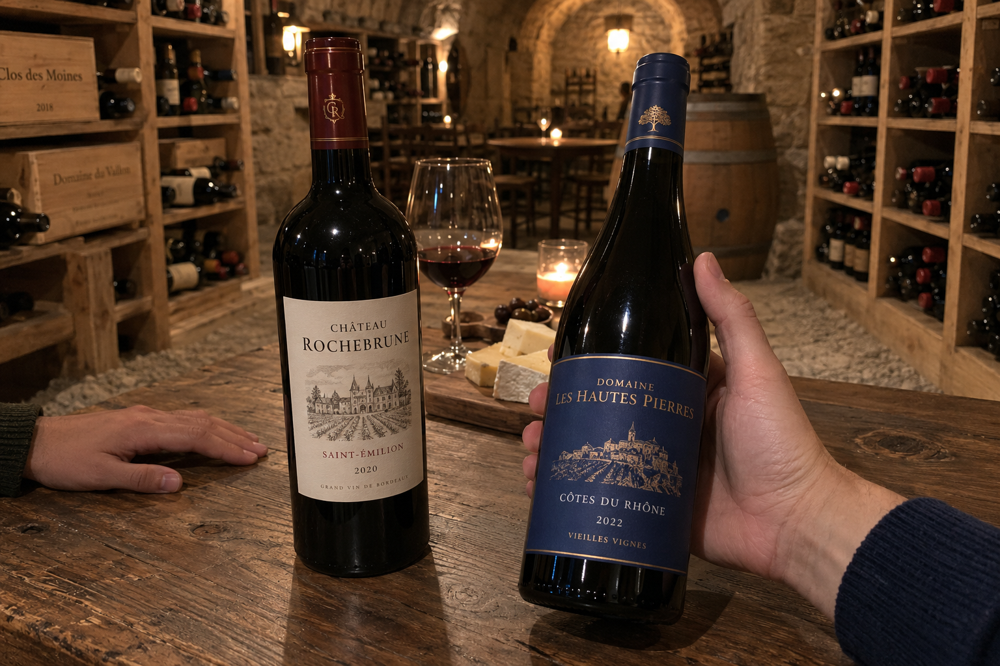
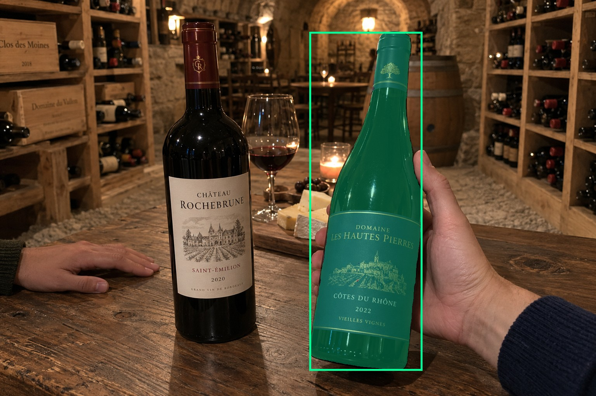
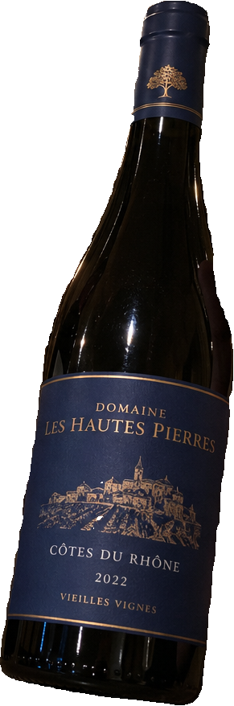
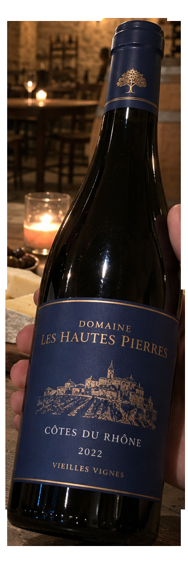
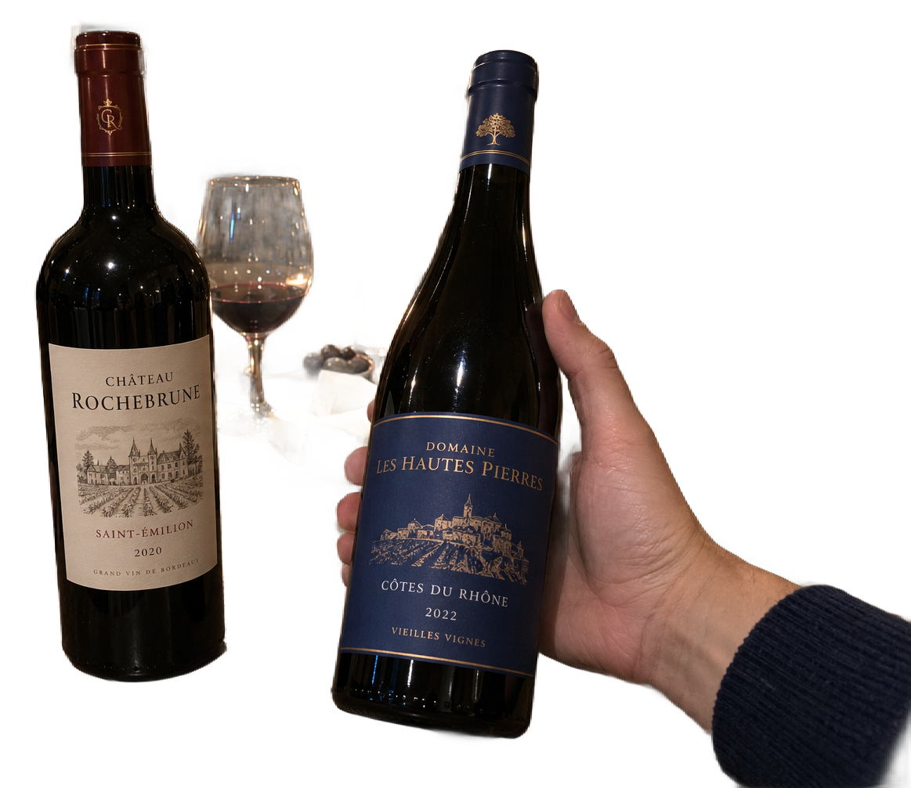

# main-selector-imagegen-diverse-v3-20261020:HP02

**Scene and masks pending — exploratory. All targets/masks are proposals; no approved segmentation ground truth.**



**scene-v1: FAIL — provisional target/proxy.**

Reference title (source): Правый хват и рука под основанием соседа

Reference target description (source): Удерживаемая бутылка справа

Expected intent: `clear`. Accepted target proposals: `d25`.

Scene group: `main-selector-imagegen-diverse-v3-20261020:HP02`. Development only; no independent split claim.

## Original and proposed target





Green marks the unreviewed target proposal. Source image pixels are retained separately.

[Selected-label mask audit](../selected-label-mask-audit.json): incomplete proposal retention is flagged separately from target agreement.

[Full-resolution target proposal mask](../masks/diverse-v3--HP02-d25.png)

## Selector results

### scene-v1: FAIL — provisional target/proxy

Selected: d25; reason: existing_scene_v1_rank; mode: legacy; crop 291×878 px. Target agreement: True. Target retention proxy: 100.0%; maximum other-bottle retention: 0.0%; minimum associated label retention: 97.1%. Mask ownership, label completeness and legibility still require human review.



[Full-resolution keep mask](../keep-masks/diverse-v3--HP02-scene-v1.png) · [Exact decision JSON](../results/diverse-v3--HP02-scene-v1.json)

Associated label-mask retention proxies (unreviewed ownership): d47: 99.7%, 75899 source pixels; d48: 97.1%, 11613 source pixels

### semantic-v2: No automatic failure flag; usability pending

Selected: d25; reason: unique_visible_hand_contact; mode: confident; crop 315×946 px. Target agreement: True. Target retention proxy: 100.0%; maximum other-bottle retention: 0.0%; minimum associated label retention: 100.0%. Mask ownership, label completeness and legibility still require human review. Selected-label mask audit: d47 100.0%; d48 100.0%.



[Full-resolution keep mask](../keep-masks/diverse-v3--HP02-semantic-v2.png) · [Exact decision JSON](../results/diverse-v3--HP02-semantic-v2.json)

Returned label views: [label 1](../label-crops/diverse-v3--HP02-semantic-v2-0.png) · [label 2](../label-crops/diverse-v3--HP02-semantic-v2-1.png)

Associated label-mask retention proxies (unreviewed ownership): d47: 100.0%, 75899 source pixels; d48: 100.0%, 11613 source pixels

### dis-v1: PROXY failure; no native target ID

Selected: dis-foreground; reason: dis_foreground_mask; mode: foreground; crop 1163×1007 px. Target agreement: n/a (no native target ID). Target retention proxy: 100.0%; maximum other-bottle retention: 99.9%; minimum associated label retention: 99.0%. Mask ownership, label completeness and legibility still require human review.



[Full-resolution keep mask](../keep-masks/diverse-v3--HP02-dis-v1.png) · [Exact decision JSON](../results/diverse-v3--HP02-dis-v1.json)

Associated label-mask retention proxies (unreviewed ownership): d47: 100.0%, 75899 source pixels; d48: 99.0%, 11613 source pixels

## All frozen mask proposals

These links expose every detector proposal, including labels and hands. Shapes and owners are unreviewed.

| ID | Detector class | Full-resolution mask |
|---|---|---|
| d0 | wine bottle | [PNG](../masks/diverse-v3--HP02-d0.png) |
| d1 | wine bottle | [PNG](../masks/diverse-v3--HP02-d1.png) |
| d2 | wine bottle | [PNG](../masks/diverse-v3--HP02-d2.png) |
| d3 | wine bottle | [PNG](../masks/diverse-v3--HP02-d3.png) |
| d4 | wine bottle | [PNG](../masks/diverse-v3--HP02-d4.png) |
| d5 | wine bottle | [PNG](../masks/diverse-v3--HP02-d5.png) |
| d6 | wine bottle | [PNG](../masks/diverse-v3--HP02-d6.png) |
| d7 | wine bottle | [PNG](../masks/diverse-v3--HP02-d7.png) |
| d8 | wine bottle | [PNG](../masks/diverse-v3--HP02-d8.png) |
| d9 | wine bottle | [PNG](../masks/diverse-v3--HP02-d9.png) |
| d10 | wine bottle | [PNG](../masks/diverse-v3--HP02-d10.png) |
| d11 | wine bottle | [PNG](../masks/diverse-v3--HP02-d11.png) |
| d12 | wine bottle | [PNG](../masks/diverse-v3--HP02-d12.png) |
| d13 | wine bottle | [PNG](../masks/diverse-v3--HP02-d13.png) |
| d14 | wine bottle | [PNG](../masks/diverse-v3--HP02-d14.png) |
| d15 | wine bottle | [PNG](../masks/diverse-v3--HP02-d15.png) |
| d16 | wine bottle | [PNG](../masks/diverse-v3--HP02-d16.png) |
| d17 | wine bottle | [PNG](../masks/diverse-v3--HP02-d17.png) |
| d18 | wine bottle | [PNG](../masks/diverse-v3--HP02-d18.png) |
| d19 | wine bottle | [PNG](../masks/diverse-v3--HP02-d19.png) |
| d20 | wine bottle | [PNG](../masks/diverse-v3--HP02-d20.png) |
| d21 | wine bottle | [PNG](../masks/diverse-v3--HP02-d21.png) |
| d22 | wine bottle | [PNG](../masks/diverse-v3--HP02-d22.png) |
| d23 | wine bottle | [PNG](../masks/diverse-v3--HP02-d23.png) |
| d24 | wine bottle | [PNG](../masks/diverse-v3--HP02-d24.png) |
| d25 | wine bottle | [PNG](../masks/diverse-v3--HP02-d25.png) |
| d26 | wine bottle | [PNG](../masks/diverse-v3--HP02-d26.png) |
| d27 | wine bottle | [PNG](../masks/diverse-v3--HP02-d27.png) |
| d28 | wine bottle | [PNG](../masks/diverse-v3--HP02-d28.png) |
| d29 | wine bottle | [PNG](../masks/diverse-v3--HP02-d29.png) |
| d30 | wine bottle | [PNG](../masks/diverse-v3--HP02-d30.png) |
| d31 | wine bottle | [PNG](../masks/diverse-v3--HP02-d31.png) |
| d32 | wine bottle | [PNG](../masks/diverse-v3--HP02-d32.png) |
| d33 | wine bottle | [PNG](../masks/diverse-v3--HP02-d33.png) |
| d34 | wine bottle | [PNG](../masks/diverse-v3--HP02-d34.png) |
| d35 | wine bottle | [PNG](../masks/diverse-v3--HP02-d35.png) |
| d36 | wine label | [PNG](../masks/diverse-v3--HP02-d36.png) |
| d37 | wine label | [PNG](../masks/diverse-v3--HP02-d37.png) |
| d38 | wine label | [PNG](../masks/diverse-v3--HP02-d38.png) |
| d39 | wine label | [PNG](../masks/diverse-v3--HP02-d39.png) |
| d40 | wine label | [PNG](../masks/diverse-v3--HP02-d40.png) |
| d41 | wine label | [PNG](../masks/diverse-v3--HP02-d41.png) |
| d42 | wine label | [PNG](../masks/diverse-v3--HP02-d42.png) |
| d43 | wine label | [PNG](../masks/diverse-v3--HP02-d43.png) |
| d44 | wine label | [PNG](../masks/diverse-v3--HP02-d44.png) |
| d45 | wine label | [PNG](../masks/diverse-v3--HP02-d45.png) |
| d46 | wine label | [PNG](../masks/diverse-v3--HP02-d46.png) |
| d47 | wine label | [PNG](../masks/diverse-v3--HP02-d47.png) |
| d48 | wine label | [PNG](../masks/diverse-v3--HP02-d48.png) |
| d49 | wine label | [PNG](../masks/diverse-v3--HP02-d49.png) |
| d50 | wine label | [PNG](../masks/diverse-v3--HP02-d50.png) |
| d51 | hand | [PNG](../masks/diverse-v3--HP02-d51.png) |
| d52 | hand | [PNG](../masks/diverse-v3--HP02-d52.png) |
| d53 | box | [PNG](../masks/diverse-v3--HP02-d53.png) |
| d54 | box | [PNG](../masks/diverse-v3--HP02-d54.png) |
| d55 | box | [PNG](../masks/diverse-v3--HP02-d55.png) |
| d56 | price tag | [PNG](../masks/diverse-v3--HP02-d56.png) |
| d57 | wine glass | [PNG](../masks/diverse-v3--HP02-d57.png) |
| d58 | wine glass | [PNG](../masks/diverse-v3--HP02-d58.png) |

## Additional image-only context masks

Fixed English noun requests used RGB only; no target or annotation was supplied. Primary dN IDs remain unchanged. These masks are detector evidence, not reviewed ground truth.

[Saved validated context response](../context/diverse-v3--HP02.json)

| Appended ID | Context class | Full-resolution mask |
|---|---|---|
| d59 | bottle held in hand | [PNG](../context-masks/diverse-v3--HP02-d59.png) |
| d60 | bottle held in hand | [PNG](../context-masks/diverse-v3--HP02-d60.png) |
| d61 | bottle held in hand | [PNG](../context-masks/diverse-v3--HP02-d61.png) |
| d62 | bottle held in hand | [PNG](../context-masks/diverse-v3--HP02-d62.png) |
| d63 | bottle held in hand | [PNG](../context-masks/diverse-v3--HP02-d63.png) |
| d64 | bottle held in hand | [PNG](../context-masks/diverse-v3--HP02-d64.png) |
| d65 | bottle held in hand | [PNG](../context-masks/diverse-v3--HP02-d65.png) |

[Raw frozen detector response](../detections/diverse-v3--HP02.json)

<details><summary>Generation prompt (quoted source data)</summary>

```text
Use case: photorealistic-natural. Generate exactly ONE independent candid smartphone photograph. Show believable glass, paper, natural material imperfections, fictional wine branding, and anatomically plausible hands. No collage, grid, arrows, annotations, bounding boxes, highlights, watermark, UI overlay, or explanatory caption. Text is allowed on physical objects within the scene. Keep the target visible front label entirely inside the frame unless partial occlusion or close-up is explicitly requested. Image format: landscape 3:2, approximately 1536 by 1024 pixels. Setting: inside a real wine cellar. Use stone or brick walls, wooden wine racks, storage cubbies, a cellar tasting table and practical dim lights. Background wine bottles may be present on shelves but should remain clearly in the background. Viewpoint: the customer is examining a wine bottle in their own hand while shopping or browsing the cellar, with the bottle front label turned toward the phone camera. Show the bottle, the holding hand and enough surrounding shelves or cellar details to establish the location. Scene details: Two bottles on a tasting table. A hand from right wraps the RIGHT blue-label bottle body. Another relaxed hand lies flat on the table behind the left bottle base without supporting or touching it. Show a small visible gap between that left bottle and resting fingers.
```

</details>

Source review notes (quoted reference data):

> Цель предварительно связана с маской SAM3 по заданию генерации; подтвердите по самому фото. Форма масок и их владельцы ещё не проверены.
> Окружение: Винный погреб. Проверьте реалистичность рук, хват и присутствие требуемых деталей.
