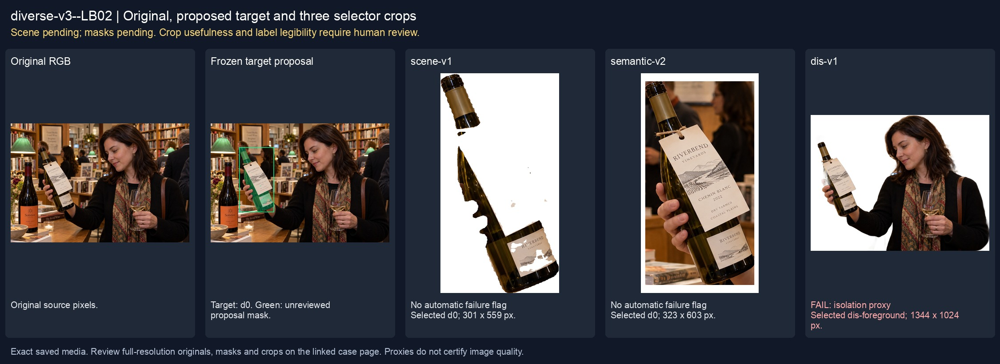
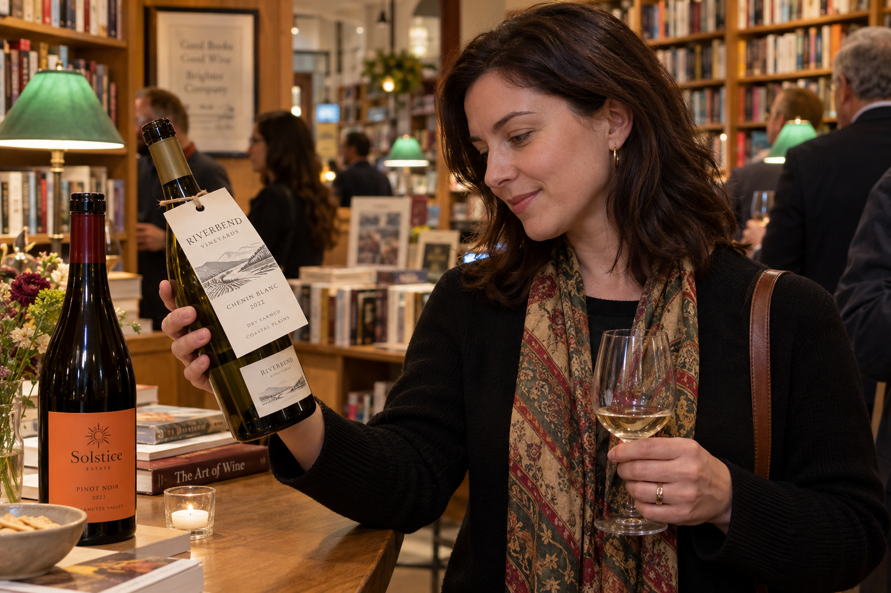
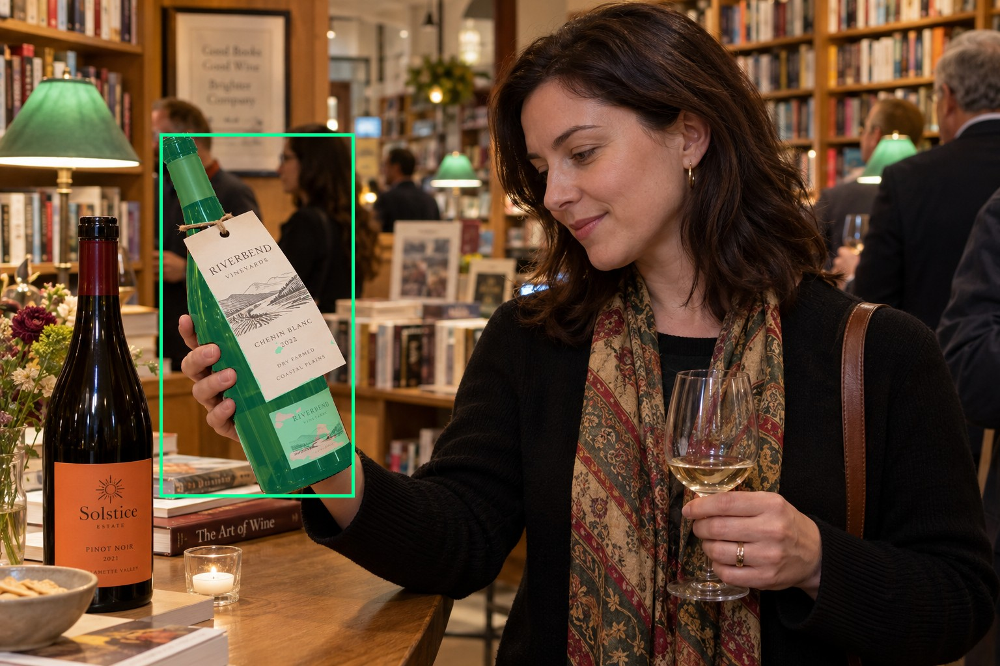
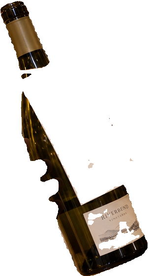
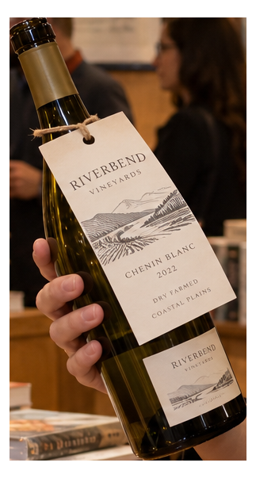
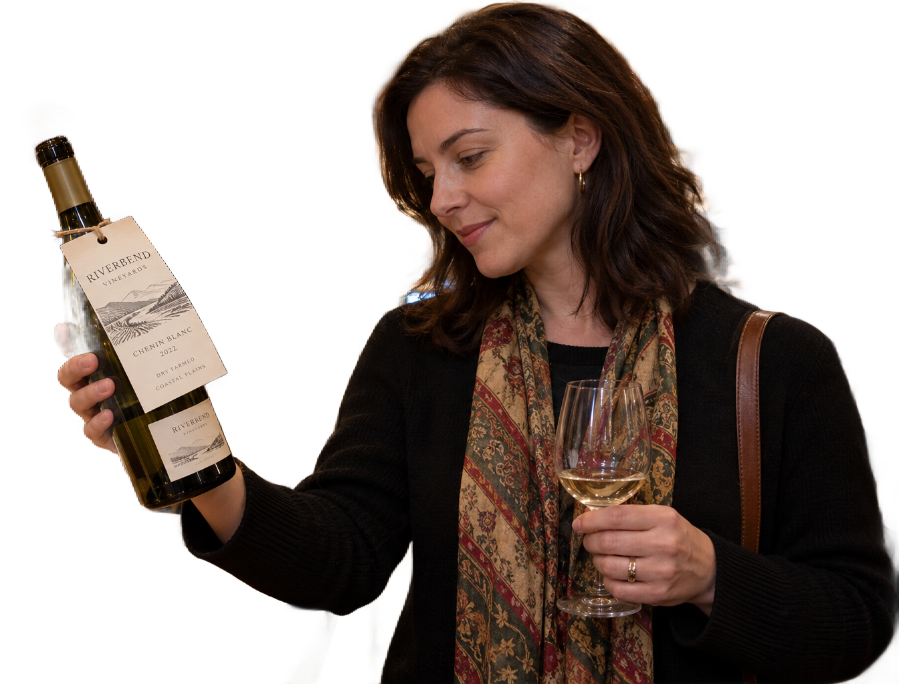

# main-selector-imagegen-diverse-v3-20261020:LB02

**Scene and masks pending — exploratory. All targets/masks are proposals; no approved segmentation ground truth.**



**scene-v1: No automatic failure flag; usability pending.**

Reference title (source): На дегустации в книжном · бирка шире бутылки

Reference target description (source): Левая удерживаемая бутылка с широкой биркой

Expected intent: `clear`. Accepted target proposals: `d0`.

Scene group: `main-selector-imagegen-diverse-v3-20261020:LB02`. Development only; no independent split claim.

## Original and proposed target





Green marks the unreviewed target proposal. Source image pixels are retained separately.

[Selected-label mask audit](../selected-label-mask-audit.json): incomplete proposal retention is flagged separately from target agreement.

[Full-resolution target proposal mask](../masks/diverse-v3--LB02-d0.png)

## Selector results

### scene-v1: No automatic failure flag; usability pending

Selected: d0; reason: existing_scene_v1_rank; mode: legacy; crop 301×559 px. Target agreement: True. Target retention proxy: 100.0%; maximum other-bottle retention: 0.0%; minimum associated label retention: n/a. Mask ownership, label completeness and legibility still require human review.



[Full-resolution keep mask](../keep-masks/diverse-v3--LB02-scene-v1.png) · [Exact decision JSON](../results/diverse-v3--LB02-scene-v1.json)

### semantic-v2: No automatic failure flag; usability pending

Selected: d0; reason: unique_visible_hand_contact; mode: confident; crop 323×603 px. Target agreement: True. Target retention proxy: 100.0%; maximum other-bottle retention: 0.0%; minimum associated label retention: n/a. Mask ownership, label completeness and legibility still require human review. Selected-label mask audit: d5 100.0%; d3 100.0%.



[Full-resolution keep mask](../keep-masks/diverse-v3--LB02-semantic-v2.png) · [Exact decision JSON](../results/diverse-v3--LB02-semantic-v2.json)

Returned label views: [label 1](../label-crops/diverse-v3--LB02-semantic-v2-0.png) · [label 2](../label-crops/diverse-v3--LB02-semantic-v2-1.png)

### dis-v1: PROXY failure; no native target ID

Selected: dis-foreground; reason: dis_foreground_mask; mode: foreground; crop 1344×1024 px. Target agreement: n/a (no native target ID). Target retention proxy: 91.3%; maximum other-bottle retention: 100.0%; minimum associated label retention: n/a. Mask ownership, label completeness and legibility still require human review.



[Full-resolution keep mask](../keep-masks/diverse-v3--LB02-dis-v1.png) · [Exact decision JSON](../results/diverse-v3--LB02-dis-v1.json)

## All frozen mask proposals

These links expose every detector proposal, including labels and hands. Shapes and owners are unreviewed.

| ID | Detector class | Full-resolution mask |
|---|---|---|
| d0 | wine bottle | [PNG](../masks/diverse-v3--LB02-d0.png) |
| d1 | wine bottle | [PNG](../masks/diverse-v3--LB02-d1.png) |
| d2 | wine bottle | [PNG](../masks/diverse-v3--LB02-d2.png) |
| d3 | wine label | [PNG](../masks/diverse-v3--LB02-d3.png) |
| d4 | wine label | [PNG](../masks/diverse-v3--LB02-d4.png) |
| d5 | wine label | [PNG](../masks/diverse-v3--LB02-d5.png) |
| d6 | hand | [PNG](../masks/diverse-v3--LB02-d6.png) |
| d7 | hand | [PNG](../masks/diverse-v3--LB02-d7.png) |
| d8 | hand | [PNG](../masks/diverse-v3--LB02-d8.png) |
| d9 | hand | [PNG](../masks/diverse-v3--LB02-d9.png) |
| d10 | price tag | [PNG](../masks/diverse-v3--LB02-d10.png) |
| d11 | wine glass | [PNG](../masks/diverse-v3--LB02-d11.png) |
| d12 | wine glass | [PNG](../masks/diverse-v3--LB02-d12.png) |
| d13 | wine glass | [PNG](../masks/diverse-v3--LB02-d13.png) |

## Additional image-only context masks

Fixed English noun requests used RGB only; no target or annotation was supplied. Primary dN IDs remain unchanged. These masks are detector evidence, not reviewed ground truth.

[Saved validated context response](../context/diverse-v3--LB02.json)

| Appended ID | Context class | Full-resolution mask |
|---|---|---|
| d14 | poster | [PNG](../context-masks/diverse-v3--LB02-d14.png) |
| d15 | screen | [PNG](../context-masks/diverse-v3--LB02-d15.png) |
| d16 | bottle held in hand | [PNG](../context-masks/diverse-v3--LB02-d16.png) |
| d17 | bottle held in hand | [PNG](../context-masks/diverse-v3--LB02-d17.png) |

[Raw frozen detector response](../detections/diverse-v3--LB02.json)

<details><summary>Generation prompt (quoted source data)</summary>

```text
Use case: photorealistic-natural. Generate ONE independent photograph, landscape 3:2, approximately 1536 by 1024 pixels. An adult reader examines a bottle with a wide hanging tag during a bookshop wine event. Bookshelves, reading lamps and other visitors behind; show face and held bottle. Two bottles in the described setting. A hand from left holds the LEFT green bottle body beneath a wide hanging paper neck tag that extends beyond glass silhouette. A small cream front label also belongs to this bottle. RIGHT unheld bottle has a large orange label. Keep entire tag visible. Make the scene composition, person, clothing and location specific to this scenario, rather than repeating a generic bottle on a tasting counter. Show genuine physical contact when a grip is requested. Fictional wine branding; no arrows, bounding boxes, captions, collages, watermark or UI. Maintain anatomically plausible hands. Keep the target visible label inside the frame except the explicit close-up and occlusion cases.
```

</details>

Source review notes (quoted reference data):

> Цель предварительно связана с маской SAM3 по заданию генерации; подтвердите по самому фото. Форма масок и их владельцы ещё не проверены.
> Окружение: На дегустации в книжном. Проверьте реалистичность рук, хват и присутствие требуемых деталей.
