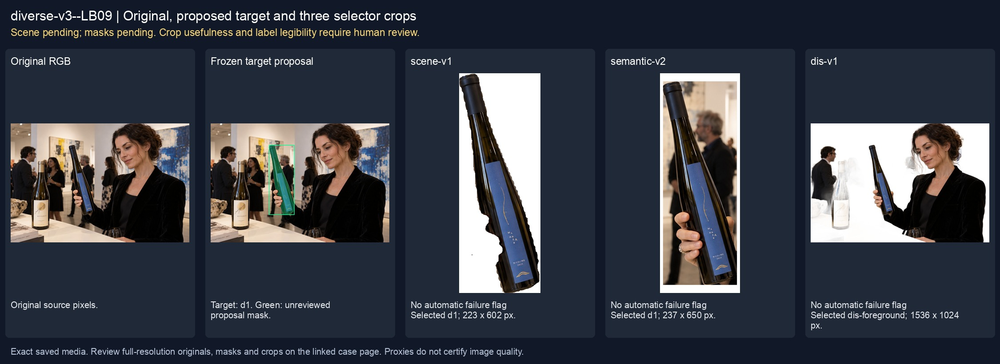
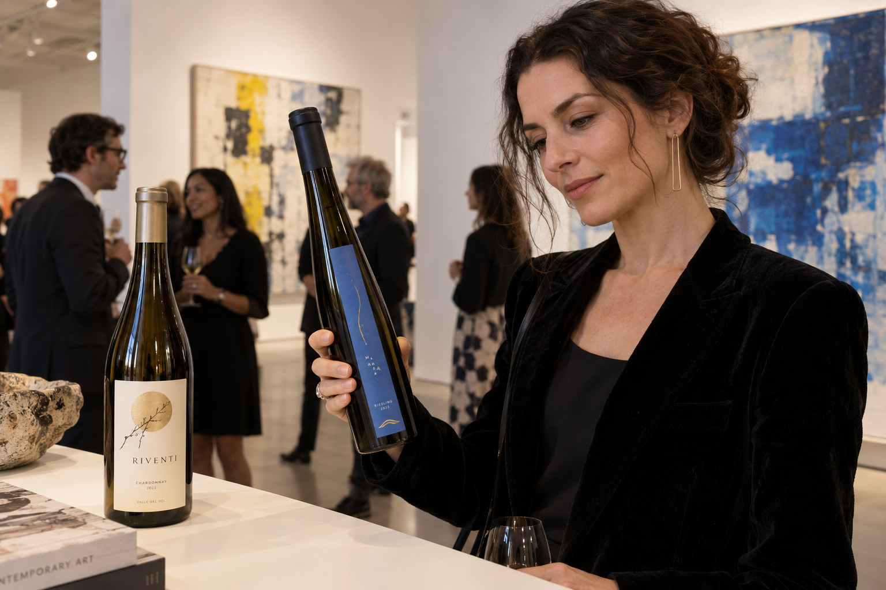
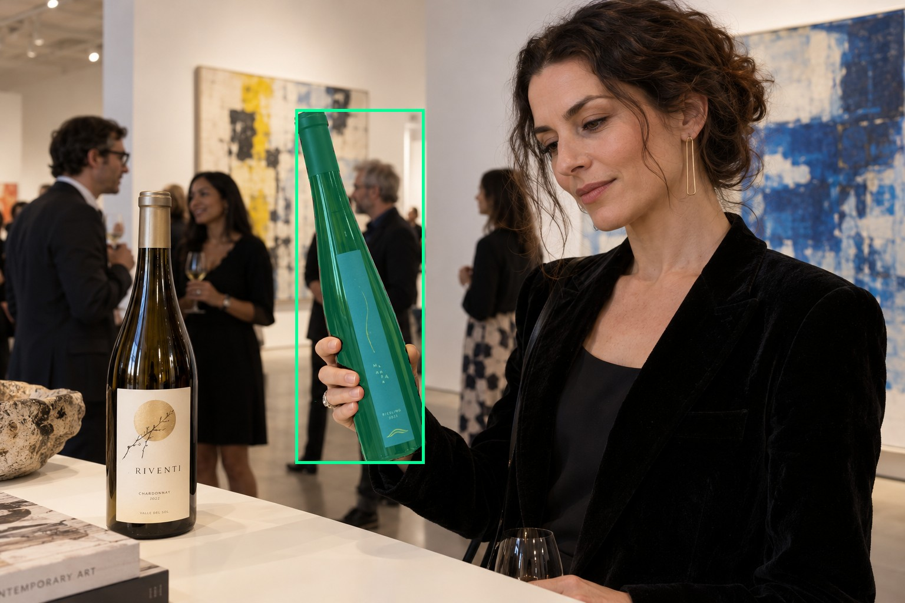
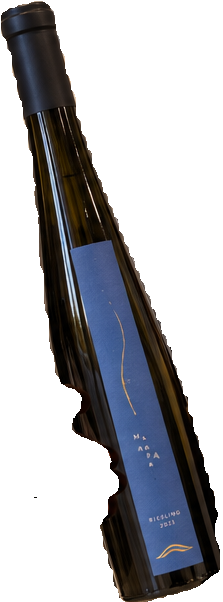
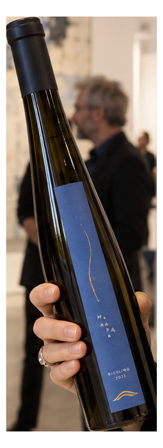
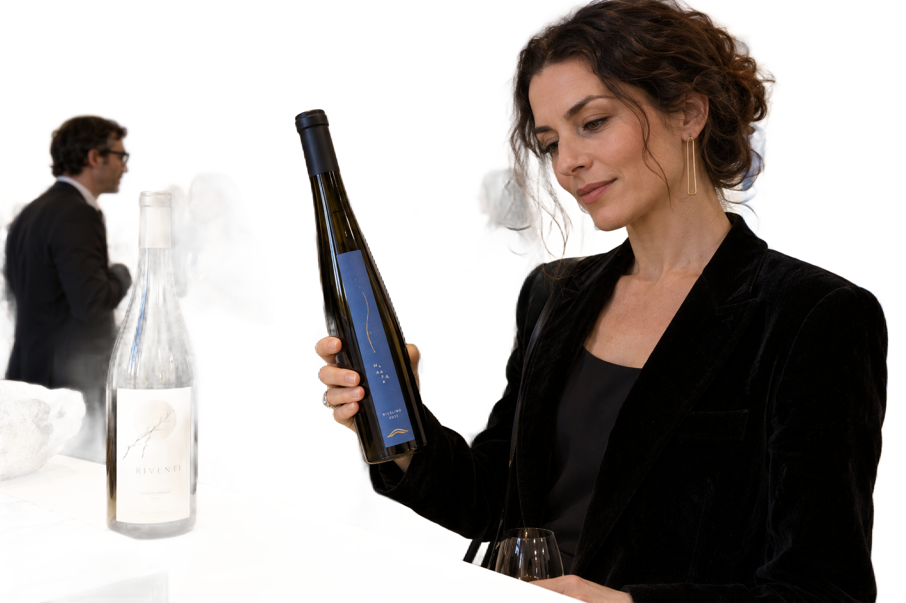

# main-selector-imagegen-diverse-v3-20261020:LB09

**Scene and masks pending — exploratory. All targets/masks are proposals; no approved segmentation ground truth.**



**scene-v1: No automatic failure flag; usability pending.**

Reference title (source): На открытии выставки · длинная узкая этикетка

Reference target description (source): Правая удерживаемая бутылка с узкой этикеткой

Expected intent: `clear`. Accepted target proposals: `d1`.

Scene group: `main-selector-imagegen-diverse-v3-20261020:LB09`. Development only; no independent split claim.

## Original and proposed target





Green marks the unreviewed target proposal. Source image pixels are retained separately.

[Selected-label mask audit](../selected-label-mask-audit.json): incomplete proposal retention is flagged separately from target agreement.

[Full-resolution target proposal mask](../masks/diverse-v3--LB09-d1.png)

## Selector results

### scene-v1: No automatic failure flag; usability pending

Selected: d1; reason: existing_scene_v1_rank; mode: legacy; crop 223×602 px. Target agreement: True. Target retention proxy: 100.0%; maximum other-bottle retention: 0.0%; minimum associated label retention: 100.0%. Mask ownership, label completeness and legibility still require human review.



[Full-resolution keep mask](../keep-masks/diverse-v3--LB09-scene-v1.png) · [Exact decision JSON](../results/diverse-v3--LB09-scene-v1.json)

Associated label-mask retention proxies (unreviewed ownership): d3: 100.0%, 16488 source pixels

### semantic-v2: No automatic failure flag; usability pending

Selected: d1; reason: unique_visible_hand_contact; mode: confident; crop 237×650 px. Target agreement: True. Target retention proxy: 100.0%; maximum other-bottle retention: 0.0%; minimum associated label retention: 100.0%. Mask ownership, label completeness and legibility still require human review. Selected-label mask audit: d3 100.0%.



[Full-resolution keep mask](../keep-masks/diverse-v3--LB09-semantic-v2.png) · [Exact decision JSON](../results/diverse-v3--LB09-semantic-v2.json)

Returned label views: [label 1](../label-crops/diverse-v3--LB09-semantic-v2-0.png)

Associated label-mask retention proxies (unreviewed ownership): d3: 100.0%, 16488 source pixels

### dis-v1: Proxy satisfied; usability pending

Selected: dis-foreground; reason: dis_foreground_mask; mode: foreground; crop 1536×1024 px. Target agreement: n/a (no native target ID). Target retention proxy: 99.6%; maximum other-bottle retention: 5.4%; minimum associated label retention: 100.0%. Mask ownership, label completeness and legibility still require human review.



[Full-resolution keep mask](../keep-masks/diverse-v3--LB09-dis-v1.png) · [Exact decision JSON](../results/diverse-v3--LB09-dis-v1.json)

Associated label-mask retention proxies (unreviewed ownership): d3: 100.0%, 16488 source pixels

## All frozen mask proposals

These links expose every detector proposal, including labels and hands. Shapes and owners are unreviewed.

| ID | Detector class | Full-resolution mask |
|---|---|---|
| d0 | wine bottle | [PNG](../masks/diverse-v3--LB09-d0.png) |
| d1 | wine bottle | [PNG](../masks/diverse-v3--LB09-d1.png) |
| d2 | wine label | [PNG](../masks/diverse-v3--LB09-d2.png) |
| d3 | wine label | [PNG](../masks/diverse-v3--LB09-d3.png) |
| d4 | hand | [PNG](../masks/diverse-v3--LB09-d4.png) |
| d5 | hand | [PNG](../masks/diverse-v3--LB09-d5.png) |
| d6 | hand | [PNG](../masks/diverse-v3--LB09-d6.png) |
| d7 | hand | [PNG](../masks/diverse-v3--LB09-d7.png) |
| d8 | hand | [PNG](../masks/diverse-v3--LB09-d8.png) |
| d9 | hand | [PNG](../masks/diverse-v3--LB09-d9.png) |
| d10 | hand | [PNG](../masks/diverse-v3--LB09-d10.png) |
| d11 | hand | [PNG](../masks/diverse-v3--LB09-d11.png) |
| d12 | wine glass | [PNG](../masks/diverse-v3--LB09-d12.png) |
| d13 | wine glass | [PNG](../masks/diverse-v3--LB09-d13.png) |
| d14 | wine glass | [PNG](../masks/diverse-v3--LB09-d14.png) |

## Additional image-only context masks

Fixed English noun requests used RGB only; no target or annotation was supplied. Primary dN IDs remain unchanged. These masks are detector evidence, not reviewed ground truth.

[Saved validated context response](../context/diverse-v3--LB09.json)

| Appended ID | Context class | Full-resolution mask |
|---|---|---|
| d15 | poster | [PNG](../context-masks/diverse-v3--LB09-d15.png) |
| d16 | poster | [PNG](../context-masks/diverse-v3--LB09-d16.png) |
| d17 | bottle held in hand | [PNG](../context-masks/diverse-v3--LB09-d17.png) |
| d18 | bottle held in hand | [PNG](../context-masks/diverse-v3--LB09-d18.png) |

[Raw frozen detector response](../detections/diverse-v3--LB09.json)

<details><summary>Generation prompt (quoted source data)</summary>

```text
Use case: photorealistic-natural. Generate ONE independent photograph, landscape 3:2, approximately 1536 by 1024 pixels. An adult artist examines a slender bottle at a contemporary art-gallery opening. Abstract canvases, white walls and guests behind. Show face, hand and long narrow label. Two bottles in the described setting. A hand from right holds the RIGHT tall bottle at its lower body; it bears a long narrow vertical blue paper label spanning much of front. A broad unheld bottle with a bright ivory label stands LEFT. Entire narrow paper inside frame. Make the scene composition, person, clothing and location specific to this scenario, rather than repeating a generic bottle on a tasting counter. Show genuine physical contact when a grip is requested. Fictional wine branding; no arrows, bounding boxes, captions, collages, watermark or UI. Maintain anatomically plausible hands. Keep the target visible label inside the frame except the explicit close-up and occlusion cases.
```

</details>

Source review notes (quoted reference data):

> Цель предварительно связана с маской SAM3 по заданию генерации; подтвердите по самому фото. Форма масок и их владельцы ещё не проверены.
> Окружение: На открытии выставки. Проверьте реалистичность рук, хват и присутствие требуемых деталей.
