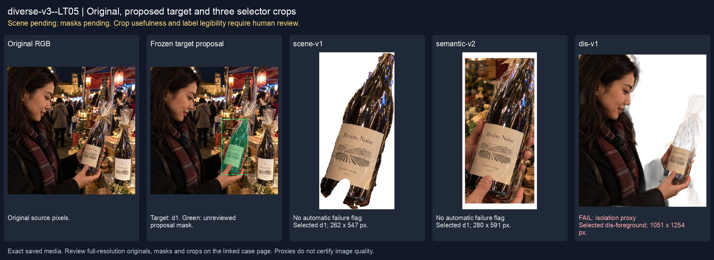
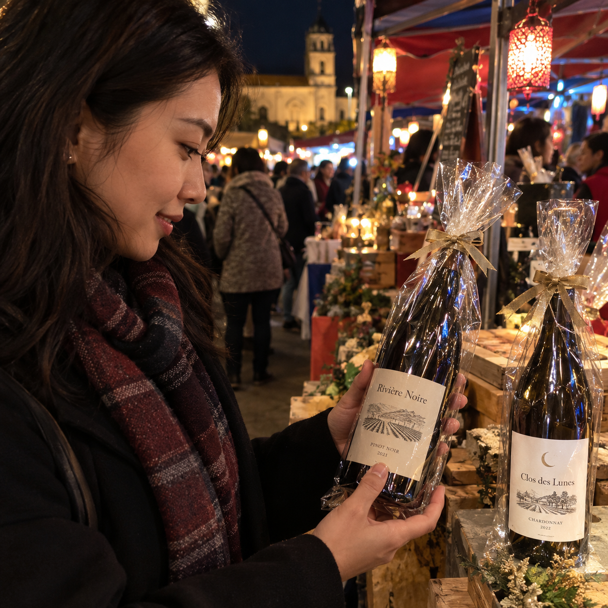
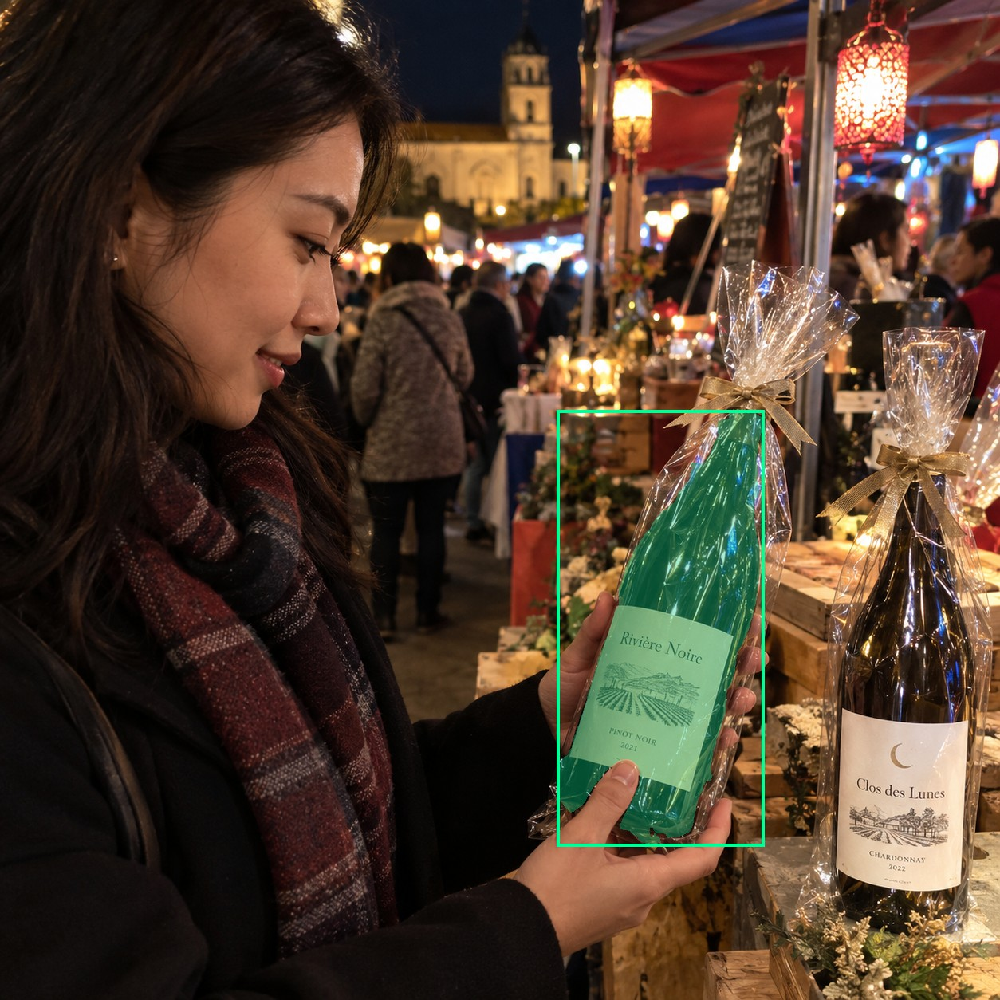
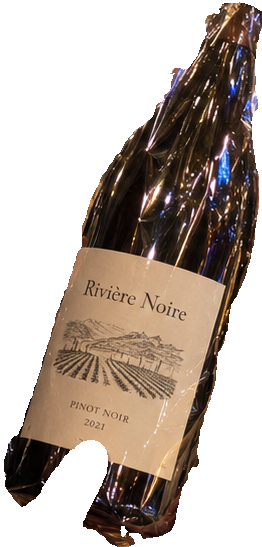
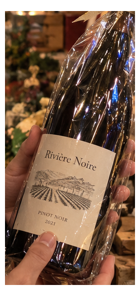
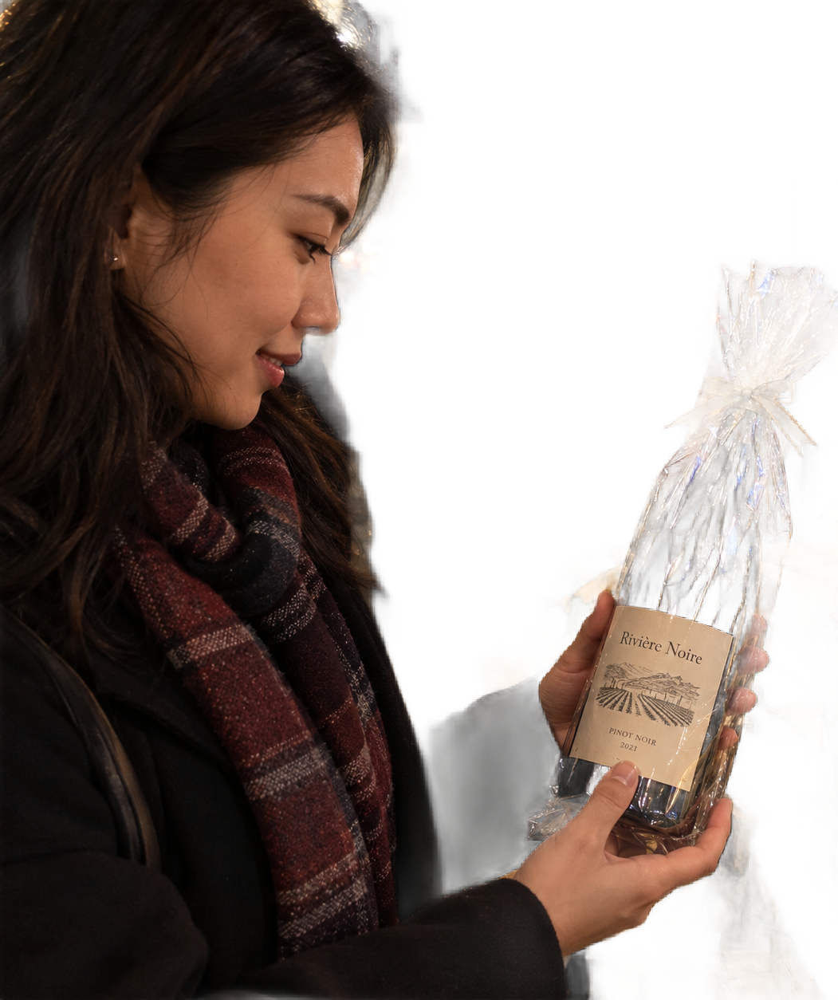

# main-selector-imagegen-diverse-v3-20261020:LT05

**Scene and masks pending — exploratory. All targets/masks are proposals; no approved segmentation ground truth.**



**scene-v1: No automatic failure flag; usability pending.**

Reference title (source): На ночном рынке · блики на прозрачном пакете в темноте

Reference target description (source): Правая удерживаемая бутылка в плёнке при слабом свете

Expected intent: `clear`. Accepted target proposals: `d1`.

Scene group: `main-selector-imagegen-diverse-v3-20261020:LT05`. Development only; no independent split claim.

## Original and proposed target





Green marks the unreviewed target proposal. Source image pixels are retained separately.

[Selected-label mask audit](../selected-label-mask-audit.json): incomplete proposal retention is flagged separately from target agreement.

[Full-resolution target proposal mask](../masks/diverse-v3--LT05-d1.png)

## Selector results

### scene-v1: No automatic failure flag; usability pending

Selected: d1; reason: existing_scene_v1_rank; mode: legacy; crop 262×547 px. Target agreement: True. Target retention proxy: 99.9%; maximum other-bottle retention: 0.0%; minimum associated label retention: 99.8%. Mask ownership, label completeness and legibility still require human review.



[Full-resolution keep mask](../keep-masks/diverse-v3--LT05-scene-v1.png) · [Exact decision JSON](../results/diverse-v3--LT05-scene-v1.json)

Associated label-mask retention proxies (unreviewed ownership): d3: 99.8%, 30959 source pixels

### semantic-v2: No automatic failure flag; usability pending

Selected: d1; reason: unique_visible_hand_contact; mode: confident; crop 280×591 px. Target agreement: True. Target retention proxy: 100.0%; maximum other-bottle retention: 0.0%; minimum associated label retention: 100.0%. Mask ownership, label completeness and legibility still require human review. Selected-label mask audit: d3 100.0%.



[Full-resolution keep mask](../keep-masks/diverse-v3--LT05-semantic-v2.png) · [Exact decision JSON](../results/diverse-v3--LT05-semantic-v2.json)

Returned label views: [label 1](../label-crops/diverse-v3--LT05-semantic-v2-0.png)

Associated label-mask retention proxies (unreviewed ownership): d3: 100.0%, 30959 source pixels

### dis-v1: PROXY failure; no native target ID

Selected: dis-foreground; reason: dis_foreground_mask; mode: foreground; crop 1051×1254 px. Target agreement: n/a (no native target ID). Target retention proxy: 57.8%; maximum other-bottle retention: 0.0%; minimum associated label retention: 100.0%. Mask ownership, label completeness and legibility still require human review.



[Full-resolution keep mask](../keep-masks/diverse-v3--LT05-dis-v1.png) · [Exact decision JSON](../results/diverse-v3--LT05-dis-v1.json)

Associated label-mask retention proxies (unreviewed ownership): d3: 100.0%, 30959 source pixels

## All frozen mask proposals

These links expose every detector proposal, including labels and hands. Shapes and owners are unreviewed.

| ID | Detector class | Full-resolution mask |
|---|---|---|
| d0 | wine bottle | [PNG](../masks/diverse-v3--LT05-d0.png) |
| d1 | wine bottle | [PNG](../masks/diverse-v3--LT05-d1.png) |
| d2 | wine label | [PNG](../masks/diverse-v3--LT05-d2.png) |
| d3 | wine label | [PNG](../masks/diverse-v3--LT05-d3.png) |
| d4 | hand | [PNG](../masks/diverse-v3--LT05-d4.png) |
| d5 | hand | [PNG](../masks/diverse-v3--LT05-d5.png) |
| d6 | hand | [PNG](../masks/diverse-v3--LT05-d6.png) |
| d7 | box | [PNG](../masks/diverse-v3--LT05-d7.png) |
| d8 | box | [PNG](../masks/diverse-v3--LT05-d8.png) |
| d9 | box | [PNG](../masks/diverse-v3--LT05-d9.png) |
| d10 | box | [PNG](../masks/diverse-v3--LT05-d10.png) |
| d11 | box | [PNG](../masks/diverse-v3--LT05-d11.png) |
| d12 | box | [PNG](../masks/diverse-v3--LT05-d12.png) |
| d13 | box | [PNG](../masks/diverse-v3--LT05-d13.png) |
| d14 | box | [PNG](../masks/diverse-v3--LT05-d14.png) |
| d15 | box | [PNG](../masks/diverse-v3--LT05-d15.png) |
| d16 | box | [PNG](../masks/diverse-v3--LT05-d16.png) |
| d17 | price tag | [PNG](../masks/diverse-v3--LT05-d17.png) |
| d18 | price tag | [PNG](../masks/diverse-v3--LT05-d18.png) |

## Additional image-only context masks

Fixed English noun requests used RGB only; no target or annotation was supplied. Primary dN IDs remain unchanged. These masks are detector evidence, not reviewed ground truth.

[Saved validated context response](../context/diverse-v3--LT05.json)

| Appended ID | Context class | Full-resolution mask |
|---|---|---|
| d19 | bottle held in hand | [PNG](../context-masks/diverse-v3--LT05-d19.png) |
| d20 | bottle held in hand | [PNG](../context-masks/diverse-v3--LT05-d20.png) |
| d21 | bottle held in hand | [PNG](../context-masks/diverse-v3--LT05-d21.png) |
| d22 | bottle held in hand | [PNG](../context-masks/diverse-v3--LT05-d22.png) |
| d23 | transparent wrapping | [PNG](../context-masks/diverse-v3--LT05-d23.png) |
| d24 | transparent wrapping | [PNG](../context-masks/diverse-v3--LT05-d24.png) |
| d25 | transparent wrapping | [PNG](../context-masks/diverse-v3--LT05-d25.png) |

[Raw frozen detector response](../detections/diverse-v3--LT05.json)

<details><summary>Generation prompt (quoted source data)</summary>

```text
Use case: photorealistic-natural. Generate ONE independent photograph, square, approximately 1024 by 1024 pixels. An adult customer examines a wrapped wine bottle at a crowded night market, colored stall lamps and people behind. Show face or partial profile, convincing grasp and realistic low-light phone noise. Two bottles in the described setting. A hand from right firmly grips the RIGHT wine bottle through clear gift film with sharp reflected highlights. Its muted cream label remains visible. LEFT unheld bottle has a brightly lit white label. Thumb and fingers oppose across bottle body. Make the scene composition, person, clothing and location specific to this scenario, rather than repeating a generic bottle on a tasting counter. Show genuine physical contact when a grip is requested. Fictional wine branding; no arrows, bounding boxes, captions, collages, watermark or UI. Maintain anatomically plausible hands. Keep the target visible label inside the frame except the explicit close-up and occlusion cases.
```

</details>

Source review notes (quoted reference data):

> Цель предварительно связана с маской SAM3 по заданию генерации; подтвердите по самому фото. Форма масок и их владельцы ещё не проверены.
> Окружение: На ночном рынке. Проверьте реалистичность рук, хват и присутствие требуемых деталей.
