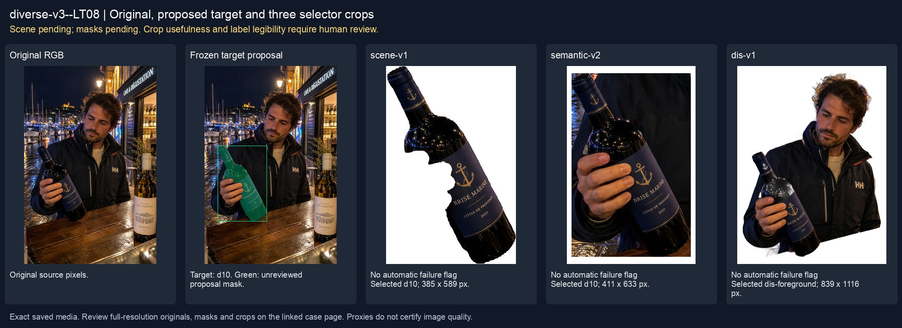
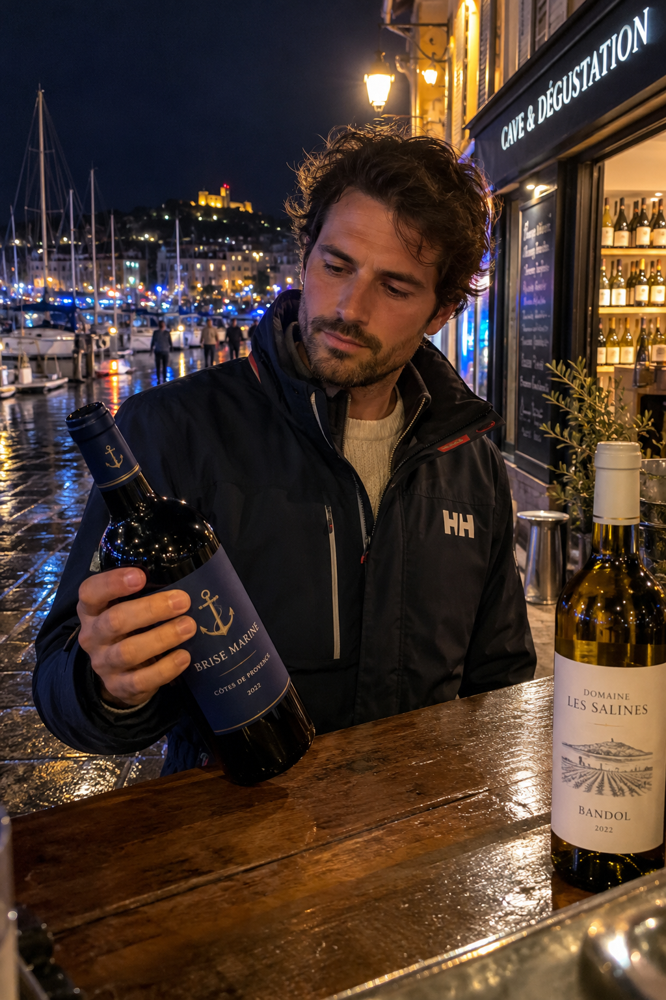
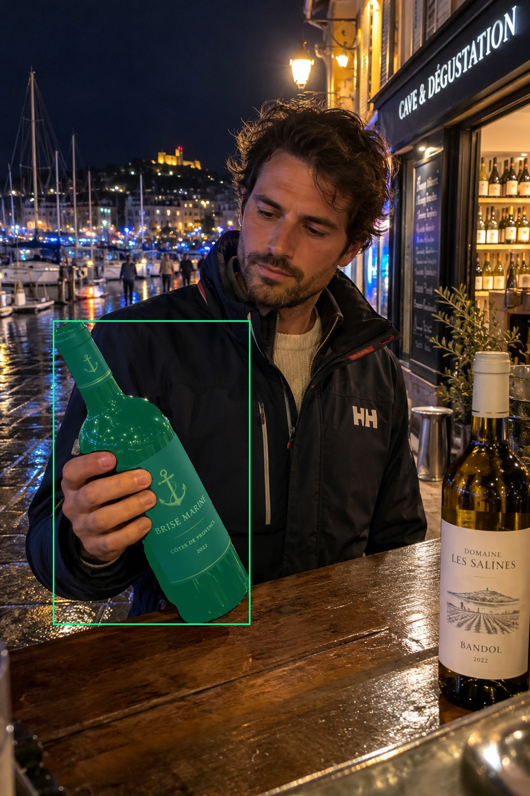
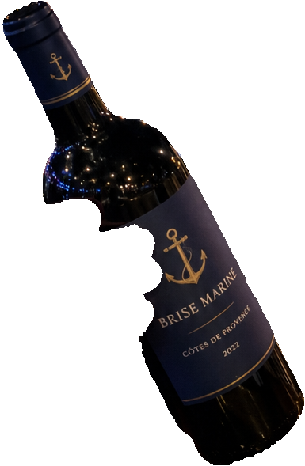
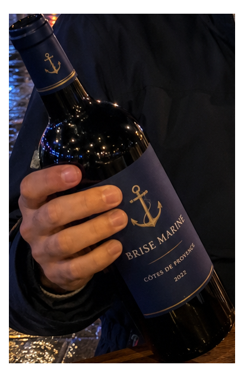
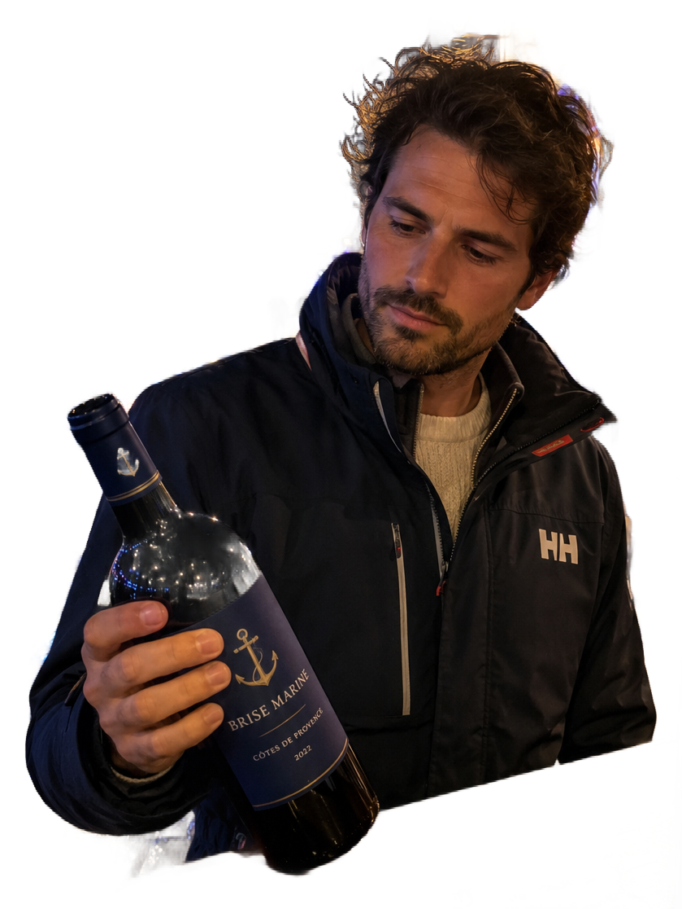

# main-selector-imagegen-diverse-v3-20261020:LT08

**Scene and masks pending — exploratory. All targets/masks are proposals; no approved segmentation ground truth.**



**scene-v1: FAIL — provisional target/proxy.**

Reference title (source): У неоновой вывески в порту · бутылка на фоне яркой вывески

Reference target description (source): Левая удерживаемая бутылка на тёмном переднем плане

Expected intent: `clear`. Accepted target proposals: `d10`.

Scene group: `main-selector-imagegen-diverse-v3-20261020:LT08`. Development only; no independent split claim.

## Original and proposed target





Green marks the unreviewed target proposal. Source image pixels are retained separately.

[Selected-label mask audit](../selected-label-mask-audit.json): incomplete proposal retention is flagged separately from target agreement.

[Full-resolution target proposal mask](../masks/diverse-v3--LT08-d10.png)

## Selector results

### scene-v1: FAIL — provisional target/proxy

Selected: d10; reason: existing_scene_v1_rank; mode: legacy; crop 385×589 px. Target agreement: True. Target retention proxy: 100.0%; maximum other-bottle retention: 0.0%; minimum associated label retention: 98.9%. Mask ownership, label completeness and legibility still require human review.



[Full-resolution keep mask](../keep-masks/diverse-v3--LT08-scene-v1.png) · [Exact decision JSON](../results/diverse-v3--LT08-scene-v1.json)

Associated label-mask retention proxies (unreviewed ownership): d23: 98.9%, 5932 source pixels; d28: 99.3%, 29235 source pixels

### semantic-v2: No automatic failure flag; usability pending

Selected: d10; reason: unique_visible_hand_contact; mode: confident; crop 411×633 px. Target agreement: True. Target retention proxy: 100.0%; maximum other-bottle retention: 0.0%; minimum associated label retention: 100.0%. Mask ownership, label completeness and legibility still require human review. Selected-label mask audit: d28 100.0%; d23 100.0%.



[Full-resolution keep mask](../keep-masks/diverse-v3--LT08-semantic-v2.png) · [Exact decision JSON](../results/diverse-v3--LT08-semantic-v2.json)

Returned label views: [label 1](../label-crops/diverse-v3--LT08-semantic-v2-0.png) · [label 2](../label-crops/diverse-v3--LT08-semantic-v2-1.png)

Associated label-mask retention proxies (unreviewed ownership): d23: 100.0%, 5932 source pixels; d28: 100.0%, 29235 source pixels

### dis-v1: PROXY failure; no native target ID

Selected: dis-foreground; reason: dis_foreground_mask; mode: foreground; crop 839×1116 px. Target agreement: n/a (no native target ID). Target retention proxy: 98.5%; maximum other-bottle retention: 0.0%; minimum associated label retention: 98.3%. Mask ownership, label completeness and legibility still require human review.



[Full-resolution keep mask](../keep-masks/diverse-v3--LT08-dis-v1.png) · [Exact decision JSON](../results/diverse-v3--LT08-dis-v1.json)

Associated label-mask retention proxies (unreviewed ownership): d23: 98.3%, 5932 source pixels; d28: 100.0%, 29235 source pixels

## All frozen mask proposals

These links expose every detector proposal, including labels and hands. Shapes and owners are unreviewed.

| ID | Detector class | Full-resolution mask |
|---|---|---|
| d0 | wine bottle | [PNG](../masks/diverse-v3--LT08-d0.png) |
| d1 | wine bottle | [PNG](../masks/diverse-v3--LT08-d1.png) |
| d2 | wine bottle | [PNG](../masks/diverse-v3--LT08-d2.png) |
| d3 | wine bottle | [PNG](../masks/diverse-v3--LT08-d3.png) |
| d4 | wine bottle | [PNG](../masks/diverse-v3--LT08-d4.png) |
| d5 | wine bottle | [PNG](../masks/diverse-v3--LT08-d5.png) |
| d6 | wine bottle | [PNG](../masks/diverse-v3--LT08-d6.png) |
| d7 | wine bottle | [PNG](../masks/diverse-v3--LT08-d7.png) |
| d8 | wine bottle | [PNG](../masks/diverse-v3--LT08-d8.png) |
| d9 | wine bottle | [PNG](../masks/diverse-v3--LT08-d9.png) |
| d10 | wine bottle | [PNG](../masks/diverse-v3--LT08-d10.png) |
| d11 | wine bottle | [PNG](../masks/diverse-v3--LT08-d11.png) |
| d12 | wine bottle | [PNG](../masks/diverse-v3--LT08-d12.png) |
| d13 | wine bottle | [PNG](../masks/diverse-v3--LT08-d13.png) |
| d14 | wine bottle | [PNG](../masks/diverse-v3--LT08-d14.png) |
| d15 | wine bottle | [PNG](../masks/diverse-v3--LT08-d15.png) |
| d16 | wine bottle | [PNG](../masks/diverse-v3--LT08-d16.png) |
| d17 | wine bottle | [PNG](../masks/diverse-v3--LT08-d17.png) |
| d18 | wine bottle | [PNG](../masks/diverse-v3--LT08-d18.png) |
| d19 | wine bottle | [PNG](../masks/diverse-v3--LT08-d19.png) |
| d20 | wine bottle | [PNG](../masks/diverse-v3--LT08-d20.png) |
| d21 | wine label | [PNG](../masks/diverse-v3--LT08-d21.png) |
| d22 | wine label | [PNG](../masks/diverse-v3--LT08-d22.png) |
| d23 | wine label | [PNG](../masks/diverse-v3--LT08-d23.png) |
| d24 | wine label | [PNG](../masks/diverse-v3--LT08-d24.png) |
| d25 | wine label | [PNG](../masks/diverse-v3--LT08-d25.png) |
| d26 | wine label | [PNG](../masks/diverse-v3--LT08-d26.png) |
| d27 | wine label | [PNG](../masks/diverse-v3--LT08-d27.png) |
| d28 | wine label | [PNG](../masks/diverse-v3--LT08-d28.png) |
| d29 | wine label | [PNG](../masks/diverse-v3--LT08-d29.png) |
| d30 | wine label | [PNG](../masks/diverse-v3--LT08-d30.png) |
| d31 | wine label | [PNG](../masks/diverse-v3--LT08-d31.png) |
| d32 | wine label | [PNG](../masks/diverse-v3--LT08-d32.png) |
| d33 | wine label | [PNG](../masks/diverse-v3--LT08-d33.png) |
| d34 | wine label | [PNG](../masks/diverse-v3--LT08-d34.png) |
| d35 | wine label | [PNG](../masks/diverse-v3--LT08-d35.png) |
| d36 | wine label | [PNG](../masks/diverse-v3--LT08-d36.png) |
| d37 | hand | [PNG](../masks/diverse-v3--LT08-d37.png) |

## Additional image-only context masks

Fixed English noun requests used RGB only; no target or annotation was supplied. Primary dN IDs remain unchanged. These masks are detector evidence, not reviewed ground truth.

[Saved validated context response](../context/diverse-v3--LT08.json)

| Appended ID | Context class | Full-resolution mask |
|---|---|---|
| d38 | bottle held in hand | [PNG](../context-masks/diverse-v3--LT08-d38.png) |
| d39 | bottle held in hand | [PNG](../context-masks/diverse-v3--LT08-d39.png) |

[Raw frozen detector response](../detections/diverse-v3--LT08.json)

<details><summary>Generation prompt (quoted source data)</summary>

```text
Use case: photorealistic-natural. Generate ONE independent photograph, portrait 2:3, approximately 1024 by 1536 pixels. An adult sailor examines a wine bottle beside a harbor bar at night, bright neon reflected on wet pavement and boats behind. Include face, jacket and hand; preserve dark foreground details. Two bottles on an evening tasting counter. A hand from left firmly wraps the LEFT navy-label bottle body. Behind RIGHT is a bright shop sign and an unheld cream-label bottle. The foreground hand and dark bottle remain recognizable. Realistic phone exposure, no added graphics. Make the scene composition, person, clothing and location specific to this scenario, rather than repeating a generic bottle on a tasting counter. Show genuine physical contact when a grip is requested. Fictional wine branding; no arrows, bounding boxes, captions, collages, watermark or UI. Maintain anatomically plausible hands. Keep the target visible label inside the frame except the explicit close-up and occlusion cases.
```

</details>

Source review notes (quoted reference data):

> Цель предварительно связана с маской SAM3 по заданию генерации; подтвердите по самому фото. Форма масок и их владельцы ещё не проверены.
> Окружение: У неоновой вывески в порту. Проверьте реалистичность рук, хват и присутствие требуемых деталей.
