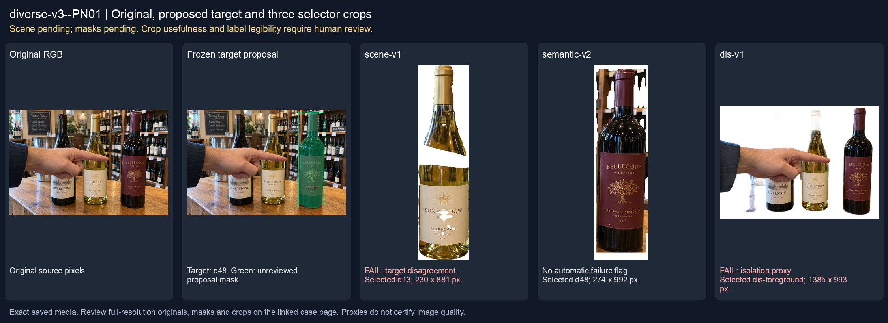
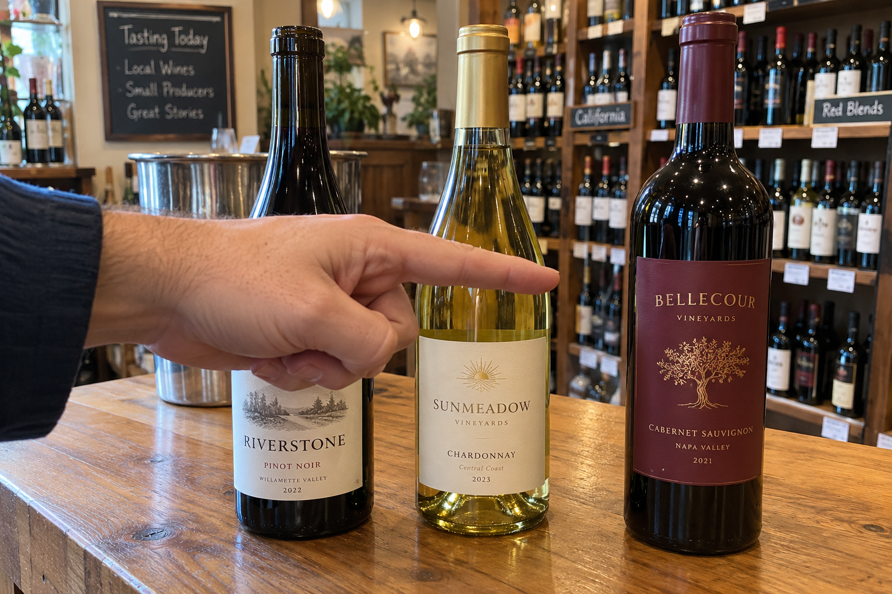
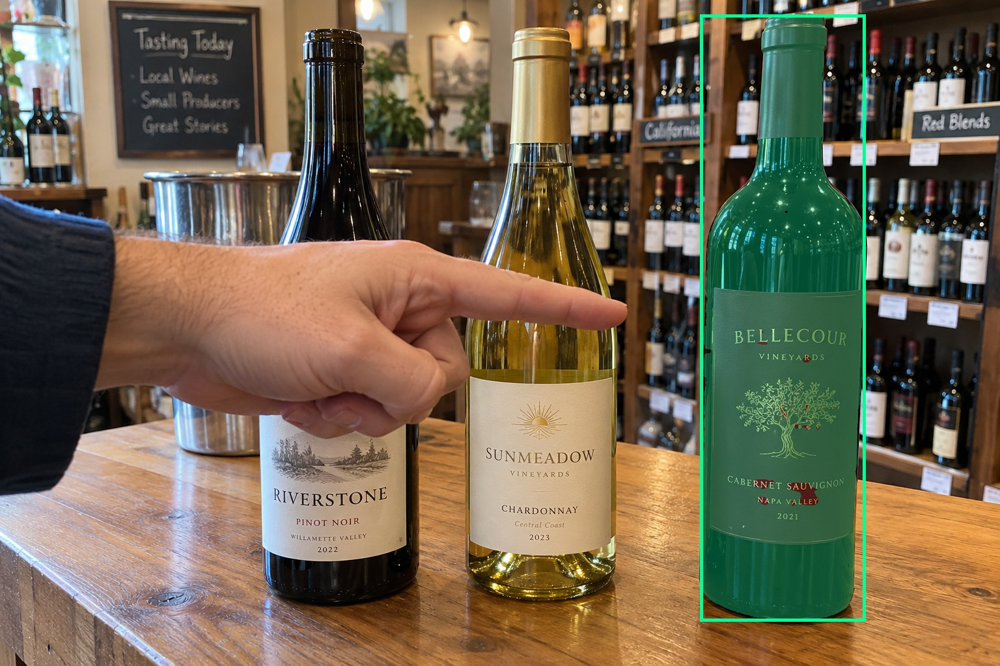
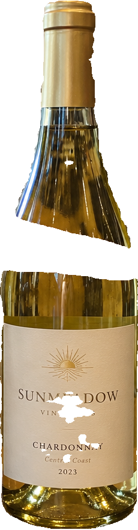
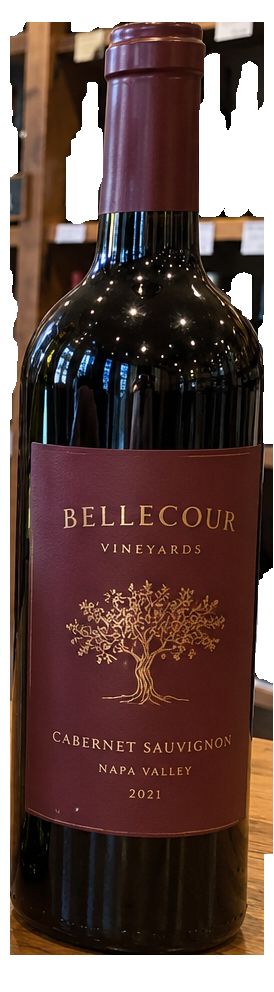
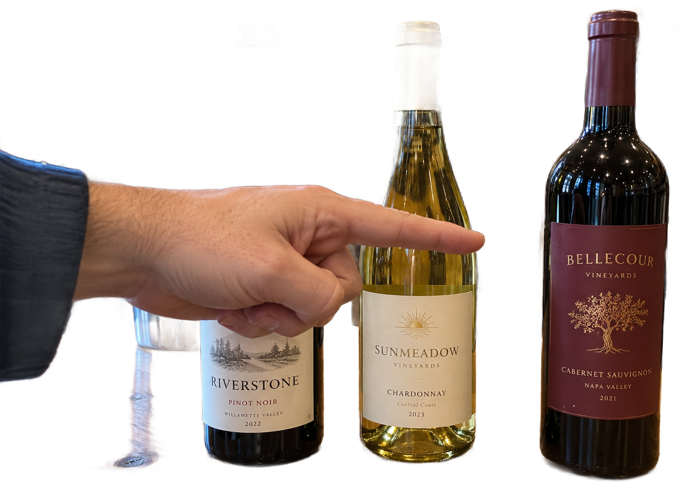

# main-selector-imagegen-diverse-v3-20261020:PN01

**Scene and masks pending — exploratory. All targets/masks are proposals; no approved segmentation ground truth.**



**scene-v1: FAIL — provisional target/proxy.**

Reference title (source): Палец проходит перед соседом

Reference target description (source): Правая бутылка с бордовой этикеткой

Expected intent: `clear`. Accepted target proposals: `d48`.

Scene group: `main-selector-imagegen-diverse-v3-20261020:PN01`. Development only; no independent split claim.

## Original and proposed target





Green marks the unreviewed target proposal. Source image pixels are retained separately.

[Selected-label mask audit](../selected-label-mask-audit.json): incomplete proposal retention is flagged separately from target agreement.

[Full-resolution target proposal mask](../masks/diverse-v3--PN01-d48.png)

## Selector results

### scene-v1: FAIL — provisional target/proxy

Selected: d13; reason: existing_scene_v1_rank; mode: legacy; crop 230×881 px. Target agreement: False. Target retention proxy: 0.0%; maximum other-bottle retention: 100.0%; minimum associated label retention: 0.0%. Mask ownership, label completeness and legibility still require human review.



[Full-resolution keep mask](../keep-masks/diverse-v3--PN01-scene-v1.png) · [Exact decision JSON](../results/diverse-v3--PN01-scene-v1.json)

Associated label-mask retention proxies (unreviewed ownership): d71: 0.0%, 86423 source pixels

### semantic-v2: No automatic failure flag; usability pending

Selected: d48; reason: explicit_pointing_gesture; mode: confident; crop 274×992 px. Target agreement: True. Target retention proxy: 100.0%; maximum other-bottle retention: 1.0%; minimum associated label retention: 100.0%. Mask ownership, label completeness and legibility still require human review. Selected-label mask audit: d71 100.0%.



[Full-resolution keep mask](../keep-masks/diverse-v3--PN01-semantic-v2.png) · [Exact decision JSON](../results/diverse-v3--PN01-semantic-v2.json)

Returned label views: [label 1](../label-crops/diverse-v3--PN01-semantic-v2-0.png)

Associated label-mask retention proxies (unreviewed ownership): d71: 100.0%, 86423 source pixels

### dis-v1: PROXY failure; no native target ID

Selected: dis-foreground; reason: dis_foreground_mask; mode: foreground; crop 1385×993 px. Target agreement: n/a (no native target ID). Target retention proxy: 99.9%; maximum other-bottle retention: 86.0%; minimum associated label retention: 100.0%. Mask ownership, label completeness and legibility still require human review.



[Full-resolution keep mask](../keep-masks/diverse-v3--PN01-dis-v1.png) · [Exact decision JSON](../results/diverse-v3--PN01-dis-v1.json)

Associated label-mask retention proxies (unreviewed ownership): d71: 100.0%, 86423 source pixels

## All frozen mask proposals

These links expose every detector proposal, including labels and hands. Shapes and owners are unreviewed.

| ID | Detector class | Full-resolution mask |
|---|---|---|
| d0 | wine bottle | [PNG](../masks/diverse-v3--PN01-d0.png) |
| d1 | wine bottle | [PNG](../masks/diverse-v3--PN01-d1.png) |
| d2 | wine bottle | [PNG](../masks/diverse-v3--PN01-d2.png) |
| d3 | wine bottle | [PNG](../masks/diverse-v3--PN01-d3.png) |
| d4 | wine bottle | [PNG](../masks/diverse-v3--PN01-d4.png) |
| d5 | wine bottle | [PNG](../masks/diverse-v3--PN01-d5.png) |
| d6 | wine bottle | [PNG](../masks/diverse-v3--PN01-d6.png) |
| d7 | wine bottle | [PNG](../masks/diverse-v3--PN01-d7.png) |
| d8 | wine bottle | [PNG](../masks/diverse-v3--PN01-d8.png) |
| d9 | wine bottle | [PNG](../masks/diverse-v3--PN01-d9.png) |
| d10 | wine bottle | [PNG](../masks/diverse-v3--PN01-d10.png) |
| d11 | wine bottle | [PNG](../masks/diverse-v3--PN01-d11.png) |
| d12 | wine bottle | [PNG](../masks/diverse-v3--PN01-d12.png) |
| d13 | wine bottle | [PNG](../masks/diverse-v3--PN01-d13.png) |
| d14 | wine bottle | [PNG](../masks/diverse-v3--PN01-d14.png) |
| d15 | wine bottle | [PNG](../masks/diverse-v3--PN01-d15.png) |
| d16 | wine bottle | [PNG](../masks/diverse-v3--PN01-d16.png) |
| d17 | wine bottle | [PNG](../masks/diverse-v3--PN01-d17.png) |
| d18 | wine bottle | [PNG](../masks/diverse-v3--PN01-d18.png) |
| d19 | wine bottle | [PNG](../masks/diverse-v3--PN01-d19.png) |
| d20 | wine bottle | [PNG](../masks/diverse-v3--PN01-d20.png) |
| d21 | wine bottle | [PNG](../masks/diverse-v3--PN01-d21.png) |
| d22 | wine bottle | [PNG](../masks/diverse-v3--PN01-d22.png) |
| d23 | wine bottle | [PNG](../masks/diverse-v3--PN01-d23.png) |
| d24 | wine bottle | [PNG](../masks/diverse-v3--PN01-d24.png) |
| d25 | wine bottle | [PNG](../masks/diverse-v3--PN01-d25.png) |
| d26 | wine bottle | [PNG](../masks/diverse-v3--PN01-d26.png) |
| d27 | wine bottle | [PNG](../masks/diverse-v3--PN01-d27.png) |
| d28 | wine bottle | [PNG](../masks/diverse-v3--PN01-d28.png) |
| d29 | wine bottle | [PNG](../masks/diverse-v3--PN01-d29.png) |
| d30 | wine bottle | [PNG](../masks/diverse-v3--PN01-d30.png) |
| d31 | wine bottle | [PNG](../masks/diverse-v3--PN01-d31.png) |
| d32 | wine bottle | [PNG](../masks/diverse-v3--PN01-d32.png) |
| d33 | wine bottle | [PNG](../masks/diverse-v3--PN01-d33.png) |
| d34 | wine bottle | [PNG](../masks/diverse-v3--PN01-d34.png) |
| d35 | wine bottle | [PNG](../masks/diverse-v3--PN01-d35.png) |
| d36 | wine bottle | [PNG](../masks/diverse-v3--PN01-d36.png) |
| d37 | wine bottle | [PNG](../masks/diverse-v3--PN01-d37.png) |
| d38 | wine bottle | [PNG](../masks/diverse-v3--PN01-d38.png) |
| d39 | wine bottle | [PNG](../masks/diverse-v3--PN01-d39.png) |
| d40 | wine bottle | [PNG](../masks/diverse-v3--PN01-d40.png) |
| d41 | wine bottle | [PNG](../masks/diverse-v3--PN01-d41.png) |
| d42 | wine bottle | [PNG](../masks/diverse-v3--PN01-d42.png) |
| d43 | wine bottle | [PNG](../masks/diverse-v3--PN01-d43.png) |
| d44 | wine bottle | [PNG](../masks/diverse-v3--PN01-d44.png) |
| d45 | wine bottle | [PNG](../masks/diverse-v3--PN01-d45.png) |
| d46 | wine bottle | [PNG](../masks/diverse-v3--PN01-d46.png) |
| d47 | wine bottle | [PNG](../masks/diverse-v3--PN01-d47.png) |
| d48 | wine bottle | [PNG](../masks/diverse-v3--PN01-d48.png) |
| d49 | wine bottle | [PNG](../masks/diverse-v3--PN01-d49.png) |
| d50 | wine bottle | [PNG](../masks/diverse-v3--PN01-d50.png) |
| d51 | wine bottle | [PNG](../masks/diverse-v3--PN01-d51.png) |
| d52 | wine bottle | [PNG](../masks/diverse-v3--PN01-d52.png) |
| d53 | wine bottle | [PNG](../masks/diverse-v3--PN01-d53.png) |
| d54 | wine bottle | [PNG](../masks/diverse-v3--PN01-d54.png) |
| d55 | wine bottle | [PNG](../masks/diverse-v3--PN01-d55.png) |
| d56 | wine bottle | [PNG](../masks/diverse-v3--PN01-d56.png) |
| d57 | wine bottle | [PNG](../masks/diverse-v3--PN01-d57.png) |
| d58 | wine bottle | [PNG](../masks/diverse-v3--PN01-d58.png) |
| d59 | wine bottle | [PNG](../masks/diverse-v3--PN01-d59.png) |
| d60 | wine bottle | [PNG](../masks/diverse-v3--PN01-d60.png) |
| d61 | wine bottle | [PNG](../masks/diverse-v3--PN01-d61.png) |
| d62 | wine bottle | [PNG](../masks/diverse-v3--PN01-d62.png) |
| d63 | wine bottle | [PNG](../masks/diverse-v3--PN01-d63.png) |
| d64 | wine label | [PNG](../masks/diverse-v3--PN01-d64.png) |
| d65 | wine label | [PNG](../masks/diverse-v3--PN01-d65.png) |
| d66 | wine label | [PNG](../masks/diverse-v3--PN01-d66.png) |
| d67 | wine label | [PNG](../masks/diverse-v3--PN01-d67.png) |
| d68 | wine label | [PNG](../masks/diverse-v3--PN01-d68.png) |
| d69 | wine label | [PNG](../masks/diverse-v3--PN01-d69.png) |
| d70 | wine label | [PNG](../masks/diverse-v3--PN01-d70.png) |
| d71 | wine label | [PNG](../masks/diverse-v3--PN01-d71.png) |
| d72 | wine label | [PNG](../masks/diverse-v3--PN01-d72.png) |
| d73 | wine label | [PNG](../masks/diverse-v3--PN01-d73.png) |
| d74 | wine label | [PNG](../masks/diverse-v3--PN01-d74.png) |
| d75 | wine label | [PNG](../masks/diverse-v3--PN01-d75.png) |
| d76 | wine label | [PNG](../masks/diverse-v3--PN01-d76.png) |
| d77 | wine label | [PNG](../masks/diverse-v3--PN01-d77.png) |
| d78 | wine label | [PNG](../masks/diverse-v3--PN01-d78.png) |
| d79 | wine label | [PNG](../masks/diverse-v3--PN01-d79.png) |
| d80 | wine label | [PNG](../masks/diverse-v3--PN01-d80.png) |
| d81 | wine label | [PNG](../masks/diverse-v3--PN01-d81.png) |
| d82 | wine label | [PNG](../masks/diverse-v3--PN01-d82.png) |
| d83 | wine label | [PNG](../masks/diverse-v3--PN01-d83.png) |
| d84 | wine label | [PNG](../masks/diverse-v3--PN01-d84.png) |
| d85 | wine label | [PNG](../masks/diverse-v3--PN01-d85.png) |
| d86 | wine label | [PNG](../masks/diverse-v3--PN01-d86.png) |
| d87 | wine label | [PNG](../masks/diverse-v3--PN01-d87.png) |
| d88 | wine label | [PNG](../masks/diverse-v3--PN01-d88.png) |
| d89 | wine label | [PNG](../masks/diverse-v3--PN01-d89.png) |
| d90 | wine label | [PNG](../masks/diverse-v3--PN01-d90.png) |
| d91 | wine label | [PNG](../masks/diverse-v3--PN01-d91.png) |
| d92 | wine label | [PNG](../masks/diverse-v3--PN01-d92.png) |
| d93 | wine label | [PNG](../masks/diverse-v3--PN01-d93.png) |
| d94 | wine label | [PNG](../masks/diverse-v3--PN01-d94.png) |
| d95 | wine label | [PNG](../masks/diverse-v3--PN01-d95.png) |
| d96 | wine label | [PNG](../masks/diverse-v3--PN01-d96.png) |
| d97 | wine label | [PNG](../masks/diverse-v3--PN01-d97.png) |
| d98 | wine label | [PNG](../masks/diverse-v3--PN01-d98.png) |
| d99 | wine label | [PNG](../masks/diverse-v3--PN01-d99.png) |
| d100 | wine label | [PNG](../masks/diverse-v3--PN01-d100.png) |
| d101 | wine label | [PNG](../masks/diverse-v3--PN01-d101.png) |
| d102 | wine label | [PNG](../masks/diverse-v3--PN01-d102.png) |
| d103 | wine label | [PNG](../masks/diverse-v3--PN01-d103.png) |
| d104 | wine label | [PNG](../masks/diverse-v3--PN01-d104.png) |
| d105 | wine label | [PNG](../masks/diverse-v3--PN01-d105.png) |
| d106 | wine label | [PNG](../masks/diverse-v3--PN01-d106.png) |
| d107 | hand | [PNG](../masks/diverse-v3--PN01-d107.png) |
| d108 | price tag | [PNG](../masks/diverse-v3--PN01-d108.png) |
| d109 | price tag | [PNG](../masks/diverse-v3--PN01-d109.png) |
| d110 | price tag | [PNG](../masks/diverse-v3--PN01-d110.png) |
| d111 | price tag | [PNG](../masks/diverse-v3--PN01-d111.png) |
| d112 | price tag | [PNG](../masks/diverse-v3--PN01-d112.png) |
| d113 | price tag | [PNG](../masks/diverse-v3--PN01-d113.png) |
| d114 | price tag | [PNG](../masks/diverse-v3--PN01-d114.png) |
| d115 | price tag | [PNG](../masks/diverse-v3--PN01-d115.png) |
| d116 | price tag | [PNG](../masks/diverse-v3--PN01-d116.png) |
| d117 | price tag | [PNG](../masks/diverse-v3--PN01-d117.png) |
| d118 | price tag | [PNG](../masks/diverse-v3--PN01-d118.png) |
| d119 | price tag | [PNG](../masks/diverse-v3--PN01-d119.png) |
| d120 | price tag | [PNG](../masks/diverse-v3--PN01-d120.png) |
| d121 | price tag | [PNG](../masks/diverse-v3--PN01-d121.png) |
| d122 | price tag | [PNG](../masks/diverse-v3--PN01-d122.png) |
| d123 | price tag | [PNG](../masks/diverse-v3--PN01-d123.png) |
| d124 | price tag | [PNG](../masks/diverse-v3--PN01-d124.png) |
| d125 | price tag | [PNG](../masks/diverse-v3--PN01-d125.png) |
| d126 | price tag | [PNG](../masks/diverse-v3--PN01-d126.png) |
| d127 | price tag | [PNG](../masks/diverse-v3--PN01-d127.png) |
| d128 | price tag | [PNG](../masks/diverse-v3--PN01-d128.png) |
| d129 | price tag | [PNG](../masks/diverse-v3--PN01-d129.png) |
| d130 | wine glass | [PNG](../masks/diverse-v3--PN01-d130.png) |
| d131 | wine glass | [PNG](../masks/diverse-v3--PN01-d131.png) |

## Additional image-only context masks

Fixed English noun requests used RGB only; no target or annotation was supplied. Primary dN IDs remain unchanged. These masks are detector evidence, not reviewed ground truth.

[Saved validated context response](../context/diverse-v3--PN01.json)

| Appended ID | Context class | Full-resolution mask |
|---|---|---|
| d132 | bottle held in hand | [PNG](../context-masks/diverse-v3--PN01-d132.png) |
| d133 | bottle held in hand | [PNG](../context-masks/diverse-v3--PN01-d133.png) |
| d134 | bottle held in hand | [PNG](../context-masks/diverse-v3--PN01-d134.png) |
| d135 | bottle held in hand | [PNG](../context-masks/diverse-v3--PN01-d135.png) |
| d136 | bottle held in hand | [PNG](../context-masks/diverse-v3--PN01-d136.png) |
| d137 | bottle held in hand | [PNG](../context-masks/diverse-v3--PN01-d137.png) |
| d138 | bottle held in hand | [PNG](../context-masks/diverse-v3--PN01-d138.png) |
| d139 | bottle held in hand | [PNG](../context-masks/diverse-v3--PN01-d139.png) |
| d140 | bottle held in hand | [PNG](../context-masks/diverse-v3--PN01-d140.png) |
| d141 | bottle held in hand | [PNG](../context-masks/diverse-v3--PN01-d141.png) |
| d142 | bottle held in hand | [PNG](../context-masks/diverse-v3--PN01-d142.png) |
| d143 | bottle held in hand | [PNG](../context-masks/diverse-v3--PN01-d143.png) |
| d144 | bottle held in hand | [PNG](../context-masks/diverse-v3--PN01-d144.png) |
| d145 | bottle held in hand | [PNG](../context-masks/diverse-v3--PN01-d145.png) |
| d146 | bottle held in hand | [PNG](../context-masks/diverse-v3--PN01-d146.png) |
| d147 | bottle held in hand | [PNG](../context-masks/diverse-v3--PN01-d147.png) |
| d148 | bottle held in hand | [PNG](../context-masks/diverse-v3--PN01-d148.png) |
| d149 | bottle held in hand | [PNG](../context-masks/diverse-v3--PN01-d149.png) |
| d150 | bottle held in hand | [PNG](../context-masks/diverse-v3--PN01-d150.png) |
| d151 | bottle held in hand | [PNG](../context-masks/diverse-v3--PN01-d151.png) |
| d152 | bottle held in hand | [PNG](../context-masks/diverse-v3--PN01-d152.png) |
| d153 | bottle held in hand | [PNG](../context-masks/diverse-v3--PN01-d153.png) |
| d154 | bottle held in hand | [PNG](../context-masks/diverse-v3--PN01-d154.png) |
| d155 | bottle held in hand | [PNG](../context-masks/diverse-v3--PN01-d155.png) |
| d156 | bottle held in hand | [PNG](../context-masks/diverse-v3--PN01-d156.png) |
| d157 | bottle held in hand | [PNG](../context-masks/diverse-v3--PN01-d157.png) |
| d158 | bottle held in hand | [PNG](../context-masks/diverse-v3--PN01-d158.png) |
| d159 | bottle held in hand | [PNG](../context-masks/diverse-v3--PN01-d159.png) |
| d160 | bottle held in hand | [PNG](../context-masks/diverse-v3--PN01-d160.png) |
| d161 | bottle held in hand | [PNG](../context-masks/diverse-v3--PN01-d161.png) |

[Raw frozen detector response](../detections/diverse-v3--PN01.json)

<details><summary>Generation prompt (quoted source data)</summary>

```text
Use case: photorealistic-natural. Generate exactly ONE independent candid smartphone photograph. Show believable glass, paper, natural material imperfections, fictional wine branding, and anatomically plausible hands. No collage, grid, arrows, annotations, bounding boxes, highlights, watermark, UI overlay, or explanatory caption. Text is allowed on physical objects within the scene. Keep the target visible front label entirely inside the frame unless partial occlusion or close-up is explicitly requested. Image format: landscape 3:2, approximately 1536 by 1024 pixels. Setting: inside a real wine store. Use a shop tasting counter, bottle shelves with small price strips, retail aisle details and natural store lighting. Keep the described foreground inventory; background racks may be empty or softly blurred. Scene details: Three upright bottles on a tasting counter. A hand from left with visible broad palm and curled non-index fingers points horizontally RIGHT across the middle bottle toward the rightmost burgundy-label bottle. The fingertip ends in the air gap immediately beside the rightmost bottle. No grasping. The middle bottle is brighter.
```

</details>

Source review notes (quoted reference data):

> Цель предварительно связана с маской SAM3 по заданию генерации; подтвердите по самому фото. Форма масок и их владельцы ещё не проверены.
> Окружение: Винный магазин. Проверьте реалистичность рук, хват и присутствие требуемых деталей.
