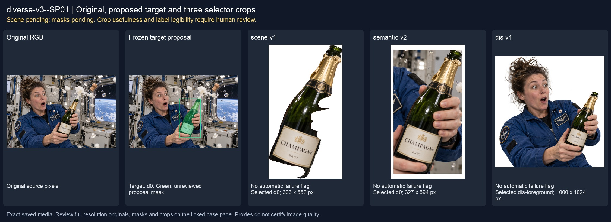
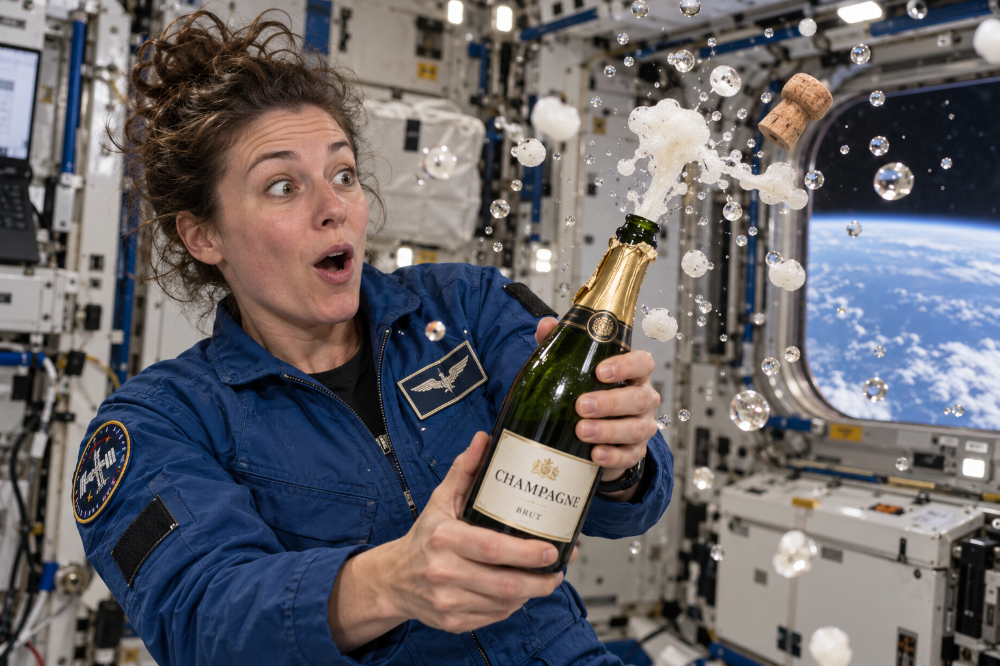
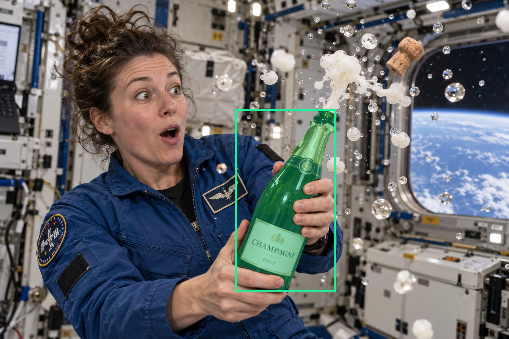
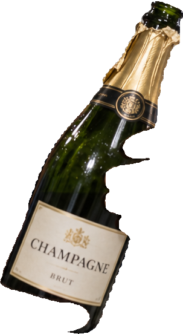
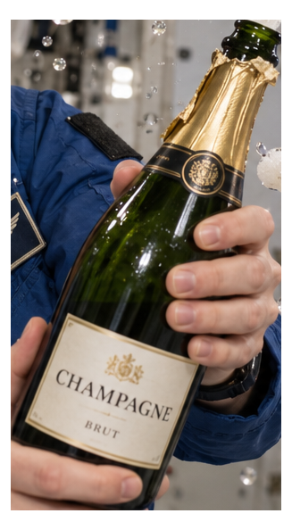
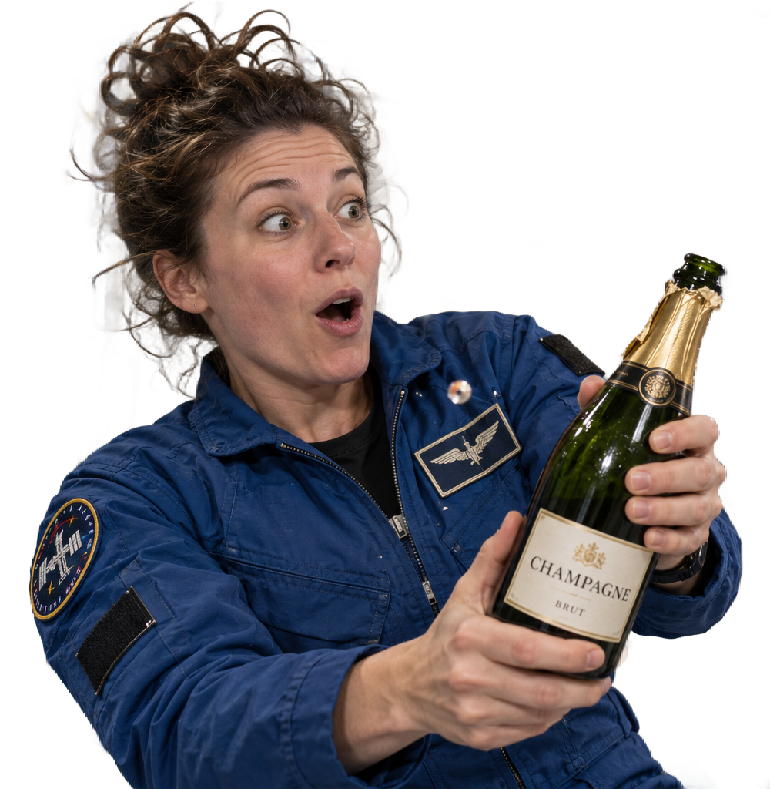

# main-selector-imagegen-diverse-v3-20261020:SP01

**Scene and masks pending — exploratory. All targets/masks are proposals; no approved segmentation ground truth.**



**scene-v1: No automatic failure flag; usability pending.**

Reference title (source): Астронавт случайно открывает шампанское

Reference target description (source): Бутылка шампанского в руках астронавта

Expected intent: `clear`. Accepted target proposals: `d0`.

Scene group: `main-selector-imagegen-diverse-v3-20261020:SP01`. Development only; no independent split claim.

## Original and proposed target





Green marks the unreviewed target proposal. Source image pixels are retained separately.

[Selected-label mask audit](../selected-label-mask-audit.json): incomplete proposal retention is flagged separately from target agreement.

[Full-resolution target proposal mask](../masks/diverse-v3--SP01-d0.png)

## Selector results

### scene-v1: No automatic failure flag; usability pending

Selected: d0; reason: existing_scene_v1_rank; mode: legacy; crop 303×552 px. Target agreement: True. Target retention proxy: 100.0%; maximum other-bottle retention: 0.0%; minimum associated label retention: 99.6%. Mask ownership, label completeness and legibility still require human review.



[Full-resolution keep mask](../keep-masks/diverse-v3--SP01-scene-v1.png) · [Exact decision JSON](../results/diverse-v3--SP01-scene-v1.json)

Associated label-mask retention proxies (unreviewed ownership): d1: 99.6%, 4151 source pixels; d2: 100.0%, 21360 source pixels

### semantic-v2: No automatic failure flag; usability pending

Selected: d0; reason: unique_visible_hand_contact; mode: confident; crop 327×594 px. Target agreement: True. Target retention proxy: 100.0%; maximum other-bottle retention: 0.0%; minimum associated label retention: 100.0%. Mask ownership, label completeness and legibility still require human review. Selected-label mask audit: d2 100.0%; d1 100.0%.



[Full-resolution keep mask](../keep-masks/diverse-v3--SP01-semantic-v2.png) · [Exact decision JSON](../results/diverse-v3--SP01-semantic-v2.json)

Returned label views: [label 1](../label-crops/diverse-v3--SP01-semantic-v2-0.png) · [label 2](../label-crops/diverse-v3--SP01-semantic-v2-1.png)

Associated label-mask retention proxies (unreviewed ownership): d1: 100.0%, 4151 source pixels; d2: 100.0%, 21360 source pixels

### dis-v1: Proxy satisfied; usability pending

Selected: dis-foreground; reason: dis_foreground_mask; mode: foreground; crop 1000×1024 px. Target agreement: n/a (no native target ID). Target retention proxy: 99.8%; maximum other-bottle retention: 0.0%; minimum associated label retention: 99.7%. Mask ownership, label completeness and legibility still require human review.



[Full-resolution keep mask](../keep-masks/diverse-v3--SP01-dis-v1.png) · [Exact decision JSON](../results/diverse-v3--SP01-dis-v1.json)

Associated label-mask retention proxies (unreviewed ownership): d1: 99.7%, 4151 source pixels; d2: 100.0%, 21360 source pixels

## All frozen mask proposals

These links expose every detector proposal, including labels and hands. Shapes and owners are unreviewed.

| ID | Detector class | Full-resolution mask |
|---|---|---|
| d0 | wine bottle | [PNG](../masks/diverse-v3--SP01-d0.png) |
| d1 | wine label | [PNG](../masks/diverse-v3--SP01-d1.png) |
| d2 | wine label | [PNG](../masks/diverse-v3--SP01-d2.png) |
| d3 | hand | [PNG](../masks/diverse-v3--SP01-d3.png) |
| d4 | hand | [PNG](../masks/diverse-v3--SP01-d4.png) |

## Additional image-only context masks

Fixed English noun requests used RGB only; no target or annotation was supplied. Primary dN IDs remain unchanged. These masks are detector evidence, not reviewed ground truth.

[Saved validated context response](../context/diverse-v3--SP01.json)

| Appended ID | Context class | Full-resolution mask |
|---|---|---|
| d5 | screen | [PNG](../context-masks/diverse-v3--SP01-d5.png) |
| d6 | bottle held in hand | [PNG](../context-masks/diverse-v3--SP01-d6.png) |

[Raw frozen detector response](../detections/diverse-v3--SP01.json)

<details><summary>Generation prompt (quoted source data)</summary>

```text
Use case: photorealistic-natural.
Asset type: one additional synthetic test photograph for a wine-bottle selector.
Primary request: A surprised adult astronaut accidentally pops open a champagne bottle inside an orbiting space station. Capture the exact amusing moment after the cork escapes: champagne foam emerges from the open neck and breaks into floating spherical droplets and small foam clusters in microgravity, with the cork drifting nearby. The astronaut is visibly startled and looking at the unexpected spray while firmly holding the actual bottle.
Scene: a believable inhabited space-station module with white equipment panels, handrails, a few restrained cables and a small window showing the curved blue Earth. The cabin is pressurized; the astronaut wears a practical flight suit with uncovered face and hands. Interior cabin light mixed with cool Earth daylight, natural skin and fabric textures.
Composition: landscape 3:2 photograph, approximately 1536 by 1024 pixels. Medium close view of the astronaut's face, upper body and hands, with the entire dark green champagne bottle prominently visible in the foreground. Show a clearly physical grasp: fingers and opposing thumb around the bottle body. The label faces the camera and remains mostly unobstructed, with readable simple text "CHAMPAGNE" and "BRUT". Gold neck foil is partly peeled back, the cork has just popped, and the open bottle mouth is visibly the source of the liquid. Floating droplets and foam have rounded surface-tension shapes and drift in different directions, without falling downward.
Constraints: exactly one physical wine bottle; anatomically plausible hands, believable reflections and glass; candid photographic realism with a light humorous mood. No additional people, drinking, captions, arrows, bounding boxes, collage, watermarks or user interface. Keep the bottle, visible label and gripping hand inside the frame.
```

</details>

Source review notes (quoted reference data):

> Цель предварительно связана с маской SAM3 по заданию генерации; подтвердите по самому фото. Форма масок и их владельцы ещё не проверены.
> Окружение: Космическая станция, капли и пена в невесомости. Проверьте реалистичность рук, хват и присутствие требуемых деталей.
> Синтетическая постановочная сцена: случайно открытое шампанское, капли, пена и пробка в невесомости. Проверьте естественность хвата и границу бутылки отдельно от пены.
