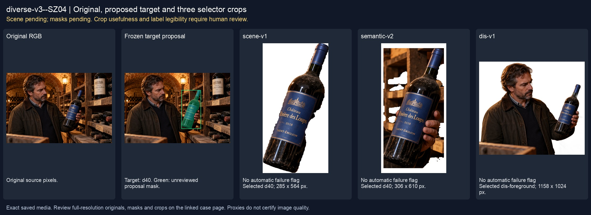
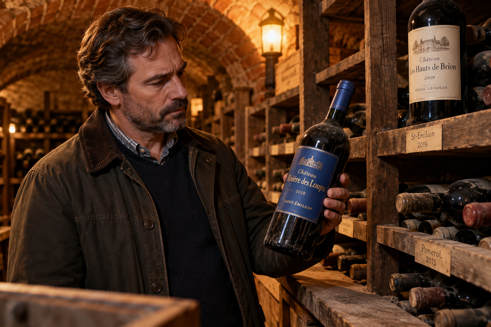
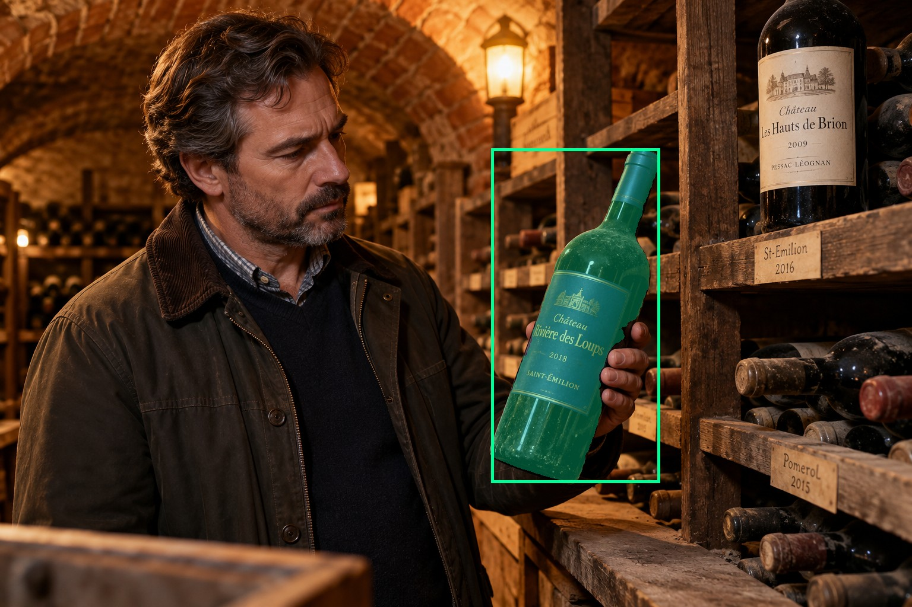
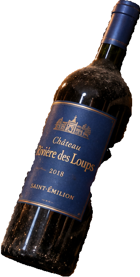
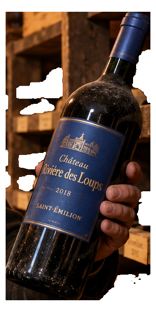
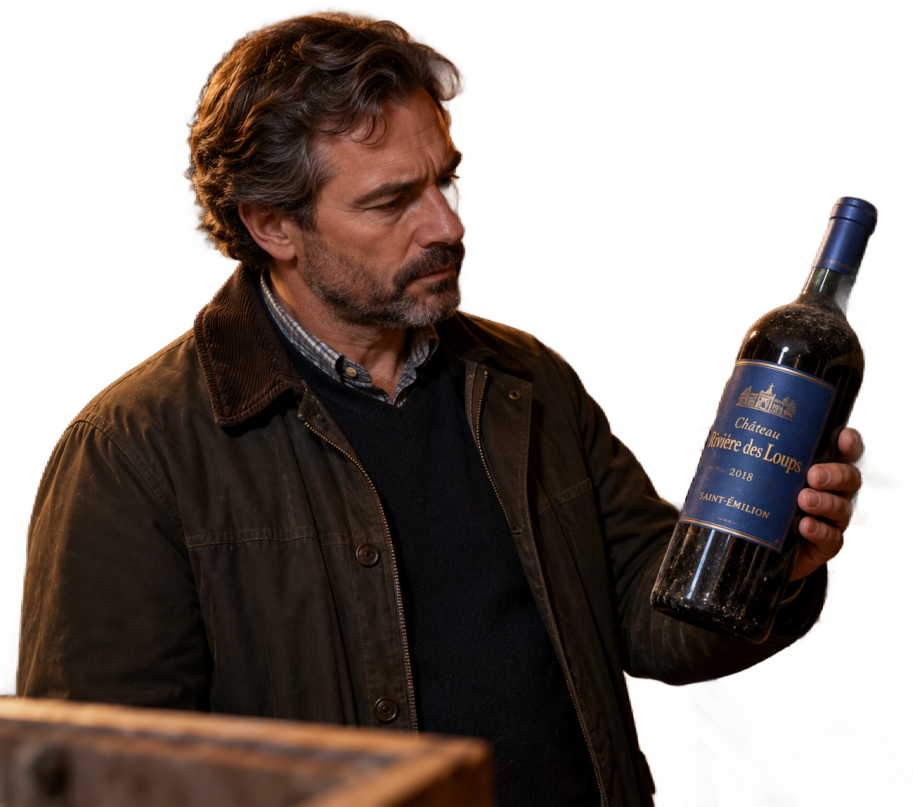

# main-selector-imagegen-diverse-v3-20261020:SZ04

**Scene and masks pending — exploratory. All targets/masks are proposals; no approved segmentation ground truth.**



**scene-v1: FAIL — provisional target/proxy.**

Reference title (source): В старом винном погребе · высокая полка и передняя бутылка

Reference target description (source): Удерживаемая бутылка слева перед полкой

Expected intent: `clear`. Accepted target proposals: `d40`.

Scene group: `main-selector-imagegen-diverse-v3-20261020:SZ04`. Development only; no independent split claim.

## Original and proposed target





Green marks the unreviewed target proposal. Source image pixels are retained separately.

[Selected-label mask audit](../selected-label-mask-audit.json): incomplete proposal retention is flagged separately from target agreement.

[Full-resolution target proposal mask](../masks/diverse-v3--SZ04-d40.png)

## Selector results

### scene-v1: FAIL — provisional target/proxy

Selected: d40; reason: existing_scene_v1_rank; mode: legacy; crop 285×564 px. Target agreement: True. Target retention proxy: 100.0%; maximum other-bottle retention: 0.0%; minimum associated label retention: 99.4%. Mask ownership, label completeness and legibility still require human review.



[Full-resolution keep mask](../keep-masks/diverse-v3--SZ04-scene-v1.png) · [Exact decision JSON](../results/diverse-v3--SZ04-scene-v1.json)

Associated label-mask retention proxies (unreviewed ownership): d61: 99.4%, 29763 source pixels

### semantic-v2: No automatic failure flag; usability pending

Selected: d40; reason: unique_visible_hand_contact; mode: confident; crop 306×610 px. Target agreement: True. Target retention proxy: 100.0%; maximum other-bottle retention: 1.8%; minimum associated label retention: 100.0%. Mask ownership, label completeness and legibility still require human review. Selected-label mask audit: d61 100.0%.



[Full-resolution keep mask](../keep-masks/diverse-v3--SZ04-semantic-v2.png) · [Exact decision JSON](../results/diverse-v3--SZ04-semantic-v2.json)

Returned label views: [label 1](../label-crops/diverse-v3--SZ04-semantic-v2-0.png)

Associated label-mask retention proxies (unreviewed ownership): d61: 100.0%, 29763 source pixels

### dis-v1: Proxy satisfied; usability pending

Selected: dis-foreground; reason: dis_foreground_mask; mode: foreground; crop 1158×1024 px. Target agreement: n/a (no native target ID). Target retention proxy: 99.6%; maximum other-bottle retention: 2.4%; minimum associated label retention: 99.9%. Mask ownership, label completeness and legibility still require human review.



[Full-resolution keep mask](../keep-masks/diverse-v3--SZ04-dis-v1.png) · [Exact decision JSON](../results/diverse-v3--SZ04-dis-v1.json)

Associated label-mask retention proxies (unreviewed ownership): d61: 99.9%, 29763 source pixels

## All frozen mask proposals

These links expose every detector proposal, including labels and hands. Shapes and owners are unreviewed.

| ID | Detector class | Full-resolution mask |
|---|---|---|
| d0 | wine bottle | [PNG](../masks/diverse-v3--SZ04-d0.png) |
| d1 | wine bottle | [PNG](../masks/diverse-v3--SZ04-d1.png) |
| d2 | wine bottle | [PNG](../masks/diverse-v3--SZ04-d2.png) |
| d3 | wine bottle | [PNG](../masks/diverse-v3--SZ04-d3.png) |
| d4 | wine bottle | [PNG](../masks/diverse-v3--SZ04-d4.png) |
| d5 | wine bottle | [PNG](../masks/diverse-v3--SZ04-d5.png) |
| d6 | wine bottle | [PNG](../masks/diverse-v3--SZ04-d6.png) |
| d7 | wine bottle | [PNG](../masks/diverse-v3--SZ04-d7.png) |
| d8 | wine bottle | [PNG](../masks/diverse-v3--SZ04-d8.png) |
| d9 | wine bottle | [PNG](../masks/diverse-v3--SZ04-d9.png) |
| d10 | wine bottle | [PNG](../masks/diverse-v3--SZ04-d10.png) |
| d11 | wine bottle | [PNG](../masks/diverse-v3--SZ04-d11.png) |
| d12 | wine bottle | [PNG](../masks/diverse-v3--SZ04-d12.png) |
| d13 | wine bottle | [PNG](../masks/diverse-v3--SZ04-d13.png) |
| d14 | wine bottle | [PNG](../masks/diverse-v3--SZ04-d14.png) |
| d15 | wine bottle | [PNG](../masks/diverse-v3--SZ04-d15.png) |
| d16 | wine bottle | [PNG](../masks/diverse-v3--SZ04-d16.png) |
| d17 | wine bottle | [PNG](../masks/diverse-v3--SZ04-d17.png) |
| d18 | wine bottle | [PNG](../masks/diverse-v3--SZ04-d18.png) |
| d19 | wine bottle | [PNG](../masks/diverse-v3--SZ04-d19.png) |
| d20 | wine bottle | [PNG](../masks/diverse-v3--SZ04-d20.png) |
| d21 | wine bottle | [PNG](../masks/diverse-v3--SZ04-d21.png) |
| d22 | wine bottle | [PNG](../masks/diverse-v3--SZ04-d22.png) |
| d23 | wine bottle | [PNG](../masks/diverse-v3--SZ04-d23.png) |
| d24 | wine bottle | [PNG](../masks/diverse-v3--SZ04-d24.png) |
| d25 | wine bottle | [PNG](../masks/diverse-v3--SZ04-d25.png) |
| d26 | wine bottle | [PNG](../masks/diverse-v3--SZ04-d26.png) |
| d27 | wine bottle | [PNG](../masks/diverse-v3--SZ04-d27.png) |
| d28 | wine bottle | [PNG](../masks/diverse-v3--SZ04-d28.png) |
| d29 | wine bottle | [PNG](../masks/diverse-v3--SZ04-d29.png) |
| d30 | wine bottle | [PNG](../masks/diverse-v3--SZ04-d30.png) |
| d31 | wine bottle | [PNG](../masks/diverse-v3--SZ04-d31.png) |
| d32 | wine bottle | [PNG](../masks/diverse-v3--SZ04-d32.png) |
| d33 | wine bottle | [PNG](../masks/diverse-v3--SZ04-d33.png) |
| d34 | wine bottle | [PNG](../masks/diverse-v3--SZ04-d34.png) |
| d35 | wine bottle | [PNG](../masks/diverse-v3--SZ04-d35.png) |
| d36 | wine bottle | [PNG](../masks/diverse-v3--SZ04-d36.png) |
| d37 | wine bottle | [PNG](../masks/diverse-v3--SZ04-d37.png) |
| d38 | wine bottle | [PNG](../masks/diverse-v3--SZ04-d38.png) |
| d39 | wine bottle | [PNG](../masks/diverse-v3--SZ04-d39.png) |
| d40 | wine bottle | [PNG](../masks/diverse-v3--SZ04-d40.png) |
| d41 | wine bottle | [PNG](../masks/diverse-v3--SZ04-d41.png) |
| d42 | wine bottle | [PNG](../masks/diverse-v3--SZ04-d42.png) |
| d43 | wine bottle | [PNG](../masks/diverse-v3--SZ04-d43.png) |
| d44 | wine bottle | [PNG](../masks/diverse-v3--SZ04-d44.png) |
| d45 | wine bottle | [PNG](../masks/diverse-v3--SZ04-d45.png) |
| d46 | wine bottle | [PNG](../masks/diverse-v3--SZ04-d46.png) |
| d47 | wine bottle | [PNG](../masks/diverse-v3--SZ04-d47.png) |
| d48 | wine bottle | [PNG](../masks/diverse-v3--SZ04-d48.png) |
| d49 | wine bottle | [PNG](../masks/diverse-v3--SZ04-d49.png) |
| d50 | wine bottle | [PNG](../masks/diverse-v3--SZ04-d50.png) |
| d51 | wine bottle | [PNG](../masks/diverse-v3--SZ04-d51.png) |
| d52 | wine label | [PNG](../masks/diverse-v3--SZ04-d52.png) |
| d53 | wine label | [PNG](../masks/diverse-v3--SZ04-d53.png) |
| d54 | wine label | [PNG](../masks/diverse-v3--SZ04-d54.png) |
| d55 | wine label | [PNG](../masks/diverse-v3--SZ04-d55.png) |
| d56 | wine label | [PNG](../masks/diverse-v3--SZ04-d56.png) |
| d57 | wine label | [PNG](../masks/diverse-v3--SZ04-d57.png) |
| d58 | wine label | [PNG](../masks/diverse-v3--SZ04-d58.png) |
| d59 | wine label | [PNG](../masks/diverse-v3--SZ04-d59.png) |
| d60 | wine label | [PNG](../masks/diverse-v3--SZ04-d60.png) |
| d61 | wine label | [PNG](../masks/diverse-v3--SZ04-d61.png) |
| d62 | hand | [PNG](../masks/diverse-v3--SZ04-d62.png) |
| d63 | box | [PNG](../masks/diverse-v3--SZ04-d63.png) |
| d64 | box | [PNG](../masks/diverse-v3--SZ04-d64.png) |
| d65 | box | [PNG](../masks/diverse-v3--SZ04-d65.png) |
| d66 | box | [PNG](../masks/diverse-v3--SZ04-d66.png) |
| d67 | price tag | [PNG](../masks/diverse-v3--SZ04-d67.png) |
| d68 | price tag | [PNG](../masks/diverse-v3--SZ04-d68.png) |
| d69 | price tag | [PNG](../masks/diverse-v3--SZ04-d69.png) |
| d70 | price tag | [PNG](../masks/diverse-v3--SZ04-d70.png) |
| d71 | price tag | [PNG](../masks/diverse-v3--SZ04-d71.png) |
| d72 | price tag | [PNG](../masks/diverse-v3--SZ04-d72.png) |
| d73 | price tag | [PNG](../masks/diverse-v3--SZ04-d73.png) |

## Additional image-only context masks

Fixed English noun requests used RGB only; no target or annotation was supplied. Primary dN IDs remain unchanged. These masks are detector evidence, not reviewed ground truth.

[Saved validated context response](../context/diverse-v3--SZ04.json)

| Appended ID | Context class | Full-resolution mask |
|---|---|---|
| d74 | bottle held in hand | [PNG](../context-masks/diverse-v3--SZ04-d74.png) |
| d75 | bottle held in hand | [PNG](../context-masks/diverse-v3--SZ04-d75.png) |
| d76 | bottle held in hand | [PNG](../context-masks/diverse-v3--SZ04-d76.png) |
| d77 | bottle held in hand | [PNG](../context-masks/diverse-v3--SZ04-d77.png) |
| d78 | bottle held in hand | [PNG](../context-masks/diverse-v3--SZ04-d78.png) |
| d79 | bottle held in hand | [PNG](../context-masks/diverse-v3--SZ04-d79.png) |
| d80 | bottle held in hand | [PNG](../context-masks/diverse-v3--SZ04-d80.png) |
| d81 | bottle held in hand | [PNG](../context-masks/diverse-v3--SZ04-d81.png) |
| d82 | bottle held in hand | [PNG](../context-masks/diverse-v3--SZ04-d82.png) |
| d83 | bottle held in hand | [PNG](../context-masks/diverse-v3--SZ04-d83.png) |
| d84 | bottle held in hand | [PNG](../context-masks/diverse-v3--SZ04-d84.png) |
| d85 | bottle held in hand | [PNG](../context-masks/diverse-v3--SZ04-d85.png) |
| d86 | bottle held in hand | [PNG](../context-masks/diverse-v3--SZ04-d86.png) |
| d87 | bottle held in hand | [PNG](../context-masks/diverse-v3--SZ04-d87.png) |
| d88 | bottle held in hand | [PNG](../context-masks/diverse-v3--SZ04-d88.png) |
| d89 | bottle held in hand | [PNG](../context-masks/diverse-v3--SZ04-d89.png) |
| d90 | bottle held in hand | [PNG](../context-masks/diverse-v3--SZ04-d90.png) |
| d91 | bottle held in hand | [PNG](../context-masks/diverse-v3--SZ04-d91.png) |
| d92 | bottle held in hand | [PNG](../context-masks/diverse-v3--SZ04-d92.png) |
| d93 | bottle held in hand | [PNG](../context-masks/diverse-v3--SZ04-d93.png) |
| d94 | bottle held in hand | [PNG](../context-masks/diverse-v3--SZ04-d94.png) |
| d95 | bottle held in hand | [PNG](../context-masks/diverse-v3--SZ04-d95.png) |
| d96 | bottle held in hand | [PNG](../context-masks/diverse-v3--SZ04-d96.png) |
| d97 | bottle held in hand | [PNG](../context-masks/diverse-v3--SZ04-d97.png) |
| d98 | bottle held in hand | [PNG](../context-masks/diverse-v3--SZ04-d98.png) |
| d99 | bottle held in hand | [PNG](../context-masks/diverse-v3--SZ04-d99.png) |

[Raw frozen detector response](../detections/diverse-v3--SZ04.json)

<details><summary>Generation prompt (quoted source data)</summary>

```text
Use case: photorealistic-natural. Generate ONE independent photograph, landscape 3:2, approximately 1536 by 1024 pixels. An adult collector examines a foreground bottle in an old private wine cellar, a larger bottle on a higher shelf behind. Include their face, dusty rack labels, brick and amber lamp. Two bottles on different support planes. A hand from left firmly grips the LEFT foreground blue-label bottle body. A large unheld ivory-label bottle stands on a high shelf at upper right. Show shelf edge and counter plane. Foreground grip is clear despite shelf bottle size. Make the scene composition, person, clothing and location specific to this scenario, rather than repeating a generic bottle on a tasting counter. Show genuine physical contact when a grip is requested. Fictional wine branding; no arrows, bounding boxes, captions, collages, watermark or UI. Maintain anatomically plausible hands. Keep the target visible label inside the frame except the explicit close-up and occlusion cases.
```

</details>

Source review notes (quoted reference data):

> Цель предварительно связана с маской SAM3 по заданию генерации; подтвердите по самому фото. Форма масок и их владельцы ещё не проверены.
> Окружение: В старом винном погребе. Проверьте реалистичность рук, хват и присутствие требуемых деталей.
