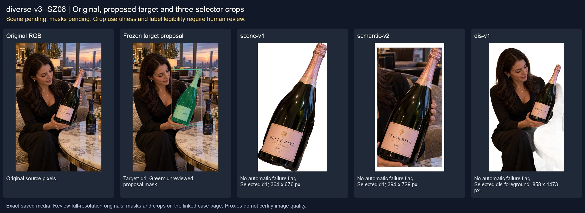
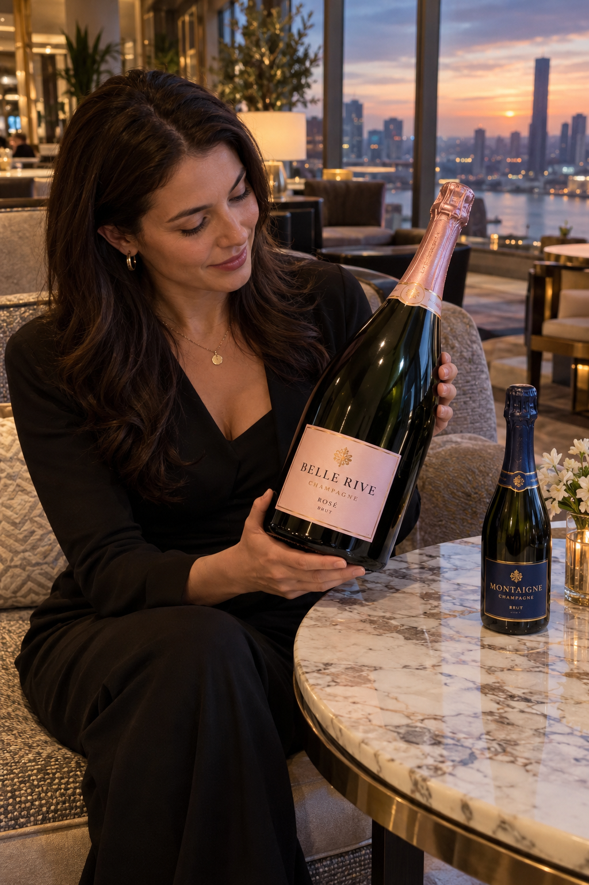
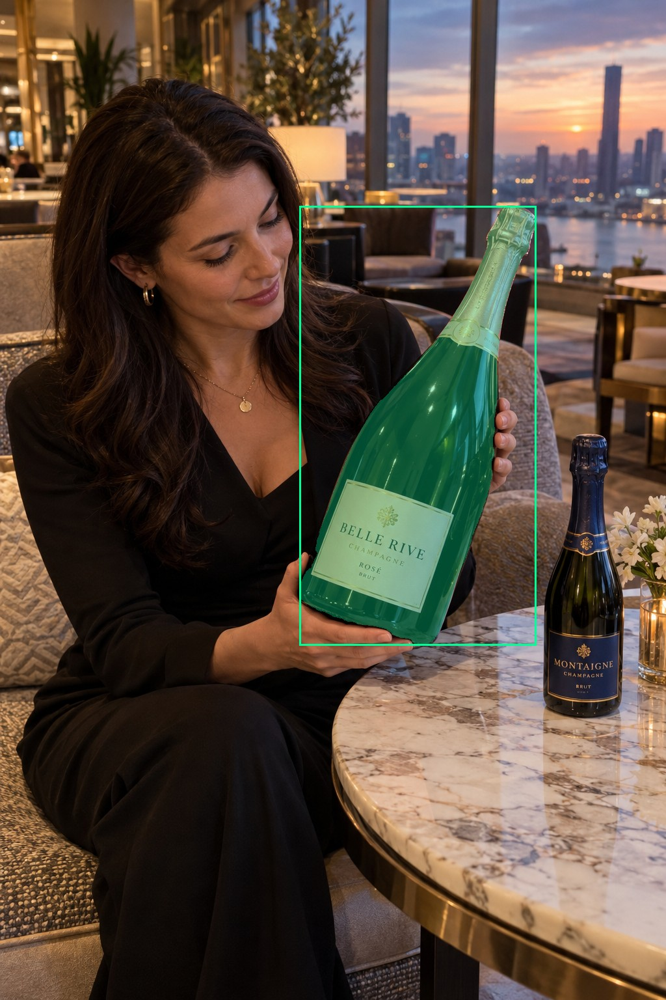
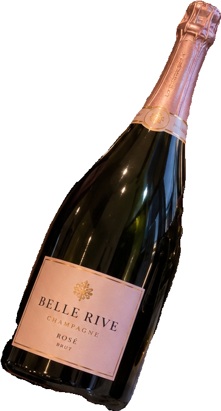
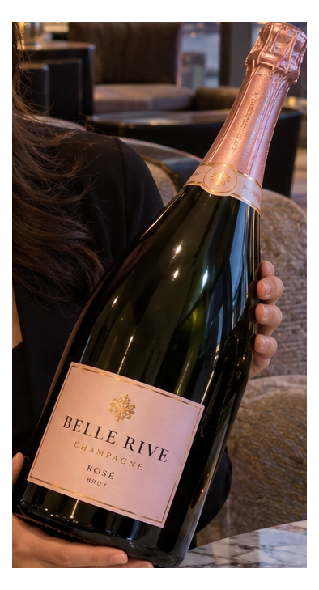
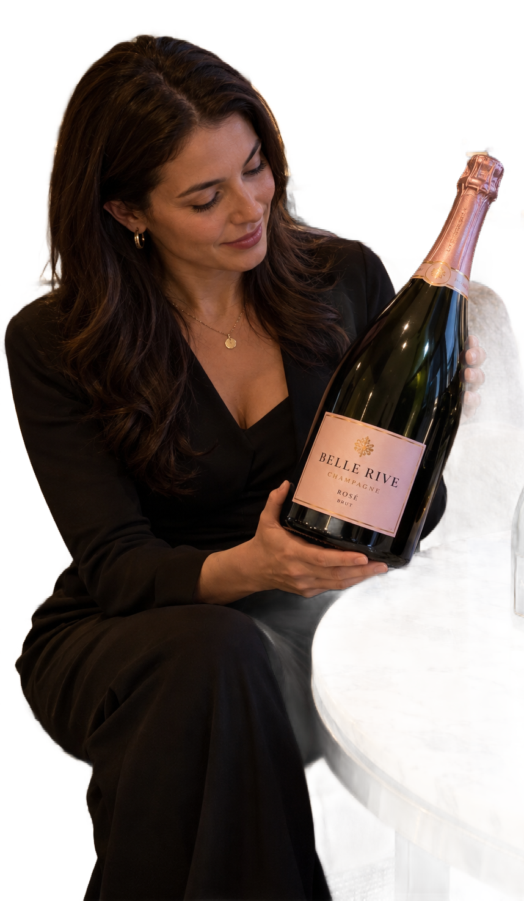

# main-selector-imagegen-diverse-v3-20261020:SZ08

**Scene and masks pending — exploratory. All targets/masks are proposals; no approved segmentation ground truth.**



**scene-v1: FAIL — provisional target/proxy.**

Reference title (source): Магнум в отельной гостиной · большая бутылка слева в руке

Reference target description (source): Большая удерживаемая бутылка слева

Expected intent: `clear`. Accepted target proposals: `d1`.

Scene group: `main-selector-imagegen-diverse-v3-20261020:SZ08`. Development only; no independent split claim.

## Original and proposed target





Green marks the unreviewed target proposal. Source image pixels are retained separately.

[Selected-label mask audit](../selected-label-mask-audit.json): incomplete proposal retention is flagged separately from target agreement.

[Full-resolution target proposal mask](../masks/diverse-v3--SZ08-d1.png)

## Selector results

### scene-v1: FAIL — provisional target/proxy

Selected: d1; reason: existing_scene_v1_rank; mode: legacy; crop 364×676 px. Target agreement: True. Target retention proxy: 100.0%; maximum other-bottle retention: 0.0%; minimum associated label retention: 98.1%. Mask ownership, label completeness and legibility still require human review.



[Full-resolution keep mask](../keep-masks/diverse-v3--SZ08-scene-v1.png) · [Exact decision JSON](../results/diverse-v3--SZ08-scene-v1.json)

Associated label-mask retention proxies (unreviewed ownership): d3: 100.0%, 28410 source pixels; d4: 98.1%, 3029 source pixels

### semantic-v2: No automatic failure flag; usability pending

Selected: d1; reason: fallback_center_contains; mode: fallback; crop 394×729 px. Target agreement: True. Target retention proxy: 100.0%; maximum other-bottle retention: 0.0%; minimum associated label retention: 100.0%. Mask ownership, label completeness and legibility still require human review. Selected-label mask audit: d3 100.0%; d4 100.0%.



[Full-resolution keep mask](../keep-masks/diverse-v3--SZ08-semantic-v2.png) · [Exact decision JSON](../results/diverse-v3--SZ08-semantic-v2.json)

Returned label views: [label 1](../label-crops/diverse-v3--SZ08-semantic-v2-0.png) · [label 2](../label-crops/diverse-v3--SZ08-semantic-v2-1.png)

Associated label-mask retention proxies (unreviewed ownership): d3: 100.0%, 28410 source pixels; d4: 100.0%, 3029 source pixels

### dis-v1: Proxy satisfied; usability pending

Selected: dis-foreground; reason: dis_foreground_mask; mode: foreground; crop 858×1473 px. Target agreement: n/a (no native target ID). Target retention proxy: 100.0%; maximum other-bottle retention: 0.0%; minimum associated label retention: 99.7%. Mask ownership, label completeness and legibility still require human review.



[Full-resolution keep mask](../keep-masks/diverse-v3--SZ08-dis-v1.png) · [Exact decision JSON](../results/diverse-v3--SZ08-dis-v1.json)

Associated label-mask retention proxies (unreviewed ownership): d3: 100.0%, 28410 source pixels; d4: 99.7%, 3029 source pixels

## All frozen mask proposals

These links expose every detector proposal, including labels and hands. Shapes and owners are unreviewed.

| ID | Detector class | Full-resolution mask |
|---|---|---|
| d0 | wine bottle | [PNG](../masks/diverse-v3--SZ08-d0.png) |
| d1 | wine bottle | [PNG](../masks/diverse-v3--SZ08-d1.png) |
| d2 | wine label | [PNG](../masks/diverse-v3--SZ08-d2.png) |
| d3 | wine label | [PNG](../masks/diverse-v3--SZ08-d3.png) |
| d4 | wine label | [PNG](../masks/diverse-v3--SZ08-d4.png) |
| d5 | wine label | [PNG](../masks/diverse-v3--SZ08-d5.png) |
| d6 | hand | [PNG](../masks/diverse-v3--SZ08-d6.png) |
| d7 | hand | [PNG](../masks/diverse-v3--SZ08-d7.png) |

## Additional image-only context masks

Fixed English noun requests used RGB only; no target or annotation was supplied. Primary dN IDs remain unchanged. These masks are detector evidence, not reviewed ground truth.

[Saved validated context response](../context/diverse-v3--SZ08.json)

| Appended ID | Context class | Full-resolution mask |
|---|---|---|
| d8 | bottle held in hand | [PNG](../context-masks/diverse-v3--SZ08-d8.png) |
| d9 | bottle held in hand | [PNG](../context-masks/diverse-v3--SZ08-d9.png) |

[Raw frozen detector response](../detections/diverse-v3--SZ08.json)

<details><summary>Generation prompt (quoted source data)</summary>

```text
Use case: photorealistic-natural. Generate ONE independent photograph, portrait 2:3, approximately 1024 by 1536 pixels. An adult hotel guest examines a large magnum bottle beside a small unattended bottle, plush hotel lounge, marble side table and large windows behind. Include face and hand contact. A hand from left firmly holds the mid-body of a broad LEFT sparkling-wine magnum with a pale pink label, while a tiny unattended blue-label bottle stands RIGHT. Show plausible hand contact at the side of the large body; labels fully inside frame. Make the scene composition, person, clothing and location specific to this scenario, rather than repeating a generic bottle on a tasting counter. Show genuine physical contact when a grip is requested. Fictional wine branding; no arrows, bounding boxes, captions, collages, watermark or UI. Maintain anatomically plausible hands. Keep the target visible label inside the frame except the explicit close-up and occlusion cases.
```

</details>

Source review notes (quoted reference data):

> Цель предварительно связана с маской SAM3 по заданию генерации; подтвердите по самому фото. Форма масок и их владельцы ещё не проверены.
> Окружение: Магнум в отельной гостиной. Проверьте реалистичность рук, хват и присутствие требуемых деталей.
