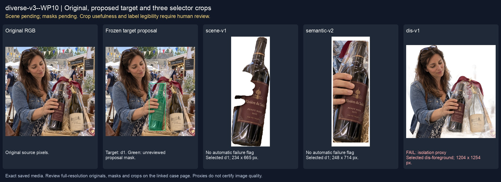
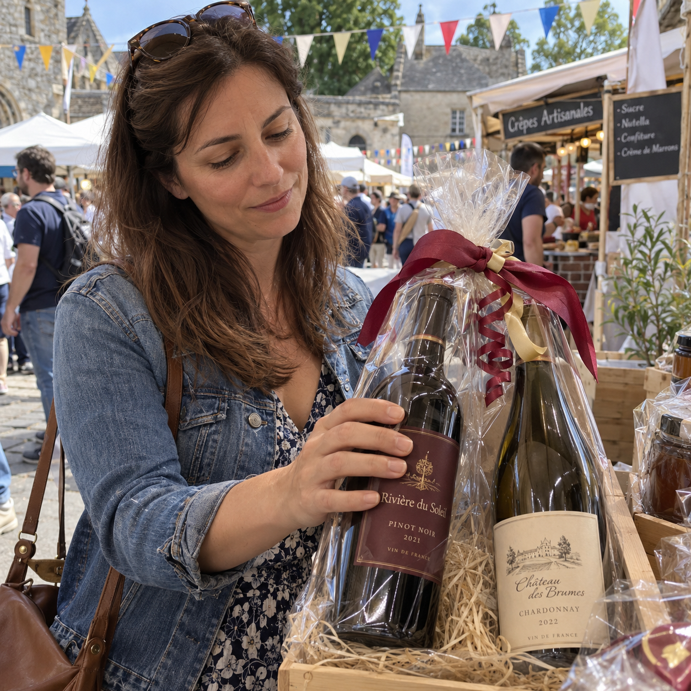
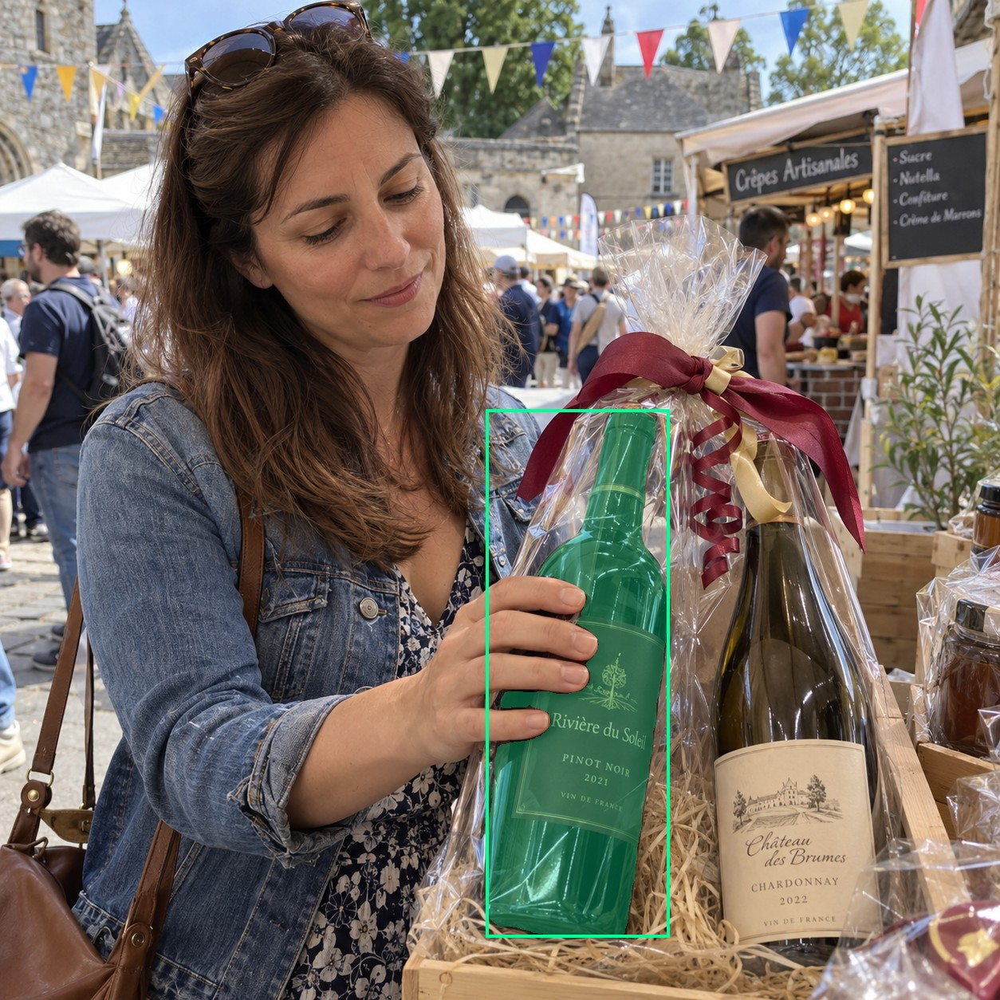
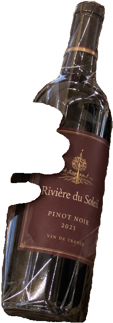
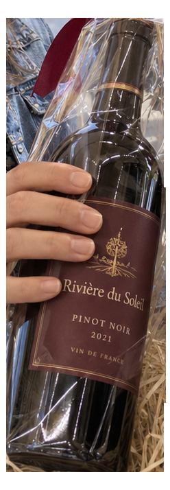
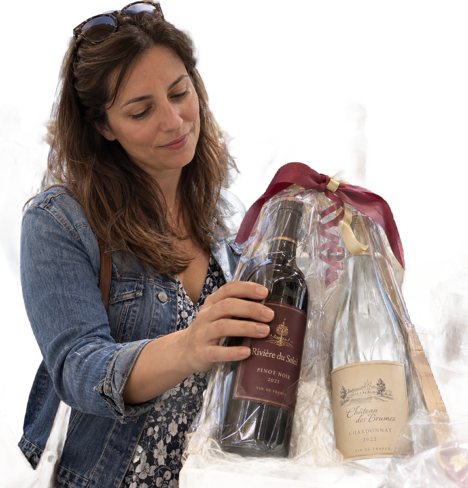

# main-selector-imagegen-diverse-v3-20261020:WP10

**Scene and masks pending — exploratory. All targets/masks are proposals; no approved segmentation ground truth.**



**scene-v1: No automatic failure flag; usability pending.**

Reference title (source): На уличном фестивале · пакет между близкими бутылками

Reference target description (source): Удерживаемая бутылка слева у соседней бутылки

Expected intent: `clear`. Accepted target proposals: `d1`.

Scene group: `main-selector-imagegen-diverse-v3-20261020:WP10`. Development only; no independent split claim.

## Original and proposed target





Green marks the unreviewed target proposal. Source image pixels are retained separately.

[Selected-label mask audit](../selected-label-mask-audit.json): incomplete proposal retention is flagged separately from target agreement.

[Full-resolution target proposal mask](../masks/diverse-v3--WP10-d1.png)

## Selector results

### scene-v1: No automatic failure flag; usability pending

Selected: d1; reason: existing_scene_v1_rank; mode: legacy; crop 234×665 px. Target agreement: True. Target retention proxy: 100.0%; maximum other-bottle retention: 0.0%; minimum associated label retention: 99.6%. Mask ownership, label completeness and legibility still require human review.



[Full-resolution keep mask](../keep-masks/diverse-v3--WP10-scene-v1.png) · [Exact decision JSON](../results/diverse-v3--WP10-scene-v1.json)

Associated label-mask retention proxies (unreviewed ownership): d3: 99.6%, 34175 source pixels

### semantic-v2: No automatic failure flag; usability pending

Selected: d1; reason: unique_visible_hand_contact; mode: confident; crop 248×714 px. Target agreement: True. Target retention proxy: 100.0%; maximum other-bottle retention: 0.0%; minimum associated label retention: 100.0%. Mask ownership, label completeness and legibility still require human review. Selected-label mask audit: d3 100.0%.



[Full-resolution keep mask](../keep-masks/diverse-v3--WP10-semantic-v2.png) · [Exact decision JSON](../results/diverse-v3--WP10-semantic-v2.json)

Returned label views: [label 1](../label-crops/diverse-v3--WP10-semantic-v2-0.png)

Associated label-mask retention proxies (unreviewed ownership): d3: 100.0%, 34175 source pixels

### dis-v1: PROXY failure; no native target ID

Selected: dis-foreground; reason: dis_foreground_mask; mode: foreground; crop 1204×1254 px. Target agreement: n/a (no native target ID). Target retention proxy: 100.0%; maximum other-bottle retention: 65.5%; minimum associated label retention: 100.0%. Mask ownership, label completeness and legibility still require human review.



[Full-resolution keep mask](../keep-masks/diverse-v3--WP10-dis-v1.png) · [Exact decision JSON](../results/diverse-v3--WP10-dis-v1.json)

Associated label-mask retention proxies (unreviewed ownership): d3: 100.0%, 34175 source pixels

## All frozen mask proposals

These links expose every detector proposal, including labels and hands. Shapes and owners are unreviewed.

| ID | Detector class | Full-resolution mask |
|---|---|---|
| d0 | wine bottle | [PNG](../masks/diverse-v3--WP10-d0.png) |
| d1 | wine bottle | [PNG](../masks/diverse-v3--WP10-d1.png) |
| d2 | wine label | [PNG](../masks/diverse-v3--WP10-d2.png) |
| d3 | wine label | [PNG](../masks/diverse-v3--WP10-d3.png) |
| d4 | hand | [PNG](../masks/diverse-v3--WP10-d4.png) |
| d5 | hand | [PNG](../masks/diverse-v3--WP10-d5.png) |
| d6 | hand | [PNG](../masks/diverse-v3--WP10-d6.png) |
| d7 | hand | [PNG](../masks/diverse-v3--WP10-d7.png) |
| d8 | hand | [PNG](../masks/diverse-v3--WP10-d8.png) |
| d9 | box | [PNG](../masks/diverse-v3--WP10-d9.png) |
| d10 | box | [PNG](../masks/diverse-v3--WP10-d10.png) |
| d11 | box | [PNG](../masks/diverse-v3--WP10-d11.png) |
| d12 | box | [PNG](../masks/diverse-v3--WP10-d12.png) |
| d13 | box | [PNG](../masks/diverse-v3--WP10-d13.png) |

## Additional image-only context masks

Fixed English noun requests used RGB only; no target or annotation was supplied. Primary dN IDs remain unchanged. These masks are detector evidence, not reviewed ground truth.

[Saved validated context response](../context/diverse-v3--WP10.json)

| Appended ID | Context class | Full-resolution mask |
|---|---|---|
| d14 | bottle held in hand | [PNG](../context-masks/diverse-v3--WP10-d14.png) |
| d15 | bottle held in hand | [PNG](../context-masks/diverse-v3--WP10-d15.png) |
| d16 | transparent wrapping | [PNG](../context-masks/diverse-v3--WP10-d16.png) |
| d17 | transparent wrapping | [PNG](../context-masks/diverse-v3--WP10-d17.png) |
| d18 | transparent wrapping | [PNG](../context-masks/diverse-v3--WP10-d18.png) |
| d19 | transparent wrapping | [PNG](../context-masks/diverse-v3--WP10-d19.png) |
| d20 | transparent wrapping | [PNG](../context-masks/diverse-v3--WP10-d20.png) |
| d21 | transparent wrapping | [PNG](../context-masks/diverse-v3--WP10-d21.png) |

[Raw frozen detector response](../detections/diverse-v3--WP10.json)

<details><summary>Generation prompt (quoted source data)</summary>

```text
Use case: photorealistic-natural. Generate ONE independent photograph, square, approximately 1024 by 1024 pixels. An adult customer examines a wine gift at an outdoor street-festival stall, fabric bunting, food stalls and casually dressed people behind. Natural busy documentary framing, no plain studio wall. A hand from left grips the LEFT wine bottle mid-body through clear cellophane. A RIGHT unheld bottle stands very close with a narrow air gap between glass silhouettes; a loose transparent flap crosses that gap. Target burgundy label remains visible, neighbor ivory label separate.  two bottles. Make the scene composition, person, clothing and location specific to this scenario, rather than repeating a generic bottle on a tasting counter. Show genuine physical contact when a grip is requested. Fictional wine branding; no arrows, bounding boxes, captions, collages, watermark or UI. Maintain anatomically plausible hands. Keep the target visible label inside the frame except the explicit close-up and occlusion cases.
```

</details>

Source review notes (quoted reference data):

> Цель предварительно связана с маской SAM3 по заданию генерации; подтвердите по самому фото. Форма масок и их владельцы ещё не проверены.
> Окружение: На уличном фестивале. Проверьте реалистичность рук, хват и присутствие требуемых деталей.
> В кадре две бутылки в общей прозрачной упаковке. Это отличается от задуманной отдельной упаковки целевой бутылки; подтвердите сцену и цель по фото.
