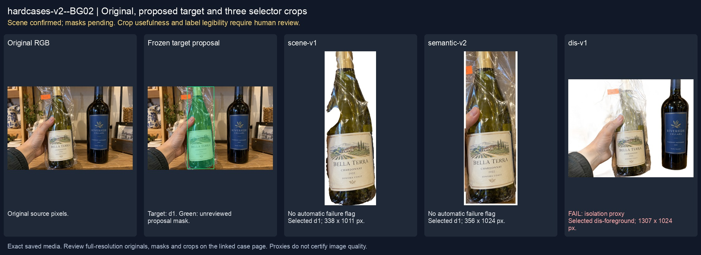
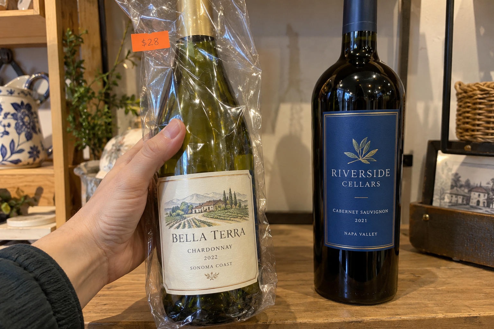
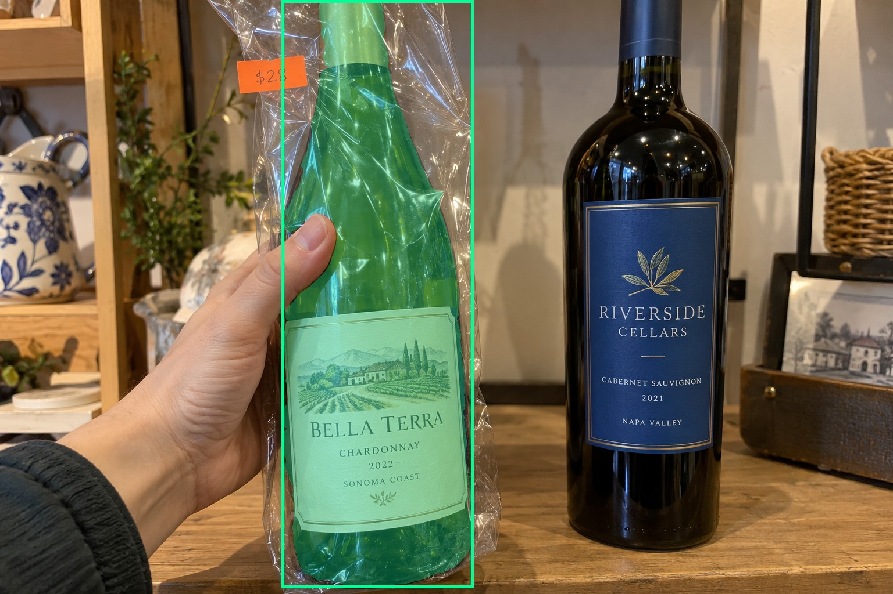
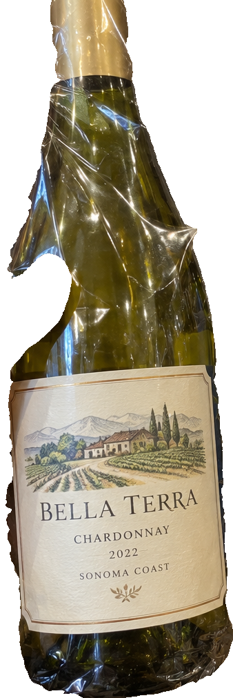
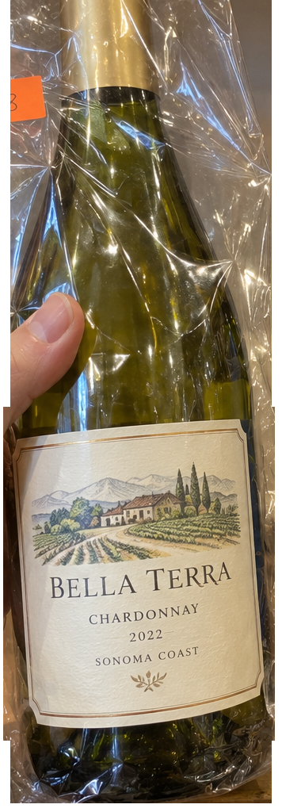
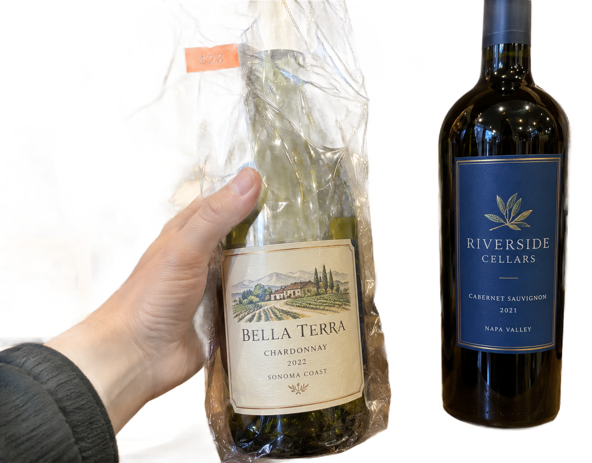

# main-selector-imagegen-hardcases-v2-20261020:BG02

**Scene confirmed; masks pending. All targets/masks are proposals; no approved segmentation ground truth.**



**scene-v1: No automatic failure flag; usability pending.**

Reference title (source): Левый хват и крупный ценник на плёнке

Reference target description (source): Удерживаемая бутылка слева внутри плёнки

Expected intent: `clear`. Accepted target proposals: `d1`.

Scene group: `main-selector-imagegen-hardcases-v2-20261020:BG02`. Development only; no independent split claim.

## Original and proposed target





Green marks the unreviewed target proposal. Source image pixels are retained separately.

[Selected-label mask audit](../selected-label-mask-audit.json): incomplete proposal retention is flagged separately from target agreement.

[Full-resolution target proposal mask](../masks/hardcases-v2--BG02-d1.png)

## Selector results

### scene-v1: No automatic failure flag; usability pending

Selected: d1; reason: existing_scene_v1_rank; mode: legacy; crop 338×1011 px. Target agreement: True. Target retention proxy: 100.0%; maximum other-bottle retention: 0.0%; minimum associated label retention: 100.0%. Mask ownership, label completeness and legibility still require human review.



[Full-resolution keep mask](../keep-masks/hardcases-v2--BG02-scene-v1.png) · [Exact decision JSON](../results/hardcases-v2--BG02-scene-v1.json)

Associated label-mask retention proxies (unreviewed ownership): d3: 100.0%, 108201 source pixels

### semantic-v2: No automatic failure flag; usability pending

Selected: d1; reason: unique_visible_hand_contact; mode: confident; crop 356×1024 px. Target agreement: True. Target retention proxy: 100.0%; maximum other-bottle retention: 0.0%; minimum associated label retention: 100.0%. Mask ownership, label completeness and legibility still require human review. Selected-label mask audit: d3 100.0%.



[Full-resolution keep mask](../keep-masks/hardcases-v2--BG02-semantic-v2.png) · [Exact decision JSON](../results/hardcases-v2--BG02-semantic-v2.json)

Returned label views: [label 1](../label-crops/hardcases-v2--BG02-semantic-v2-0.png)

Associated label-mask retention proxies (unreviewed ownership): d3: 100.0%, 108201 source pixels

### dis-v1: PROXY failure; no native target ID

Selected: dis-foreground; reason: dis_foreground_mask; mode: foreground; crop 1307×1024 px. Target agreement: n/a (no native target ID). Target retention proxy: 78.0%; maximum other-bottle retention: 99.9%; minimum associated label retention: 100.0%. Mask ownership, label completeness and legibility still require human review.



[Full-resolution keep mask](../keep-masks/hardcases-v2--BG02-dis-v1.png) · [Exact decision JSON](../results/hardcases-v2--BG02-dis-v1.json)

Associated label-mask retention proxies (unreviewed ownership): d3: 100.0%, 108201 source pixels

## All frozen mask proposals

These links expose every detector proposal, including labels and hands. Shapes and owners are unreviewed.

| ID | Detector class | Full-resolution mask |
|---|---|---|
| d0 | wine bottle | [PNG](../masks/hardcases-v2--BG02-d0.png) |
| d1 | wine bottle | [PNG](../masks/hardcases-v2--BG02-d1.png) |
| d2 | wine label | [PNG](../masks/hardcases-v2--BG02-d2.png) |
| d3 | wine label | [PNG](../masks/hardcases-v2--BG02-d3.png) |
| d4 | wine label | [PNG](../masks/hardcases-v2--BG02-d4.png) |
| d5 | hand | [PNG](../masks/hardcases-v2--BG02-d5.png) |
| d6 | price tag | [PNG](../masks/hardcases-v2--BG02-d6.png) |

## Additional image-only context masks

Fixed English noun requests used RGB only; no target or annotation was supplied. Primary dN IDs remain unchanged. These masks are detector evidence, not reviewed ground truth.

[Saved validated context response](../context/hardcases-v2--BG02.json)

| Appended ID | Context class | Full-resolution mask |
|---|---|---|
| d7 | bottle held in hand | [PNG](../context-masks/hardcases-v2--BG02-d7.png) |
| d8 | bottle held in hand | [PNG](../context-masks/hardcases-v2--BG02-d8.png) |
| d9 | transparent wrapping | [PNG](../context-masks/hardcases-v2--BG02-d9.png) |

[Raw frozen detector response](../detections/hardcases-v2--BG02.json)

<details><summary>Generation prompt (quoted source data)</summary>

```text
Generate exactly one independent photorealistic smartphone photograph, landscape 3:2, approximately 1536 by 1024 pixels. This is an ordinary wine selection moment, with natural perspective, believable glass and paper, imperfect ambient lighting, and realistic human anatomy. No collage, inset, split screen, arrows, highlights, bounding boxes, annotations, watermarks, UI, or text outside physical objects. Use fictional wine branding. Keep the target bottle's entire front label within the frame. The scene must communicate the stated gesture or physical relation visually; do not add any explanatory caption. Exactly two wine bottles in a small gift shop. On the LEFT foreground, one hand from left grips the middle body of a green wine bottle through a crinkled transparent plastic sleeve, thumb opposing curled fingers on the glass body. A small bright orange rectangular price sticker is attached to an upper loose flap of the sleeve, not the bottle label. The target bottle has a complete ivory paper label visible through the plastic despite glare. On the right a separate unheld bottle has a clean blue label. Clear gap between the two bottles. Accurate single hand anatomy, natural warm light, no opaque wrapping.
```

</details>

Source review notes (quoted reference data):

> Оранжевый ценник находится на плёнке, а не на бумажной этикетке. Противоположные пальцы скрыты бутылкой; хват требует вашего подтверждения.
