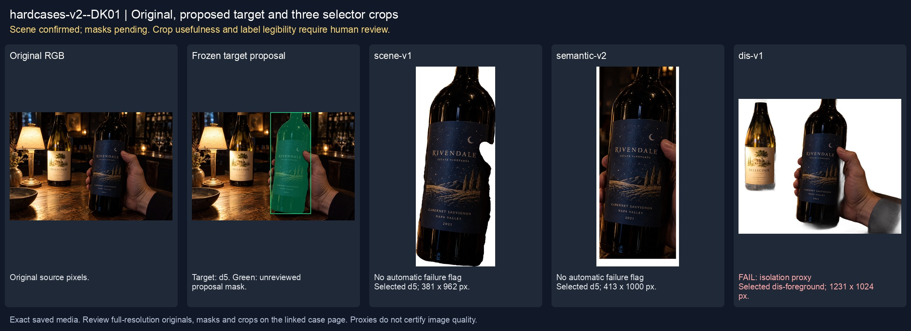
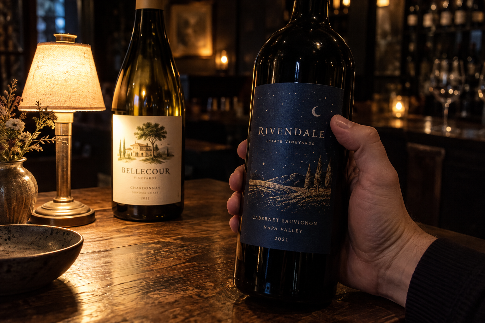
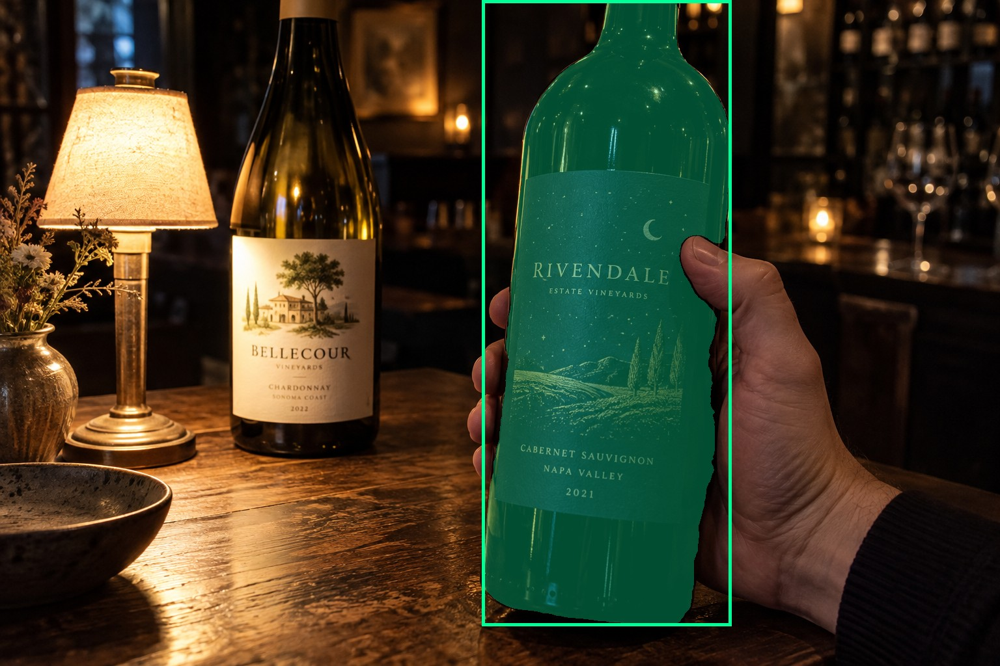
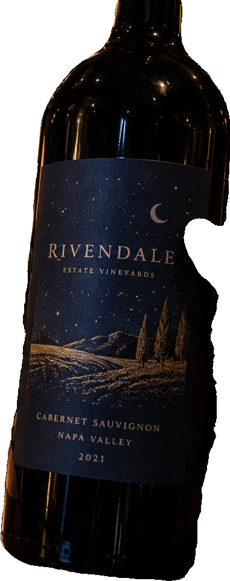
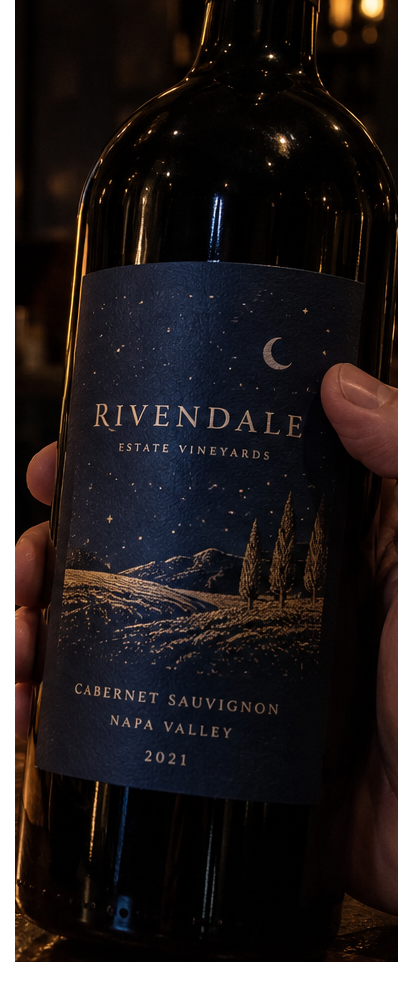
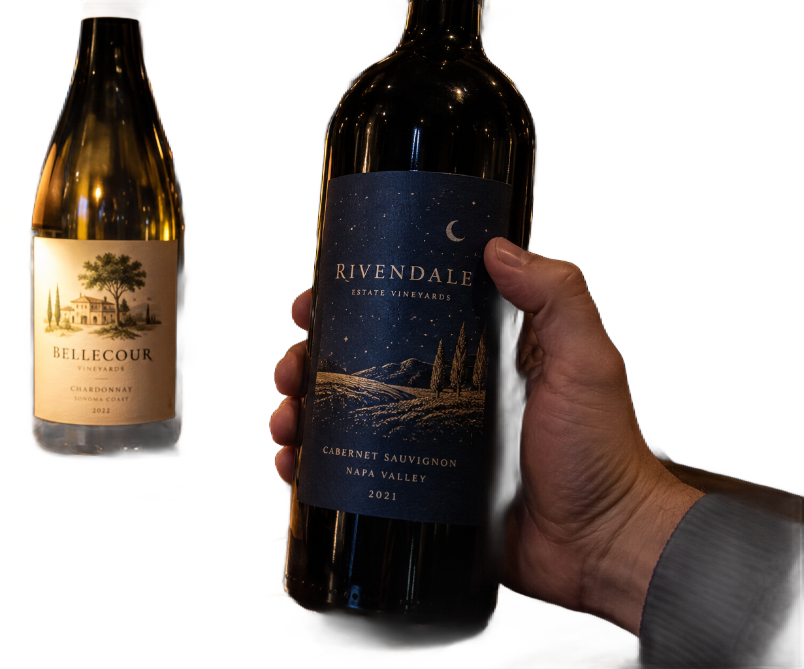

# main-selector-imagegen-hardcases-v2-20261020:DK01

**Scene confirmed; masks pending. All targets/masks are proposals; no approved segmentation ground truth.**



**scene-v1: No automatic failure flag; usability pending.**

Reference title (source): Тёмная бутылка справа и яркая этикетка слева

Reference target description (source): Удерживаемая тёмная бутылка справа

Expected intent: `clear`. Accepted target proposals: `d5`.

Scene group: `main-selector-imagegen-hardcases-v2-20261020:DK01`. Development only; no independent split claim.

## Original and proposed target





Green marks the unreviewed target proposal. Source image pixels are retained separately.

[Selected-label mask audit](../selected-label-mask-audit.json): incomplete proposal retention is flagged separately from target agreement.

[Full-resolution target proposal mask](../masks/hardcases-v2--DK01-d5.png)

## Selector results

### scene-v1: No automatic failure flag; usability pending

Selected: d5; reason: existing_scene_v1_rank; mode: legacy; crop 381×962 px. Target agreement: True. Target retention proxy: 100.0%; maximum other-bottle retention: 0.0%; minimum associated label retention: 100.0%. Mask ownership, label completeness and legibility still require human review.



[Full-resolution keep mask](../keep-masks/hardcases-v2--DK01-scene-v1.png) · [Exact decision JSON](../results/hardcases-v2--DK01-scene-v1.json)

Associated label-mask retention proxies (unreviewed ownership): d13: 100.0%, 145527 source pixels

### semantic-v2: No automatic failure flag; usability pending

Selected: d5; reason: unique_visible_hand_contact; mode: confident; crop 413×1000 px. Target agreement: True. Target retention proxy: 100.0%; maximum other-bottle retention: 0.0%; minimum associated label retention: 100.0%. Mask ownership, label completeness and legibility still require human review. Selected-label mask audit: d13 100.0%.



[Full-resolution keep mask](../keep-masks/hardcases-v2--DK01-semantic-v2.png) · [Exact decision JSON](../results/hardcases-v2--DK01-semantic-v2.json)

Returned label views: [label 1](../label-crops/hardcases-v2--DK01-semantic-v2-0.png)

Associated label-mask retention proxies (unreviewed ownership): d13: 100.0%, 145527 source pixels

### dis-v1: PROXY failure; no native target ID

Selected: dis-foreground; reason: dis_foreground_mask; mode: foreground; crop 1231×1024 px. Target agreement: n/a (no native target ID). Target retention proxy: 97.9%; maximum other-bottle retention: 95.8%; minimum associated label retention: 100.0%. Mask ownership, label completeness and legibility still require human review.



[Full-resolution keep mask](../keep-masks/hardcases-v2--DK01-dis-v1.png) · [Exact decision JSON](../results/hardcases-v2--DK01-dis-v1.json)

Associated label-mask retention proxies (unreviewed ownership): d13: 100.0%, 145527 source pixels

## All frozen mask proposals

These links expose every detector proposal, including labels and hands. Shapes and owners are unreviewed.

| ID | Detector class | Full-resolution mask |
|---|---|---|
| d0 | wine bottle | [PNG](../masks/hardcases-v2--DK01-d0.png) |
| d1 | wine bottle | [PNG](../masks/hardcases-v2--DK01-d1.png) |
| d2 | wine bottle | [PNG](../masks/hardcases-v2--DK01-d2.png) |
| d3 | wine bottle | [PNG](../masks/hardcases-v2--DK01-d3.png) |
| d4 | wine bottle | [PNG](../masks/hardcases-v2--DK01-d4.png) |
| d5 | wine bottle | [PNG](../masks/hardcases-v2--DK01-d5.png) |
| d6 | wine bottle | [PNG](../masks/hardcases-v2--DK01-d6.png) |
| d7 | wine label | [PNG](../masks/hardcases-v2--DK01-d7.png) |
| d8 | wine label | [PNG](../masks/hardcases-v2--DK01-d8.png) |
| d9 | wine label | [PNG](../masks/hardcases-v2--DK01-d9.png) |
| d10 | wine label | [PNG](../masks/hardcases-v2--DK01-d10.png) |
| d11 | wine label | [PNG](../masks/hardcases-v2--DK01-d11.png) |
| d12 | wine label | [PNG](../masks/hardcases-v2--DK01-d12.png) |
| d13 | wine label | [PNG](../masks/hardcases-v2--DK01-d13.png) |
| d14 | wine label | [PNG](../masks/hardcases-v2--DK01-d14.png) |
| d15 | hand | [PNG](../masks/hardcases-v2--DK01-d15.png) |
| d16 | hand | [PNG](../masks/hardcases-v2--DK01-d16.png) |
| d17 | hand | [PNG](../masks/hardcases-v2--DK01-d17.png) |
| d18 | wine glass | [PNG](../masks/hardcases-v2--DK01-d18.png) |
| d19 | wine glass | [PNG](../masks/hardcases-v2--DK01-d19.png) |

## Additional image-only context masks

Fixed English noun requests used RGB only; no target or annotation was supplied. Primary dN IDs remain unchanged. These masks are detector evidence, not reviewed ground truth.

[Saved validated context response](../context/hardcases-v2--DK01.json)

| Appended ID | Context class | Full-resolution mask |
|---|---|---|
| d20 | bottle held in hand | [PNG](../context-masks/hardcases-v2--DK01-d20.png) |
| d21 | bottle held in hand | [PNG](../context-masks/hardcases-v2--DK01-d21.png) |

[Raw frozen detector response](../detections/hardcases-v2--DK01.json)

<details><summary>Generation prompt (quoted source data)</summary>

```text
Generate exactly one independent photorealistic smartphone photograph, landscape 3:2, approximately 1536 by 1024 pixels. This is an ordinary wine selection moment, with natural perspective, believable glass and paper, imperfect ambient lighting, and realistic human anatomy. No collage, inset, split screen, arrows, highlights, bounding boxes, annotations, watermarks, UI, or text outside physical objects. Use fictional wine branding. Keep the target bottle's entire front label within the frame. The scene must communicate the stated gesture or physical relation visually; do not add any explanatory caption. A dim wine bar with exactly two physical bottles in view. On the RIGHT foreground, a visible hand enters from right and wraps firmly around the middle of a dark wine bottle with a very dark blue label, thumb and curled fingers clearly contacting opposite sides. The dark target glass and hand remain distinguishable under weak side light. On the left farther back, an unheld bottle with a bright white label is strongly illuminated by a small table lamp. It must look tempting visually but is not held. No other hands. Low-key realistic phone photo with mild noise, target full label inside frame.
```

</details>

Source review notes (quoted reference data):

> Тёмная этикетка остаётся достаточно читаемой: умеренный, а не предельный тест недостатка света. На дальнем плане есть дополнительные бутылки.
