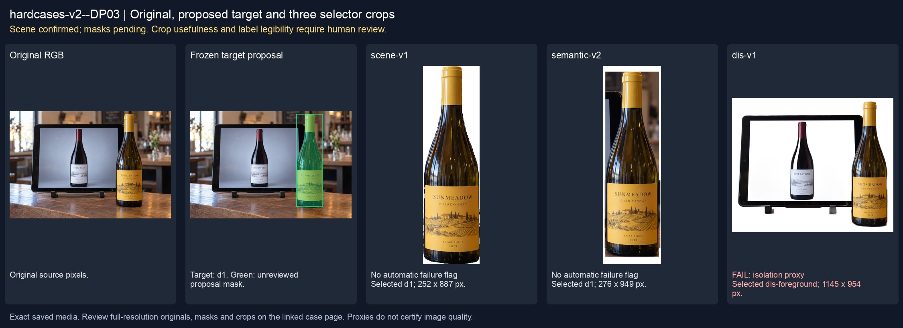
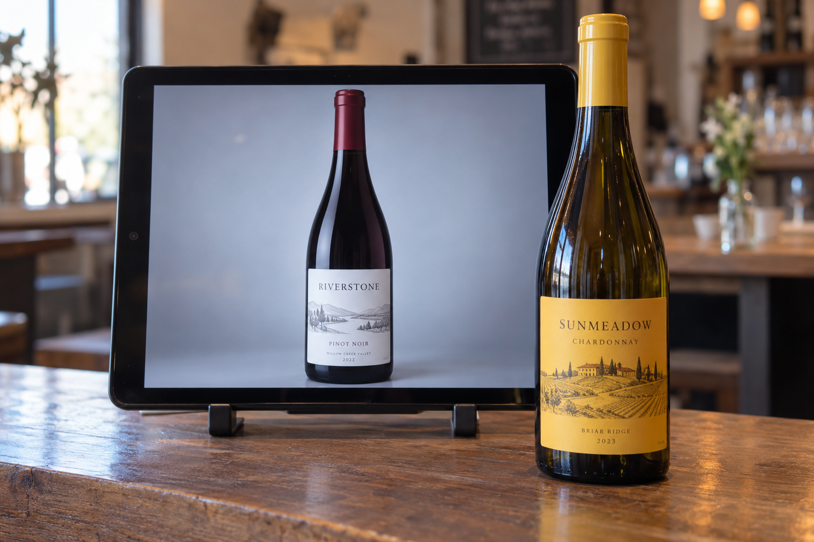
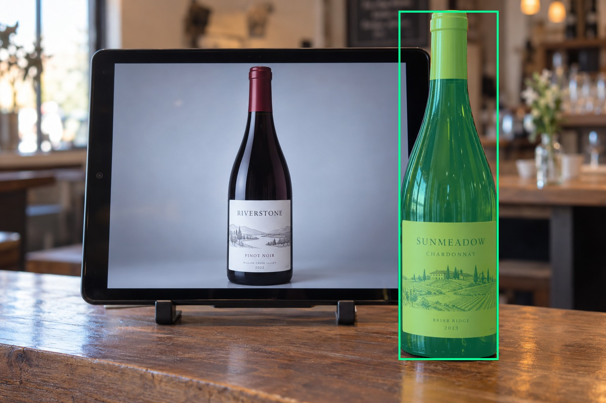
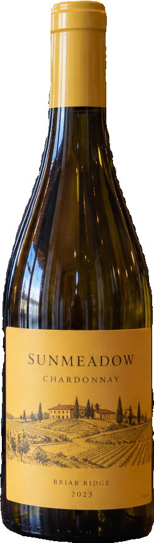
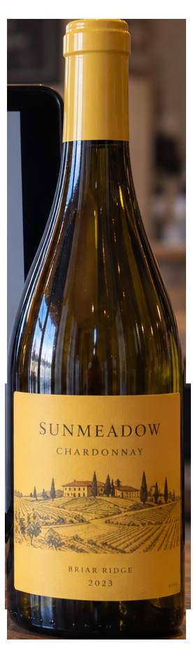
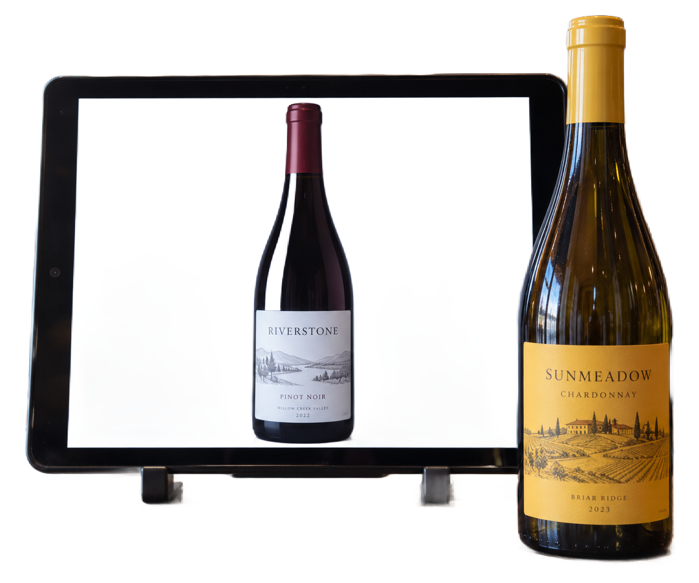

# main-selector-imagegen-hardcases-v2-20261020:DP03

**Scene confirmed; masks pending. All targets/masks are proposals; no approved segmentation ground truth.**



**scene-v1: No automatic failure flag; usability pending.**

Reference title (source): Настоящая бутылка перекрывает рекламную картинку

Reference target description (source): Настоящая бутылка справа перед планшетом

Expected intent: `clear`. Accepted target proposals: `d1`.

Scene group: `main-selector-imagegen-hardcases-v2-20261020:DP03`. Development only; no independent split claim.

## Original and proposed target





Green marks the unreviewed target proposal. Source image pixels are retained separately.

[Selected-label mask audit](../selected-label-mask-audit.json): incomplete proposal retention is flagged separately from target agreement.

[Full-resolution target proposal mask](../masks/hardcases-v2--DP03-d1.png)

## Selector results

### scene-v1: No automatic failure flag; usability pending

Selected: d1; reason: existing_scene_v1_rank; mode: legacy; crop 252×887 px. Target agreement: True. Target retention proxy: 100.0%; maximum other-bottle retention: 0.0%; minimum associated label retention: 100.0%. Mask ownership, label completeness and legibility still require human review.



[Full-resolution keep mask](../keep-masks/hardcases-v2--DP03-scene-v1.png) · [Exact decision JSON](../results/hardcases-v2--DP03-scene-v1.json)

Associated label-mask retention proxies (unreviewed ownership): d4: 100.0%, 69631 source pixels

### semantic-v2: No automatic failure flag; usability pending

Selected: d1; reason: single_substantial_bottle_in_scene_context; mode: confident; crop 276×949 px. Target agreement: True. Target retention proxy: 100.0%; maximum other-bottle retention: 0.0%; minimum associated label retention: 100.0%. Mask ownership, label completeness and legibility still require human review. Selected-label mask audit: d4 100.0%.



[Full-resolution keep mask](../keep-masks/hardcases-v2--DP03-semantic-v2.png) · [Exact decision JSON](../results/hardcases-v2--DP03-semantic-v2.json)

Returned label views: [label 1](../label-crops/hardcases-v2--DP03-semantic-v2-0.png)

Associated label-mask retention proxies (unreviewed ownership): d4: 100.0%, 69631 source pixels

### dis-v1: PROXY failure; no native target ID

Selected: dis-foreground; reason: dis_foreground_mask; mode: foreground; crop 1145×954 px. Target agreement: n/a (no native target ID). Target retention proxy: 100.0%; maximum other-bottle retention: 93.9%; minimum associated label retention: 100.0%. Mask ownership, label completeness and legibility still require human review.



[Full-resolution keep mask](../keep-masks/hardcases-v2--DP03-dis-v1.png) · [Exact decision JSON](../results/hardcases-v2--DP03-dis-v1.json)

Associated label-mask retention proxies (unreviewed ownership): d4: 100.0%, 69631 source pixels

## All frozen mask proposals

These links expose every detector proposal, including labels and hands. Shapes and owners are unreviewed.

| ID | Detector class | Full-resolution mask |
|---|---|---|
| d0 | wine bottle | [PNG](../masks/hardcases-v2--DP03-d0.png) |
| d1 | wine bottle | [PNG](../masks/hardcases-v2--DP03-d1.png) |
| d2 | wine bottle | [PNG](../masks/hardcases-v2--DP03-d2.png) |
| d3 | wine bottle | [PNG](../masks/hardcases-v2--DP03-d3.png) |
| d4 | wine label | [PNG](../masks/hardcases-v2--DP03-d4.png) |
| d5 | wine label | [PNG](../masks/hardcases-v2--DP03-d5.png) |
| d6 | wine glass | [PNG](../masks/hardcases-v2--DP03-d6.png) |

## Additional image-only context masks

Fixed English noun requests used RGB only; no target or annotation was supplied. Primary dN IDs remain unchanged. These masks are detector evidence, not reviewed ground truth.

[Saved validated context response](../context/hardcases-v2--DP03.json)

| Appended ID | Context class | Full-resolution mask |
|---|---|---|
| d7 | screen | [PNG](../context-masks/hardcases-v2--DP03-d7.png) |
| d8 | bottle held in hand | [PNG](../context-masks/hardcases-v2--DP03-d8.png) |
| d9 | bottle held in hand | [PNG](../context-masks/hardcases-v2--DP03-d9.png) |

[Raw frozen detector response](../detections/hardcases-v2--DP03.json)

<details><summary>Generation prompt (quoted source data)</summary>

```text
Generate exactly one independent photorealistic smartphone photograph, landscape 3:2, approximately 1536 by 1024 pixels. This is an ordinary wine selection moment, with natural perspective, believable glass and paper, imperfect ambient lighting, and realistic human anatomy. No collage, inset, split screen, arrows, highlights, bounding boxes, annotations, watermarks, UI, or text outside physical objects. Use fictional wine branding. Keep the target bottle's entire front label within the frame. The scene must communicate the stated gesture or physical relation visually; do not add any explanatory caption. Exactly one physical wine bottle with a yellow label stands on the RIGHT foreground of a tasting counter. Behind and slightly left is a tablet in landscape orientation on a visible stand, displaying a large studio photograph of another wine bottle. The tablet screen border and dark bezel are fully visible. The real bottle partly overlaps the lower-right corner of the tablet but its entire label and three-dimensional base remain visible. The screen bottle is larger and centered within the screen. No hands, no other physical bottles. Gentle cafe ambient light, realistic reflections without obscuring the screen border.
```

</details>

Source review notes (quoted reference data):

> Бутылка на экране меньше настоящей, хотя задание просило более крупное изображение. Пример сохраняет различие физического предмета и изображения, но не стресс по большему размеру картинки.
> На дальнем плане видны дополнительные бутылки.
