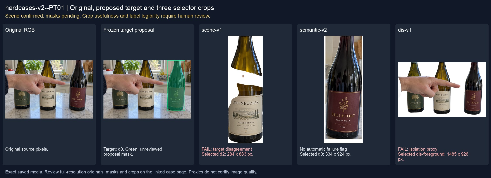
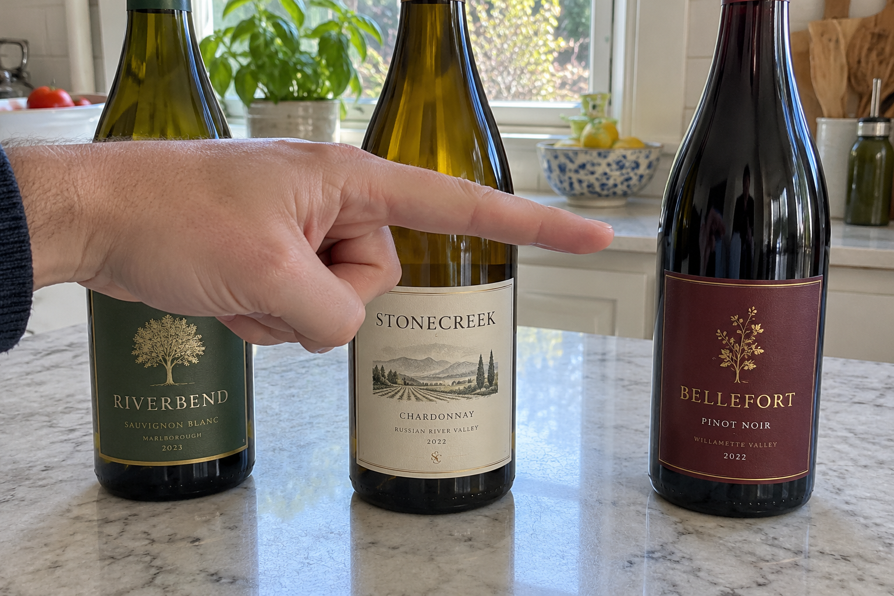
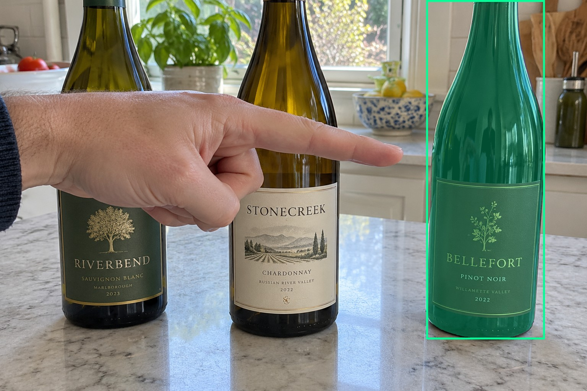
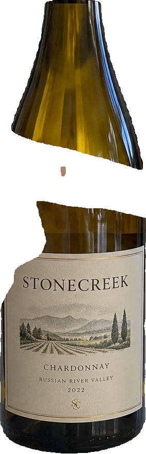
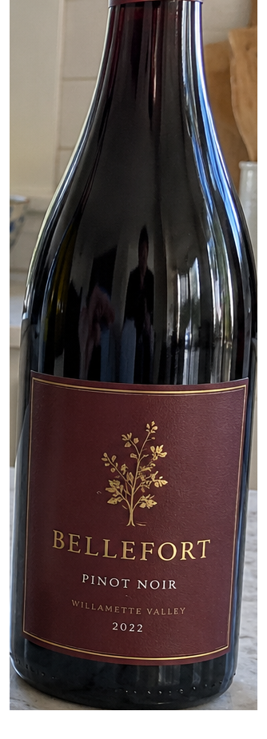
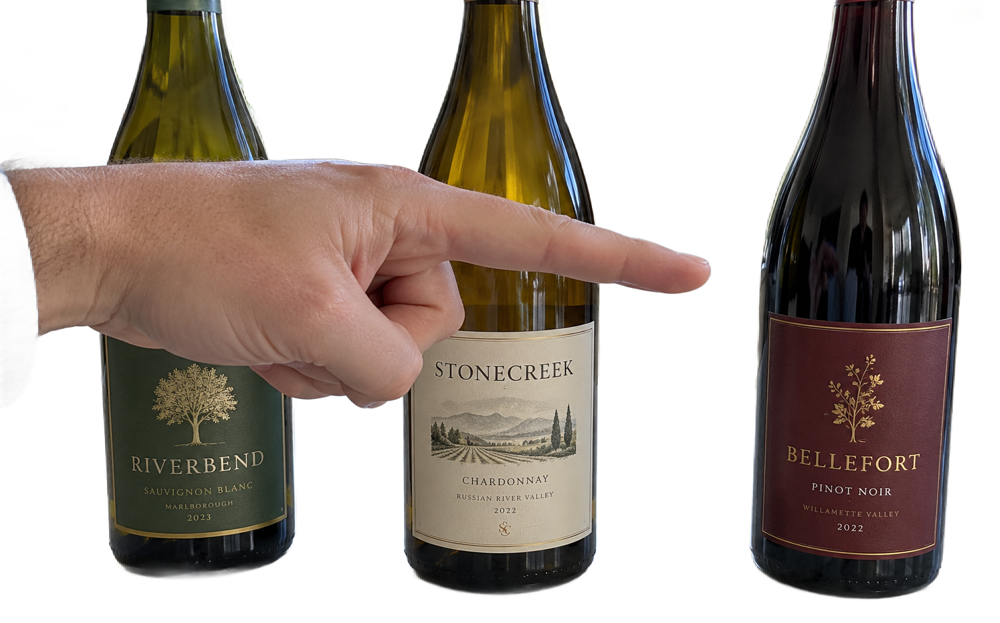

# main-selector-imagegen-hardcases-v2-20261020:PT01

**Scene confirmed; masks pending. All targets/masks are proposals; no approved segmentation ground truth.**



**scene-v1: FAIL — provisional target/proxy.**

Reference title (source): Палец слева — бутылка справа

Reference target description (source): Правая бутылка с узкой бордовой этикеткой

Expected intent: `clear`. Accepted target proposals: `d0`.

Scene group: `main-selector-imagegen-hardcases-v2-20261020:PT01`. Development only; no independent split claim.

## Original and proposed target





Green marks the unreviewed target proposal. Source image pixels are retained separately.

[Selected-label mask audit](../selected-label-mask-audit.json): incomplete proposal retention is flagged separately from target agreement.

[Full-resolution target proposal mask](../masks/hardcases-v2--PT01-d0.png)

## Selector results

### scene-v1: FAIL — provisional target/proxy

Selected: d2; reason: existing_scene_v1_rank; mode: legacy; crop 284×883 px. Target agreement: False. Target retention proxy: 0.0%; maximum other-bottle retention: 100.0%; minimum associated label retention: 0.0%. Mask ownership, label completeness and legibility still require human review.



[Full-resolution keep mask](../keep-masks/hardcases-v2--PT01-scene-v1.png) · [Exact decision JSON](../results/hardcases-v2--PT01-scene-v1.json)

Associated label-mask retention proxies (unreviewed ownership): d4: 0.0%, 91832 source pixels

### semantic-v2: No automatic failure flag; usability pending

Selected: d0; reason: explicit_pointing_gesture; mode: confident; crop 334×924 px. Target agreement: True. Target retention proxy: 100.0%; maximum other-bottle retention: 0.0%; minimum associated label retention: 100.0%. Mask ownership, label completeness and legibility still require human review. Selected-label mask audit: d4 100.0%.



[Full-resolution keep mask](../keep-masks/hardcases-v2--PT01-semantic-v2.png) · [Exact decision JSON](../results/hardcases-v2--PT01-semantic-v2.json)

Returned label views: [label 1](../label-crops/hardcases-v2--PT01-semantic-v2-0.png)

Associated label-mask retention proxies (unreviewed ownership): d4: 100.0%, 91832 source pixels

### dis-v1: PROXY failure; no native target ID

Selected: dis-foreground; reason: dis_foreground_mask; mode: foreground; crop 1485×926 px. Target agreement: n/a (no native target ID). Target retention proxy: 100.0%; maximum other-bottle retention: 100.0%; minimum associated label retention: 100.0%. Mask ownership, label completeness and legibility still require human review.



[Full-resolution keep mask](../keep-masks/hardcases-v2--PT01-dis-v1.png) · [Exact decision JSON](../results/hardcases-v2--PT01-dis-v1.json)

Associated label-mask retention proxies (unreviewed ownership): d4: 100.0%, 91832 source pixels

## All frozen mask proposals

These links expose every detector proposal, including labels and hands. Shapes and owners are unreviewed.

| ID | Detector class | Full-resolution mask |
|---|---|---|
| d0 | wine bottle | [PNG](../masks/hardcases-v2--PT01-d0.png) |
| d1 | wine bottle | [PNG](../masks/hardcases-v2--PT01-d1.png) |
| d2 | wine bottle | [PNG](../masks/hardcases-v2--PT01-d2.png) |
| d3 | wine label | [PNG](../masks/hardcases-v2--PT01-d3.png) |
| d4 | wine label | [PNG](../masks/hardcases-v2--PT01-d4.png) |
| d5 | wine label | [PNG](../masks/hardcases-v2--PT01-d5.png) |
| d6 | wine label | [PNG](../masks/hardcases-v2--PT01-d6.png) |
| d7 | hand | [PNG](../masks/hardcases-v2--PT01-d7.png) |

## Additional image-only context masks

Fixed English noun requests used RGB only; no target or annotation was supplied. Primary dN IDs remain unchanged. These masks are detector evidence, not reviewed ground truth.

[Saved validated context response](../context/hardcases-v2--PT01.json)

| Appended ID | Context class | Full-resolution mask |
|---|---|---|
| d8 | bottle held in hand | [PNG](../context-masks/hardcases-v2--PT01-d8.png) |
| d9 | bottle held in hand | [PNG](../context-masks/hardcases-v2--PT01-d9.png) |
| d10 | bottle held in hand | [PNG](../context-masks/hardcases-v2--PT01-d10.png) |
| d11 | bottle held in hand | [PNG](../context-masks/hardcases-v2--PT01-d11.png) |

[Raw frozen detector response](../detections/hardcases-v2--PT01.json)

<details><summary>Generation prompt (quoted source data)</summary>

```text
Generate exactly one independent photorealistic smartphone photograph, landscape 3:2, approximately 1536 by 1024 pixels. This is an ordinary wine selection moment, with natural perspective, believable glass and paper, imperfect ambient lighting, and realistic human anatomy. No collage, inset, split screen, arrows, highlights, bounding boxes, annotations, watermarks, UI, or text outside physical objects. Use fictional wine branding. Keep the target bottle's entire front label within the frame. The scene must communicate the stated gesture or physical relation visually; do not add any explanatory caption. A kitchen counter holds exactly three separate upright wine bottles. A human hand enters from the left, palm well visible, index finger fully extended horizontally toward the RIGHTMOST bottle with a narrow burgundy label; the other fingers curl naturally. The fingertip stops a small visible gap before the target middle body. A larger cream-label bottle stands at center and a green-label bottle at left, both unheld. The finger direction clearly passes in front of the central bottle and ends at the rightmost target, without touching any bottle. Midday window light, pale stone counter, casual close photograph.
```

</details>

Source review notes (quoted reference data):

> Верхние части горлышек выходят за кадр; целевая этикетка видна целиком.
