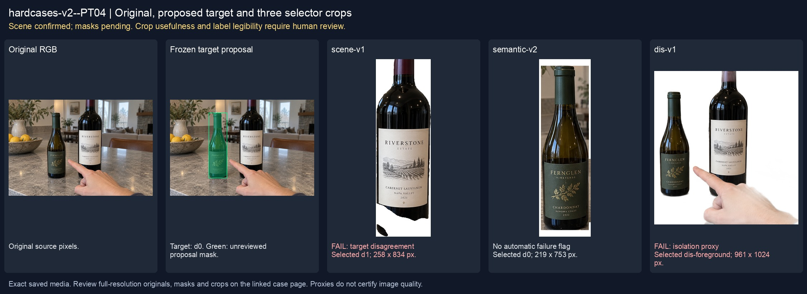
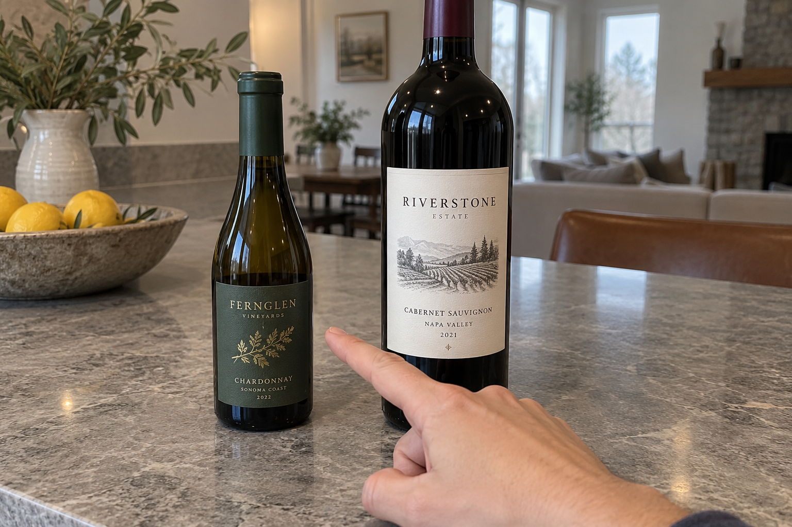
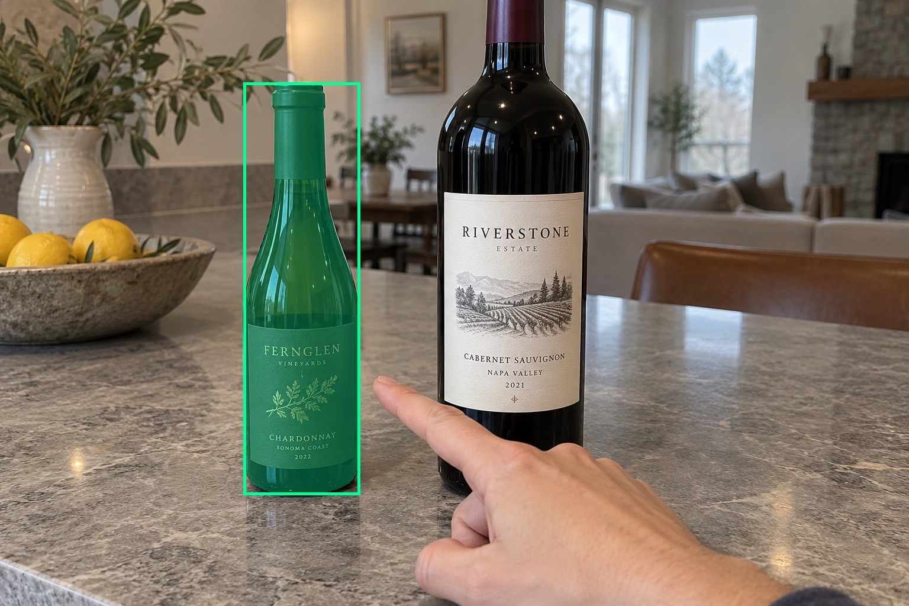
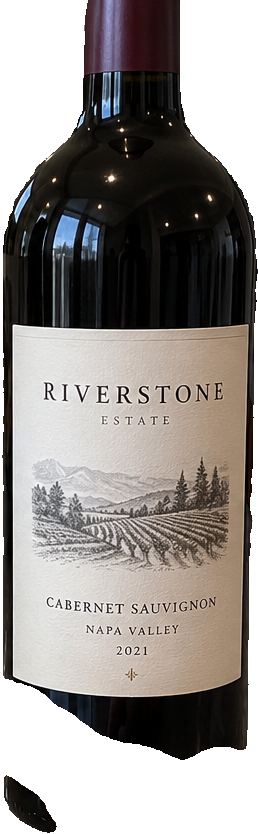
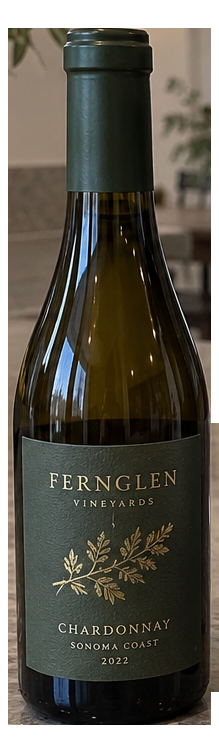
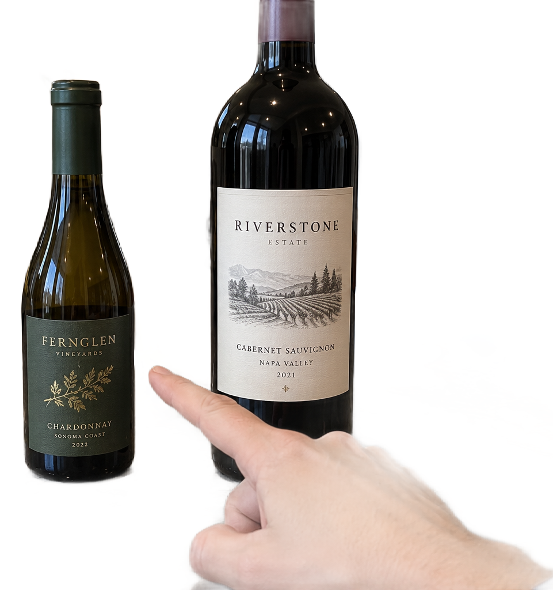

# main-selector-imagegen-hardcases-v2-20261020:PT04

**Scene confirmed; masks pending. All targets/masks are proposals; no approved segmentation ground truth.**



**scene-v1: FAIL — provisional target/proxy.**

Reference title (source): Диагональное указание — маленькая бутылка

Reference target description (source): Маленькая бутылка слева с зелёной этикеткой

Expected intent: `clear`. Accepted target proposals: `d0`.

Scene group: `main-selector-imagegen-hardcases-v2-20261020:PT04`. Development only; no independent split claim.

## Original and proposed target





Green marks the unreviewed target proposal. Source image pixels are retained separately.

[Selected-label mask audit](../selected-label-mask-audit.json): incomplete proposal retention is flagged separately from target agreement.

[Full-resolution target proposal mask](../masks/hardcases-v2--PT04-d0.png)

## Selector results

### scene-v1: FAIL — provisional target/proxy

Selected: d1; reason: existing_scene_v1_rank; mode: legacy; crop 258×834 px. Target agreement: False. Target retention proxy: 0.0%; maximum other-bottle retention: 100.0%; minimum associated label retention: 0.0%. Mask ownership, label completeness and legibility still require human review.



[Full-resolution keep mask](../keep-masks/hardcases-v2--PT04-scene-v1.png) · [Exact decision JSON](../results/hardcases-v2--PT04-scene-v1.json)

Associated label-mask retention proxies (unreviewed ownership): d2: 0.0%, 43135 source pixels

### semantic-v2: No automatic failure flag; usability pending

Selected: d0; reason: explicit_pointing_gesture; mode: confident; crop 219×753 px. Target agreement: True. Target retention proxy: 100.0%; maximum other-bottle retention: 0.0%; minimum associated label retention: 100.0%. Mask ownership, label completeness and legibility still require human review. Selected-label mask audit: d2 100.0%.



[Full-resolution keep mask](../keep-masks/hardcases-v2--PT04-semantic-v2.png) · [Exact decision JSON](../results/hardcases-v2--PT04-semantic-v2.json)

Returned label views: [label 1](../label-crops/hardcases-v2--PT04-semantic-v2-0.png)

Associated label-mask retention proxies (unreviewed ownership): d2: 100.0%, 43135 source pixels

### dis-v1: PROXY failure; no native target ID

Selected: dis-foreground; reason: dis_foreground_mask; mode: foreground; crop 961×1024 px. Target agreement: n/a (no native target ID). Target retention proxy: 99.9%; maximum other-bottle retention: 99.8%; minimum associated label retention: 100.0%. Mask ownership, label completeness and legibility still require human review.



[Full-resolution keep mask](../keep-masks/hardcases-v2--PT04-dis-v1.png) · [Exact decision JSON](../results/hardcases-v2--PT04-dis-v1.json)

Associated label-mask retention proxies (unreviewed ownership): d2: 100.0%, 43135 source pixels

## All frozen mask proposals

These links expose every detector proposal, including labels and hands. Shapes and owners are unreviewed.

| ID | Detector class | Full-resolution mask |
|---|---|---|
| d0 | wine bottle | [PNG](../masks/hardcases-v2--PT04-d0.png) |
| d1 | wine bottle | [PNG](../masks/hardcases-v2--PT04-d1.png) |
| d2 | wine label | [PNG](../masks/hardcases-v2--PT04-d2.png) |
| d3 | wine label | [PNG](../masks/hardcases-v2--PT04-d3.png) |
| d4 | hand | [PNG](../masks/hardcases-v2--PT04-d4.png) |

## Additional image-only context masks

Fixed English noun requests used RGB only; no target or annotation was supplied. Primary dN IDs remain unchanged. These masks are detector evidence, not reviewed ground truth.

[Saved validated context response](../context/hardcases-v2--PT04.json)

| Appended ID | Context class | Full-resolution mask |
|---|---|---|
| d5 | bottle held in hand | [PNG](../context-masks/hardcases-v2--PT04-d5.png) |
| d6 | bottle held in hand | [PNG](../context-masks/hardcases-v2--PT04-d6.png) |

[Raw frozen detector response](../detections/hardcases-v2--PT04.json)

<details><summary>Generation prompt (quoted source data)</summary>

```text
Generate exactly one independent photorealistic smartphone photograph, landscape 3:2, approximately 1536 by 1024 pixels. This is an ordinary wine selection moment, with natural perspective, believable glass and paper, imperfect ambient lighting, and realistic human anatomy. No collage, inset, split screen, arrows, highlights, bounding boxes, annotations, watermarks, UI, or text outside physical objects. Use fictional wine branding. Keep the target bottle's entire front label within the frame. The scene must communicate the stated gesture or physical relation visually; do not add any explanatory caption. On a gray stone counter are exactly two bottles: a smaller 375 ml wine bottle on the LEFT with a green paper label and a taller 750 ml bottle on the right with a crisp white label. A hand with visible palm enters from bottom right; its extended index points diagonally up-left and ends just short of the left small bottle middle body. Other fingers are curled. No bottle is held. The larger right bottle dominates the center-right, but the gesture clearly identifies the left small bottle. Soft overcast daylight, realistic skin, all visible label edges retained, no additional hands.
```

</details>

Source review notes (quoted reference data):

> Явного отклонения от задания при первичном просмотре не отмечено; требуется ваше review.
