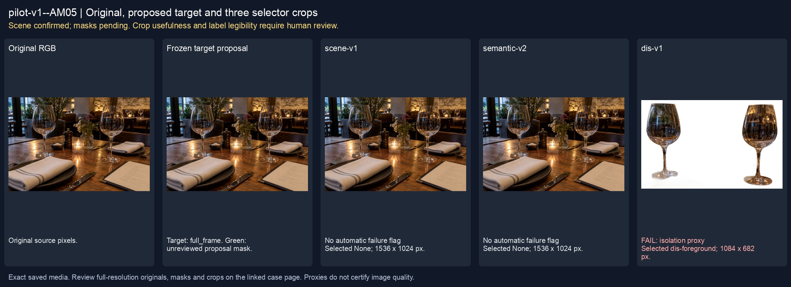
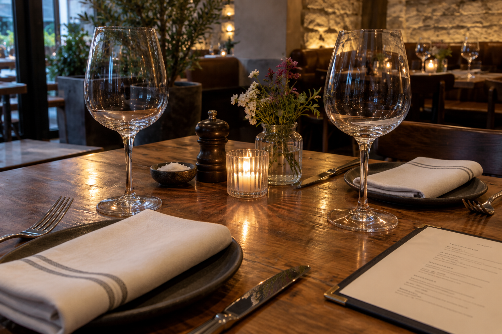
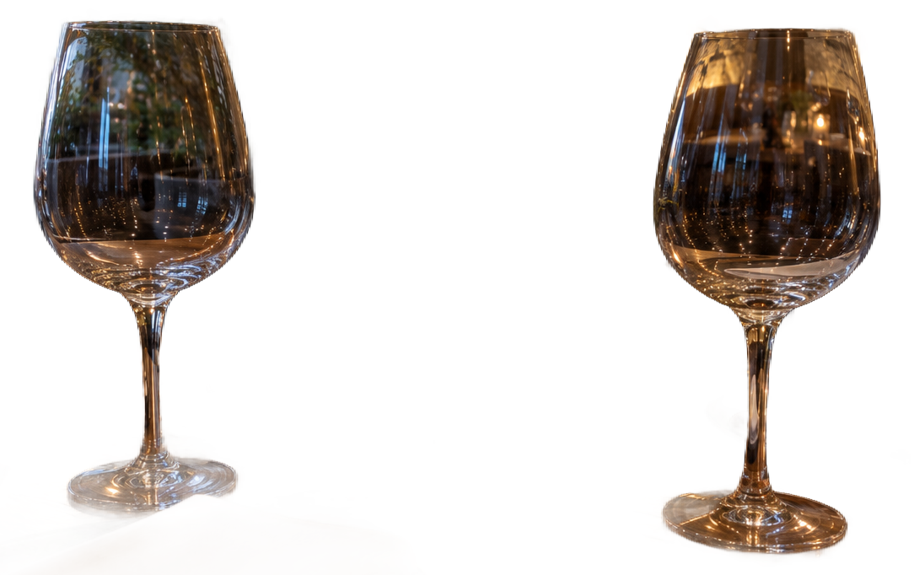

# main-selector-imagegen-pilot-v1-20261019:AM05

**Scene confirmed; masks pending. All targets/masks are proposals; no approved segmentation ground truth.**



**scene-v1: No automatic failure flag; usability pending.**

Reference title (source): Нет бутылок

Reference target description (source): Нет целевого предмета — полный кадр

Expected intent: `no_target`. Accepted target proposals: `full_frame`.

Scene group: `main-selector-imagegen-pilot-v1-20261019:AM05`. Development only; no independent split claim.

## Original and proposed target




Green marks the unreviewed target proposal. Source image pixels are retained separately.

[Selected-label mask audit](../selected-label-mask-audit.json): incomplete proposal retention is flagged separately from target agreement.

## Selector results

### scene-v1: No automatic failure flag; usability pending

Selected: None; reason: existing_original_frame_fallback; mode: legacy; crop 1536×1024 px. Target agreement: True. Target retention proxy: n/a; maximum other-bottle retention: n/a; minimum associated label retention: n/a. Mask ownership, label completeness and legibility still require human review.


[Full-resolution keep mask](../keep-masks/pilot-v1--AM05-scene-v1.png) · [Exact decision JSON](../results/pilot-v1--AM05-scene-v1.json)

### semantic-v2: No automatic failure flag; usability pending

Selected: None; reason: fallback_original_frame; mode: fallback; crop 1536×1024 px. Target agreement: True. Target retention proxy: n/a; maximum other-bottle retention: n/a; minimum associated label retention: n/a. Mask ownership, label completeness and legibility still require human review.


[Full-resolution keep mask](../keep-masks/pilot-v1--AM05-semantic-v2.png) · [Exact decision JSON](../results/pilot-v1--AM05-semantic-v2.json)

### dis-v1: PROXY failure; no native target ID

Selected: dis-foreground; reason: dis_foreground_mask; mode: foreground; crop 1084×682 px. Target agreement: n/a (no native target ID). Target retention proxy: n/a; maximum other-bottle retention: n/a; minimum associated label retention: n/a. Mask ownership, label completeness and legibility still require human review.



[Full-resolution keep mask](../keep-masks/pilot-v1--AM05-dis-v1.png) · [Exact decision JSON](../results/pilot-v1--AM05-dis-v1.json)

## All frozen mask proposals

These links expose every detector proposal, including labels and hands. Shapes and owners are unreviewed.

| ID | Detector class | Full-resolution mask |
|---|---|---|
| d0 | wine glass | [PNG](../masks/pilot-v1--AM05-d0.png) |
| d1 | wine glass | [PNG](../masks/pilot-v1--AM05-d1.png) |
| d2 | wine glass | [PNG](../masks/pilot-v1--AM05-d2.png) |
| d3 | wine glass | [PNG](../masks/pilot-v1--AM05-d3.png) |

## Additional image-only context masks

Fixed English noun requests used RGB only; no target or annotation was supplied. Primary dN IDs remain unchanged. These masks are detector evidence, not reviewed ground truth.

[Saved validated context response](../context/pilot-v1--AM05.json)

| Appended ID | Context class | Full-resolution mask |
|---|---|---|

[Raw frozen detector response](../detections/pilot-v1--AM05.json)

<details><summary>Generation prompt (quoted source data)</summary>

```text
Use case: photorealistic-natural.
Asset type: one independent synthetic smartphone photograph for a wine-subject selection test dataset.
Style: a believable candid phone photo with realistic optics, materials, shadows, depth and anatomically plausible hands when requested. Natural photographic imperfections, not a diagram, collage, 3D render, advertisement or contact sheet.
Bottle labels may use fictional wine names and normal small wine-label text. Labels must have complete physical paper boundaries and plausible printing. Do not add target markers, bounding boxes, arrows, captions, segmentation colors, watermarks or any explanation outside the scene.
Generate exactly one landscape photograph, approximately 1536 by 1024 pixels. Any wine identity is fictional; this tests selection and visible-label preservation, not catalogue recognition.
Scene request: A believable restaurant table phone photo with two empty wine glasses, folded napkins, cutlery and a small menu. There are no bottles, bottle illustrations, cartons shaped like bottles or wine labels anywhere in the scene, including the background.
```

</details>

Source review notes (quoted reference data):

> Явного несоответствия при первичном просмотре не отмечено; требуется ваше review.
