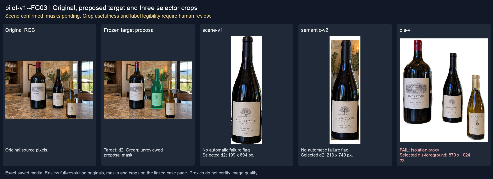
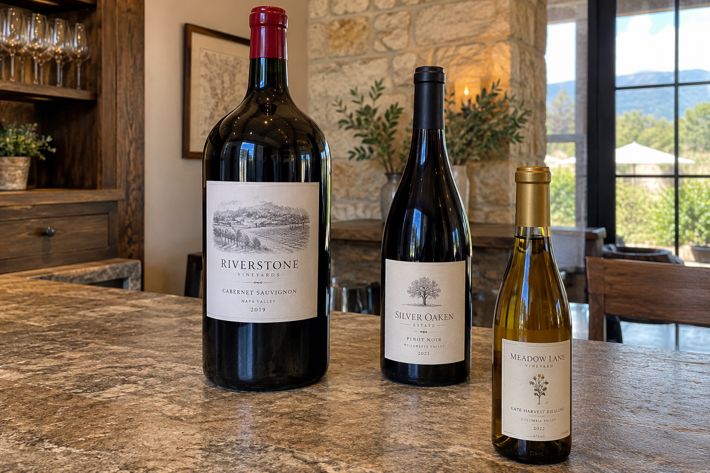
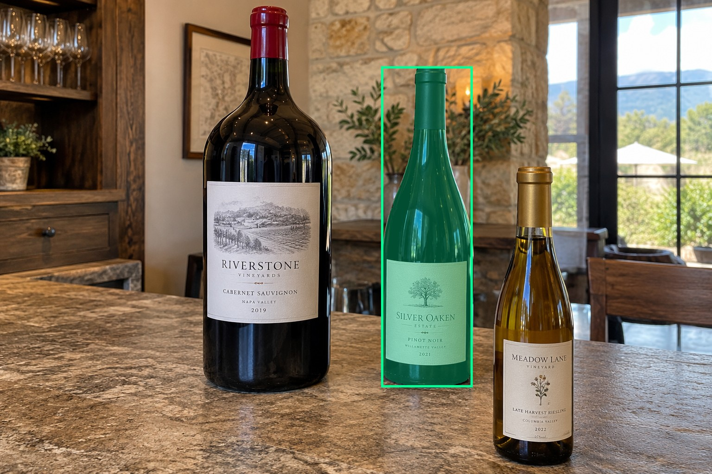
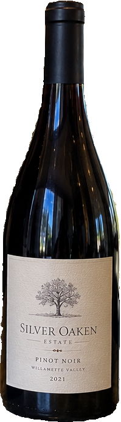
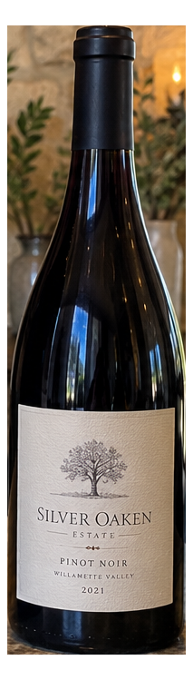
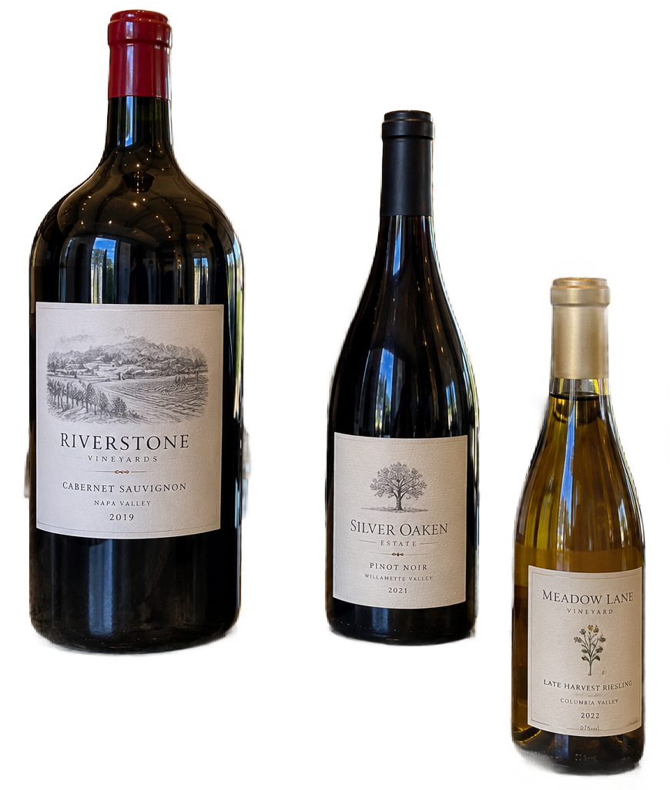

# main-selector-imagegen-pilot-v1-20261019:FG03

**Scene confirmed; masks pending. All targets/masks are proposals; no approved segmentation ground truth.**



**scene-v1: No automatic failure flag; usability pending.**

Reference title (source): Большая бутылка сзади

Reference target description (source): Средняя стандартная бутылка — fallback

Expected intent: `ambiguous`. Accepted target proposals: `d2`.

Scene group: `main-selector-imagegen-pilot-v1-20261019:FG03`. Development only; no independent split claim.

## Original and proposed target





Green marks the unreviewed target proposal. Source image pixels are retained separately.

[Selected-label mask audit](../selected-label-mask-audit.json): incomplete proposal retention is flagged separately from target agreement.

[Full-resolution target proposal mask](../masks/pilot-v1--FG03-d2.png)

## Selector results

### scene-v1: No automatic failure flag; usability pending

Selected: d2; reason: existing_scene_v1_rank; mode: legacy; crop 199×694 px. Target agreement: True. Target retention proxy: 100.0%; maximum other-bottle retention: 0.0%; minimum associated label retention: 100.0%. Mask ownership, label completeness and legibility still require human review.



[Full-resolution keep mask](../keep-masks/pilot-v1--FG03-scene-v1.png) · [Exact decision JSON](../results/pilot-v1--FG03-scene-v1.json)

Associated label-mask retention proxies (unreviewed ownership): d5: 100.0%, 38080 source pixels

### semantic-v2: No automatic failure flag; usability pending

Selected: d2; reason: fallback_nearest_center; mode: fallback; crop 213×749 px. Target agreement: True. Target retention proxy: 100.0%; maximum other-bottle retention: 0.0%; minimum associated label retention: 100.0%. Mask ownership, label completeness and legibility still require human review. Selected-label mask audit: d5 100.0%.



[Full-resolution keep mask](../keep-masks/pilot-v1--FG03-semantic-v2.png) · [Exact decision JSON](../results/pilot-v1--FG03-semantic-v2.json)

Returned label views: [label 1](../label-crops/pilot-v1--FG03-semantic-v2-0.png)

Associated label-mask retention proxies (unreviewed ownership): d5: 100.0%, 38080 source pixels

### dis-v1: PROXY failure; no native target ID

Selected: dis-foreground; reason: dis_foreground_mask; mode: foreground; crop 870×1024 px. Target agreement: n/a (no native target ID). Target retention proxy: 99.9%; maximum other-bottle retention: 100.0%; minimum associated label retention: 100.0%. Mask ownership, label completeness and legibility still require human review.



[Full-resolution keep mask](../keep-masks/pilot-v1--FG03-dis-v1.png) · [Exact decision JSON](../results/pilot-v1--FG03-dis-v1.json)

Associated label-mask retention proxies (unreviewed ownership): d5: 100.0%, 38080 source pixels

## All frozen mask proposals

These links expose every detector proposal, including labels and hands. Shapes and owners are unreviewed.

| ID | Detector class | Full-resolution mask |
|---|---|---|
| d0 | wine bottle | [PNG](../masks/pilot-v1--FG03-d0.png) |
| d1 | wine bottle | [PNG](../masks/pilot-v1--FG03-d1.png) |
| d2 | wine bottle | [PNG](../masks/pilot-v1--FG03-d2.png) |
| d3 | wine label | [PNG](../masks/pilot-v1--FG03-d3.png) |
| d4 | wine label | [PNG](../masks/pilot-v1--FG03-d4.png) |
| d5 | wine label | [PNG](../masks/pilot-v1--FG03-d5.png) |
| d6 | wine glass | [PNG](../masks/pilot-v1--FG03-d6.png) |
| d7 | wine glass | [PNG](../masks/pilot-v1--FG03-d7.png) |
| d8 | wine glass | [PNG](../masks/pilot-v1--FG03-d8.png) |
| d9 | wine glass | [PNG](../masks/pilot-v1--FG03-d9.png) |
| d10 | wine glass | [PNG](../masks/pilot-v1--FG03-d10.png) |
| d11 | wine glass | [PNG](../masks/pilot-v1--FG03-d11.png) |
| d12 | wine glass | [PNG](../masks/pilot-v1--FG03-d12.png) |

## Additional image-only context masks

Fixed English noun requests used RGB only; no target or annotation was supplied. Primary dN IDs remain unchanged. These masks are detector evidence, not reviewed ground truth.

[Saved validated context response](../context/pilot-v1--FG03.json)

| Appended ID | Context class | Full-resolution mask |
|---|---|---|
| d13 | bottle held in hand | [PNG](../context-masks/pilot-v1--FG03-d13.png) |
| d14 | bottle held in hand | [PNG](../context-masks/pilot-v1--FG03-d14.png) |
| d15 | bottle held in hand | [PNG](../context-masks/pilot-v1--FG03-d15.png) |

[Raw frozen detector response](../detections/pilot-v1--FG03.json)

<details><summary>Generation prompt (quoted source data)</summary>

```text
Use case: photorealistic-natural.
Asset type: one independent synthetic smartphone photograph for a wine-subject selection test dataset.
Style: a believable candid phone photo with realistic optics, materials, shadows, depth and anatomically plausible hands when requested. Natural photographic imperfections, not a diagram, collage, 3D render, advertisement or contact sheet.
Bottle labels may use fictional wine names and normal small wine-label text. Labels must have complete physical paper boundaries and plausible printing. Do not add target markers, bounding boxes, arrows, captions, segmentation colors, watermarks or any explanation outside the scene.
Generate exactly one landscape photograph, approximately 1536 by 1024 pixels. Any wine identity is fictional; this tests selection and visible-label preservation, not catalogue recognition.
Scene request: Exactly three physical wine bottles on a tasting counter: a rear magnum slightly left of center, a rear standard bottle slightly right of center, and a small half-bottle nearer the camera at the lower right. The rear magnum is physically larger, so apparent size conflicts with camera distance. All bottles are equally sharp and similarly lit; no hand and no unmistakable intended subject.
```

</details>

Source review notes (quoted reference data):

> Размер и глубина конфликтуют. Проверьте, действительно ли кадр воспринимается неоднозначным; не принимайте это только из текста рецепта.
