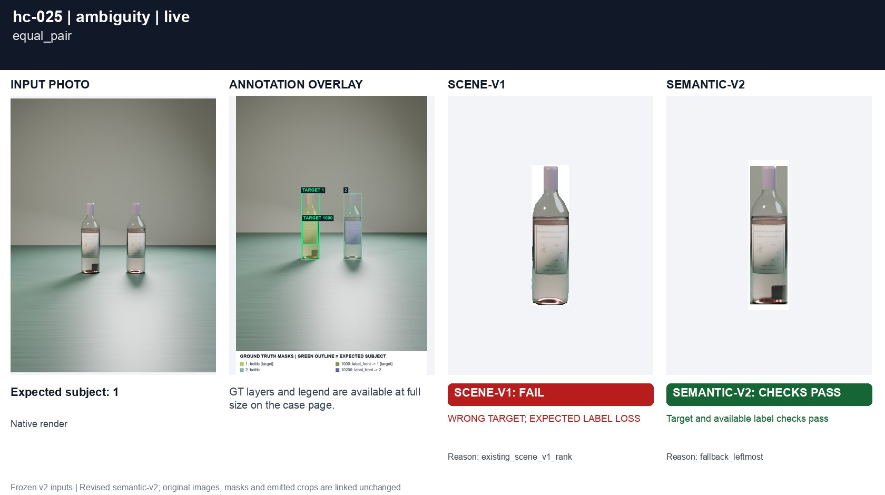
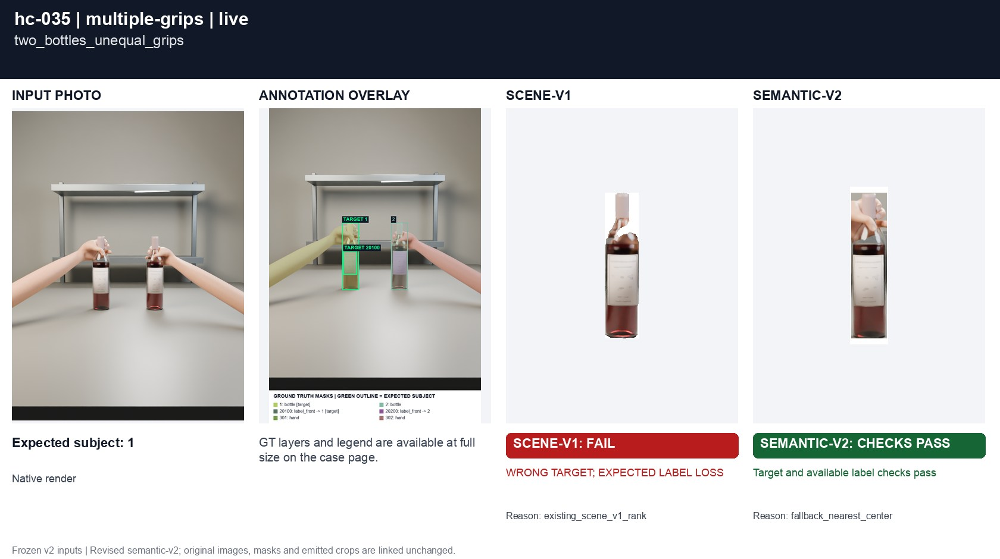
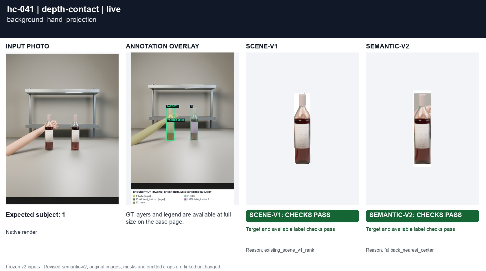
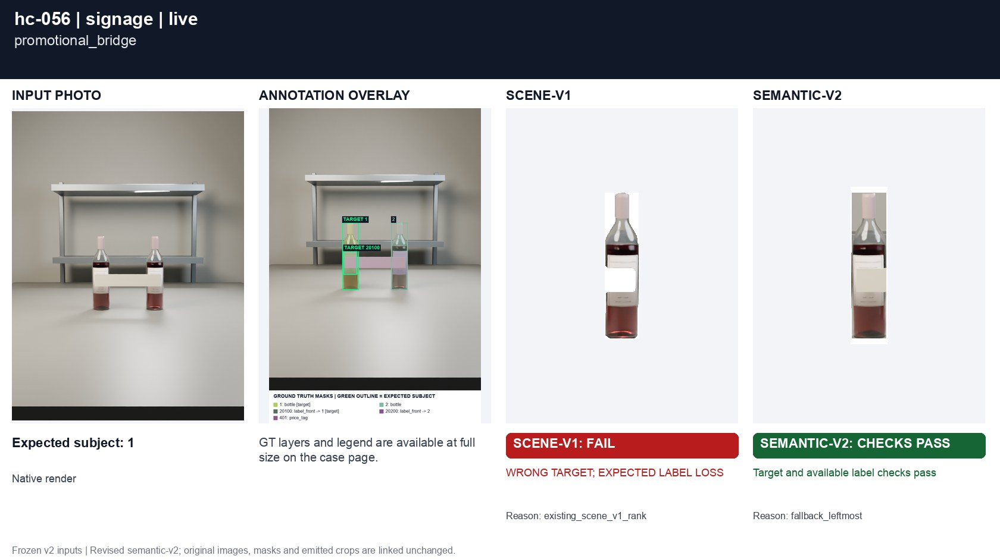
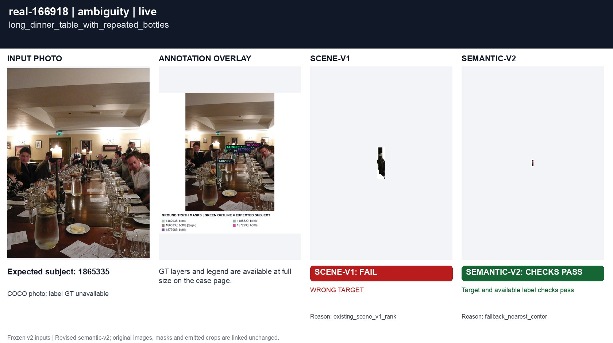
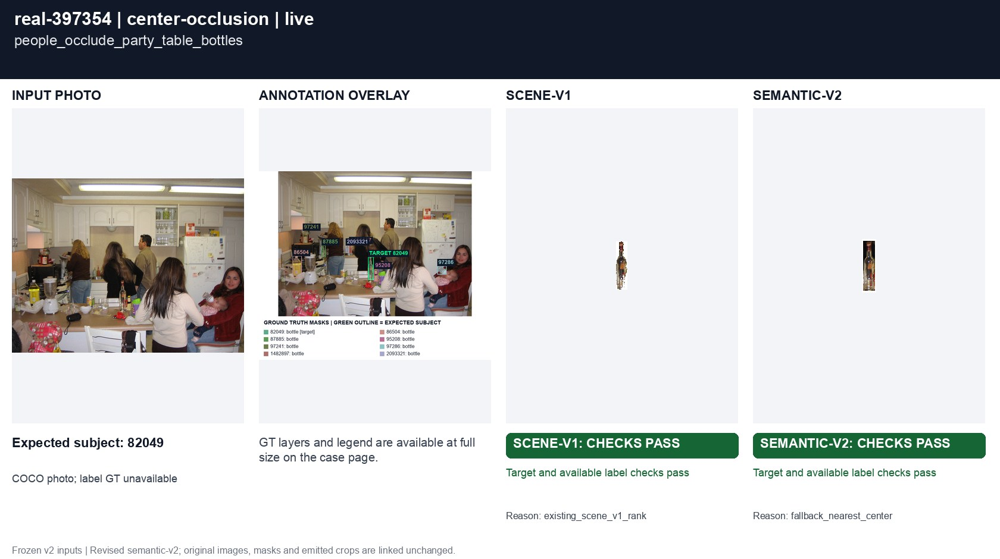
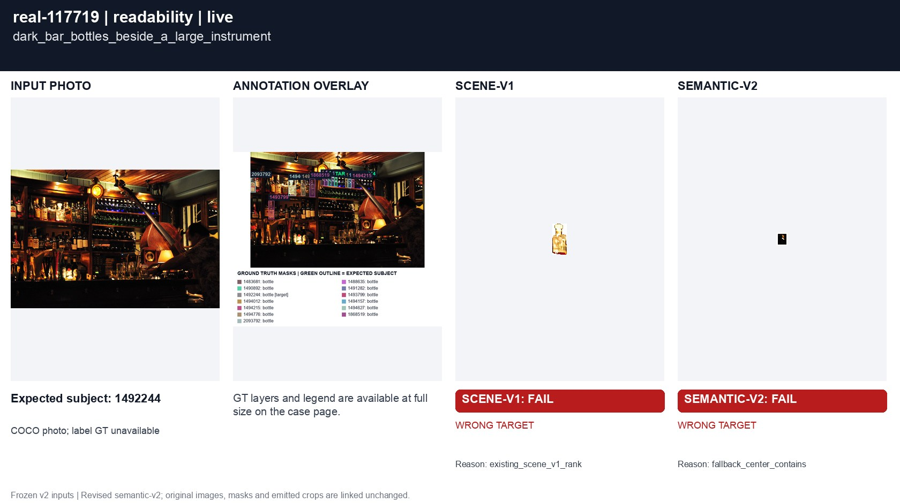
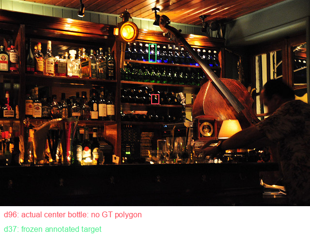

# Investigation of all eight remaining mismatches

**Seven corrected; one frozen annotation conflict still fails.** Every example below has original RGB, GT masks, all primary/effective detector mask PNGs, both current selector crops and a saved preceding semantic crop. No local files are required.

| Case | Before semantic-v2 | Current semantic-v2 | Current scene-v1 | Mechanism / remaining issue |
|---|---|---|---|---|
| [hc-025](cases/hc-025.md) | FAIL | PASS | FAIL: WRONG TARGET, EXPECTED LABEL LOSS | Stable-neck bilateral outline fit |

## hc-025 · PASS

[Open full photos, masks, selector crops and geometry](cases/hc-025.md)

Stable-neck bilateral outline fit.
| [hc-035](cases/hc-035.md) | FAIL | PASS | FAIL: WRONG TARGET, EXPECTED LABEL LOSS | Stable-neck bilateral outline fit |

## hc-035 · PASS

[Open full photos, masks, selector crops and geometry](cases/hc-035.md)

Stable-neck bilateral outline fit.
| [hc-039](cases/hc-039.md) | FAIL | PASS | FAIL: WRONG TARGET, EXPECTED LABEL LOSS | Stable-neck bilateral outline fit |

## hc-039 · PASS

[Open full photos, masks, selector crops and geometry](cases/hc-039.md)

Stable-neck bilateral outline fit.
| [hc-041](cases/hc-041.md) | FAIL | PASS | Recorded checks pass | Stable-neck bilateral outline fit |

## hc-041 · PASS

[Open full photos, masks, selector crops and geometry](cases/hc-041.md)

Stable-neck bilateral outline fit.
| [hc-056](cases/hc-056.md) | FAIL | PASS | FAIL: WRONG TARGET, EXPECTED LABEL LOSS | Stable-neck bilateral outline fit |

## hc-056 · PASS

[Open full photos, masks, selector crops and geometry](cases/hc-056.md)

Stable-neck bilateral outline fit.
| [real-166918](cases/real-166918.md) | FAIL | PASS | FAIL: WRONG TARGET | Central 160px scan recovers the tiny held bottle |

## real-166918 · PASS

[Open full photos, masks, selector crops and geometry](cases/real-166918.md)

Central 160px scan recovers the tiny held bottle.
| [real-397354](cases/real-397354.md) | FAIL | PASS | Recorded checks pass | Highest-quality admissible tracker mask, preserving original RGB rectangle |

## real-397354 · PASS

[Open full photos, masks, selector crops and geometry](cases/real-397354.md)

Highest-quality admissible tracker mask, preserving original RGB rectangle.
| [real-117719](cases/real-117719.md) | FAIL | **FAIL — frozen annotation conflict** | FAIL: WRONG TARGET | Actual unannotated bottle covers photo center; GT subset chooses d37; still FAIL |

## real-117719 · **FAIL — frozen annotation conflict**

[Open full photos, masks, selector crops and geometry](cases/real-117719.md)

Actual unannotated bottle covers photo center; GT subset chooses d37; still FAIL.

## Remaining annotation conflict

This derived overlay is for review; the original RGB, GT masks and detector PNGs above remain unmodified. The raw response and crop show the actual unannotated rack bottle. `augmentation-scores.json` contains passive diagnostic probes including interaction photographs without their taps; those scores are not used as the final interaction result or accuracy. All final interaction metrics come from the complete paired replay.

[99 raw RGB-only diagnostic responses and declarations](evidence/detector-investigation.json) · [Enhancement policy](evidence/enhancement-policy.json) · [Full comparison JSON](evidence/comparison.json) · [All scene-v1 failures](SCENE-V1-FAILURES.md).
