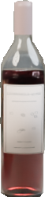
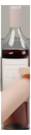
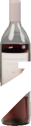
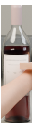
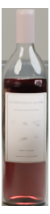

# hc-039 pointing_at_label

[All cases](../README.md) · [Group](../groups/touch-grip.md) · [Exact case metadata](../evidence/hc-039.json)

**scene-v1:** **FAIL** live: WRONG TARGET; EXPECTED LABEL LOSS  
**semantic-v2:** Recorded checks pass

## Expected result

- Group: `touch-grip`; provenance: `new_native_render`.
- Expected subject: `1`; acceptable IDs: `[1, 2]`.
- Expected status: `selected`; expected selection mode: `fallback`.
- Interaction: `{}`.
- Annotation source: native opaque visible geometry.
- Complete label GT: `True`.

No unique intended bottle. The annotated crop target follows the revised photo-center / pixel-distance / left / upper policy; this is a product fallback, not evidence of user intent.

## Original input and masks

| Mask ID | Category | Parent | Expected subject or label | Original binary PNG |
|---|---|---|---|---|
| `1` | bottle | `None` | yes | [view raw mask](../assets/masks/hc-039-i1.png) |
| `2` | bottle | `None` |  | [view raw mask](../assets/masks/hc-039-i2.png) |
| `20100` | label_front | `1` | yes | [view raw mask](../assets/masks/hc-039-i20100.png) |
| `20200` | label_front | `2` |  | [view raw mask](../assets/masks/hc-039-i20200.png) |
| `301` | hand | `None` |  | [view raw mask](../assets/masks/hc-039-i301.png) |

## Saved selector outputs

`live` replays saved detector responses; `controlled` uses declared GT-derived detections and faults. No new inference was run for this gallery. Expected-label retention below 98% is flagged separately from target matching. A full-frame crop can retain distractors.

### live

| Selector | Result | Assigned subject | Mode | Expected-label retention | Reason |
|---|---|---|---|---|---|
| `scene-v1` | **FAIL: WRONG TARGET, EXPECTED LABEL LOSS** | `2` | `legacy` | 0.00% | `existing_scene_v1_rank` |
| `semantic-v2` | Recorded checks pass | `1` | `fallback` | 100.00% | `fallback_leftmost` |

#### scene-v1 live crop

[View original selector keep mask](../assets/crops/hc-039-live-scene-v1-keep.png)

#### semantic-v2 live crop

[View original selector keep mask](../assets/crops/hc-039-live-semantic-v2-keep.png)

Label crop views: [view 1](../assets/crops/hc-039-live-semantic-v2-label-0.png).
### controlled

| Selector | Result | Assigned subject | Mode | Expected-label retention | Reason |
|---|---|---|---|---|---|
| `scene-v1` | Recorded checks pass | `1` | `legacy` | 100.00% | `existing_scene_v1_rank` |
| `semantic-v2` | Recorded checks pass | `1` | `fallback` | 100.00% | `fallback_leftmost` |

#### scene-v1 controlled crop

[View original selector keep mask](../assets/crops/hc-039-controlled-scene-v1-keep.png)

#### semantic-v2 controlled crop

[View original selector keep mask](../assets/crops/hc-039-controlled-semantic-v2-keep.png)

Label crop views: [view 1](../assets/crops/hc-039-controlled-semantic-v2-label-0.png).

## Localization investigation · current revision

**Before semantic-v2: FAIL. Current semantic-v2: PASS. Current scene-v1: FAIL: WRONG TARGET, EXPECTED LABEL LOSS.**

Stable-neck bilateral outline fit.

Before: `d0` → GT `2`; current: `d1` → GT `1`; frozen target `1`. Required/current mode: `fallback` / `fallback`.

### Exact detector inputs and localization geometry

Primary masks/caches remain unchanged. Effective masks include separately recorded image-only recovery/localization. Numeric detector IDs are distinct from GT IDs. Owner assignment below is an offline review annotation, never detector input.

| Detector | Class | Score | Effective input box | Current selector box / source | Offline assigned GT | Primary mask | Effective mask |
|---|---|---:|---|---|---|---|---|
| `d0` | wine bottle | 0.9395 | `[444.0, 413.0, 501.0, 658.0]` | `[444, 413, 502, 658]` / visible_mask | `2` (IoU 0.935) | [PNG](../detector-masks/hc-039/primary-d0.png) | [PNG](../detector-masks/hc-039/effective-d0.png) |
| `d1` | wine bottle | 0.9370 | `[266.0, 413.0, 323.0, 658.0]` | `[266, 413, 324, 658]` / neck_axis | `1` (IoU 0.914) | [PNG](../detector-masks/hc-039/primary-d1.png) | [PNG](../detector-masks/hc-039/effective-d1.png) |
| `d2` | wine label | 0.9556 | `[447.0, 517.0, 500.0, 604.0]` | not an eligible output candidate | `2` (IoU 0.955) | [PNG](../detector-masks/hc-039/primary-d2.png) | [PNG](../detector-masks/hc-039/effective-d2.png) |
| `d3` | wine label | 0.8535 | `[267.0, 517.0, 321.0, 580.0]` | not an eligible output candidate | `1` (IoU 0.848) | [PNG](../detector-masks/hc-039/primary-d3.png) | [PNG](../detector-masks/hc-039/effective-d3.png) |
| `d4` | hand | 0.8877 | `[309.0, 513.0, 420.0, 592.0]` | not an eligible output candidate | `None` (IoU 0.203) | [PNG](../detector-masks/hc-039/primary-d4.png) | [PNG](../detector-masks/hc-039/effective-d4.png) |
