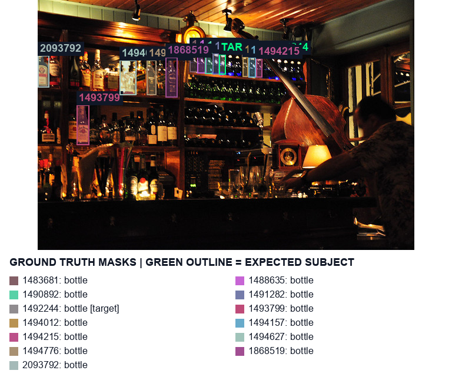
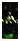

# real-117719 dark_bar_bottles_beside_a_large_instrument

[All cases](../README.md) · [Group](../groups/readability.md) · [Exact case metadata](../evidence/real-117719.json)

**scene-v1:** **FAIL** live: WRONG TARGET  
**semantic-v2:** **FAIL** live: WRONG TARGET

## Expected result

- Group: `readability`; provenance: `coco_real_photo`.
- Expected subject: `1492244`; acceptable IDs: `[1483681, 1488635, 1490892, 1491282, 1492244, 1493799, 1494012, 1494157, 1494215, 1494627, 1494776, 1868519, 2093792]`.
- Expected status: `selected`; expected selection mode: `fallback`.
- Interaction: `{}`.
- Annotation source: COCO bottle polygons; Codex visual target review before evaluation, not independently adjudicated; background instance coverage can be incomplete.
- Complete label GT: `False`.

No unique intended bottle. The annotated crop target follows the revised photo-center / pixel-distance / left / upper policy; this is a product fallback, not evidence of user intent.

COCO image `117719` · [original source](http://images.cocodataset.org/val2017/000000117719.jpg) · [Flickr source](http://farm4.staticflickr.com/3395/3499231904_8b958aa5bc_z.jpg) · [license: Attribution-ShareAlike License](http://creativecommons.org/licenses/by-sa/2.0/).

Real targets are developer judgments, not independently adjudicated user intent. COCO competitor coverage may be incomplete; no hand or complete-label ground truth is invented.

## Original input and masks

| Mask ID | Category | Parent | Expected subject or label | Original binary PNG |
|---|---|---|---|---|
| `1483681` | bottle | `None` |  | [view raw mask](../assets/masks/real-117719-i1483681.png) |
| `1488635` | bottle | `None` |  | [view raw mask](../assets/masks/real-117719-i1488635.png) |
| `1490892` | bottle | `None` |  | [view raw mask](../assets/masks/real-117719-i1490892.png) |
| `1491282` | bottle | `None` |  | [view raw mask](../assets/masks/real-117719-i1491282.png) |
| `1492244` | bottle | `None` | yes | [view raw mask](../assets/masks/real-117719-i1492244.png) |
| `1493799` | bottle | `None` |  | [view raw mask](../assets/masks/real-117719-i1493799.png) |
| `1494012` | bottle | `None` |  | [view raw mask](../assets/masks/real-117719-i1494012.png) |
| `1494157` | bottle | `None` |  | [view raw mask](../assets/masks/real-117719-i1494157.png) |
| `1494215` | bottle | `None` |  | [view raw mask](../assets/masks/real-117719-i1494215.png) |
| `1494627` | bottle | `None` |  | [view raw mask](../assets/masks/real-117719-i1494627.png) |
| `1494776` | bottle | `None` |  | [view raw mask](../assets/masks/real-117719-i1494776.png) |
| `1868519` | bottle | `None` |  | [view raw mask](../assets/masks/real-117719-i1868519.png) |
| `2093792` | bottle | `None` |  | [view raw mask](../assets/masks/real-117719-i2093792.png) |

## Saved selector outputs

`live` replays saved detector responses; `controlled` uses declared GT-derived detections and faults. No new inference was run for this gallery. Expected-label retention below 98% is flagged separately from target matching. A full-frame crop can retain distractors.

### live

| Selector | Result | Assigned subject | Mode | Expected-label retention | Reason |
|---|---|---|---|---|---|
| `scene-v1` | **FAIL: WRONG TARGET** | `1494627` | `legacy` | not scored | `existing_scene_v1_rank` |
| `semantic-v2` | **FAIL: WRONG TARGET** | `None` | `fallback` | not scored | `fallback_center_contains` |

#### scene-v1 live crop

[View original selector keep mask](../assets/crops/real-117719-live-scene-v1-keep.png)

#### semantic-v2 live crop

[View original selector keep mask](../assets/crops/real-117719-live-semantic-v2-keep.png)

## Localization investigation · current revision

**Before semantic-v2: FAIL. Current semantic-v2: **FAIL — frozen annotation conflict**. Current scene-v1: FAIL: WRONG TARGET.**

Actual unannotated bottle covers photo center; GT subset chooses d37; still FAIL.

Before: `d7` → GT `None`; current: `d96` → GT `None`; frozen target `1492244`. Required/current mode: `fallback` / `fallback`.

### Exact detector inputs and localization geometry

Primary masks/caches remain unchanged. Effective masks include separately recorded image-only recovery/localization. Numeric detector IDs are distinct from GT IDs. Owner assignment below is an offline review annotation, never detector input.

| Detector | Class | Score | Effective input box | Current selector box / source | Offline assigned GT | Primary mask | Effective mask |
|---|---|---:|---|---|---|---|---|
| `d0` | wine bottle | 0.4768 | `[358.0, 95.0, 372.0, 132.0]` | `[359, 96, 372, 131]` / visible_mask | `1494157` (IoU 0.817) | [PNG](../detector-masks/real-117719/primary-d0.png) | [PNG](../detector-masks/real-117719/effective-d0.png) |
| `d1` | wine bottle | 0.5996 | `[168.0, 261.0, 191.0, 340.0]` | `[167, 261, 191, 341]` / visible_mask | `None` (IoU 0.000) | [PNG](../detector-masks/real-117719/primary-d1.png) | [PNG](../detector-masks/real-117719/effective-d1.png) |
| `d2` | wine bottle | 0.4019 | `[343.0, 138.0, 357.0, 173.0]` | `[344, 138, 358, 173]` / visible_mask | `None` (IoU 0.000) | [PNG](../detector-masks/real-117719/primary-d2.png) | [PNG](../detector-masks/real-117719/effective-d2.png) |
| `d3` | wine bottle | 0.6260 | `[0.0, 93.0, 18.0, 148.0]` | `[0, 93, 19, 148]` / visible_mask | `2093792` (IoU 0.871) | [PNG](../detector-masks/real-117719/primary-d3.png) | [PNG](../detector-masks/real-117719/effective-d3.png) |
| `d4` | wine bottle | 0.6187 | `[219.0, 98.0, 237.0, 164.0]` | `[220, 98, 238, 165]` / visible_mask | `1868519` (IoU 0.782) | [PNG](../detector-masks/real-117719/primary-d4.png) | [PNG](../detector-masks/real-117719/effective-d4.png) |
| `d5` | wine bottle | 0.4958 | `[282.0, 88.0, 297.0, 125.0]` | `[282, 89, 298, 125]` / visible_mask | `1490892` (IoU 0.815) | [PNG](../detector-masks/real-117719/primary-d5.png) | [PNG](../detector-masks/real-117719/effective-d5.png) |
| `d6` | wine bottle | 0.4517 | `[370.0, 97.0, 384.0, 132.0]` | `[370, 97, 384, 132]` / detector_box | `1494215` (IoU 0.748) | [PNG](../detector-masks/real-117719/primary-d6.png) | [PNG](../detector-masks/real-117719/effective-d6.png) |
| `d7` | wine bottle | 0.4363 | `[307.0, 134.0, 323.0, 171.0]` | `[308, 134, 324, 171]` / visible_mask | `None` (IoU 0.000) | [PNG](../detector-masks/real-117719/primary-d7.png) | [PNG](../detector-masks/real-117719/effective-d7.png) |
| `d8` | wine bottle | 0.5181 | `[138.0, 102.0, 165.0, 160.0]` | `[138, 102, 166, 161]` / visible_mask | `1494627` (IoU 0.865) | [PNG](../detector-masks/real-117719/primary-d8.png) | [PNG](../detector-masks/real-117719/effective-d8.png) |
| `d9` | wine bottle | 0.5630 | `[51.0, 190.0, 68.0, 244.0]` | `[51, 190, 68, 244]` / detector_box | `None` (IoU 0.026) | [PNG](../detector-masks/real-117719/primary-d9.png) | [PNG](../detector-masks/real-117719/effective-d9.png) |
| `d10` | wine bottle | 0.6143 | `[66.0, 177.0, 86.0, 244.0]` | `[67, 177, 87, 244]` / visible_mask | `1493799` (IoU 0.776) | [PNG](../detector-masks/real-117719/primary-d10.png) | [PNG](../detector-masks/real-117719/effective-d10.png) |
| `d11` | wine bottle | 0.6206 | `[166.0, 187.0, 186.0, 248.0]` | `[167, 188, 187, 248]` / visible_mask | `None` (IoU 0.000) | [PNG](../detector-masks/real-117719/primary-d11.png) | [PNG](../detector-masks/real-117719/effective-d11.png) |
| `d12` | wine bottle | 0.6255 | `[202.0, 178.0, 221.0, 248.0]` | `[202, 178, 221, 248]` / detector_box | `None` (IoU 0.000) | [PNG](../detector-masks/real-117719/primary-d12.png) | [PNG](../detector-masks/real-117719/effective-d12.png) |
| `d13` | wine bottle | 0.4282 | `[294.0, 133.0, 309.0, 169.0]` | `[293, 134, 310, 170]` / visible_mask | `None` (IoU 0.000) | [PNG](../detector-masks/real-117719/primary-d13.png) | [PNG](../detector-masks/real-117719/effective-d13.png) |
| `d14` | wine bottle | 0.5703 | `[146.0, 190.0, 167.0, 244.0]` | `[147, 189, 167, 245]` / visible_mask | `None` (IoU 0.000) | [PNG](../detector-masks/real-117719/primary-d14.png) | [PNG](../detector-masks/real-117719/effective-d14.png) |
| `d15` | wine bottle | 0.5566 | `[113.0, 108.0, 138.0, 157.0]` | `[113, 108, 140, 158]` / visible_mask | `None` (IoU 0.000) | [PNG](../detector-masks/real-117719/primary-d15.png) | [PNG](../detector-masks/real-117719/effective-d15.png) |
| `d16` | wine bottle | 0.5908 | `[17.0, 91.0, 39.0, 150.0]` | `[17, 91, 39, 150]` / detector_box | `None` (IoU 0.012) | [PNG](../detector-masks/real-117719/primary-d16.png) | [PNG](../detector-masks/real-117719/effective-d16.png) |
| `d17` | wine bottle | 0.5508 | `[149.0, 262.0, 171.0, 340.0]` | `[149, 263, 173, 341]` / visible_mask | `None` (IoU 0.000) | [PNG](../detector-masks/real-117719/primary-d17.png) | [PNG](../detector-masks/real-117719/effective-d17.png) |
| `d18` | wine bottle | 0.4709 | `[333.0, 93.0, 347.0, 130.0]` | `[331, 94, 347, 130]` / visible_mask | `None` (IoU 0.000) | [PNG](../detector-masks/real-117719/primary-d18.png) | [PNG](../detector-masks/real-117719/effective-d18.png) |
| `d19` | wine bottle | 0.6250 | `[184.0, 101.0, 203.0, 162.0]` | `[184, 102, 204, 162]` / visible_mask | `1494776` (IoU 0.827) | [PNG](../detector-masks/real-117719/primary-d19.png) | [PNG](../detector-masks/real-117719/effective-d19.png) |
| `d20` | wine bottle | 0.6055 | `[200.0, 98.0, 220.0, 163.0]` | `[201, 99, 220, 164]` / visible_mask | `None` (IoU 0.045) | [PNG](../detector-masks/real-117719/primary-d20.png) | [PNG](../detector-masks/real-117719/effective-d20.png) |
| `d21` | wine bottle | 0.6519 | `[91.0, 83.0, 113.0, 156.0]` | `[91, 84, 113, 156]` / visible_mask | `None` (IoU 0.000) | [PNG](../detector-masks/real-117719/primary-d21.png) | [PNG](../detector-masks/real-117719/effective-d21.png) |
| `d22` | wine bottle | 0.6392 | `[184.0, 181.0, 203.0, 247.0]` | `[184, 181, 203, 247]` / detector_box | `None` (IoU 0.000) | [PNG](../detector-masks/real-117719/primary-d22.png) | [PNG](../detector-masks/real-117719/effective-d22.png) |
| `d23` | wine bottle | 0.5981 | `[102.0, 195.0, 126.0, 245.0]` | `[103, 195, 127, 245]` / visible_mask | `None` (IoU 0.000) | [PNG](../detector-masks/real-117719/primary-d23.png) | [PNG](../detector-masks/real-117719/effective-d23.png) |
| `d24` | wine bottle | 0.4294 | `[331.0, 135.0, 345.0, 172.0]` | `[330, 136, 345, 173]` / visible_mask | `None` (IoU 0.000) | [PNG](../detector-masks/real-117719/primary-d24.png) | [PNG](../detector-masks/real-117719/effective-d24.png) |
| `d25` | wine bottle | 0.6543 | `[53.0, 79.0, 71.0, 152.0]` | `[53, 80, 72, 152]` / visible_mask | `None` (IoU 0.000) | [PNG](../detector-masks/real-117719/primary-d25.png) | [PNG](../detector-masks/real-117719/effective-d25.png) |
| `d26` | wine bottle | 0.5996 | `[124.0, 191.0, 141.0, 245.0]` | `[125, 191, 142, 245]` / visible_mask | `None` (IoU 0.000) | [PNG](../detector-masks/real-117719/primary-d26.png) | [PNG](../detector-masks/real-117719/effective-d26.png) |
| `d27` | wine bottle | 0.4014 | `[282.0, 131.0, 297.0, 168.0]` | `[281, 131, 298, 168]` / visible_mask | `None` (IoU 0.000) | [PNG](../detector-masks/real-117719/primary-d27.png) | [PNG](../detector-masks/real-117719/effective-d27.png) |
| `d28` | wine bottle | 0.4775 | `[320.0, 92.0, 334.0, 129.0]` | `[320, 92, 335, 130]` / visible_mask | `None` (IoU 0.000) | [PNG](../detector-masks/real-117719/primary-d28.png) | [PNG](../detector-masks/real-117719/effective-d28.png) |
| `d29` | wine bottle | 0.5874 | `[164.0, 98.0, 186.0, 161.0]` | `[164, 99, 187, 161]` / visible_mask | `None` (IoU 0.022) | [PNG](../detector-masks/real-117719/primary-d29.png) | [PNG](../detector-masks/real-117719/effective-d29.png) |
| `d30` | wine bottle | 0.5923 | `[5.0, 187.0, 29.0, 243.0]` | `[5, 187, 31, 244]` / visible_mask | `None` (IoU 0.000) | [PNG](../detector-masks/real-117719/primary-d30.png) | [PNG](../detector-masks/real-117719/effective-d30.png) |
| `d31` | wine bottle | 0.4382 | `[438.0, 103.0, 454.0, 138.0]` | `[439, 103, 454, 139]` / visible_mask | `None` (IoU 0.000) | [PNG](../detector-masks/real-117719/primary-d31.png) | [PNG](../detector-masks/real-117719/effective-d31.png) |
| `d32` | wine bottle | 0.5459 | `[85.0, 197.0, 104.0, 245.0]` | `[85, 197, 104, 245]` / detector_box | `None` (IoU 0.017) | [PNG](../detector-masks/real-117719/primary-d32.png) | [PNG](../detector-masks/real-117719/effective-d32.png) |
| `d33` | wine bottle | 0.5552 | `[70.0, 87.0, 90.0, 154.0]` | `[71, 87, 91, 155]` / visible_mask | `None` (IoU 0.000) | [PNG](../detector-masks/real-117719/primary-d33.png) | [PNG](../detector-masks/real-117719/effective-d33.png) |
| `d34` | wine bottle | 0.6338 | `[188.0, 262.0, 205.0, 339.0]` | `[189, 263, 205, 339]` / visible_mask | `None` (IoU 0.000) | [PNG](../detector-masks/real-117719/primary-d34.png) | [PNG](../detector-masks/real-117719/effective-d34.png) |
| `d35` | wine bottle | 0.6162 | `[219.0, 190.0, 237.0, 248.0]` | `[220, 192, 238, 248]` / visible_mask | `None` (IoU 0.000) | [PNG](../detector-masks/real-117719/primary-d35.png) | [PNG](../detector-masks/real-117719/effective-d35.png) |
| `d36` | wine bottle | 0.4680 | `[296.0, 89.0, 309.0, 126.0]` | `[296, 90, 309, 127]` / visible_mask | `1491282` (IoU 0.838) | [PNG](../detector-masks/real-117719/primary-d36.png) | [PNG](../detector-masks/real-117719/effective-d36.png) |
| `d37` | wine bottle | 0.4946 | `[307.0, 90.0, 320.0, 127.0]` | `[307, 90, 322, 128]` / visible_mask | `1492244` (IoU 0.763) | [PNG](../detector-masks/real-117719/primary-d37.png) | [PNG](../detector-masks/real-117719/effective-d37.png) |
| `d38` | wine bottle | 0.4905 | `[18.0, 271.0, 41.0, 342.0]` | `[20, 270, 42, 342]` / visible_mask | `None` (IoU 0.000) | [PNG](../detector-masks/real-117719/primary-d38.png) | [PNG](../detector-masks/real-117719/effective-d38.png) |
| `d39` | wine bottle | 0.4624 | `[344.0, 93.0, 359.0, 131.0]` | `[344, 93, 360, 131]` / visible_mask | `1494012` (IoU 0.604) | [PNG](../detector-masks/real-117719/primary-d39.png) | [PNG](../detector-masks/real-117719/effective-d39.png) |
| `d40` | wine bottle | 0.4910 | `[257.0, 87.0, 270.0, 123.0]` | `[258, 87, 271, 122]` / visible_mask | `1483681` (IoU 0.785) | [PNG](../detector-masks/real-117719/primary-d40.png) | [PNG](../detector-masks/real-117719/effective-d40.png) |
| `d41` | wine bottle | 0.4998 | `[268.0, 87.0, 283.0, 124.0]` | `[268, 87, 284, 124]` / visible_mask | `1488635` (IoU 0.579) | [PNG](../detector-masks/real-117719/primary-d41.png) | [PNG](../detector-masks/real-117719/effective-d41.png) |
| `d42` | wine label | 0.5479 | `[86.0, 217.0, 103.0, 242.0]` | not an eligible output candidate | `None` (IoU 0.003) | [PNG](../detector-masks/real-117719/primary-d42.png) | [PNG](../detector-masks/real-117719/effective-d42.png) |
| `d43` | wine label | 0.6543 | `[170.0, 301.0, 188.0, 329.0]` | not an eligible output candidate | `None` (IoU 0.000) | [PNG](../detector-masks/real-117719/primary-d43.png) | [PNG](../detector-masks/real-117719/effective-d43.png) |
| `d44` | wine label | 0.7236 | `[0.0, 110.0, 18.0, 146.0]` | not an eligible output candidate | `2093792` (IoU 0.642) | [PNG](../detector-masks/real-117719/primary-d44.png) | [PNG](../detector-masks/real-117719/effective-d44.png) |
| `d45` | wine label | 0.5728 | `[203.0, 127.0, 220.0, 162.0]` | not an eligible output candidate | `None` (IoU 0.048) | [PNG](../detector-masks/real-117719/primary-d45.png) | [PNG](../detector-masks/real-117719/effective-d45.png) |
| `d46` | wine label | 0.4189 | `[54.0, 134.0, 70.0, 148.0]` | not an eligible output candidate | `None` (IoU 0.000) | [PNG](../detector-masks/real-117719/primary-d46.png) | [PNG](../detector-masks/real-117719/effective-d46.png) |
| `d47` | wine label | 0.7129 | `[52.0, 205.0, 68.0, 237.0]` | not an eligible output candidate | `None` (IoU 0.010) | [PNG](../detector-masks/real-117719/primary-d47.png) | [PNG](../detector-masks/real-117719/effective-d47.png) |
| `d48` | wine label | 0.7358 | `[67.0, 211.0, 86.0, 242.0]` | not an eligible output candidate | `1493799` (IoU 0.446) | [PNG](../detector-masks/real-117719/primary-d48.png) | [PNG](../detector-masks/real-117719/effective-d48.png) |
| `d49` | wine label | 0.4097 | `[104.0, 220.0, 125.0, 242.0]` | not an eligible output candidate | `None` (IoU 0.000) | [PNG](../detector-masks/real-117719/primary-d49.png) | [PNG](../detector-masks/real-117719/effective-d49.png) |
| `d50` | wine label | 0.5903 | `[187.0, 131.0, 201.0, 160.0]` | not an eligible output candidate | `1494776` (IoU 0.454) | [PNG](../detector-masks/real-117719/primary-d50.png) | [PNG](../detector-masks/real-117719/effective-d50.png) |
| `d51` | wine label | 0.6406 | `[19.0, 107.0, 37.0, 130.0]` | not an eligible output candidate | `None` (IoU 0.000) | [PNG](../detector-masks/real-117719/primary-d51.png) | [PNG](../detector-masks/real-117719/effective-d51.png) |
| `d52` | wine label | 0.6021 | `[148.0, 230.0, 166.0, 240.0]` | not an eligible output candidate | `None` (IoU 0.000) | [PNG](../detector-masks/real-117719/primary-d52.png) | [PNG](../detector-masks/real-117719/effective-d52.png) |
| `d53` | wine label | 0.6543 | `[118.0, 126.0, 137.0, 152.0]` | not an eligible output candidate | `None` (IoU 0.000) | [PNG](../detector-masks/real-117719/primary-d53.png) | [PNG](../detector-masks/real-117719/effective-d53.png) |
| `d54` | wine label | 0.6748 | `[155.0, 299.0, 170.0, 331.0]` | not an eligible output candidate | `None` (IoU 0.000) | [PNG](../detector-masks/real-117719/primary-d54.png) | [PNG](../detector-masks/real-117719/effective-d54.png) |
| `d55` | wine label | 0.6855 | `[6.0, 226.0, 29.0, 242.0]` | not an eligible output candidate | `None` (IoU 0.000) | [PNG](../detector-masks/real-117719/primary-d55.png) | [PNG](../detector-masks/real-117719/effective-d55.png) |
| `d56` | wine label | 0.6899 | `[93.0, 117.0, 113.0, 151.0]` | not an eligible output candidate | `None` (IoU 0.000) | [PNG](../detector-masks/real-117719/primary-d56.png) | [PNG](../detector-masks/real-117719/effective-d56.png) |
| `d57` | wine label | 0.7119 | `[73.0, 116.0, 90.0, 147.0]` | not an eligible output candidate | `None` (IoU 0.000) | [PNG](../detector-masks/real-117719/primary-d57.png) | [PNG](../detector-masks/real-117719/effective-d57.png) |
| `d58` | wine label | 0.6519 | `[186.0, 228.0, 203.0, 245.0]` | not an eligible output candidate | `None` (IoU 0.000) | [PNG](../detector-masks/real-117719/primary-d58.png) | [PNG](../detector-masks/real-117719/effective-d58.png) |
| `d59` | wine label | 0.4092 | `[221.0, 124.0, 234.0, 140.0]` | not an eligible output candidate | `None` (IoU 0.187) | [PNG](../detector-masks/real-117719/primary-d59.png) | [PNG](../detector-masks/real-117719/effective-d59.png) |
| `d60` | wine label | 0.5054 | `[191.0, 212.0, 201.0, 229.0]` | not an eligible output candidate | `None` (IoU 0.000) | [PNG](../detector-masks/real-117719/primary-d60.png) | [PNG](../detector-masks/real-117719/effective-d60.png) |
| `d61` | wine label | 0.5659 | `[126.0, 222.0, 141.0, 244.0]` | not an eligible output candidate | `None` (IoU 0.000) | [PNG](../detector-masks/real-117719/primary-d61.png) | [PNG](../detector-masks/real-117719/effective-d61.png) |
| `d62` | wine label | 0.4067 | `[69.0, 178.0, 79.0, 198.0]` | not an eligible output candidate | `None` (IoU 0.167) | [PNG](../detector-masks/real-117719/primary-d62.png) | [PNG](../detector-masks/real-117719/effective-d62.png) |
| `d63` | wine label | 0.4888 | `[19.0, 294.0, 28.0, 315.0]` | not an eligible output candidate | `None` (IoU 0.000) | [PNG](../detector-masks/real-117719/primary-d63.png) | [PNG](../detector-masks/real-117719/effective-d63.png) |
| `d64` | wine label | 0.7275 | `[203.0, 213.0, 220.0, 240.0]` | not an eligible output candidate | `None` (IoU 0.000) | [PNG](../detector-masks/real-117719/primary-d64.png) | [PNG](../detector-masks/real-117719/effective-d64.png) |
| `d65` | wine label | 0.6294 | `[165.0, 124.0, 185.0, 159.0]` | not an eligible output candidate | `None` (IoU 0.007) | [PNG](../detector-masks/real-117719/primary-d65.png) | [PNG](../detector-masks/real-117719/effective-d65.png) |
| `d66` | wine label | 0.7266 | `[220.0, 215.0, 236.0, 238.0]` | not an eligible output candidate | `None` (IoU 0.000) | [PNG](../detector-masks/real-117719/primary-d66.png) | [PNG](../detector-masks/real-117719/effective-d66.png) |
| `d67` | wine label | 0.7183 | `[190.0, 303.0, 204.0, 330.0]` | not an eligible output candidate | `None` (IoU 0.000) | [PNG](../detector-masks/real-117719/primary-d67.png) | [PNG](../detector-masks/real-117719/effective-d67.png) |
| `d68` | wine label | 0.4985 | `[221.0, 124.0, 235.0, 160.0]` | not an eligible output candidate | `1868519` (IoU 0.374) | [PNG](../detector-masks/real-117719/primary-d68.png) | [PNG](../detector-masks/real-117719/effective-d68.png) |
| `d69` | hand | 0.6309 | `[407.0, 300.0, 452.0, 324.0]` | not an eligible output candidate | `None` (IoU 0.000) | [PNG](../detector-masks/real-117719/primary-d69.png) | [PNG](../detector-masks/real-117719/effective-d69.png) |
| `d70` | hand | 0.6138 | `[405.0, 286.0, 453.0, 324.0]` | not an eligible output candidate | `None` (IoU 0.000) | [PNG](../detector-masks/real-117719/primary-d70.png) | [PNG](../detector-masks/real-117719/effective-d70.png) |
| `d71` | bottle | 0.4182 | `[346, 197, 373, 216]` | `[346, 197, 373, 216]` / central_recovery | `None` (IoU 0.000) | new recovery | [PNG](../detector-masks/real-117719/effective-d71.png) |
| `d72` | bottle | 0.5586 | `[344, 190, 373, 216]` | not an eligible output candidate | `None` (IoU 0.000) | new recovery | [PNG](../detector-masks/real-117719/effective-d72.png) |
| `d73` | bottle | 0.4438 | `[265, 182, 284, 212]` | `[265, 182, 284, 212]` / central_recovery | `None` (IoU 0.000) | new recovery | [PNG](../detector-masks/real-117719/effective-d73.png) |
| `d74` | bottle | 0.5708 | `[288, 235, 304, 250]` | not an eligible output candidate | `None` (IoU 0.000) | new recovery | [PNG](../detector-masks/real-117719/effective-d74.png) |
| `d75` | bottle | 0.4814 | `[249, 229, 260, 249]` | `[249, 229, 260, 249]` / central_recovery | `None` (IoU 0.000) | new recovery | [PNG](../detector-masks/real-117719/effective-d75.png) |
| `d76` | bottle | 0.4597 | `[326, 234, 341, 252]` | not an eligible output candidate | `None` (IoU 0.000) | new recovery | [PNG](../detector-masks/real-117719/effective-d76.png) |
| `d77` | bottle | 0.5288 | `[272, 235, 290, 250]` | not an eligible output candidate | `None` (IoU 0.000) | new recovery | [PNG](../detector-masks/real-117719/effective-d77.png) |
| `d78` | bottle | 0.5415 | `[249, 184, 267, 211]` | not an eligible output candidate | `None` (IoU 0.000) | new recovery | [PNG](../detector-masks/real-117719/effective-d78.png) |
| `d79` | bottle | 0.4478 | `[319, 186, 341, 215]` | not an eligible output candidate | `None` (IoU 0.000) | new recovery | [PNG](../detector-masks/real-117719/effective-d79.png) |
| `d80` | bottle | 0.5083 | `[341, 236, 357, 253]` | not an eligible output candidate | `None` (IoU 0.000) | new recovery | [PNG](../detector-masks/real-117719/effective-d80.png) |
| `d81` | bottle | 0.4773 | `[304, 234, 320, 251]` | not an eligible output candidate | `None` (IoU 0.000) | new recovery | [PNG](../detector-masks/real-117719/effective-d81.png) |
| `d82` | bottle | 0.4001 | `[312, 195, 327, 214]` | not an eligible output candidate | `None` (IoU 0.000) | new recovery | [PNG](../detector-masks/real-117719/effective-d82.png) |
| `d83` | bottle | 0.4595 | `[318, 234, 329, 251]` | not an eligible output candidate | `None` (IoU 0.000) | new recovery | [PNG](../detector-masks/real-117719/effective-d83.png) |
| `d84` | bottle | 0.4839 | `[258, 234, 274, 250]` | `[258, 234, 274, 250]` / central_recovery | `None` (IoU 0.000) | new recovery | [PNG](../detector-masks/real-117719/effective-d84.png) |
| `d85` | bottle | 0.6064 | `[344, 190, 373, 216]` | `[344, 190, 373, 216]` / central_recovery | `None` (IoU 0.000) | new recovery | [PNG](../detector-masks/real-117719/effective-d85.png) |
| `d86` | bottle | 0.4775 | `[265, 182, 284, 212]` | not an eligible output candidate | `None` (IoU 0.000) | new recovery | [PNG](../detector-masks/real-117719/effective-d86.png) |
| `d87` | bottle | 0.5972 | `[287, 235, 304, 251]` | `[287, 235, 304, 251]` / central_recovery | `None` (IoU 0.000) | new recovery | [PNG](../detector-masks/real-117719/effective-d87.png) |
| `d88` | bottle | 0.5103 | `[249, 229, 260, 249]` | not an eligible output candidate | `None` (IoU 0.000) | new recovery | [PNG](../detector-masks/real-117719/effective-d88.png) |
| `d89` | bottle | 0.4792 | `[326, 234, 340, 252]` | `[326, 234, 340, 252]` / central_recovery | `None` (IoU 0.000) | new recovery | [PNG](../detector-masks/real-117719/effective-d89.png) |
| `d90` | bottle | 0.4871 | `[282, 178, 316, 214]` | `[282, 178, 316, 214]` / central_recovery | `None` (IoU 0.000) | new recovery | [PNG](../detector-masks/real-117719/effective-d90.png) |
| `d91` | bottle | 0.5483 | `[272, 235, 290, 250]` | `[272, 235, 290, 250]` / central_recovery | `None` (IoU 0.000) | new recovery | [PNG](../detector-masks/real-117719/effective-d91.png) |
| `d92` | bottle | 0.5835 | `[249, 184, 267, 211]` | `[249, 184, 267, 211]` / central_recovery | `None` (IoU 0.000) | new recovery | [PNG](../detector-masks/real-117719/effective-d92.png) |
| `d93` | bottle | 0.4846 | `[319, 186, 341, 215]` | `[319, 186, 341, 215]` / central_recovery | `None` (IoU 0.000) | new recovery | [PNG](../detector-masks/real-117719/effective-d93.png) |
| `d94` | bottle | 0.5269 | `[341, 236, 357, 253]` | `[341, 236, 357, 253]` / central_recovery | `None` (IoU 0.000) | new recovery | [PNG](../detector-masks/real-117719/effective-d94.png) |
| `d95` | bottle | 0.4800 | `[303, 234, 320, 251]` | `[303, 234, 320, 251]` / central_recovery | `None` (IoU 0.000) | new recovery | [PNG](../detector-masks/real-117719/effective-d95.png) |
| `d96` | bottle | 0.4236 | `[312, 194, 328, 214]` | `[312, 194, 328, 214]` / central_recovery | `None` (IoU 0.000) | new recovery | [PNG](../detector-masks/real-117719/effective-d96.png) |
| `d97` | bottle | 0.4771 | `[318, 234, 329, 251]` | `[318, 234, 329, 251]` / central_recovery | `None` (IoU 0.000) | new recovery | [PNG](../detector-masks/real-117719/effective-d97.png) |

### Raw responses used by the declared enhancement

- [tracker/26-real-117719-d7.json](../evidence/tracker/26-real-117719-d7.json)
- [tracker/27-real-117719-d24.json](../evidence/tracker/27-real-117719-d24.json)
- [central/real-117719.json](../evidence/central/real-117719.json)

### Why this remains a failure

The independently detected `d96` has visible pixels at the photo center, while the frozen annotated target `1492244` maps to `d37` away from the center. Both are eligible. With the exact unchanged fallback, `d96` wins. Restricting candidates to those having COCO polygons would make `d37` win, but would remove real bottles using evaluation knowledge. That filtering is not implemented. The case stays failed. No missing label GT is invented.

[Exact candidate ordering and annotated-subset counterfactual](../evidence/residual-failures.json).
