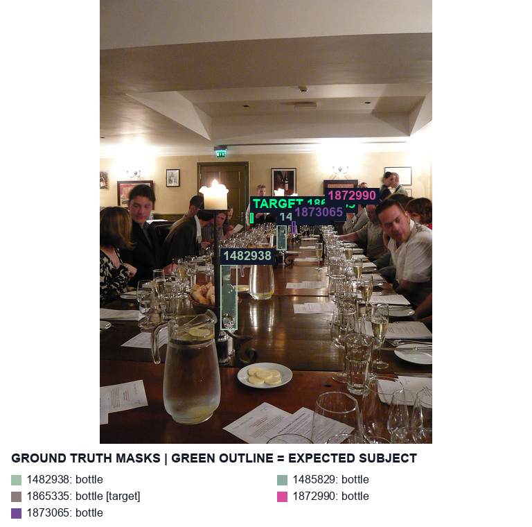
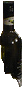
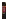
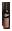

# real-166918 long_dinner_table_with_repeated_bottles

[All cases](../README.md) · [Group](../groups/ambiguity.md) · [Exact case metadata](../evidence/real-166918.json)

**scene-v1:** **FAIL** live: WRONG TARGET  
**semantic-v2:** Recorded checks pass

## Expected result

- Group: `ambiguity`; provenance: `coco_real_photo`.
- Expected subject: `1865335`; acceptable IDs: `[1482938, 1485829, 1865335, 1872990, 1873065]`.
- Expected status: `selected`; expected selection mode: `fallback`.
- Interaction: `{}`.
- Annotation source: COCO bottle polygons; Codex visual target review before evaluation, not independently adjudicated; background instance coverage can be incomplete.
- Complete label GT: `False`.

No unique intended bottle. The annotated crop target follows the revised photo-center / pixel-distance / left / upper policy; this is a product fallback, not evidence of user intent.

COCO image `166918` · [original source](http://images.cocodataset.org/val2017/000000166918.jpg) · [Flickr source](http://farm5.staticflickr.com/4117/4745624149_369a63786e_z.jpg) · [license: Attribution License](http://creativecommons.org/licenses/by/2.0/).

Real targets are developer judgments, not independently adjudicated user intent. COCO competitor coverage may be incomplete; no hand or complete-label ground truth is invented.

## Original input and masks

| Mask ID | Category | Parent | Expected subject or label | Original binary PNG |
|---|---|---|---|---|
| `1482938` | bottle | `None` |  | [view raw mask](../assets/masks/real-166918-i1482938.png) |
| `1485829` | bottle | `None` |  | [view raw mask](../assets/masks/real-166918-i1485829.png) |
| `1865335` | bottle | `None` | yes | [view raw mask](../assets/masks/real-166918-i1865335.png) |
| `1872990` | bottle | `None` |  | [view raw mask](../assets/masks/real-166918-i1872990.png) |
| `1873065` | bottle | `None` |  | [view raw mask](../assets/masks/real-166918-i1873065.png) |

## Saved selector outputs

`live` replays saved detector responses; `controlled` uses declared GT-derived detections and faults. No new inference was run for this gallery. Expected-label retention below 98% is flagged separately from target matching. A full-frame crop can retain distractors.

### live

| Selector | Result | Assigned subject | Mode | Expected-label retention | Reason |
|---|---|---|---|---|---|
| `scene-v1` | **FAIL: WRONG TARGET** | `1482938` | `legacy` | not scored | `existing_scene_v1_rank` |
| `semantic-v2` | Recorded checks pass | `1865335` | `fallback` | not scored | `fallback_nearest_center` |

#### scene-v1 live crop

[View original selector keep mask](../assets/crops/real-166918-live-scene-v1-keep.png)

#### semantic-v2 live crop

[View original selector keep mask](../assets/crops/real-166918-live-semantic-v2-keep.png)

## Localization investigation · current revision

**Before semantic-v2: FAIL. Current semantic-v2: PASS. Current scene-v1: FAIL: WRONG TARGET.**

Central 160px scan recovers the tiny held bottle.

Before: `d4` → GT `None`; current: `d23` → GT `1865335`; frozen target `1865335`. Required/current mode: `fallback` / `fallback`.

### Exact detector inputs and localization geometry

Primary masks/caches remain unchanged. Effective masks include separately recorded image-only recovery/localization. Numeric detector IDs are distinct from GT IDs. Owner assignment below is an offline review annotation, never detector input.

| Detector | Class | Score | Effective input box | Current selector box / source | Offline assigned GT | Primary mask | Effective mask |
|---|---|---:|---|---|---|---|---|
| `d0` | wine bottle | 0.5337 | `[0.0, 252.0, 8.0, 272.0]` | `[0, 253, 9, 272]` / visible_mask | `None` (IoU 0.000) | [PNG](../detector-masks/real-166918/primary-d0.png) | [PNG](../detector-masks/real-166918/effective-d0.png) |
| `d1` | wine bottle | 0.6489 | `[314.0, 327.0, 326.0, 372.0]` | `[314, 327, 326, 372]` / detector_box | `None` (IoU 0.000) | [PNG](../detector-masks/real-166918/primary-d1.png) | [PNG](../detector-masks/real-166918/effective-d1.png) |
| `d2` | wine bottle | 0.5454 | `[324.0, 293.0, 336.0, 304.0]` | `[325, 293, 337, 303]` / visible_mask | `1872990` (IoU 0.611) | [PNG](../detector-masks/real-166918/primary-d2.png) | [PNG](../detector-masks/real-166918/effective-d2.png) |
| `d3` | wine bottle | 0.8374 | `[174.0, 379.0, 196.0, 466.0]` | `[173, 380, 197, 467]` / visible_mask | `1482938` (IoU 0.848) | [PNG](../detector-masks/real-166918/primary-d3.png) | [PNG](../detector-masks/real-166918/effective-d3.png) |
| `d4` | wine bottle | 0.6724 | `[265.0, 250.0, 272.0, 275.0]` | `[265, 249, 273, 276]` / visible_mask | `None` (IoU 0.000) | [PNG](../detector-masks/real-166918/primary-d4.png) | [PNG](../detector-masks/real-166918/effective-d4.png) |
| `d5` | hand | 0.6055 | `[145.0, 347.0, 162.0, 357.0]` | not an eligible output candidate | `None` (IoU 0.000) | [PNG](../detector-masks/real-166918/primary-d5.png) | [PNG](../detector-masks/real-166918/effective-d5.png) |
| `d6` | hand | 0.7319 | `[34.0, 379.0, 53.0, 400.0]` | not an eligible output candidate | `None` (IoU 0.000) | [PNG](../detector-masks/real-166918/primary-d6.png) | [PNG](../detector-masks/real-166918/effective-d6.png) |
| `d7` | hand | 0.4656 | `[183.0, 323.0, 194.0, 334.0]` | not an eligible output candidate | `None` (IoU 0.000) | [PNG](../detector-masks/real-166918/primary-d7.png) | [PNG](../detector-masks/real-166918/effective-d7.png) |
| `d8` | hand | 0.7461 | `[354.0, 303.0, 368.0, 317.0]` | not an eligible output candidate | `None` (IoU 0.000) | [PNG](../detector-masks/real-166918/primary-d8.png) | [PNG](../detector-masks/real-166918/effective-d8.png) |
| `d9` | hand | 0.6235 | `[91.0, 380.0, 105.0, 396.0]` | not an eligible output candidate | `None` (IoU 0.000) | [PNG](../detector-masks/real-166918/primary-d9.png) | [PNG](../detector-masks/real-166918/effective-d9.png) |
| `d10` | hand | 0.5322 | `[211.0, 324.0, 219.0, 332.0]` | not an eligible output candidate | `None` (IoU 0.000) | [PNG](../detector-masks/real-166918/primary-d10.png) | [PNG](../detector-masks/real-166918/effective-d10.png) |
| `d11` | hand | 0.4961 | `[179.0, 332.0, 192.0, 344.0]` | not an eligible output candidate | `None` (IoU 0.000) | [PNG](../detector-masks/real-166918/primary-d11.png) | [PNG](../detector-masks/real-166918/effective-d11.png) |
| `d12` | hand | 0.6763 | `[223.0, 305.0, 236.0, 316.0]` | not an eligible output candidate | `None` (IoU 0.000) | [PNG](../detector-masks/real-166918/primary-d12.png) | [PNG](../detector-masks/real-166918/effective-d12.png) |
| `d13` | bottle | 0.6606 | `[276, 319, 283, 336]` | not an eligible output candidate | `1873065` (IoU 0.730) | new recovery | [PNG](../detector-masks/real-166918/effective-d13.png) |
| `d14` | bottle | 0.4644 | `[218, 309, 222, 322]` | not an eligible output candidate | `1865335` (IoU 0.780) | new recovery | [PNG](../detector-masks/real-166918/effective-d14.png) |
| `d15` | bottle | 0.8096 | `[266, 249, 272, 275]` | `[266, 249, 272, 275]` / central_recovery | `None` (IoU 0.000) | new recovery | [PNG](../detector-masks/real-166918/effective-d15.png) |
| `d16` | bottle | 0.7617 | `[261, 326, 269, 358]` | not an eligible output candidate | `1485829` (IoU 0.496) | new recovery | [PNG](../detector-masks/real-166918/effective-d16.png) |
| `d17` | bottle | 0.5825 | `[260, 258, 266, 272]` | not an eligible output candidate | `None` (IoU 0.000) | new recovery | [PNG](../detector-masks/real-166918/effective-d17.png) |
| `d18` | bottle | 0.5029 | `[218, 309, 222, 322]` | not an eligible output candidate | `1865335` (IoU 0.814) | new recovery | [PNG](../detector-masks/real-166918/effective-d18.png) |
| `d19` | bottle | 0.6865 | `[276, 318, 283, 336]` | `[276, 318, 283, 336]` / central_recovery | `1873065` (IoU 0.752) | new recovery | [PNG](../detector-masks/real-166918/effective-d19.png) |
| `d20` | bottle | 0.8447 | `[266, 249, 272, 275]` | not an eligible output candidate | `None` (IoU 0.000) | new recovery | [PNG](../detector-masks/real-166918/effective-d20.png) |
| `d21` | bottle | 0.7939 | `[261, 326, 269, 358]` | `[261, 326, 269, 358]` / central_recovery | `1485829` (IoU 0.501) | new recovery | [PNG](../detector-masks/real-166918/effective-d21.png) |
| `d22` | bottle | 0.6187 | `[260, 258, 266, 272]` | `[260, 258, 266, 272]` / central_recovery | `None` (IoU 0.000) | new recovery | [PNG](../detector-masks/real-166918/effective-d22.png) |
| `d23` | bottle | 0.5117 | `[218, 309, 222, 326]` | `[218, 309, 222, 326]` / central_recovery | `1865335` (IoU 0.696) | new recovery | [PNG](../detector-masks/real-166918/effective-d23.png) |
| `d24` | bottle | 0.4326 | `[261, 326, 269, 358]` | not an eligible output candidate | `1485829` (IoU 0.493) | new recovery | [PNG](../detector-masks/real-166918/effective-d24.png) |

### Raw responses used by the declared enhancement

- [central/real-166918.json](../evidence/central/real-166918.json)
